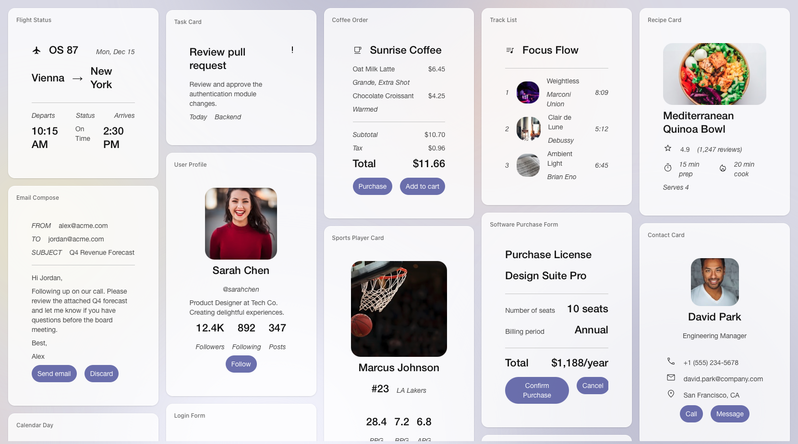

# Build delightful, fast, reliable agentic experiences with A2UI

A2UI (Agent-to-User Interface) is an open-source generative UI framework,
complete with a protocol optimized for streaming dynamic user interfaces at
low latency, native renderers for web and mobile frameworks, and agent SDKs
in several popular languages. With A2UI, your agents can communicate with
your users using natively rendered widgets, in addition to text.

_Examples of UI compositions that A2UI can express._

## Quick links

- [Main website](https://a2ui.org).
- Try it in your browser using [A2UI Composer](https://a2ui-project.github.io/composer/).
- [Supported renderers](https://a2ui.org/reference/renderers/).
- [Supported agents](https://a2ui.org/reference/agents/).
- [Protocol specification](https://a2ui.org/specification/v1.0-a2ui/).

## Introduction

Language models (LLMs) and decision models (e.g.
[Jev](https://docs.typesafe.ai/)) excel at creating text and code, and making
fast decisions on top of raw structured data (e.g. JSON). A2UI gives these
models a specialized vocabulary for expressing user interfaces.

A2UI expresses UI using _data_, not code. A schema for the data exchanged
between the agent and the renderer enforces strict capability boundaries for
the agent, keeping agent-generated experiences safe and aligned with the
business requirements of your application. A _core library_, a _native
framework adapter_, and a _catalog of components_ provide access to native
components and form the building blocks that the agent _composes_ into a final
user experience, making the result expressive and high-performance.

## When to use A2UI

Use A2UI when your application needs any combination of the following:

- Parts of your application that are agent- and/or server-driven. By design,
  A2UI supports remote rendering.
- You want the UI to be composed dynamically, tailored to the user's immediate
  need. Instead of making your users navigate through multiple screens to solve
  their problems, have the agent build the right flow of UI that guides users
  directly to solutions.
- You need the UI to have the highest performance, and highest visual fidelity.
  A2UI renders UI using the framework of your choice, typically one that the
  host app itself is written in. WebViews or HTML are not required.
- The same agent streams UI to multiple platforms or frameworks, such as
  Flutter, React, SwiftUI, and Jetpack Compose. A2UI will help keep the user
  experience compatible and consistent across all screens.
- The agent is remote, third-party, or operates across a trust boundary. For
  example, the agent must not be able to handle certain kinds of data (credit
  card/account numbers, PII, financial data). A2UI will help enforce the trust
  boundary and protect your app's critical functionality from hallucinations
  using a strict schema, and by expressing UI using validated data rather than
  executable code.

## A2UI core philosophy

We develop A2UI under the guidance of the following core principles:

- **Security first**: The app developer controls what the agent can and cannot
  do in the app. A2UI provides a framework for specifying and enforcing the
  necessary guardrails, such as expressing UI as data, validating inputs and
  outputs against a schema, and disallowing arbitrary executable code. Every
  capability granted to the agent is either a safe standard capability built
  into the framework, or a capability explicitly granted by the app developer.
- **Model-friendly and server-driven**: The A2UI protocol is designed to be
  efficiently generated by language and decision models and transported over
  the network, and to support progressive rendering (or "streaming") for a
  responsive user experience. An agent can adapt the UI based on where the user
  takes the conversation. A2UI supports swappable inference formats, allowing
  customizing inference for specific models and specific use-cases.
- **Native rendering and portability**: A2UI renders UI using the framework
  native to your app. No need to change frameworks, unless required for other
  reasons. A2UI provides renderers for many major UI frameworks.

## Architecture

A2UI's architecture is made of multiple layers spanning the full stack that
connects the agent to the application:

1. **Inference**: An agent (typically backed by a language or a decision model)
   instructed by an A2UI skill (typically created using an A2UI Agent SDK)
   generates the description of UI and data using an appropriate inference
   format (e.g. A2UI Express, or a decision tree).
2. **Transport**: An A2UI Agent SDK, embedded in a larger agent architecture,
   parses and validates the model's output, expands macros, and converts the UI
   to the wire-stable _A2UI Transport_ protocol messages, which are sent to the
   renderer.
3. **Rendering**: A renderer is made of an _A2UI Core_ library (e.g. the
   `@a2ui/web_core` npm package, or `a2ui_core` Dart package), a UI framework
   adapter (e.g. `@a2ui/react` React adapter, or `a2ui_flutter` Flutter
   adapter), and a widget catalog. The core library parses the incoming
   messages, and creates a framework-agnostic in-memory representation of the UI
   and data. The framework adapter maps the in-memory representation to concrete
   framework-specific UI widgets. The widget catalog provides access to the
   widgets the agent is allowed to compose.

## Getting started

Pick the path that matches where you want to start:

| Path                                                             | What you get                                                                                                    | Time   |
| ---------------------------------------------------------------- | --------------------------------------------------------------------------------------------------------------- | ------ |
| 🍜 **[Quickstart](https://a2ui.org/quickstart/)**                | A full-stack A2UI app with a backend and front end. Learn A2UI end-to-end and customize to your use case.       | ~5 min |
| 🎨 **[A2UI Composer](https://a2ui-project.github.io/composer/)** | Generate A2UI JSON from a visual editor and paste it into any agent prompt — no install required.               | ~1 min |
| 🎬 **[A2UI Theater](https://a2ui-composer.ag-ui.com/theater)**   | Step through pre-built A2UI streaming scenarios across Lit, React, and Angular renderers — no install required. | ~1 min |

## Packages

These packages are developed in this repository. Packages marked "Not published
yet" can be used from source.

### Python

| Package                              | Description                                                                                        | Version                                                                                               |
| ------------------------------------ | -------------------------------------------------------------------------------------------------- | ----------------------------------------------------------------------------------------------------- |
| [a2ui-core](python/a2ui_core/)       | Protocol messages, data model, data binding, expression evaluation, and catalog validation.        |            |
| [a2ui-agent-sdk](python/a2ui_agent/) | Agent SDK: negotiates catalogs, generates prompts and skills, and compiles model output into A2UI. |  |
| [a2ui-a2a](python/a2ui_a2a/)         | Connects the agent SDK to the [Agent-to-Agent (A2A) protocol](https://a2a-protocol.org).           |              |
| [a2ui-adk](python/a2ui_adk/)         | Connects the agent SDK to the [Agent Development Kit (ADK)](https://github.com/google/adk-python). |              |

### TypeScript

| Package                                                   | Description                                                                                                | Version                                                                                                       |
| --------------------------------------------------------- | ---------------------------------------------------------------------------------------------------------- | ------------------------------------------------------------------------------------------------------------- |
| [@a2ui/web_core](typescript/core/web_core/)               | Protocol messages, state management, expressions, and basic catalog shared by renderers and `@a2ui/agent`. |        |
| [@a2ui/lit](typescript/renderers/lit/)                    | Lit (web components) renderer.                                                                             |                  |
| [@a2ui/angular](typescript/renderers/angular/)            | Angular renderer.                                                                                          |          |
| [@a2ui/react](typescript/renderers/react/)                | React renderer.                                                                                            |              |
| [@a2ui/markdown-it](typescript/renderers/markdown-it/)    | Markdown rendering with markdown-it and DOMPurify, shared by the web renderers.                            |  |
| [@a2ui/agent](typescript/agents/a2ui_agent/)              | Agent SDK: negotiates catalogs, generates prompts and skills, and compiles model output into A2UI.         |              |
| [@a2ui/catalog-mcp](typescript/catalogs/mcp/)             | MCP catalog: calls MCP tools and renders A2UI messages returned in tool results and UI resources.          |  |
| [@a2ui/catalog-vegachart](typescript/catalogs/vegachart/) | VegaChart catalog: renders Vega and Vega-Lite chart specifications on A2UI surfaces.                       | Not published yet                                                                                             |

### Dart and Flutter

| Package                            | Description                                                                                        | Version                                                                                        |
| ---------------------------------- | -------------------------------------------------------------------------------------------------- | ---------------------------------------------------------------------------------------------- |
| [a2ui_core](dart/a2ui_core/)       | Protocol messages, data model, data binding, and expressions for renderers and agents.             |        |
| [a2ui_agent](dart/a2ui_agent/)     | Agent SDK: negotiates catalogs, generates prompts and skills, and compiles model output into A2UI. |      |
| [a2ui_flutter](dart/a2ui_flutter/) | Flutter renderer.                                                                                  |  |
| [a2ui_cli](dart/a2ui_cli/)         | Developer tool that generates typesafe component code from a catalog.                              | [GitHub Releases](https://github.com/a2ui-project/a2ui/releases)                               |

### Swift

The Swift libraries are distributed via Swift Package Manager from
[Package.swift](Package.swift) at the root of this repository.

| Package                                            | Description                                                                          |
| -------------------------------------------------- | ------------------------------------------------------------------------------------ |
| [A2UISwiftCore, BasicCatalog](swift/core/)         | Message processor, data model, expression evaluation, and basic catalog definitions. |
| [A2UISwiftUI, BasicCatalogSwiftUI](swift/swiftui/) | SwiftUI renderer and basic catalog views.                                            |

## Roadmap

- **Protocol 1.1**: We are collecting requirements for the next iteration of the A2UI protocol.
- **Inference**: Support for decision models (e.g. Jev).
- **Templates**: A cross-framework templating engine and a set of standard primitives for rendering reusable rich UI widgets.
- **Sandboxed logic**: A way for securely attaching logic to A2UI components.
- **Agent SDK**: Skill generation, better diagnostics, and integrations with more agent frameworks.
- **Evals**: A set of tools for evaluating generated UI quality.
- **MCP Apps**: Embedding MCP Apps inside A2UI UI, and embedding A2UI experiences into MCP Apps.
- **CLI**: Schema validation, codegen, local preview, integration with coding agents.

## Contribute

A2UI is an **Apache 2.0** licensed project. We believe the future of UI is agentic,
and we want to work with you to help build it.

See [CONTRIBUTING.md](CONTRIBUTING.md) for details on how to get started.
