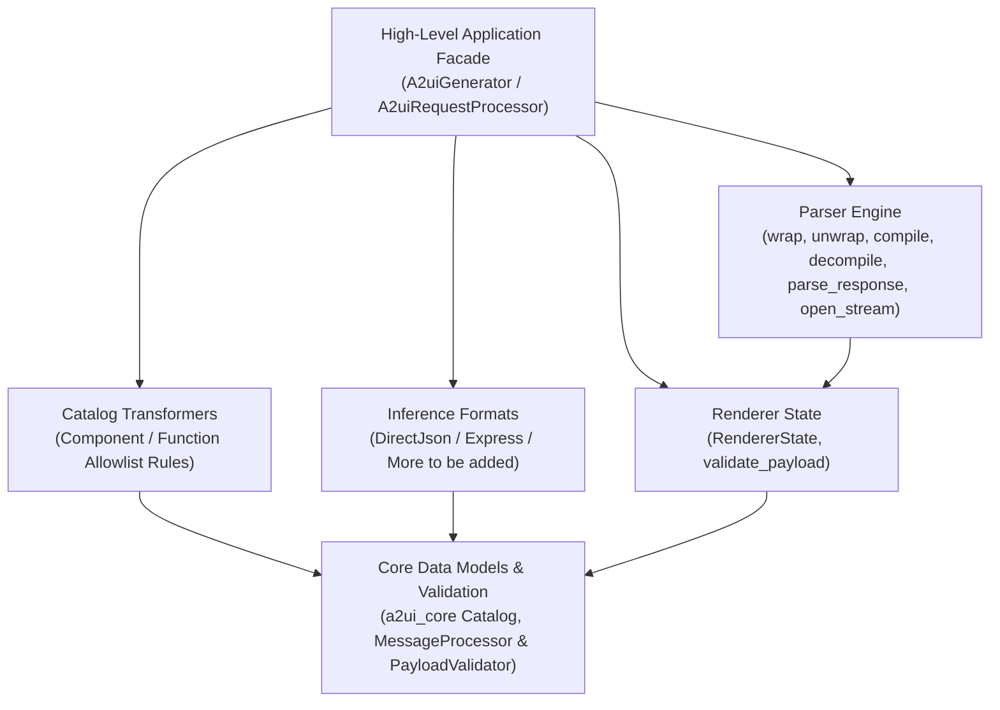

# Agent SDK Development Guide

This document describes the architecture of an A2UI Agent SDK. The design separates concerns into distinct layers to follow a similar structure for consistency across languages, providing a streamlined developer experience for building AI agents that generate rich UI.

The Agent SDK is responsible for:

- **Catalog management**
- **Capability negotiation**
- **Prompt engineering**
- **Response parsing**
- **Payload validation**
- **Transport packaging**

It enables Large Language Models (LLMs) and autonomous agents to understand available UI capabilities and ensures that generated UI payloads conform strictly to negotiated specification contracts before transmission to client renderers.

---

## 1. Unified Architecture Overview

The Agent SDK architecture introduces a clear separation between **low-level single-responsibility primitives** and a **high-level application manager facade**:



1. **Decoupled Primitive Layer**:
   - **Catalog Representation**: Directly uses canonical `Catalog` models from `a2ui_core`, as the schema-only `CatalogApi`.
   - **Catalog Transformers**: Standalone rule sets (`CatalogTransformer`, `ComponentPruningTransformer`, `FunctionPruningTransformer`) for filtering component definitions and function signatures from pristine catalogs.
   - **Inference Formats**: Strategy facades (`InferenceFormat`, `InferenceFormatFactory`) pairing format-specific prompt generators (`PromptGenerator`) and parsers (`Parser`). Supported strategies include `DirectJsonFormat` and `ExpressFormat`.
   - **Prompt Generators**: Format builders consuming transformed catalogs and prompt examples to generate system instruction snippets.
   - **Parsers**: Response extraction engines performing tag detection (`has_format_content`), tag unwrapping (`unwrap`) and wrapping (`wrap`), and translation between a format and A2UI messages (`compile`, `decompile`). `parse_response` reads a whole response and checks it against a `RendererState`. A format whose notation can be read incrementally also opens a `ResponseStream` that reads one streamed response chunk by chunk (`open_stream`). A parser holds no per-response state, so one parser serves every response of a set of catalogs.
   - **Validation Layer**: `RendererState` is the agent's mirror of the surfaces one renderer holds. It wraps one `a2ui_core` `MessageProcessor`, which holds every active catalog, resolves each item to the catalog it belongs to, and delegates the item to that catalog's `PayloadValidator`. `validate_payload` checks one payload on its own, on a short-lived state. Protocol version branching (`v0_8`, `v0_9`, `v0_9_1`, `v1_0`) is handled by the core version adapters.
2. **Encapsulated Application Processor**:
   - `CatalogConfig`: Configuration dataclass pairing a resolved `Catalog` with the custom transformers to apply to it. A `CatalogProvider` (`FileSystemCatalogProvider`, `InMemoryCatalogProvider`) is how a catalog document becomes that `Catalog`, but the config holds the result rather than the provider.
   - `A2uiGenerator`: Agent-level lifecycle manager holding supported `CatalogConfig`s, generating pre-negotiated `A2uiRequestProcessor` instances per renderer capability signature.
   - `A2uiRequestProcessor`: Central processor facade object unifying multi-catalog capability resolution (`resolve_catalogs`), system prompt snippet rendering, one reusable parser, and response validation against a `RendererState` the caller chooses.

---

## 2. Directory & Package Structure

All SDK implementations of `a2ui_agent` must maintain a standardized directory layout similar to the Python SDK under `python/a2ui_agent/`.

```
a2ui_agent/
├── processor/                 # High-level application facade package
│   ├── catalog_config         # CatalogConfig structure for catalog registration
│   ├── processor              # A2uiRequestProcessor facade implementation
│   ├── generator              # A2uiGenerator class
│   └── catalog_providers      # Catalog provider classes
├── inference_format           # Abstract InferenceFormat & InferenceFormatFactory facades
├── inference_formats/         # Concrete inference format strategy implementations
│   ├── direct_json/           # Self-contained Direct JSON format package
│   │   ├── format             # DirectJsonFormat, DirectJsonFormatFactory
│   │   ├── prompt_generator   # DirectJsonPromptGenerator
│   │   ├── parser             # DirectJsonParser class
│   │   ├── response_stream    # DirectJsonResponseStream, which reads one streamed response
│   │   └── blocks             # Finding and cleaning <a2ui-json> blocks, shared by parser and stream
│   └── express/               # Self-contained Express DSL format package
│       ├── format             # ExpressFormat, ExpressFormatFactory
│       ├── compiler           # ExpressCompiler class
│       ├── decompiler         # ExpressDecompiler class
│       ├── parser             # ExpressParser class
│       ├── response_stream    # ExpressResponseStream, which reads one streamed response block by block
│       └── prompt_generator   # ExpressPromptGenerator class
├── parser/                    # Common Parser contracts and data structures
│   ├── parser                 # Abstract Parser base class
│   ├── response_stream        # Abstract ResponseStream returned by Parser.open_stream
│   └── response_part          # RawResponsePart, RawA2uiPart, TextPart, A2uiPart data structures
├── prompt/                    # Prompt Generation contracts
│   └── generator              # Abstract PromptGenerator base class
├── catalog_transformers/      # Catalog and Protocol Transformers
│   ├── base                   # Abstract CatalogTransformer class
│   └── pruning                # ComponentPruningTransformer, FunctionPruningTransformer
└── utils/                     # Utility helpers layer
    ├── catalog_resolver       # resolve_catalogs capability resolution function
    └── renderer_state         # RendererState and the stateless validate_payload
```

---

## 3. Interface Specification

### A. Catalog Representation & Catalog Transformers

The Agent SDK uses `a2ui.core.Catalog` directly as the canonical model representing component definitions, function signatures, and theme schemas.

An agent describes and validates functions but never runs them, so every catalog it loads, negotiates, prompts with, or validates against is a [`CatalogApi`](a2ui_core.blueprint.md#catalogapi), the core name for `Catalog[ComponentApi, FunctionApi]`. Catalog transformers are the exception: they stay generic over the component and function types, so the same rules can also prune a catalog that carries implementations.

#### `CatalogTransformer`

Abstract base interface for transformation rules applied to catalog schemas prior to prompt engineering and payload validation.

```python
TComponent = TypeVar("TComponent", bound=ComponentApi)
TFunction = TypeVar("TFunction", bound=FunctionApi)

class CatalogTransformer(ABC):
    """Abstract base interface for transformation rules applied to catalog schemas."""

    @abstractmethod
    def transform(
        self, catalog: Catalog[TComponent, TFunction]
    ) -> Catalog[TComponent, TFunction]:
        """Transforms a Catalog into a modified Catalog of the same component and function types."""
        pass
```

#### `ComponentPruningTransformer`

Prunes catalog component definitions to an allowlist of allowed components.

```python
class ComponentPruningTransformer(CatalogTransformer):
    """Prunes catalog component definitions to an allowlist of allowed components."""

    def __init__(self, allowed_components: Sequence[str]):
        self.allowed_components = set(allowed_components)

    def transform(
        self, catalog: Catalog[TComponent, TFunction]
    ) -> Catalog[TComponent, TFunction]:
        """Returns a new Catalog filtered to only include components in allowed_components."""
        pass
```

#### `FunctionPruningTransformer`

Prunes catalog function definitions to an allowlist of allowed renderer-side validation rules and logic functions.

```python
class FunctionPruningTransformer(CatalogTransformer):
    """Prunes catalog function definitions to an allowlist of allowed functions."""

    def __init__(self, allowed_functions: Sequence[str]):
        self.allowed_functions = set(allowed_functions)

    def transform(
        self, catalog: Catalog[TComponent, TFunction]
    ) -> Catalog[TComponent, TFunction]:
        """Returns a new Catalog filtered to only include functions in allowed_functions."""
        pass
```

---

### B. Prompt Generation Layer (`a2ui.prompt`)

#### `PromptGenerator`

Abstract base interface for constructing system prompt instruction snippets across inference formats.

The interface is `generate()` alone. Application code gets a prompt generator from `InferenceFormat.prompt_generator` and only renders it, so what a generator is built from (catalogs, examples, format-specific options) belongs to each format's constructor rather than to the shared interface.

Every format's generator renders the prompt example turns it is given in the order given. Each turn is the list of `AgentToRendererMessage` objects making it up. An example carries no label of its own: what the model learns from it is the payload, so a description would be the prompt author's prose rather than part of the contract.

```python
class PromptGenerator(ABC):
    """Abstract base class for format-specific prompt generators."""

    @abstractmethod
    def generate(self) -> str:
        """
        Renders format-specific system prompt instructions and catalog schemas.
        The caller (Agent / Framework) prepends role/workflow preambles and appends suffixes.
        """
        pass
```

---

### C. Common Parser Package (`a2ui.parser`)

#### Response Part Structures

```python
@dataclass
class TextPart:
    """Represents extracted conversational text from an LLM response.

    Attributes:
        text: The conversational text content intended for user display.
    """
    text: str

@dataclass
class RawA2uiPart:
    """Represents an uncompiled A2UI format content block extracted from an LLM response.

    Attributes:
        a2ui_raw: The raw uncompiled format content string (e.g., raw XML/DSL/JSON).
    """
    a2ui_raw: str

@dataclass
class RawResponsePart:
    """Represents an uncompiled token from an LLM response stream.

    Attributes:
        part: The underlying content, either conversational TextPart or uncompiled RawA2uiPart.
        is_final: Whether this part is complete/closed (not truncated during streaming).
    """
    part: Union[TextPart, RawA2uiPart]
    is_final: bool = True

An SDK may represent `RawResponsePart` as a tagged union of the two parts rather than a wrapper. `is_final` only matters for an A2UI block: text is always emitted whole.

@dataclass
class A2uiPart:
    """Represents extracted and compiled A2UI payload messages.

    Attributes:
        a2ui: List of validated AgentToRendererMessage objects to deliver to client renderers.
    """
    a2ui: list[AgentToRendererMessage]

ResponsePart = Union[TextPart, A2uiPart]
```

#### `Parser`

Base interface for response parsers across all inference format strategies.

The optional `state` argument of the parsing methods, and of `A2uiRequestProcessor` and `A2uiGenerator.create_processor`, is a named argument in languages that have them: keyword-only in Python, a named optional parameter in Dart (where every optional parameter is named), and an options object or trailing optional parameter where the language has neither.

The signatures below are written in Python, and the error types they name are the A2UI errors every SDK defines. Where a docstring names a language error, such as Python's `NotImplementedError`, an SDK raises its own language's equivalent.

A parser knows only its own format. It reads its own sentinel tags and treats everything else in a response as conversational text, including a block in another format's tags: a model that shows the other notation in prose has written text, not a payload, and adding a format must not require changing the parsers of the existing ones.

```python
class Parser(ABC):
    """Abstract base class for response parsers.

    Responsible for unwrapping format tags, translating raw format expressions into standard
    A2UI payload messages, and checking the messages of a response against a RendererState.

    A parser holds no per-response state. It is bound to a set of catalogs, and one parser
    reads every response and every stream for them, from any number of sessions.
    """

    @property
    @abstractmethod
    def catalogs(self) -> list[CatalogApi]:
        """The active catalogs the parser translates and checks against."""
        pass

    @abstractmethod
    def has_format_content(self, content: str, complete: bool = False) -> bool:
        """Reports whether the content carries a block written in this format.

        A caller uses this to decide whether a response is this format's business at all,
        without paying for a parse. It tokenizes blocks without compiling. Another format's
        tags do not count. A block recovered by `unwrap` when its opening sentinel tag was
        omitted (closed by this format's closing tag) also counts as a complete block.

        Args:
            content: Raw string response emitted by the LLM, possibly partial.
            complete: Whether to require a closed block. False matches an opening tag on
                its own, which is what a streaming caller needs to know it has started
                receiving a payload.

        Returns:
            True when the content carries a block belonging to this format.
        """
        pass

    @abstractmethod
    def wrap(self, blocks: Sequence[RawResponsePart]) -> str:
        """Converts a sequence of RawResponseParts to a string, adding enclosing tags or markers around each raw A2UI section and concatenating conversational text parts."""
        pass

    @abstractmethod
    def unwrap(self, content: str) -> list[RawResponsePart]:
        """Tokenizes the LLM response into an ordered list of RawResponsePart objects, extracting raw format content between sentinel tags while preserving chronological order.

        Content outside this format's sentinel tags, including another format's tags, is a TextPart.
        Markdown fences and backticks wrapping inline-code sentinel tags are stripped from block
        edges, and a closing tag on a single-line comment line closes the block.
        If the model omits the opening sentinel tag but emits a closing sentinel tag after a fenced
        block or a line that begins a format payload, at most one such block is recovered in
        one-shot unwrapping (streaming parsers require the opening sentinel tag).

        Args:
            content: Raw string response emitted by the LLM.

        Returns:
            An ordered list of RawResponsePart objects representing alternating slices of
            conversational text and cleaned format payload blocks.
        """
        pass

    @abstractmethod
    def compile(
        self, format_content: str, is_final: bool = True
    ) -> list[AgentToRendererMessage]:
        """Translates a raw format content string into A2UI messages.

        Compiling reports what the notation itself gets wrong, such as text that is not JSON
        or an Express reference to an undefined variable. A format may consult the catalogs
        to translate the notation, such as Express resolving a component, a function or a
        positional argument, and it then rejects a name or property the catalogs do not
        declare. It does not check the messages against a renderer state: parse_response
        and open_stream do, and parse_response(block, wrapped=False) compiles and checks one
        block.

        Compile-time repairs tolerate stray unescaped line breaks inside object keys,
        identifier/reference properties, at single-line string edges, and in data paths or
        split identifiers when the joined name resolves.

        Args:
            format_content: The uncompiled raw payload string (e.g. raw JSON or DSL expression).
            is_final: False for a block that the end of the response cut off before its close
                tag, as `RawResponsePart.is_final` reports it. A format that can read part of
                a block, such as Express, compiles such a block as far as it goes and ignores
                the syntax errors the cut causes. Direct JSON raises A2uiParseError instead.

        Returns:
            List of compiled AgentToRendererMessage objects.

        Raises:
            A2uiParseError: If the text cannot be read, or the block is cut off and the format
                cannot read part of a block.
            A2uiValidationError: If the text reads but names something the catalogs do not
                declare (Express raises A2uiCompilationValidationError), or a message does
                not match the protocol's message schema.
        """
        pass

    @abstractmethod
    def decompile(self, a2ui_payload: Sequence[AgentToRendererMessage]) -> str:
        """Decompiles structured A2UI payload messages into this format's raw notation.

        Args:
            a2ui_payload: List of AgentToRendererMessage objects to convert to raw format text.

        Returns:
            Raw format content string representing the messages.
        """
        pass

    def parse_response(
        self,
        content: str,
        wrapped: bool = True,
        state: Optional[RendererState] = None,
    ) -> list[ResponsePart]:
        """Parses a complete response, preserving the order of text and A2UI payload blocks.

        Nothing has been sent when a whole response is parsed, so it is checked as a whole:
        every block is compiled and applied to the state inside one transaction, so a
        component may name a child that a later block adds, and the trees of the surfaces
        the response touched are checked once every block is applied. The messages are
        applied all or nothing: if any check fails, the state is left as it was.

        A block that the end of the response cut off (`is_final` False) is compiled with
        `compile(block, is_final=False)`. If it compiles, it is applied, and the surfaces it
        touched skip check_topology and are marked checked with `mark_checked`, since a cut
        block may name children that never arrived. A surface that a complete block of the
        same response also touched skips the check too. A cut Direct JSON block raises,
        since Direct JSON `compile` refuses one.

        Args:
            content: Complete raw text response emitted by the LLM.
            wrapped: Whether the output is expected to be wrapped inside format sentinel tags.
            state: The renderer state to check the response against and apply it to. Without
                one, the response is checked against a new, empty state, as a chat turn that
                shows new UI, so an update to a surface the response does not create is
                rejected.

        Returns:
            List of ResponsePart objects (TextPart / A2uiPart).

        Raises:
            A2uiError: If a block cannot be read or a message is rejected. Every failure is
                an A2uiError: an error of another type raised while compiling is wrapped in
                A2uiCompilationError. The error carries `partial_results`, the parts the
                response yields before the failure: when a block fails, the parts before
                that block; when the tree check fails, only the text parts. None of them has
                been applied to the state.
        """
        pass

    @property
    def supports_streaming(self) -> bool:
        """Whether this parser implements open_stream.

        Every format an SDK ships streams, so its parser returns True. How soon a stream
        emits a payload depends on the format. Direct JSON emits each message as soon as
        it reads, because an unfinished object can be healed and re-read as it grows.
        Express emits a block once its close tag arrives, because its notation resolves
        references across the whole block. Either way, text reaches the caller as it
        arrives, and an agent streams a response the same way whatever the format.

        The default False is for a format added outside the SDK that has no stream yet.
        An agent using such a format buffers the response and parses it whole through
        parse_response.
        """
        return False

    def open_stream(
        self,
        wrapped: bool = True,
        state: Optional[RendererState] = None,
    ) -> ResponseStream:
        """Opens a stream that reads one response chunk by chunk.

        Implemented by every parser whose supports_streaming is True. The default refuses,
        so that a caller handed a parser without a stream fails at the call rather than
        silently receiving nothing.

        Args:
            wrapped: Whether the output stream is expected to be wrapped inside format sentinel tags.
            state: The renderer state the stream checks its messages against and applies them
                to, as for parse_response. A new, empty state when None.

        Raises:
            NotImplementedError: If this format does not support streaming (the language's
                unsupported-operation error).
        """
        raise NotImplementedError
```

#### `ResponseStream`

The object that holds the text buffers of one streamed response. A parser opens one per response, so the parser itself stays stateless and a stream's end is explicit.

```python
class ResponseStream(ABC):
    """Reads one streamed model response, chunk by chunk.

    Each message the stream emits has been applied to its state, in the order emitted, and
    no other message has, so the state mirrors what a renderer that received the emitted
    parts holds. A growing `updateDataModel` is the one exception: it is emitted again as
    its value grows, and applied again only once it closes. What earlier chunks emitted
    cannot be rolled back, since the renderer has already received it. Each feed runs
    inside a transaction of the state, so the one thing a failure undoes is what the
    failing chunk applied, which it never returned (see "Where the SDKs differ" for
    TypeScript's Express stream).

    How soon a payload is emitted depends on the format (see supports_streaming and
    section 4). Text outside blocks is emitted as it arrives, less a tail that could
    still start an open tag, which the next chunk settles. A block is checked on its
    own once it closes: the trees of the surfaces it touched must be complete then. So
    a response whose first block names a component that a later block defines is
    accepted by parse_response, which checks a response as a whole, and rejected by a
    stream, which has already sent the first block.

    When the stream fails, in feed or in close, the surfaces that the open block had
    already emitted messages to are marked checked with `RendererState.mark_checked`: the
    renderer holds those messages, and the tree check of a later turn on the same state
    must not require the components this response added to be reachable. A failing feed
    marks the surfaces emitted to before that chunk, since what the chunk applied is
    undone. Blocks that closed before the failure have had their tree checked already.

    Each chunk is read and checked for what it adds, so a stream takes time in proportion
    to the response; see "Cost of a response".
    """

    @property
    @abstractmethod
    def state(self) -> RendererState:
        """The renderer state the stream's messages are applied to."""
        pass

    @abstractmethod
    def feed(self, chunk: str) -> list[ResponsePart]:
        """Reads the next chunk and returns the parts that became ready since the last one.

        If it raises, the stream has ended: a response cannot be read further once part of
        it is rejected, and a later feed raises too, with the language's invalid-state
        error (Python's ValueError) saying the stream has ended. A chunk that raises
        returns nothing, so what it applied is undone, including a block that closed
        earlier in the same chunk, and the state holds only what earlier chunks emitted.

        Raises:
            A2uiParseError: If a block cannot be read.
            A2uiValidationError: If a message is rejected.
        """
        pass

    @abstractmethod
    def close(self) -> list[ResponsePart]:
        """Ends the response and returns the parts still held back.

        Called after the last chunk: text that could still have started a tag is held until
        then, and an unwrapped response is checked as a whole only then. A block that the
        end of the response cut off is compiled with `is_final` False, as parse_response
        compiles one: a format that can read part of a block, such as Express, applies
        what it compiles and marks the surfaces it touched checked without checking their
        trees, and Direct JSON raises. Closing a stream that has ended returns nothing.

        Raises:
            A2uiParseError: If a block is still open and the format cannot read part of
                a block.
            A2uiValidationError: If the messages the response left behind are rejected.
        """
        pass
```

---

### D. Validation Layer

The checks themselves belong to the `a2ui_core` package, and the Agent SDK does not
reimplement them. Core splits the work across two objects, and an agent reaches them
through the first, which the Agent SDK's `RendererState` wraps:

- **`MessageProcessor` (`a2ui.core.processing`)** is the entry point. It holds every
  active catalog, resolves each component and function call to the catalog it belongs to
  (the item's own `catalogId`, else the surface default, else `A2uiCatalogError`), and hands
  the item to that catalog's validator. It also owns the checks that need more than one
  item: surface lifecycle, component uniqueness, root reachability, cycles, recursion
  depth caps, and data binding JSON Pointer syntax. A surface whose components come from
  several catalogs can only be checked here, which is why this and not the validator is
  what an agent calls.
- **`PayloadValidator` (`a2ui.core.validation`)** is scoped to exactly one catalog and
  checks exactly one item against it, through `validate_component`, `validate_function`
  and `validate_theme`. It cannot see a whole payload and cannot know which catalog an
  item belongs to, so it never decides routing.

Wire envelope structure is checked before either of them, by the core version adapter for
the protocol version the message declares. That is also where version branching across
`v0_8`, `v0_9`, `v0_9_1` and `v1_0` lives, so neither object above is version-aware.

See [`a2ui_core.blueprint.md`](a2ui_core.blueprint.md) for the full validation contract
and its implementation matrix.

#### `RendererState` (`a2ui.utils`)

`RendererState` is the agent's mirror of the surfaces that one renderer holds. It owns one `MessageProcessor` for its whole life, created once with the linked active catalogs, and runs the agent's outbound messages through it. A message is therefore checked against everything the renderer has already received: a reference resolves against the components earlier messages added, and a cycle is found across the whole surface. The renderer runs these same checks when the payload arrives, so an agent that runs them first catches a bad payload before sending it rather than after.

The state holds the surfaces as they now stand, not the messages that built them.

```python
class RendererState:
    """The agent's mirror of the surfaces a renderer holds."""

    def __init__(self, catalogs: Sequence[CatalogApi]):
        """Creates the empty state of a renderer that holds the catalogs.

        Raises:
            A2uiCatalogError: If no catalogs are given, or their messages state different
                versions, for example v0.9 and v1.0 catalogs.
        """
        pass

    @property
    def catalogs(self) -> list[CatalogApi]:
        """The active catalogs in priority order."""
        pass

    @property
    def surface_ids(self) -> list[str]:
        """The ids of the surfaces the renderer holds."""
        pass

    def get_surface(self, surface_id: str) -> Optional[SurfaceModel]:
        """Returns the surface with the id, or None. Callers must not modify it."""
        pass

    def apply(self, payload: AgentToRendererMessagePayload) -> list[str]:
        """Checks the messages against the state and applies them.

        Each component and function call is checked against the catalog it resolves to,
        and component ids and cycles against the surface's components. References, the root
        and reachability are left to check_topology, since a component may name a child that
        a later message adds. The call is atomic: if a message is rejected, the state is left
        as it was before the call. Being atomic costs what the messages change, not the size
        of the surfaces they touch.

        Returns:
            The ids of the surfaces the messages create, update or delete, in the order the
            messages first name them.
        """
        pass

    def transaction(self) -> ContextManager[RendererState]:
        """Applies everything inside the block atomically.

        If the block raises, the state is restored to what it was when the block started.
        Opening a transaction copies nothing, and undoing one costs what was applied inside
        it. Transactions nest: an inner transaction that fails restores the state to where
        the inner one started, and the outer one goes on.

        Languages without context managers take a callback instead, and return what the
        callback returns. The callback must be synchronous: a callback that returns a
        promise or future is rejected and what it applied is undone, since the state cannot
        keep a transaction open across an await while other code applies to it.
        """
        pass

    def check_topology(self, surface_ids: Iterable[str]) -> None:
        """Checks the whole tree of each surface.

        The surface must have its root, every reference must resolve, and every component
        added or replaced since the surface's tree was last checked must be reachable from
        the root, within the depth limit. A component that an update left unreachable, by
        rewriting its parent's children, is accepted: the protocol has no message that
        removes one component, so replacing part of a canvas always leaves such components
        behind. A surface with no components yet passes.

        Each id is checked once, however often it is listed. An id the state does not hold,
        a surface deleted since, and a surface the state assumes (see validate_payload) are
        skipped. Every id that is not assumed is then marked checked, as by mark_checked.
        """
        pass

    def mark_checked(self, surface_ids: Iterable[str]) -> None:
        """Marks the surfaces' trees as checked without checking them.

        A later check_topology then requires only the components added or replaced after
        this call to be reachable. parse_response calls it for the surfaces of a block that
        the end of the response cut off, and a stream calls it for the surfaces it had
        emitted to when it fails. Like any other change, it is undone when the transaction
        it was made in fails.
        """
        pass
```

The processor inside the state applies messages with references, a missing root and orphans allowed, and unknown components and functions still rejected; `check_topology` runs the graph checks the protocol requires once a response is complete.

Undoing costs what the undone messages changed, not the size of the surfaces they touched. A state keeps an undo log:

1. The processor checks a message whole before it changes a surface, so a rejected message changes nothing. Where an SDK's core cannot yet check part of a message first, the state undoes that part as soon as the message is rejected (see "Where the SDKs differ").
2. Each applied message records what it replaced: the components it added or replaced, with their positions, and the data model value at its path. A failed transaction or `apply` reverts those records in reverse order.
3. Core updates a component in place when a message names an existing id with the same type and catalog, so the record holds a copy of the component's previous properties, not a reference to the object the update then changes.
4. A deleted surface is the one change recorded whole. The state keeps the surface it removed and puts it back as it was, with each component's own `catalogId`, so a v1.0 surface whose components come from several catalogs comes back unchanged. It is not replayed through the processor: the processor would check the surface again as one message, and could reject a surface that it accepted when many messages built it. The v0.8 updates buffered for the surface come back from their own records in the log.
5. The log also records the state's own bookkeeping: the components changed since the surface's tree was last checked (what `check_topology` holds a later turn to), the effect of `mark_checked`, the surfaces a payload state assumes, and the v0.8 updates buffered before `beginRendering`.
6. A transaction is a position in the log. A failed transaction reverts the log to its own position, so a failed inner transaction undoes only what was applied inside it, and the outer one goes on.

A state must not copy a surface each time a message is applied or a transaction opens. A stream applies each message on its own and reads each chunk inside a transaction, so such a copy makes a response of n messages to one surface take time that grows with the square of n.

An update to a surface the state never saw created is rejected, as the renderer would reject it.

A v0.8 renderer buffers the `surfaceUpdate` and `dataModelUpdate` messages that arrive for a surface before its `beginRendering`, so a v0.8 state does the same. It is the one case where the state holds messages rather than surfaces:

1. An update to a surface that has not begun rendering is checked when it arrives against the catalog its components resolve to, chosen as for an assumed surface (see `validate_payload`), and buffered.
2. When `beginRendering` arrives, the buffered updates are checked again, in order, against the catalog it names, and the surface then holds them.
3. A second `beginRendering` for a surface that is rendering is rejected, as the core processor rejects it. The v0.8 specification does not say whether a renderer accepts one.
4. `check_topology` rejects a surface whose updates are still buffered when the response ends, so a v0.8 chat response that sends updates without `beginRendering` is rejected, as a v0.9 response that updates a surface it never created is. A payload state is the exception: it assumes such a surface, as `validate_payload` describes, and skips its tree.

#### `validate_payload` (`a2ui.utils`)

```python
def validate_payload(
    catalogs: Sequence[CatalogApi],
    payload: AgentToRendererMessagePayload,
) -> None:
    """Checks one payload the way a renderer holding the catalogs would."""
```

`validate_payload` checks one payload with no record of earlier ones, such as the argument of a tool call. The payload has any shape core's `AgentToRendererMessagePayload` accepts, including one message on its own. It builds one processor per call, not one per surface or candidate catalog, and runs on a short-lived payload state: a `RendererState` that assumes a surface the payload updates without creating already exists.

1. A surface is assumed when the payload updates it before any message of the payload creates or deletes it. A surface an earlier message deleted is not assumed, and neither is one that a later message creates before any delete. A v0.8 surface is assumed until its `beginRendering`, since a v0.8 renderer buffers the updates before it.
2. The candidate catalogs for an assumed surface are those that define every component type in the payload's updates to that surface, up to its next create or delete. A component that names its own `catalogId` does not count. The candidates are tried in priority order, and the surface gets an empty placeholder on the first one that accepts the updates. When no catalog defines every type, the first catalog is used, so the error names a type it lacks.
3. Each component is still checked against the catalog it resolves to, but an assumed surface's tree is not, since the surface may already hold components the check never saw. A surface the payload creates is checked in full.

#### Chat and canvas

How long a state lives is the one difference between the two ways an agent shows UI, and the caller chooses it:

1. In a chat, each turn shows new UI. The agent passes no state, and each response is checked against a new, empty one, so a response that updates a surface it never created is rejected.
2. In a canvas, turns update the surfaces earlier turns created. The agent creates one state per conversation, typically with `A2uiRequestProcessor.create_state()`, and passes it on every turn, streamed or not. Before each turn it checks the state with `A2uiRequestProcessor.accepts_state`, and starts a new state when the client's catalogs have changed.

A whole response is applied inside a transaction. A streamed response applies each message as it is emitted, so the state matches what the client received even when the response fails part way.

#### Cost of a response

Parsing a response whole, and streaming it in chunks of a few tokens, take time in proportion to the response, in a chat turn on a new state and in a canvas turn alike. Streaming costs at most a fixed multiple of parsing the same response whole. The timing suites `conformance/agent/direct_json/scaling.yaml`, `conformance/agent/express/scaling.yaml` and `conformance/core/message_processor_scaling.yaml` check this.

Every SDK must meet three requirements for this to hold. Any one of them left out makes a response of n messages to one surface take time that grows with the square of n:

1. Core: under a `ValidationConfig` that defers the graph checks, the processor checks an `updateComponents` against the components it changes. It does not copy the surface's components or walk the whole surface for each message. It may fall back to a whole-surface check when what it recorded cannot show that an update passes, such as for the first update to a surface or after a state reverts a change, as long as the fallback does not run for every message of a response; see [`a2ui_core.blueprint.md`](a2ui_core.blueprint.md).
2. `RendererState`: `apply` and `transaction` cost what they change. The state keeps an undo log, as `RendererState` describes, and never copies a surface when a message is applied or a transaction opens.
3. `ResponseStream`: a stream reads each chunk once. The scan for the close tag and the read of the open block resume where the previous chunk left them, and the block text is not copied whole for each chunk. While a block is open, a message that has closed is not read or checked again. A message that grows in place is checked for what it gains: an `updateComponents` for the components it adds, and an `updateDataModel` for the lists and maps its value gains. The `updateDataModel` is applied again once it closes. When the block closes, it is read and applied once more, in full. A format that emits a block only once it closes, such as Express, compiles it once, then.

Apart from the fallback in requirement 1, only `check_topology` walks a whole surface: once for a response parsed whole, and once for each block of a stream that touches the surface.

#### Where the SDKs differ

The SDKs implement this interface: Python ([#3326](https://github.com/a2ui-project/a2ui/pull/3326), [#3268](https://github.com/a2ui-project/a2ui/pull/3268) to [#3271](https://github.com/a2ui-project/a2ui/pull/3271)), TypeScript ([#3327](https://github.com/a2ui-project/a2ui/pull/3327), [#3278](https://github.com/a2ui-project/a2ui/pull/3278), [#3279](https://github.com/a2ui-project/a2ui/pull/3279)) and Dart ([#3276](https://github.com/a2ui-project/a2ui/pull/3276), [#3277](https://github.com/a2ui-project/a2ui/pull/3277)). All three keep an undo log, restore a deleted surface without replaying it, and check a growing `updateComponents` for the components it adds. The SDKs differ from this document, and from each other, in these places. Each is a gap to fix in the SDK, and its entry is removed once the SDKs follow the rule:

1. Express streaming: Python's and Dart's `ExpressParser` do not open a stream yet, so `open_stream` raises for the default format. TypeScript adds the block-by-block stream in [#3633](https://github.com/a2ui-project/a2ui/pull/3633).
2. Stream reads: Dart copies the whole block text for every chunk, and builds a new list of a growing message's components and a new set of their ids for every chunk (requirement 3).
3. Growing data model: Python checks nothing in a growing `updateDataModel` until it closes, so a value the close then rejects has already been emitted (requirement 3).
4. Core fallback: Dart's processor checks the composition constraints of an update against the whole surface whenever a catalog other than the surface's default declares any (requirement 1).
5. Message checks: Python's core processor can change a surface before rejecting a `createSurface` whose components or data model it rejects, or a data model update that fails part way. Its `RendererState` undoes these changes at once (undo log rule 1).
6. `compile`: Dart's has no `is_final` argument, so a cut Express block raises rather than compiling as far as it goes, and a cut Direct JSON block whose JSON is complete is accepted rather than refused.
7. Errors: Dart lets an error that is not an A2UI error escape from `compile`, such as a `StateError` from the Express compiler, and its errors carry no `partial_results`. TypeScript names its parse error `ParseError` rather than `A2uiParseError`.
8. `transaction`: Dart does not reject a callback that returns a future.
9. v0.8: only Python implements a v0.8 state.
10. `RendererState.apply` and `validate_payload`: Python and TypeScript accept one message on its own. Dart's take a list of messages, not a core `AgentToRendererMessagePayload`.
11. `accepts_state`: TypeScript compares normalized protocol versions. Python and Dart compare the exact versions, so a v0.9.1 state is refused by a v0.9 processor, although `RendererState` treats the two as one version.
12. Examples: TypeScript checks a processor's examples in `A2uiGenerator.create_processor`, not in the `A2uiRequestProcessor` constructor, so a processor constructed directly does not check them.
13. Example shape: TypeScript takes examples as a record keyed by example name rather than a list of turns, and an entry may be preformatted text, which `create_processor` does not check.
14. Express stream transactions: TypeScript's Express stream ([#3633](https://github.com/a2ui-project/a2ui/pull/3633)) applies each block in its own transaction rather than running each `feed` in one. A chunk that closes a block and then fails leaves that block applied to the state but not returned.
15. Express close-tag scan: TypeScript's Express stream skips the scan for a chunk that cannot complete a close tag, and otherwise rescans the open block from its start, so a block with many `<` characters is scanned more than once (requirement 3).
16. Catalog transformers: only Dart's are generic over the component and function types. Python's and TypeScript's take and return a `CatalogApi`.
17. `PromptGenerator`: Python's and TypeScript's base classes add template-method hooks (`generate_base_rules`, `generate_catalog_instructions`, `generate_examples`), and TypeScript's constructor takes the catalogs and raises `A2uiCatalogError` for none.
18. Empty catalogs: Dart's `A2uiRequestProcessor` constructor does not reject an empty catalog list. The `A2uiCatalogError` is raised when the prompt is first generated.
19. `RawResponsePart`: Dart's text parts carry no `is_final`.
20. Capabilities: TypeScript's `resolve_catalogs` reads the bare-entry shape for every version key, not only v0.8.
21. Catalog providers: TypeScript treats a declared `catalogId` or `protocolVersion` that is not a string as undeclared, and a document that is not an object fails with a `TypeError` rather than `A2uiCatalogError`.
22. Inline catalogs: TypeScript's and Dart's `A2uiGenerator` take no `accepts_inline_catalogs`, so a processor they create never activates inline catalogs.
23. Direct JSON `allowed_messages`: TypeScript's `DirectJsonFormatFactory` and `DirectJsonFormat` do not take it; only its `DirectJsonPromptGenerator` does.
24. Direct JSON `progressive_keys`: TypeScript's `DirectJsonFormat` defaults to `['text']` rather than empty, so its processors heal `text` values while streaming unless told otherwise.
25. Direct JSON protocol schemas: TypeScript puts them in each catalog's instructions rather than the base rules, so a skill that combines several catalogs repeats them, and the core skill holds none.

---

### E. Inference Format Facades (`a2ui.inference_format`)

#### `InferenceFormatFactory` & `InferenceFormat`

```python
class InferenceFormatFactory(ABC):
    """Abstract interface for constructing InferenceFormat strategies bound to active catalogs."""

    @abstractmethod
    def create_format(
        self,
        catalogs: Sequence[CatalogApi],
        examples: Optional[Sequence[Sequence[AgentToRendererMessage]]] = None,
    ) -> "InferenceFormat":
        """Constructs an InferenceFormat instance bound to the provided active catalogs.

        Args:
            catalogs: List of active Catalog instances.
            examples: Optional list of few-shot example turns, each a list of messages.

        Returns:
            An InferenceFormat strategy instance.
        """
        pass

class InferenceFormat(ABC):
    """Coordinator facade pairing a prompt generator (input) and parser (output) for a format."""

    @property
    @abstractmethod
    def prompt_generator(self) -> PromptGenerator:
        """Returns the format prompt generator instance."""
        pass

    @abstractmethod
    def create_parser(self) -> Parser:
        """Creates a parser bound to this format strategy.

        A parser holds no per-response state, so a caller creates one and reuses it.
        """
        pass
```

---

### F. High-Level Application Facade (`a2ui.processor`)

#### Catalog Providers

A provider can be constructed with a catalog id and a protocol version. Each is both a
default and an assertion: when the document states the same field, the two must agree or
the load fails; when the document states nothing, the provider's value is used, and the
resulting catalog is no different from one that carried its own.

Neither field has a fallback default. A load fails when nothing names the catalog, since
nothing could then address it in `supportedCatalogIds` or `createSurface`, and it fails
when nothing states a version, since a document read under the wrong version
mis-validates every payload written against it. This is what the notes below about
`catalog_id` being undefined in v0.8 and `protocol_version` being undefined before v1.0
imply: a provider value would otherwise be useless for exactly the documents that need it
most.

Every failure a provider raises is a catalog error, whether it comes from a file that is
not there, a document that is not JSON, a declaration conflicting with the document, or
an id or version nobody stated.

```python
class CatalogProvider(ABC):
    """Abstract base class for loading catalog definitions."""

    @abstractmethod
    def load(self) -> CatalogApi:
        """Loads and returns a Catalog definition instance."""
        pass

class FileSystemCatalogProvider(CatalogProvider):
    """Loads a catalog definition from a JSON file on the local filesystem."""

    def __init__(
        self,
        path: str,
        protocol_version: Optional[ProtocolVersion] = None,  # protocol_version is not defined before v1.0
        catalog_id: Optional[str] = None,        # catalog_id is not defined in v0.8
    ):
        """Initializes the filesystem catalog provider.

        Args:
            path: Absolute or relative filesystem path to the catalog JSON file.
            protocol_version: Optional expected A2ui protocol version for validation.
            catalog_id: Optional expected catalog ID for validation.
        """
        self.path = path
        self.protocol_version = protocol_version
        self.catalog_id = catalog_id

    def load(self) -> CatalogApi:
        """Reads the catalog JSON file and returns a Catalog instance.

        If self.protocol_version or self.catalog_id are defined and the loaded catalog
        has protocol_version or catalog_id specified, verify they match; if they conflict, raise an error.
        """
        pass

class InMemoryCatalogProvider(CatalogProvider):
    """Loads a catalog definition from an in-memory dictionary schema."""

    def __init__(
        self,
        catalog: Mapping[str, Any],
        protocol_version: Optional[ProtocolVersion] = None,  # protocol_version is not defined before v1.0
        catalog_id: Optional[str] = None,        # catalog_id is not defined in v0.8
    ):
        """Initializes the in-memory provider.

        Args:
            catalog: Raw catalog schema dictionary.
            protocol_version: Optional expected A2ui protocol version for validation.
            catalog_id: Optional expected catalog ID for validation.
        """
        self.catalog = catalog
        self.protocol_version = protocol_version
        self.catalog_id = catalog_id

    def load(self) -> CatalogApi:
        """Constructs and returns a Catalog instance from the raw schema dictionary.

        If self.protocol_version or self.catalog_id are defined and the loaded catalog
        has protocol_version or catalog_id specified, verify they match; if they conflict, raise an error.
        """
        pass
```

#### `CatalogConfig`

```python
@dataclass
class CatalogConfig:
    """Configuration model associating a component catalog definition with its transformations.

    Attributes:
        catalog: Base Catalog instance loaded via a CatalogProvider.
        transformers: Optional list of CatalogTransformer rules to apply sequentially.
    """
    catalog: CatalogApi
    transformers: Optional[Sequence[CatalogTransformer]] = None

    @property
    def transformed_catalog(self) -> CatalogApi:
        """Returns the Catalog after applying all configured transformers sequentially."""
        current = self.catalog
        if self.transformers:
            for t in self.transformers:
                current = t.transform(current)
        return current

    @classmethod
    def from_path(
        cls,
        catalog_path: str,
        transformers: Optional[Sequence[CatalogTransformer]] = None,
        protocol_version: Optional[ProtocolVersion] = None,
        catalog_id: Optional[str] = None,
    ) -> "CatalogConfig":
        """Factory method loading a Catalog from disk into a CatalogConfig.

        Args:
            catalog_path: Path to the catalog JSON file.
            transformers: Optional list of catalog transformers.
            protocol_version: Optional expected protocol version for validation.
            catalog_id: Optional expected catalog ID for validation.

        Returns:
            A CatalogConfig instance.
        """
        catalog = FileSystemCatalogProvider(
            catalog_path,
            protocol_version=protocol_version,
            catalog_id=catalog_id,
        ).load()
        return cls(catalog=catalog, transformers=transformers)
```

#### `A2uiGenerator`

```python
class A2uiGenerator:
    """Agent-level generator holding agent-supported catalogs and returning A2uiRequestProcessor instances per request renderer capabilities.

    Attributes:
        catalogs: Master list of CatalogConfig objects supported by the agent.
        examples: Optional list of few-shot example turns shared across sessions.
        factory: Default InferenceFormatFactory used when instantiating processors.
    """

    def __init__(
        self,
        catalogs: Sequence[CatalogConfig],
        examples: Optional[Sequence[Sequence[AgentToRendererMessage]]] = None,
        inference_format_factory: Optional[InferenceFormatFactory] = None,
        accepts_inline_catalogs: bool = False,
    ):
        """Initializes A2uiGenerator with supported catalog configurations and format factory.

        Args:
            catalogs: List of supported CatalogConfig configurations.
            examples: Optional list of prompt example turns.
            inference_format_factory: Optional default InferenceFormatFactory (defaults to ExpressFormatFactory).
            accepts_inline_catalogs: Passed to resolve_catalogs by create_processor, so a
                processor can activate the inline catalogs a renderer sends.
        """
        pass

    def create_processor(
        self,
        renderer_capabilities: A2uiRendererCapabilities,
        inference_format_factory: Optional[InferenceFormatFactory] = None,
        state: Optional[RendererState] = None,
    ) -> A2uiRequestProcessor:
        """Creates an A2uiRequestProcessor bound to the specified renderer capabilities.

        An agent creates one processor for each request, from the capabilities the client
        sent with it, since a client may change what it renders between requests.

        Args:
            renderer_capabilities: Capabilities sent by the client renderer. Must not be None:
                a processor is negotiated for one renderer, so a request without capabilities
                is a catalog error here, although resolve_catalogs accepts one. A language
                with non-nullable types enforces this in the signature.
            inference_format_factory: Optional override format factory for this processor.
            state: The renderer state a canvas agent keeps for the conversation, bound to the
                processor. The client may have changed its catalogs since the state was
                created, so an agent that is not sure the state still fits creates the
                processor without one, checks the state with accepts_state, and passes it to
                parse_response or open_stream (see the code example in section 5).

        Returns:
            Pre-negotiated client-bound A2uiRequestProcessor instance.

        Raises:
            A2uiCatalogError: If no catalog can be resolved, or `state` holds other catalogs
                than the resolved ones.
        """
        pass
```

#### `A2uiRequestProcessor`

```python
class A2uiRequestProcessor:
    """Central request processor facade unifying multi-catalog capability resolution, prompt rendering, parsing, and validation."""

    def __init__(
        self,
        catalogs: Sequence[CatalogApi],
        examples: Optional[Sequence[Sequence[AgentToRendererMessage]]] = None,
        format_factory: Optional[InferenceFormatFactory] = None,
        state: Optional[RendererState] = None,
    ):
        """Initializes A2uiRequestProcessor with the active catalogs and format strategy.

        Args:
            catalogs: List of active Catalog instances.
            examples: Optional list of prompt example turns, checked with validate_payload
                against the active catalogs.
            format_factory: Format factory for instantiating format strategies (defaults to
                ExpressFormatFactory).
            state: The renderer state a canvas agent keeps for the conversation.
                parse_response and open_stream use it when a call passes none.

        Raises:
            A2uiCatalogError: If no catalogs are given, or `state` holds other catalogs, in
                another order or of other versions, as accepts_state decides. The order
                matters because it is the priority order the state resolves catalogs in.
            A2uiValidationError: If an example is rejected by validate_payload.
        """
        pass

    @property
    def active_catalogs(self) -> list[CatalogApi]:
        """Returns the list of active negotiated Catalog instances for this processor."""
        pass

    @property
    def examples(self) -> Optional[list[list[AgentToRendererMessage]]]:
        """Returns the ordered list of prompt example turns."""
        pass

    @property
    def prompt_snippet(self) -> str:
        """Format-specific system prompt instruction snippet."""
        pass

    @property
    def parser(self) -> Parser:
        """The parser for the format, created once and reused."""
        pass

    @property
    def state(self) -> Optional[RendererState]:
        """The renderer state bound to this processor, if any."""
        pass

    def create_state(self) -> RendererState:
        """Creates an empty renderer state that holds the active catalogs."""
        pass

    def accepts_state(self, state: RendererState) -> bool:
        """Reports whether a renderer state holds this processor's catalogs.

        True when the state holds the same catalogs, by catalog id and protocol version, in
        the same order. Versions are compared as RendererState compares them, so v0.9 and
        v0.9.1 match. A processor raises A2uiCatalogError when it is bound to, or handed,
        a state for which this is False.

        A canvas agent creates a processor for each request, and the client may change its
        catalogs between requests. The agent calls this before binding the state it keeps
        for the conversation, and starts a new state with create_state when it returns
        False, since the surfaces the old state holds were built from other catalogs.
        """
        pass

    def parse_response(
        self,
        content: str,
        wrapped: bool = True,
        state: Optional[RendererState] = None,
    ) -> list[ResponsePart]:
        """Parses and validates a whole response, as Parser.parse_response does.

        `state` defaults to the bound state. With neither, the response is checked against
        a new state.
        """
        pass

    def open_stream(
        self,
        wrapped: bool = True,
        state: Optional[RendererState] = None,
    ) -> ResponseStream:
        """Opens a stream that reads one response, as Parser.open_stream does.

        `state` defaults to the bound state, as for parse_response.
        """
        pass
```

---

### G. Utility Helpers (`a2ui.utils`)

#### `resolve_catalogs` (`a2ui.utils.catalog_resolver`)

Negotiates renderer capabilities against a registered sequence of catalogs (`Sequence[CatalogConfig]`) to select matching active schemas for a session.

`A2uiRendererCapabilities` comes from `a2ui_core` and is a multi-version union, the same way `AgentToRendererMessage` is: it covers each supported protocol version's capabilities shape, including the v0.9 `A2uiClientCapabilities`. An agent that supports more than one protocol version accepts any member of that union here and must not assume the v1.0 shape.

```python
def resolve_catalogs(
    catalogs: Sequence[CatalogConfig],
    renderer_capabilities: Optional[A2uiRendererCapabilities],
    accepts_inline_catalogs: bool = False,
) -> list[CatalogApi]:
    """Matches renderer capabilities against registered catalogs and returns active transformed Catalog objects.

    Resolution follows these rules:

    - `None`, for a request that carries no capabilities object, activates every
      registered catalog in registration order, since the renderer stated no
      preference. Where the language allows it, the argument stays required
      but nullable, so a caller passes `None` deliberately rather than by
      leaving it out.
    - A present but empty `supportedCatalogIds` with no inline catalogs raises a catalog
      error, because the renderer has said it can render nothing.
    - Active catalogs come back in the renderer's preference order rather than the
      agent's registration order, so the renderer's first choice is the first catalog
      the model reads about.
    - From v0.9 the capabilities are keyed by protocol version (`{"v0.9": {...}}`). The
      v0.8 specification sends the entry itself (`{"supportedCatalogIds": [...]}`), so
      v0.8 catalogs read that shape as well as the `"v0.8"` key. Capabilities count as a
      bare entry when they hold `supportedCatalogIds` or `inlineCatalogs`.

    The catalogs returned are the transformed ones, so a pruning transformer is visible
    both in the prompt snippet and in what the processor will later accept.
    """
    pass
```

---

## 4. Inference Format Strategy Implementations

### A. DIRECT_JSON Format (`a2ui.inference_formats.direct_json`)

Standard A2UI JSON payload format enclosed in `<a2ui-json>` sentinel tags.

```python
class DirectJsonFormatFactory(InferenceFormatFactory):
    """Factory for instantiating DirectJsonFormat strategies bound to active catalogs.

    `create_format` is called by the SDK with the catalogs of each request, so the
    options of the format are given to the factory and passed on to every format
    it creates.
    """

    def __init__(
        self,
        allowed_messages: Optional[Sequence[str]] = None,
        progressive_keys: frozenset[str] = frozenset(),
    ):
        """Initializes DirectJsonFormatFactory.

        Args:
            allowed_messages: Optional list of allowed payload envelope names.
            progressive_keys: String property keys whose partial values the parser
                heals while streaming. Empty turns healing off.
        """
        self.allowed_messages = allowed_messages
        self.progressive_keys = progressive_keys

    def create_format(
        self,
        catalogs: Sequence[CatalogApi],
        examples: Optional[Sequence[Sequence[AgentToRendererMessage]]] = None,
    ) -> InferenceFormat:
        """Constructs a DirectJsonFormat instance bound to the provided active catalogs.

        Args:
            catalogs: List of active Catalog instances.
            examples: Optional list of prompt example turns.

        Returns:
            DirectJsonFormat strategy instance.
        """
        return DirectJsonFormat(
            catalogs=catalogs,
            examples=examples,
            allowed_messages=self.allowed_messages,
            progressive_keys=self.progressive_keys,
        )

class DirectJsonFormat(InferenceFormat):
    """Coordinator facade pairing DirectJsonPromptGenerator and DirectJsonParser."""

    def __init__(
        self,
        catalogs: Sequence[CatalogApi],
        examples: Optional[Sequence[Sequence[AgentToRendererMessage]]] = None,
        allowed_messages: Optional[Sequence[str]] = None,
        progressive_keys: frozenset[str] = frozenset(),
    ):
        """Initializes DirectJsonFormat with active catalogs, examples, and format options.

        Args:
            catalogs: Active Catalog instances.
            examples: Optional list of prompt example turns.
            allowed_messages: Optional list of allowed payload envelope names.
            progressive_keys: String property keys each parser heals while streaming.
        """
        self._prompt_generator = DirectJsonPromptGenerator(
            catalogs, examples=examples, allowed_messages=allowed_messages
        )
        self._catalogs = catalogs
        self._progressive_keys = progressive_keys

    @property
    def prompt_generator(self) -> DirectJsonPromptGenerator:
        """Returns the DirectJsonPromptGenerator instance."""
        return self._prompt_generator

    def create_parser(self) -> DirectJsonParser:
        """Creates a fresh DirectJsonParser instance bound to active catalogs."""
        return DirectJsonParser(
            catalogs=self._catalogs, progressive_keys=self._progressive_keys
        )

class DirectJsonPromptGenerator(PromptGenerator):
    """Formats standard JSON schema system prompt instructions enclosed in <a2ui-json> tags."""

    def __init__(
        self,
        catalogs: Sequence[CatalogApi],
        examples: Optional[Sequence[Sequence[AgentToRendererMessage]]] = None,
        allowed_messages: Optional[Sequence[str]] = None,
    ):
        """Initializes DirectJsonPromptGenerator.

        Args:
            catalogs: Active Catalog instances.
            examples: Optional list of prompt example turns.
            allowed_messages: Optional list of allowed payload envelope names.
        """
        self.catalogs = catalogs
        self.examples = examples
        self.allowed_messages = allowed_messages

    def generate(self) -> str:
        """Renders the base rules, then the catalog schemas, then the examples.

        The base rules are the workflow rules, including the <a2ui-json> output
        instructions, and the protocol schemas: the agent-to-renderer schema, pruned to
        allowed_messages, and the common types the catalogs use. The protocol schemas
        belong to the base rules rather than to a catalog, so output that combines
        several catalogs' instructions, such as a skill, holds them once. Each catalog's
        schema, pruned by its transformers, follows. Each schema sits between
        `---BEGIN A2UI JSON SCHEMA---` and `---END A2UI JSON SCHEMA---` lines.

        Returns:
            Formatted system prompt instruction snippet string.
        """
        pass

class DirectJsonParser(Parser):
    """Parser for standard A2UI JSON payload envelopes enclosed in <a2ui-json> sentinel tags."""

    def __init__(
        self,
        catalogs: Sequence[CatalogApi],
        progressive_keys: frozenset[str] = frozenset(),
    ):
        """Initializes DirectJsonParser.

        Args:
            catalogs: Active Catalog instances for validation.
            progressive_keys: String property keys whose partial values are healed
                while streaming. Which properties hold prose depends on the catalog,
                so there is no built-in set; empty turns healing off.
        """
        self.catalogs = catalogs
        self.progressive_keys = progressive_keys

    @property
    def supports_streaming(self) -> bool:
        """Direct JSON reads incrementally, so this parser implements open_stream."""
        return True

    def compile(
        self, format_content: str, is_final: bool = True
    ) -> list[AgentToRendererMessage]:
        """Parses and fixes JSON payload content string into AgentToRendererMessage objects, without checking them.

        Args:
            format_content: Raw JSON string extracted from <a2ui-json> tags.
            is_final: False for a block cut off before its close tag. Direct JSON does
                not compile part of a block, so it raises A2uiParseError.

        Returns:
            List of compiled AgentToRendererMessage objects.
        """
        pass

    def decompile(self, a2ui_payload: Sequence[AgentToRendererMessage]) -> str:
        """Decompiles AgentToRendererMessage list into standard formatted A2UI JSON string.

        Args:
            a2ui_payload: List of AgentToRendererMessage objects.

        Returns:
            Formatted A2UI JSON string representation.
        """
        pass

    def open_stream(
        self,
        wrapped: bool = True,
        state: Optional[RendererState] = None,
    ) -> DirectJsonResponseStream:
        """Opens a DirectJsonResponseStream for one response."""
        pass
```

`DirectJsonResponseStream` heals the partial JSON of each chunk, healing the values of `progressive_keys` in real time. It emits a message once the message reads and its state accepts it, and again each time a later chunk changes it. Only `updateComponents` and `updateDataModel` (v0.8's `surfaceUpdate` and `dataModelUpdate`) are emitted while they grow. Any other message, such as `createSurface`, v0.8's `beginRendering`, `deleteSurface` or `callRendererFunction`, is held until its object closes, so it is emitted once, and the messages after it wait with it. A message the state rejects, such as an update to a surface that does not exist yet, is held back with the messages after it, and the block raises when it closes. From v1.0 a component is held until its object closes, so an `updateComponents` whose components have closed cannot change, and the chunk that closes a rejected one raises.

The stream checks each message against the state rather than building a processor per message, and keeps no copy of the surfaces of its own. It reads each chunk once, as "Cost of a response" requires: it resumes after the last message that closed, and checks a growing message for what it gains. When a block closes, it is read once more, the messages it holds are applied in full, and the trees of the surfaces it touched are checked. A response that ends inside a block raises on `close`, since Direct JSON does not compile part of a block.

---

### B. EXPRESS Format (`a2ui.inference_formats.express`)

Compact functional DSL format designed to reduce output token consumption, enclosed in `<a2ui>` sentinel tags. For formal grammar and syntax specification, see [Express Specification](../../specification/proposals/express/a2ui_express.md) and [Express Grammar](../../specification/inference_formats/express/Express.g4).

The Express format package under `a2ui/inference_formats/express/` contains:

- `format`: `ExpressFormatFactory` (subclassing `InferenceFormatFactory`) and `ExpressFormat` (subclassing `InferenceFormat`).
- `prompt_generator`: `ExpressPromptGenerator` (subclassing `PromptGenerator`), rendering compact positional signatures for catalog components and functions into prompt instructions.
- `compiler`: `ExpressCompiler`, lexing and parsing the DSL expressions found between `<a2ui>` tags into standard `AgentToRendererMessage` list structures.
- `decompiler`: `ExpressDecompiler`, converting `AgentToRendererMessage` payload lists back into Express DSL string format.
- `parser`: `ExpressParser` (subclassing `Parser`), delegating compilation and decompilation to `ExpressCompiler` and `ExpressDecompiler`.
- `response_stream`: `ExpressResponseStream` (subclassing `ResponseStream`), reading a streamed response block by block.

```python
class ExpressFormatFactory(InferenceFormatFactory):
    """Factory for instantiating ExpressFormat strategies bound to active catalogs."""

    def __init__(self, allowed_messages: Optional[Sequence[str]] = None):
        """Initializes ExpressFormatFactory.

        Args:
            allowed_messages: Optional list of allowed payload envelope names. The
                prompt teaches only the statements that compile to them.
        """
        self.allowed_messages = allowed_messages
```

Express streams a block at a time. `ExpressParser.supports_streaming` is True, and its `open_stream` returns an `ExpressResponseStream`, so an agent streams an Express response as it streams a Direct JSON one:

1. Text outside blocks is emitted as it arrives, less a tail that could still start an open tag, or a Markdown fence around one, which the next chunk settles. A fence line right before an open tag or right after a close tag is dropped, as `unwrap` drops it.
2. A block is held until its close tag arrives. It is then compiled whole, applied to the state and its touched trees checked in one transaction, and emitted as one `A2uiPart`. The statements of an open block are not applied as they arrive: an Express block resolves references across its whole body, so a partial block names components that are not yet defined.
3. A block the model wrote without its open tag, which `parse_response` recovers from the close tag, is read as text, since the text before the close tag has been emitted by the time the tag arrives.
4. A response read with `wrapped` False is one block, compiled and applied on `close`.
5. A response that ends inside a block is compiled on `close` as far as it goes, as `parse_response` compiles a cut-off block, and the surfaces it touched are marked checked without checking their trees.

The stream resumes the close-tag scan where the previous chunk left it and compiles each block once, so it takes time in proportion to the response. A stream that applies the statements of an open block as they arrive needs a streaming Express compiler, which is a follow-up ([#2896](https://github.com/a2ui-project/a2ui/issues/2896)).

#### Grammar and parser generation

[`Express.g4`](../../specification/inference_formats/express/Express.g4) is the canonical grammar, and every SDK accepts exactly the language it defines. Generating the lexer and parser from it with [ANTLR](https://www.antlr.org/) is preferred, so that a change to the grammar reaches each SDK by regenerating rather than by reimplementing. The Python, TypeScript and Dart SDKs do this.

An SDK may write its parser by hand instead, for example when the language has no maintained ANTLR runtime or the SDK avoids third-party dependencies. It then says so where the parser is defined, and a change to the grammar has to be made in that parser too. `<format>/compiler.yaml` and the round-trip test below check that the parser still accepts the grammar's language.

---

## 5. Agent Workflow & Execution Walkthroughs

### Code Example

```python
# 1. Agent Startup: Initialize long-lived A2uiGenerator with agent catalogs.
#    Note: Prompt examples passed here are validated internally during processor creation
#    (create_processor) against active negotiated catalogs, raising A2uiValidationError if
#    any example uses components or structures not supported by the active catalog.
generator = A2uiGenerator(
    catalogs=[
        CatalogConfig(BasicCatalog("v1.0")),
        CatalogConfig.from_path("./catalogs/custom_catalog.json"),
    ],
    examples=example_turns,  # Each turn is a list of AgentToRendererMessage objects.
)

# 2. In Request Handler: Negotiate this request's processor from the capabilities the client sent.
processor = generator.create_processor(renderer_capabilities)

#    A canvas agent keeps one RendererState for the conversation and passes it on every
#    turn; a chat agent passes none, so conversation_state stays None. The client may have
#    changed its catalogs since the state was created, and a state for other catalogs is
#    refused, so a canvas agent checks it and starts a new one when it no longer fits.
if is_canvas and (
    conversation_state is None or not processor.accepts_state(conversation_state)
):
    conversation_state = processor.create_state()

# 3. Invoke LLM to generate the output
llm_output_text = myagent.call_llm(processor.prompt_snippet, request_context)

# 4. Parse and validate output using the processor
response_parts = processor.parse_response(llm_output_text, state=conversation_state)

# 5. Deliver A2UI payloads to the renderer

# Streaming instead of step 4: each part is sent as soon as it is checked. Every format
# streams: Direct JSON sends each message as it reads, Express each block once it closes.
stream = processor.open_stream(state=conversation_state)
for chunk in myagent.stream_llm(processor.prompt_snippet, request_context):
    send(stream.feed(chunk))
send(stream.close())
```

---

## 6. Conformance Test Plan

To ensure behavioral parity across all SDK implementations (Python, Kotlin, etc.), the project maintains a language-agnostic conformance suite.

The suites covering this document live under `conformance/agent/`:

| Suite                                 | Covers                                                                                          |
| ------------------------------------- | ----------------------------------------------------------------------------------------------- |
| `<format>/compiler.yaml`              | `Parser.compile`: what a block of that format means                                             |
| `<format>/decompiler.yaml`            | `Parser.decompile`: how messages are written back into that format                              |
| `<format>/response_parser.yaml`       | `Parser.wrap`, `unwrap` and `parse_response`: where a payload begins and ends                   |
| `<format>/prompt_generator.yaml`      | `PromptGenerator.generate`: what the system prompt snippet has to tell the model                |
| `direct_json/response_streaming.yaml` | `Parser.open_stream` and `ResponseStream` for Direct JSON                                       |
| `<format>/scaling.yaml`               | How the time to parse or stream a payload grows with the payload; see "Cost of a response"      |
| `catalog_provider.yaml`               | `CatalogProvider.load` and the checks it makes on a document                                    |
| `request_processor.yaml`              | `InferenceFormatFactory.create_format`, `A2uiGenerator.create_processor` and `resolve_catalogs` |

There is no `express/response_streaming.yaml` yet: only one SDK streams Express so far, and the suite belongs here once the others do. Suites under `conformance/agent/legacy/` describe the earlier interface still implemented by `kotlin/agent_sdk_legacy`, and stay until it moves to the interface above. The TypeScript harness still reads some of them, as its `KNOWN_GAPS.md` records.

Where a suite fixes something this document leaves open, the decision is stated in that suite's header rather than left for a reader to infer from the cases.

A `compile` or `decompile` case checks a block on its own, the way `validate_payload` does, so a surface the block only updates is assumed to exist. A `parse_response` or streaming case is read as one chat turn, against a renderer that holds no surfaces, so a case that updates a surface creates it in its input. The streaming action is still named `parse_chunk`, after the method the cases were first written against: a harness calls `open_stream`, then `feed` for each step, then `close()`, which must not raise. What `close()` returns is added to the parts the case compares with the single-shot parse, since a stream may hold back text, such as a trailing backtick, until the response ends. A case whose last step expects an error ends there, without `close()`. The header of `response_streaming.yaml` and the conformance README state this.

No suite covers `RendererState` itself, a canvas turn (a response checked against a state that earlier turns built), or `validate_payload` yet. These rules are checked only by each SDK's unit tests until such suites are added, which is a follow-up.

For complete setup instructions, test harness requirements, suite descriptions, and schema definitions, see [Conformance README](../../conformance/README.md).

### Format Round-Trip and Specification Example Testing

In addition to the per-format YAML suites, implementations of non-JSON inference formats (such as Express) should implement a systematic round-trip test against the full corpus of catalog golden example files (`catalogs/basic/v1/examples/*.json`).

Because Express notation is a compact, catalog-driven DSL, decompile-then-recompile round-trips against the full set of specification examples verify that:

1. Every standard component, property, data-binding, and check rule decompiles into clean notation without error.
2. Recompiling the decompiled DSL reproduces the original semantic surface envelope, components, and data model.

Refer to `python/a2ui_agent/tests/test_specification_roundtrip.py` for a reference implementation of this test.
