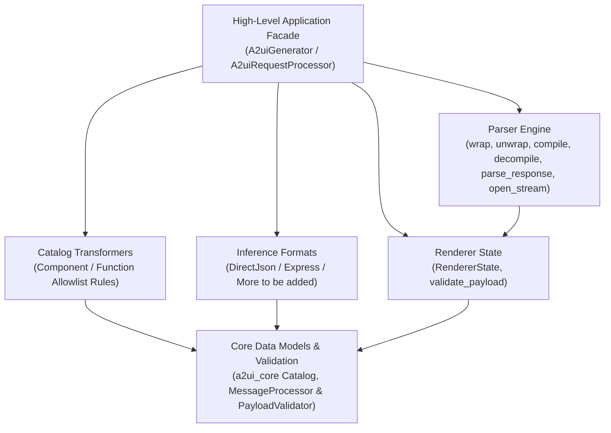

# Agent SDK Development Guide

This document describes the architecture of an A2UI Agent SDK. The design separates concerns into distinct layers to follow a similar structure for consistency across languages, providing a streamlined developer experience for building AI agents that generate rich UI.

The Agent SDK is responsible for:

- **Catalog management**
- **Capability negotiation**
- **Prompt engineering**
- **Response parsing**
- **Payload validation**
- **Transport packaging**

It enables Large Language Models (LLMs) and autonomous agents to understand available UI capabilities and ensures that generated UI payloads conform strictly to negotiated specification contracts before transmission to client renderers.

---

## 1. Unified Architecture Overview

The Agent SDK architecture introduces a clear separation between **low-level single-responsibility primitives** and a **high-level application manager facade**:



1. **Decoupled Primitive Layer**:
   - **Catalog Representation**: Directly uses canonical `Catalog` models from `a2ui_core`, as the schema-only `CatalogApi`.
   - **Catalog Transformers**: Standalone rule sets (`CatalogTransformer`, `ComponentPruningTransformer`, `FunctionPruningTransformer`) for filtering component definitions and function signatures from pristine catalogs.
   - **Inference Formats**: Strategy facades (`InferenceFormat`, `InferenceFormatFactory`) pairing format-specific prompt generators (`PromptGenerator`) and parsers (`Parser`). Supported strategies include `DirectJsonFormat` and `ExpressFormat`.
   - **Prompt Generators**: Format builders consuming transformed catalogs and prompt examples to generate system instruction snippets.
   - **Parsers**: Response extraction engines performing tag detection (`has_format_content`), tag unwrapping (`unwrap`) and wrapping (`wrap`), and translation between a format and A2UI messages (`compile`, `decompile`). `parse_response` reads a whole response and checks it against a `RendererState`. A format whose notation can be read incrementally also opens a `ResponseStream` that reads one streamed response chunk by chunk (`open_stream`). A parser holds no per-response state, so one parser serves every response of a set of catalogs.
   - **Validation Layer**: `RendererState` is the agent's mirror of the surfaces one renderer holds. It wraps one `a2ui_core` `MessageProcessor`, which holds every active catalog, resolves each item to the catalog it belongs to, and delegates the item to that catalog's `PayloadValidator`. `validate_payload` checks one payload on its own, on a short-lived state. Protocol version branching (`v0_8`, `v0_9`, `v0_9_1`, `v1_0`) is handled by the core version adapters.
2. **Encapsulated Application Processor**:
   - `CatalogConfig`: Configuration dataclass pairing a resolved `Catalog` with the custom transformers to apply to it. A `CatalogProvider` (`FileSystemCatalogProvider`, `InMemoryCatalogProvider`) is how a catalog document becomes that `Catalog`, but the config holds the result rather than the provider.
   - `A2uiGenerator`: Agent-level lifecycle manager holding supported `CatalogConfig`s, generating pre-negotiated `A2uiRequestProcessor` instances per renderer capability signature.
   - `A2uiRequestProcessor`: Central processor facade object unifying multi-catalog capability resolution (`resolve_catalogs`), system prompt snippet rendering, one reusable parser, and response validation against a `RendererState` the caller chooses.

---

## 2. Directory & Package Structure

All SDK implementations of `a2ui_agent` must maintain a standardized directory layout similar to the Python SDK under `python/a2ui_agent/`.

```
a2ui_agent/
├── processor/                 # High-level application facade package
│   ├── catalog_config         # CatalogConfig structure for catalog registration
│   ├── processor              # A2uiRequestProcessor facade implementation
│   ├── generator              # A2uiGenerator class
│   └── catalog_providers      # Catalog provider classes
├── inference_format           # Abstract InferenceFormat & InferenceFormatFactory facades
├── inference_formats/         # Concrete inference format strategy implementations
│   ├── direct_json/           # Self-contained Direct JSON format package
│   │   ├── format             # DirectJsonFormat, DirectJsonFormatFactory
│   │   ├── prompt_generator   # DirectJsonPromptGenerator
│   │   ├── parser             # DirectJsonParser class
│   │   ├── response_stream    # DirectJsonResponseStream, which reads one streamed response
│   │   └── blocks             # Finding and cleaning <a2ui-json> blocks, shared by parser and stream
│   └── express/               # Self-contained Express DSL format package
│       ├── format             # ExpressFormat, ExpressFormatFactory
│       ├── compiler           # ExpressCompiler class
│       ├── decompiler         # ExpressDecompiler class
│       ├── parser             # ExpressParser class
│       └── prompt_generator   # ExpressPromptGenerator class
├── parser/                    # Common Parser contracts and data structures
│   ├── parser                 # Abstract Parser base class
│   ├── response_stream        # Abstract ResponseStream returned by Parser.open_stream
│   └── response_part          # RawResponsePart, RawA2uiPart, TextPart, A2uiPart data structures
├── prompt/                    # Prompt Generation contracts
│   └── generator              # Abstract PromptGenerator base class
├── catalog_transformers/      # Catalog and Protocol Transformers
│   ├── base                   # Abstract CatalogTransformer class
│   └── pruning                # ComponentPruningTransformer, FunctionPruningTransformer
└── utils/                     # Utility helpers layer
    ├── catalog_resolver       # resolve_catalogs capability resolution function
    └── renderer_state         # RendererState and the stateless validate_payload
```

---

## 3. Interface Specification

### A. Catalog Representation & Catalog Transformers

The Agent SDK uses `a2ui.core.Catalog` directly as the canonical model representing component definitions, function signatures, and theme schemas.

An agent describes and validates functions but never runs them, so every catalog it loads, negotiates, prompts with, or validates against is a [`CatalogApi`](a2ui_core.blueprint.md#catalogapi), the core name for `Catalog[ComponentApi, FunctionApi]`. Catalog transformers are the exception: they stay generic over the component and function types, so the same rules can also prune a catalog that carries implementations.

#### `CatalogTransformer`

Abstract base interface for transformation rules applied to catalog schemas prior to prompt engineering and payload validation.

```python
TComponent = TypeVar("TComponent", bound=ComponentApi)
TFunction = TypeVar("TFunction", bound=FunctionApi)

class CatalogTransformer(ABC):
    """Abstract base interface for transformation rules applied to catalog schemas."""

    @abstractmethod
    def transform(
        self, catalog: Catalog[TComponent, TFunction]
    ) -> Catalog[TComponent, TFunction]:
        """Transforms a Catalog into a modified Catalog of the same component and function types."""
        pass
```

#### `ComponentPruningTransformer`

Prunes catalog component definitions to an allowlist of allowed components.

```python
class ComponentPruningTransformer(CatalogTransformer):
    """Prunes catalog component definitions to an allowlist of allowed components."""

    def __init__(self, allowed_components: Sequence[str]):
        self.allowed_components = set(allowed_components)

    def transform(
        self, catalog: Catalog[TComponent, TFunction]
    ) -> Catalog[TComponent, TFunction]:
        """Returns a new Catalog filtered to only include components in allowed_components."""
        pass
```

#### `FunctionPruningTransformer`

Prunes catalog function definitions to an allowlist of allowed renderer-side validation rules and logic functions.

```python
class FunctionPruningTransformer(CatalogTransformer):
    """Prunes catalog function definitions to an allowlist of allowed functions."""

    def __init__(self, allowed_functions: Sequence[str]):
        self.allowed_functions = set(allowed_functions)

    def transform(
        self, catalog: Catalog[TComponent, TFunction]
    ) -> Catalog[TComponent, TFunction]:
        """Returns a new Catalog filtered to only include functions in allowed_functions."""
        pass
```

---

### B. Prompt Generation Layer (`a2ui.prompt`)

#### `PromptGenerator`

Abstract base interface for constructing system prompt instruction snippets across inference formats.

The interface is `generate()` alone. Application code gets a prompt generator from `InferenceFormat.prompt_generator` and only renders it, so what a generator is built from (catalogs, examples, format-specific options) belongs to each format's constructor rather than to the shared interface.

Every format's generator renders the prompt example turns it is given in the order given. Each turn is the list of `AgentToRendererMessage` objects making it up. An example carries no label of its own: what the model learns from it is the payload, so a description would be the prompt author's prose rather than part of the contract.

```python
class PromptGenerator(ABC):
    """Abstract base class for format-specific prompt generators."""

    @abstractmethod
    def generate(self) -> str:
        """
        Renders format-specific system prompt instructions and catalog schemas.
        The caller (Agent / Framework) prepends role/workflow preambles and appends suffixes.
        """
        pass
```

---

### C. Common Parser Package (`a2ui.parser`)

#### Response Part Structures

```python
@dataclass
class TextPart:
    """Represents extracted conversational text from an LLM response.

    Attributes:
        text: The conversational text content intended for user display.
    """
    text: str

@dataclass
class RawA2uiPart:
    """Represents an uncompiled A2UI format content block extracted from an LLM response.

    Attributes:
        a2ui_raw: The raw uncompiled format content string (e.g., raw XML/DSL/JSON).
    """
    a2ui_raw: str

@dataclass
class RawResponsePart:
    """Represents an uncompiled token from an LLM response stream.

    Attributes:
        part: The underlying content, either conversational TextPart or uncompiled RawA2uiPart.
        is_final: Whether this part is complete/closed (not truncated during streaming).
    """
    part: Union[TextPart, RawA2uiPart]
    is_final: bool = True

@dataclass
class A2uiPart:
    """Represents extracted and compiled A2UI payload messages.

    Attributes:
        a2ui: List of validated AgentToRendererMessage objects to deliver to client renderers.
    """
    a2ui: list[AgentToRendererMessage]

ResponsePart = Union[TextPart, A2uiPart]
```

#### `Parser`

Base interface for response parsers across all inference format strategies.

The optional `state` argument of the parsing methods, and of `A2uiRequestProcessor` and `A2uiGenerator.create_processor`, is meant to be passed by name in languages that have named arguments.

A parser knows only its own format. It reads its own sentinel tags and treats everything else in a response as conversational text, including a block in another format's tags: a model that shows the other notation in prose has written text, not a payload, and adding a format must not require changing the parsers of the existing ones.

```python
class Parser(ABC):
    """Abstract base class for response parsers.

    Responsible for unwrapping format tags, translating raw format expressions into standard
    A2UI payload messages, and checking the messages of a response against a RendererState.

    A parser holds no per-response state. It is bound to a set of catalogs, and one parser
    reads every response and every stream for them, from any number of sessions.
    """

    @property
    @abstractmethod
    def catalogs(self) -> list[CatalogApi]:
        """The active catalogs the parser translates and checks against."""
        pass

    @abstractmethod
    def has_format_content(self, content: str, complete: bool = False) -> bool:
        """Reports whether the content carries a block written in this format.

        A caller uses this to decide whether a response is this format's business at all,
        without paying for a parse. It reads the sentinel tags only and never compiles.
        Another format's tags do not count.

        Args:
            content: Raw string response emitted by the LLM, possibly partial.
            complete: Whether to require a closed block. False matches an opening tag on
                its own, which is what a streaming caller needs to know it has started
                receiving a payload.

        Returns:
            True when the content carries a block belonging to this format.
        """
        pass

    @abstractmethod
    def wrap(self, blocks: Sequence[RawResponsePart]) -> str:
        """Converts a sequence of RawResponseParts to a string, adding enclosing tags or markers around each raw A2UI section and concatenating conversational text parts."""
        pass

    @abstractmethod
    def unwrap(self, content: str) -> list[RawResponsePart]:
        """Tokenizes the LLM response into an ordered list of RawResponsePart objects, extracting raw format content between sentinel tags while preserving chronological order.

        Content outside this format's sentinel tags, including another format's tags, is a TextPart.

        Args:
            content: Raw string response emitted by the LLM.

        Returns:
            An ordered list of RawResponsePart objects representing alternating slices of
            conversational text and tagged A2UI payload blocks exactly as emitted by the LLM.
        """
        pass

    @abstractmethod
    def compile(self, format_content: str) -> list[AgentToRendererMessage]:
        """Translates a raw format content string into A2UI messages.

        Compiling reports what the notation itself gets wrong, such as text that is not JSON
        or an Express reference to an undefined variable. It does not check the messages
        against the catalogs or a renderer state: parse_response and open_stream do, and
        parse_response(block, wrapped=False) compiles and checks one block.

        Args:
            format_content: The uncompiled raw payload string (e.g. raw JSON or DSL expression).

        Returns:
            List of compiled AgentToRendererMessage objects.
        """
        pass

    @abstractmethod
    def decompile(self, a2ui_payload: Sequence[AgentToRendererMessage]) -> str:
        """Decompiles structured A2UI payload messages into this format's raw notation.

        Args:
            a2ui_payload: List of AgentToRendererMessage objects to convert to raw format text.

        Returns:
            Raw format content string representing the messages.
        """
        pass

    def parse_response(
        self,
        content: str,
        wrapped: bool = True,
        state: Optional[RendererState] = None,
    ) -> list[ResponsePart]:
        """Parses a complete response, preserving the order of text and A2UI payload blocks.

        Nothing has been sent when a whole response is parsed, so it is checked as a whole:
        every block is compiled and applied to the state inside one transaction, so a
        component may name a child that a later block adds, and the trees of the surfaces
        the response touched are checked once every block is applied. The messages are
        applied all or nothing: if any check fails, the state is left as it was.

        Args:
            content: Complete raw text response emitted by the LLM.
            wrapped: Whether the output is expected to be wrapped inside format sentinel tags.
            state: The renderer state to check the response against and apply it to. Without
                one, the response is checked against a new, empty state, as a chat turn that
                shows new UI, so an update to a surface the response does not create is
                rejected.

        Returns:
            List of ResponsePart objects (TextPart / A2uiPart).

        Raises:
            A2uiError: If a block cannot be read or a message is rejected. Any other failure
                to compile is raised as a compilation error.
        """
        pass

    @property
    def supports_streaming(self) -> bool:
        """Whether this parser can read a response incrementally through open_stream.

        A format can only stream if a partial block already means something. Direct JSON
        can, because an unfinished object can be healed and re-read as it grows. Express
        cannot: its notation resolves references across the whole block, so a block is
        read once it is closed and not before. A parser that returns False here buffers
        the response and is parsed whole through parse_response.
        """
        return False

    def open_stream(
        self,
        wrapped: bool = True,
        state: Optional[RendererState] = None,
    ) -> ResponseStream:
        """Opens a stream that reads one response chunk by chunk.

        Implemented only by parsers whose supports_streaming is True. The default refuses,
        so that a caller handed a non-streaming parser fails at the call rather than
        silently receiving nothing.

        Args:
            wrapped: Whether the output stream is expected to be wrapped inside format sentinel tags.
            state: The renderer state the stream checks its messages against and applies them
                to, as for parse_response. A new, empty state when None.

        Raises:
            NotImplementedError: If this format does not support streaming.
        """
        raise NotImplementedError
```

#### `ResponseStream`

The object that holds the text buffers of one streamed response. A parser opens one per response, so the parser itself stays stateless and a stream's end is explicit.

```python
class ResponseStream(ABC):
    """Reads one streamed model response, chunk by chunk.

    Each message the stream emits has been applied to its state, in the order emitted, and
    no other message has, so the state mirrors what a renderer that received the emitted
    parts holds. A streamed response cannot be rolled back, since the renderer has already
    received what was emitted.
    """

    @property
    @abstractmethod
    def state(self) -> RendererState:
        """The renderer state the stream's messages are applied to."""
        pass

    @abstractmethod
    def feed(self, chunk: str) -> list[ResponsePart]:
        """Reads the next chunk and returns the parts that became ready since the last one.

        If it raises, the stream has ended: a response cannot be read further once part of
        it is rejected, and a later feed raises too.

        Raises:
            A2uiParseError: If a block cannot be read.
            A2uiValidationError: If a message is rejected.
        """
        pass

    @abstractmethod
    def close(self) -> list[ResponsePart]:
        """Ends the response and returns the parts still held back.

        Called after the last chunk: text that could still have started a tag is held until
        then, and an unwrapped response is checked as a whole only then. Closing a stream
        that has ended returns nothing.

        Raises:
            A2uiParseError: If a block is still open.
            A2uiValidationError: If the messages the response left behind are rejected.
        """
        pass
```

---

### D. Validation Layer

The checks themselves belong to the `a2ui_core` package, and the Agent SDK does not
reimplement them. Core splits the work across two objects, and an agent reaches them
through the first, which the Agent SDK's `RendererState` wraps:

- **`MessageProcessor` (`a2ui.core.processing`)** is the entry point. It holds every
  active catalog, resolves each component and function call to the catalog it belongs to
  (the item's own `catalogId`, else the surface default, else `A2uiCatalogError`), and hands
  the item to that catalog's validator. It also owns the checks that need more than one
  item: surface lifecycle, component uniqueness, root reachability, cycles, recursion
  depth caps, and data binding JSON Pointer syntax. A surface whose components come from
  several catalogs can only be checked here, which is why this and not the validator is
  what an agent calls.
- **`PayloadValidator` (`a2ui.core.validation`)** is scoped to exactly one catalog and
  checks exactly one item against it, through `validate_component`, `validate_function`
  and `validate_theme`. It cannot see a whole payload and cannot know which catalog an
  item belongs to, so it never decides routing.

Wire envelope structure is checked before either of them, by the core version adapter for
the protocol version the message declares. That is also where version branching across
`v0_8`, `v0_9`, `v0_9_1` and `v1_0` lives, so neither object above is version-aware.

See [`a2ui_core.blueprint.md`](a2ui_core.blueprint.md) for the full validation contract
and its implementation matrix.

#### `RendererState` (`a2ui.utils`)

`RendererState` is the agent's mirror of the surfaces that one renderer holds. It owns one `MessageProcessor` for its whole life, created once with the linked active catalogs, and runs the agent's outbound messages through it. A message is therefore checked against everything the renderer has already received: a reference resolves against the components earlier messages added, and a cycle is found across the whole surface. The renderer runs these same checks when the payload arrives, so an agent that runs them first catches a bad payload before sending it rather than after.

The state holds the surfaces as they now stand, not the messages that built them.

```python
class RendererState:
    """The agent's mirror of the surfaces a renderer holds."""

    def __init__(self, catalogs: Sequence[CatalogApi]):
        """Creates the empty state of a renderer that holds the catalogs.

        Raises:
            A2uiCatalogError: If no catalogs are given, or their messages state different
                versions, for example v0.9 and v1.0 catalogs.
        """
        pass

    @property
    def catalogs(self) -> list[CatalogApi]:
        """The active catalogs in priority order."""
        pass

    @property
    def surface_ids(self) -> list[str]:
        """The ids of the surfaces the renderer holds."""
        pass

    def get_surface(self, surface_id: str) -> Optional[SurfaceModel]:
        """Returns the surface with the id, or None. Callers must not modify it."""
        pass

    def apply(self, payload: AgentToRendererMessagePayload) -> list[str]:
        """Checks the messages against the state and applies them.

        Each component and function call is checked against the catalog it resolves to,
        and component ids and cycles against the surface's components. References, the root
        and reachability are left to check_topology, since a component may name a child that
        a later message adds. The call is atomic: if a message is rejected, the state is left
        as it was before the call.

        Returns:
            The ids of the surfaces the messages create, update or delete, in the order the
            messages first name them.
        """
        pass

    def transaction(self) -> ContextManager[RendererState]:
        """Applies everything inside the block atomically.

        If the block raises, the state is restored to what it was when the block started.
        Languages without context managers take a synchronous callback instead.
        """
        pass

    def check_topology(self, surface_ids: Iterable[str]) -> None:
        """Checks the whole tree of each surface.

        The surface must have its root, every reference must resolve, and every component
        added or replaced since the surface's tree was last checked must be reachable from
        the root, within the depth limit. A component that an update left unreachable, by
        rewriting its parent's children, is accepted: the protocol has no message that
        removes one component, so replacing part of a canvas always leaves such components
        behind. A surface with no components yet passes.
        """
        pass
```

The processor inside the state applies messages with references, a missing root and orphans allowed, and unknown components and functions still rejected; `check_topology` runs the graph checks the protocol requires once a response is complete. A rollback restores copies of the surfaces that the frame changed.

An update to a surface the state never saw created is rejected, as the renderer would reject it. A v0.8 renderer buffers the updates that arrive before `beginRendering`, so a v0.8 state holds such updates and checks them once the surface begins rendering.

#### `validate_payload` (`a2ui.utils`)

```python
def validate_payload(
    catalogs: Sequence[CatalogApi],
    payload: AgentToRendererMessagePayload,
) -> None:
    """Checks one payload the way a renderer holding the catalogs would."""
```

`validate_payload` checks one payload with no record of earlier ones, such as the argument of a tool call. It runs on a short-lived `RendererState` that assumes a surface the payload updates without creating already exists: the state creates an empty placeholder for it on the first catalog that defines the update's components and accepts it. Each component is still checked against that catalog, but the surface's tree is not, since the surface may already hold components the check never saw. A surface the payload creates is checked in full. It builds one processor per call, not one per surface or candidate catalog.

#### Chat and canvas

How long a state lives is the one difference between the two ways an agent shows UI, and the caller chooses it:

1. In a chat, each turn shows new UI. The agent passes no state, and each response is checked against a new, empty one, so a response that updates a surface it never created is rejected.
2. In a canvas, turns update the surfaces earlier turns created. The agent creates one state per conversation, typically with `A2uiRequestProcessor.create_state()`, and passes it on every turn, streamed or not.

A whole response is applied inside a transaction. A streamed response applies each message as it is emitted, so the state matches what the client received even when the response fails part way.

---

### E. Inference Format Facades (`a2ui.inference_format`)

#### `InferenceFormatFactory` & `InferenceFormat`

```python
class InferenceFormatFactory(ABC):
    """Abstract interface for constructing InferenceFormat strategies bound to active catalogs."""

    @abstractmethod
    def create_format(
        self,
        catalogs: Sequence[CatalogApi],
        examples: Optional[Sequence[Sequence[AgentToRendererMessage]]] = None,
    ) -> "InferenceFormat":
        """Constructs an InferenceFormat instance bound to the provided active catalogs.

        Args:
            catalogs: List of active Catalog instances.
            examples: Optional list of few-shot example turns, each a list of messages.

        Returns:
            An InferenceFormat strategy instance.
        """
        pass

class InferenceFormat(ABC):
    """Coordinator facade pairing a prompt generator (input) and parser (output) for a format."""

    @property
    @abstractmethod
    def prompt_generator(self) -> PromptGenerator:
        """Returns the format prompt generator instance."""
        pass

    @abstractmethod
    def create_parser(self) -> Parser:
        """Creates a parser bound to this format strategy.

        A parser holds no per-response state, so a caller creates one and reuses it.
        """
        pass
```

---

### F. High-Level Application Facade (`a2ui.processor`)

#### Catalog Providers

A provider can be constructed with a catalog id and a protocol version. Each is both a
default and an assertion: when the document states the same field, the two must agree or
the load fails; when the document states nothing, the provider's value is used, and the
resulting catalog is no different from one that carried its own.

Neither field has a fallback default. A load fails when nothing names the catalog, since
nothing could then address it in `supportedCatalogIds` or `createSurface`, and it fails
when nothing states a version, since a document read under the wrong version
mis-validates every payload written against it. This is what the notes below about
`catalog_id` being undefined in v0.8 and `protocol_version` being undefined before v1.0
imply: a provider value would otherwise be useless for exactly the documents that need it
most.

Every failure a provider raises is a catalog error, whether it comes from a file that is
not there, a document that is not JSON, a declaration conflicting with the document, or
an id or version nobody stated.

```python
class CatalogProvider(ABC):
    """Abstract base class for loading catalog definitions."""

    @abstractmethod
    def load(self) -> CatalogApi:
        """Loads and returns a Catalog definition instance."""
        pass

class FileSystemCatalogProvider(CatalogProvider):
    """Loads a catalog definition from a JSON file on the local filesystem."""

    def __init__(
        self,
        path: str,
        protocol_version: Optional[ProtocolVersion] = None,  # protocol_version is not defined before v1.0
        catalog_id: Optional[str] = None,        # catalog_id is not defined in v0.8
    ):
        """Initializes the filesystem catalog provider.

        Args:
            path: Absolute or relative filesystem path to the catalog JSON file.
            protocol_version: Optional expected A2ui protocol version for validation.
            catalog_id: Optional expected catalog ID for validation.
        """
        self.path = path
        self.protocol_version = protocol_version
        self.catalog_id = catalog_id

    def load(self) -> CatalogApi:
        """Reads the catalog JSON file and returns a Catalog instance.

        If self.protocol_version or self.catalog_id are defined and the loaded catalog
        has protocol_version or catalog_id specified, verify they match; if they conflict, raise an error.
        """
        pass

class InMemoryCatalogProvider(CatalogProvider):
    """Loads a catalog definition from an in-memory dictionary schema."""

    def __init__(
        self,
        catalog: Mapping[str, Any],
        protocol_version: Optional[ProtocolVersion] = None,  # protocol_version is not defined before v1.0
        catalog_id: Optional[str] = None,        # catalog_id is not defined in v0.8
    ):
        """Initializes the in-memory provider.

        Args:
            catalog: Raw catalog schema dictionary.
            protocol_version: Optional expected A2ui protocol version for validation.
            catalog_id: Optional expected catalog ID for validation.
        """
        self.catalog = catalog
        self.protocol_version = protocol_version
        self.catalog_id = catalog_id

    def load(self) -> CatalogApi:
        """Constructs and returns a Catalog instance from the raw schema dictionary.

        If self.protocol_version or self.catalog_id are defined and the loaded catalog
        has protocol_version or catalog_id specified, verify they match; if they conflict, raise an error.
        """
        pass
```

#### `CatalogConfig`

```python
@dataclass
class CatalogConfig:
    """Configuration model associating a component catalog definition with its transformations.

    Attributes:
        catalog: Base Catalog instance loaded via a CatalogProvider.
        transformers: Optional list of CatalogTransformer rules to apply sequentially.
    """
    catalog: CatalogApi
    transformers: Optional[Sequence[CatalogTransformer]] = None

    @property
    def transformed_catalog(self) -> CatalogApi:
        """Returns the Catalog after applying all configured transformers sequentially."""
        current = self.catalog
        if self.transformers:
            for t in self.transformers:
                current = t.transform(current)
        return current

    @classmethod
    def from_path(
        cls,
        catalog_path: str,
        transformers: Optional[Sequence[CatalogTransformer]] = None,
        protocol_version: Optional[ProtocolVersion] = None,
        catalog_id: Optional[str] = None,
    ) -> "CatalogConfig":
        """Factory method loading a Catalog from disk into a CatalogConfig.

        Args:
            catalog_path: Path to the catalog JSON file.
            transformers: Optional list of catalog transformers.
            protocol_version: Optional expected protocol version for validation.
            catalog_id: Optional expected catalog ID for validation.

        Returns:
            A CatalogConfig instance.
        """
        catalog = FileSystemCatalogProvider(
            catalog_path,
            protocol_version=protocol_version,
            catalog_id=catalog_id,
        ).load()
        return cls(catalog=catalog, transformers=transformers)
```

#### `A2uiGenerator`

```python
class A2uiGenerator:
    """Agent-level generator holding agent-supported catalogs and returning A2uiRequestProcessor instances per request renderer capabilities.

    Attributes:
        catalogs: Master list of CatalogConfig objects supported by the agent.
        examples: Optional list of few-shot example turns shared across sessions.
        factory: Default InferenceFormatFactory used when instantiating processors.
    """

    def __init__(
        self,
        catalogs: Sequence[CatalogConfig],
        examples: Optional[Sequence[Sequence[AgentToRendererMessage]]] = None,
        inference_format_factory: Optional[InferenceFormatFactory] = None,
    ):
        """Initializes A2uiGenerator with supported catalog configurations and format factory.

        Args:
            catalogs: List of supported CatalogConfig configurations.
            examples: Optional list of prompt example turns.
            inference_format_factory: Optional default InferenceFormatFactory (defaults to DirectJsonFormatFactory).
        """
        pass

    def create_processor(
        self,
        renderer_capabilities: A2uiRendererCapabilities,
        inference_format_factory: Optional[InferenceFormatFactory] = None,
        state: Optional[RendererState] = None,
    ) -> A2uiRequestProcessor:
        """Creates an A2uiRequestProcessor bound to the specified renderer capabilities.

        An agent creates one processor for each request, from the capabilities the client
        sent with it, since a client may change what it renders between requests.

        Args:
            renderer_capabilities: Capabilities sent by the client renderer. Must not be None:
                a processor is negotiated for one renderer, so a request without capabilities
                is a catalog error here, although resolve_catalogs accepts one. A language
                with non-nullable types enforces this in the signature.
            inference_format_factory: Optional override format factory for this processor.
            state: The renderer state a canvas agent keeps for the conversation, bound to the
                processor.

        Returns:
            Pre-negotiated client-bound A2uiRequestProcessor instance.

        Raises:
            A2uiCatalogError: If no catalog can be resolved, or `state` holds other catalogs
                than the resolved ones.
        """
        pass
```

#### `A2uiRequestProcessor`

```python
class A2uiRequestProcessor:
    """Central request processor facade unifying multi-catalog capability resolution, prompt rendering, parsing, and validation."""

    def __init__(
        self,
        catalogs: Sequence[CatalogApi],
        examples: Optional[Sequence[Sequence[AgentToRendererMessage]]] = None,
        format_factory: Optional[InferenceFormatFactory] = None,
        state: Optional[RendererState] = None,
    ):
        """Initializes A2uiRequestProcessor with the active catalogs and format strategy.

        Args:
            catalogs: List of active Catalog instances.
            examples: Optional list of prompt example turns, checked with validate_payload
                against the active catalogs.
            format_factory: Format factory for instantiating format strategies.
            state: The renderer state a canvas agent keeps for the conversation.
                parse_response and open_stream use it when a call passes none.

        Raises:
            A2uiCatalogError: If no catalogs are given, or `state` holds other catalogs, in
                another order or of other versions. The order matters because it is the
                priority order the state resolves catalogs in.
        """
        pass

    @property
    def active_catalogs(self) -> list[CatalogApi]:
        """Returns the list of active negotiated Catalog instances for this processor."""
        pass

    @property
    def examples(self) -> Optional[list[list[AgentToRendererMessage]]]:
        """Returns the ordered list of prompt example turns."""
        pass

    @property
    def prompt_snippet(self) -> str:
        """Format-specific system prompt instruction snippet."""
        pass

    @property
    def parser(self) -> Parser:
        """The parser for the format, created once and reused."""
        pass

    @property
    def state(self) -> Optional[RendererState]:
        """The renderer state bound to this processor, if any."""
        pass

    def create_state(self) -> RendererState:
        """Creates an empty renderer state that holds the active catalogs."""
        pass

    def parse_response(
        self,
        content: str,
        wrapped: bool = True,
        state: Optional[RendererState] = None,
    ) -> list[ResponsePart]:
        """Parses and validates a whole response, as Parser.parse_response does.

        `state` defaults to the bound state. With neither, the response is checked against
        a new state.
        """
        pass

    def open_stream(
        self,
        wrapped: bool = True,
        state: Optional[RendererState] = None,
    ) -> ResponseStream:
        """Opens a stream that reads one response, as Parser.open_stream does.

        `state` defaults to the bound state, as for parse_response.
        """
        pass
```

---

### G. Utility Helpers (`a2ui.utils`)

#### `resolve_catalogs` (`a2ui.utils.catalog_resolver`)

Negotiates renderer capabilities against a registered sequence of catalogs (`Sequence[CatalogConfig]`) to select matching active schemas for a session.

`A2uiRendererCapabilities` comes from `a2ui_core` and is a multi-version union, the same way `AgentToRendererMessage` is: it covers each supported protocol version's capabilities shape, including the v0.9 `A2uiClientCapabilities`. An agent that supports more than one protocol version accepts any member of that union here and must not assume the v1.0 shape.

```python
def resolve_catalogs(
    catalogs: Sequence[CatalogConfig],
    renderer_capabilities: Optional[A2uiRendererCapabilities],
    accepts_inline_catalogs: bool = False,
) -> list[CatalogApi]:
    """Matches renderer capabilities against registered catalogs and returns active transformed Catalog objects.

    Resolution follows these rules:

    - `None`, for a request that carries no capabilities object, activates every
      registered catalog in registration order, since the renderer stated no
      preference. Where the language allows it, the argument stays required
      but nullable, so a caller passes `None` deliberately rather than by
      leaving it out.
    - A present but empty `supportedCatalogIds` with no inline catalogs raises a catalog
      error, because the renderer has said it can render nothing.
    - Active catalogs come back in the renderer's preference order rather than the
      agent's registration order, so the renderer's first choice is the first catalog
      the model reads about.
    - From v0.9 the capabilities are keyed by protocol version (`{"v0.9": {...}}`). The
      v0.8 specification sends the entry itself (`{"supportedCatalogIds": [...]}`), so
      v0.8 catalogs read that shape as well as the `"v0.8"` key. Capabilities count as a
      bare entry when they hold `supportedCatalogIds` or `inlineCatalogs`.

    The catalogs returned are the transformed ones, so a pruning transformer is visible
    both in the prompt snippet and in what the processor will later accept.
    """
    pass
```

---

## 4. Inference Format Strategy Implementations

### A. DIRECT_JSON Format (`a2ui.inference_formats.direct_json`)

Standard A2UI JSON payload format enclosed in `<a2ui-json>` sentinel tags.

```python
class DirectJsonFormatFactory(InferenceFormatFactory):
    """Factory for instantiating DirectJsonFormat strategies bound to active catalogs.

    `create_format` is called by the SDK with the catalogs of each request, so the
    options of the format are given to the factory and passed on to every format
    it creates.
    """

    def __init__(
        self,
        allowed_messages: Optional[Sequence[str]] = None,
        progressive_keys: frozenset[str] = frozenset(),
    ):
        """Initializes DirectJsonFormatFactory.

        Args:
            allowed_messages: Optional list of allowed payload envelope names.
            progressive_keys: String property keys whose partial values the parser
                heals while streaming. Empty turns healing off.
        """
        self.allowed_messages = allowed_messages
        self.progressive_keys = progressive_keys

    def create_format(
        self,
        catalogs: Sequence[CatalogApi],
        examples: Optional[Sequence[Sequence[AgentToRendererMessage]]] = None,
    ) -> InferenceFormat:
        """Constructs a DirectJsonFormat instance bound to the provided active catalogs.

        Args:
            catalogs: List of active Catalog instances.
            examples: Optional list of prompt example turns.

        Returns:
            DirectJsonFormat strategy instance.
        """
        return DirectJsonFormat(
            catalogs=catalogs,
            examples=examples,
            allowed_messages=self.allowed_messages,
            progressive_keys=self.progressive_keys,
        )

class DirectJsonFormat(InferenceFormat):
    """Coordinator facade pairing DirectJsonPromptGenerator and DirectJsonParser."""

    def __init__(
        self,
        catalogs: Sequence[CatalogApi],
        examples: Optional[Sequence[Sequence[AgentToRendererMessage]]] = None,
        allowed_messages: Optional[Sequence[str]] = None,
        progressive_keys: frozenset[str] = frozenset(),
    ):
        """Initializes DirectJsonFormat with active catalogs, examples, and format options.

        Args:
            catalogs: Active Catalog instances.
            examples: Optional list of prompt example turns.
            allowed_messages: Optional list of allowed payload envelope names.
            progressive_keys: String property keys each parser heals while streaming.
        """
        self._prompt_generator = DirectJsonPromptGenerator(
            catalogs, examples=examples, allowed_messages=allowed_messages
        )
        self._catalogs = catalogs
        self._progressive_keys = progressive_keys

    @property
    def prompt_generator(self) -> DirectJsonPromptGenerator:
        """Returns the DirectJsonPromptGenerator instance."""
        return self._prompt_generator

    def create_parser(self) -> DirectJsonParser:
        """Creates a fresh DirectJsonParser instance bound to active catalogs."""
        return DirectJsonParser(
            catalogs=self._catalogs, progressive_keys=self._progressive_keys
        )

class DirectJsonPromptGenerator(PromptGenerator):
    """Formats standard JSON schema system prompt instructions enclosed in <a2ui-json> tags."""

    def __init__(
        self,
        catalogs: Sequence[CatalogApi],
        examples: Optional[Sequence[Sequence[AgentToRendererMessage]]] = None,
        allowed_messages: Optional[Sequence[str]] = None,
    ):
        """Initializes DirectJsonPromptGenerator.

        Args:
            catalogs: Active Catalog instances.
            examples: Optional list of prompt example turns.
            allowed_messages: Optional list of allowed payload envelope names.
        """
        self.catalogs = catalogs
        self.examples = examples
        self.allowed_messages = allowed_messages

    def generate(self) -> str:
        """Renders system instructions containing pruned JSON schemas inside <a2ui_schema> tags and <a2ui-json> output instructions.

        Returns:
            Formatted system prompt instruction snippet string.
        """
        pass

class DirectJsonParser(Parser):
    """Parser for standard A2UI JSON payload envelopes enclosed in <a2ui-json> sentinel tags."""

    def __init__(
        self,
        catalogs: Sequence[CatalogApi],
        progressive_keys: frozenset[str] = frozenset(),
    ):
        """Initializes DirectJsonParser.

        Args:
            catalogs: Active Catalog instances for validation.
            progressive_keys: String property keys whose partial values are healed
                while streaming. Which properties hold prose depends on the catalog,
                so there is no built-in set; empty turns healing off.
        """
        self.catalogs = catalogs
        self.progressive_keys = progressive_keys

    @property
    def supports_streaming(self) -> bool:
        """Direct JSON reads incrementally, so this parser implements open_stream."""
        return True

    def compile(self, format_content: str) -> list[AgentToRendererMessage]:
        """Parses and fixes JSON payload content string into AgentToRendererMessage objects, without checking them.

        Args:
            format_content: Raw JSON string extracted from <a2ui-json> tags.

        Returns:
            List of compiled AgentToRendererMessage objects.
        """
        pass

    def decompile(self, a2ui_payload: Sequence[AgentToRendererMessage]) -> str:
        """Decompiles AgentToRendererMessage list into standard formatted A2UI JSON string.

        Args:
            a2ui_payload: List of AgentToRendererMessage objects.

        Returns:
            Formatted A2UI JSON string representation.
        """
        pass

    def open_stream(
        self,
        wrapped: bool = True,
        state: Optional[RendererState] = None,
    ) -> DirectJsonResponseStream:
        """Opens a DirectJsonResponseStream for one response."""
        pass
```

`DirectJsonResponseStream` heals the partial JSON of each chunk, healing the values of `progressive_keys` in real time, and emits the messages that read whole and that its state accepts. It checks each message against the state rather than building a processor per message, and keeps no copy of the surfaces of its own. A `createSurface` or `deleteSurface` is held until its object closes, so it is emitted once, and a message for a surface that does not exist yet is held back, as a renderer would reject it. When a block closes, the trees of the surfaces it touched are checked.

---

### B. EXPRESS Format (`a2ui.inference_formats.express`)

Compact functional DSL format designed to reduce output token consumption, enclosed in `<a2ui>` sentinel tags. For formal grammar and syntax specification, see [Express Specification](../../specification/proposals/express/a2ui_express.md) and [Express Grammar](../../specification/inference_formats/express/Express.g4).

The Express format package under `a2ui/inference_formats/express/` contains:

- `format`: `ExpressFormatFactory` (subclassing `InferenceFormatFactory`) and `ExpressFormat` (subclassing `InferenceFormat`).
- `prompt_generator`: `ExpressPromptGenerator` (subclassing `PromptGenerator`), rendering compact positional signatures for catalog components and functions into prompt instructions.
- `compiler`: `ExpressCompiler`, lexing and parsing the DSL expressions found between `<a2ui>` tags into standard `AgentToRendererMessage` list structures.
- `decompiler`: `ExpressDecompiler`, converting `AgentToRendererMessage` payload lists back into Express DSL string format.
- `parser`: `ExpressParser` (subclassing `Parser`), delegating compilation and decompilation to `ExpressCompiler` and `ExpressDecompiler`.

```python
class ExpressFormatFactory(InferenceFormatFactory):
    """Factory for instantiating ExpressFormat strategies bound to active catalogs."""

    def __init__(self, allowed_messages: Optional[Sequence[str]] = None):
        """Initializes ExpressFormatFactory.

        Args:
            allowed_messages: Optional list of allowed payload envelope names. The
                prompt teaches only the statements that compile to them.
        """
        self.allowed_messages = allowed_messages
```

Express does not stream. `ExpressParser.supports_streaming` is False and its `open_stream` raises: an Express block resolves references across its whole body, so a partial block names components that are not yet defined and cannot be compiled into anything. An agent using Express buffers the response and parses it whole.

#### Grammar and parser generation

[`Express.g4`](../../specification/inference_formats/express/Express.g4) is the canonical grammar, and every SDK accepts exactly the language it defines. Generating the lexer and parser from it with [ANTLR](https://www.antlr.org/) is preferred, so that a change to the grammar reaches each SDK by regenerating rather than by reimplementing. The Python, TypeScript and Dart SDKs do this.

An SDK may write its parser by hand instead, for example when the language has no maintained ANTLR runtime or the SDK avoids third-party dependencies. It then says so where the parser is defined, and a change to the grammar has to be made in that parser too. `<format>/compiler.yaml` and the round-trip test below check that the parser still accepts the grammar's language.

---

## 5. Agent Workflow & Execution Walkthroughs

### Code Example

```python
# 1. Agent Startup: Initialize long-lived A2uiGenerator with agent catalogs.
#    Note: Prompt examples passed here are validated internally during processor creation
#    (create_processor) against active negotiated catalogs, raising A2uiValidationError if
#    any example uses components or structures not supported by the active catalog.
generator = A2uiGenerator(
    catalogs=[
        CatalogConfig(BasicCatalog("v1.0")),
        CatalogConfig.from_path("./catalogs/custom_catalog.json"),
    ],
    examples=load_examples("./prompts/examples/**")
)

# 2. In Request Handler: Negotiate this request's processor from the capabilities the client sent.
#    A canvas agent binds the RendererState it keeps for the conversation; a chat agent binds none.
processor = generator.create_processor(renderer_capabilities, state=conversation_state)

# 3. Invoke LLM to generate the output
llm_output_text = myagent.call_llm(processor.prompt_snippet, request_context)

# 4. Parse and validate output using the processor
response_parts = processor.parse_response(llm_output_text)

# 5. Deliver A2UI payloads to the renderer

# Streaming instead of step 4: each part is sent as soon as it is checked.
stream = processor.open_stream()
for chunk in myagent.stream_llm(processor.prompt_snippet, request_context):
    send(stream.feed(chunk))
send(stream.close())
```

---

## 6. Conformance Test Plan

To ensure behavioral parity across all SDK implementations (Python, Kotlin, etc.), the project maintains a language-agnostic conformance suite.

The suites covering this document live under `conformance/agent/`:

| Suite                                 | Covers                                                                                          |
| ------------------------------------- | ----------------------------------------------------------------------------------------------- |
| `<format>/compiler.yaml`              | `Parser.compile`: what a block of that format means                                             |
| `<format>/decompiler.yaml`            | `Parser.decompile`: how messages are written back into that format                              |
| `<format>/response_parser.yaml`       | `Parser.wrap`, `unwrap` and `parse_response`: where a payload begins and ends                   |
| `<format>/prompt_generator.yaml`      | `PromptGenerator.generate`: what the system prompt snippet has to tell the model                |
| `direct_json/response_streaming.yaml` | `Parser.open_stream` and `ResponseStream`, for the one format that streams                      |
| `catalog_provider.yaml`               | `CatalogProvider.load` and the checks it makes on a document                                    |
| `request_processor.yaml`              | `InferenceFormatFactory.create_format`, `A2uiGenerator.create_processor` and `resolve_catalogs` |

There is no `express/response_streaming.yaml`, because Express does not stream. Suites under `conformance/agent/legacy/` describe the earlier interface still implemented by `python/a2ui_agent` and `kotlin/agent_sdk_legacy`, and stay until those SDKs move to the interface above.

Where a suite fixes something this document leaves open, the decision is stated in that suite's header rather than left for a reader to infer from the cases.

A `compile` or `decompile` case checks a block on its own, the way `validate_payload` does, so a surface the block only updates is assumed to exist. A `parse_response` or streaming case is read as one chat turn, against a renderer that holds no surfaces, so a case that updates a surface creates it in its input. A streaming case ends with `close()`, which must return nothing more.

For complete setup instructions, test harness requirements, suite descriptions, and schema definitions, see [Conformance README](../../conformance/README.md).

### Format Round-Trip and Specification Example Testing

In addition to the per-format YAML suites, implementations of non-JSON inference formats (such as Express) should implement a systematic round-trip test against the full corpus of catalog golden example files (`catalogs/basic/v1/examples/*.json`).

Because Express notation is a compact, catalog-driven DSL, decompile-then-recompile round-trips against the full set of specification examples verify that:

1. Every standard component, property, data-binding, and check rule decompiles into clean notation without error.
2. Recompiling the decompiled DSL reproduces the original semantic surface envelope, components, and data model.

Refer to `python/a2ui_agent/tests/test_specification_roundtrip.py` for a reference implementation of this test.
