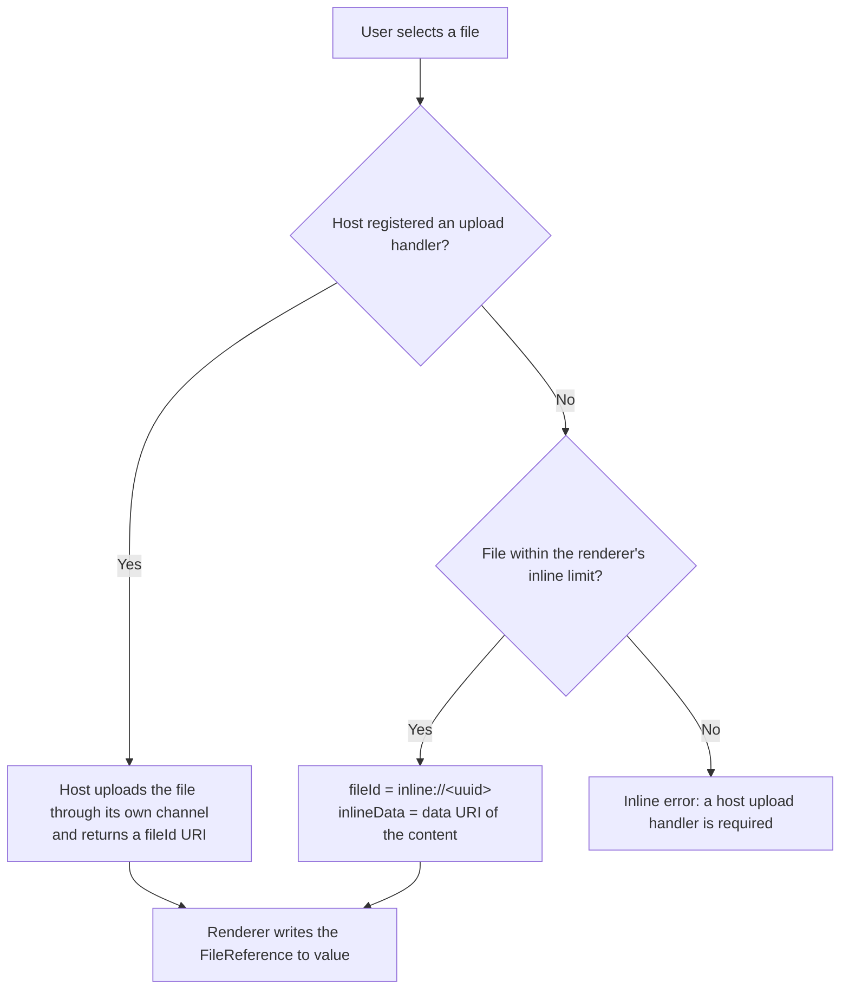

# A2UI File Upload catalog

The A2UI File Upload catalog lets a surface collect files from the user without putting their bytes into the A2UI messages. It defines one component, `FileUpload`: an input that shows a drop zone, hands each selected file to the host application to upload, and writes a list of file references to the data model. The agent receives a `fileId` pointer and metadata per file, and resolves the pointer to the file content out of band, so action payloads and conversation history stay small no matter how large the files are.

The catalog ID is `https://a2ui.org/specification/v1_0/catalogs/file_upload/catalog.json`. It targets A2UI protocol v1.0 and is declared in [catalog.json](catalog.json).

## `FileUpload` component

`FileUpload` is an input like `TextField`: its `value` binds a data model path, and the renderer writes to that path when the user uploads or removes files. A surface is usually created on the basic catalog, so the component selects this catalog with its own `catalogId`.

| Property   | Type                                      | Required | Description                                                                                                                                                                                                                      |
| :--------- | :---------------------------------------- | :------- | :------------------------------------------------------------------------------------------------------------------------------------------------------------------------------------------------------------------------------- |
| `value`    | `DataBinding`                             | Yes      | The data model path where the renderer writes the uploaded files, as an array of [`FileReference`](#filereference) objects. The array is replaced after every upload and removal, and is empty until the first upload completes. |
| `label`    | `DynamicString`                           | No       | The prompt shown in the drop zone, e.g. `"Drop a PDF here or click to upload"`.                                                                                                                                                  |
| `accept`   | `DynamicString`                           | No       | Comma-separated accepted MIME types or extensions, e.g. `"image/*, application/pdf"`. A file picker filter only; the agent must still validate what it receives.                                                                 |
| `maxSize`  | `DynamicNumber`                           | No       | Maximum size of each file in bytes. Larger files are rejected with an inline error and not uploaded.                                                                                                                             |
| `multiple` | `boolean`                                 | No       | Whether the user may upload more than one file. Defaults to `false`, where a new file replaces the previous one.                                                                                                                 |
| `action`   | `Action`                                  | No       | Dispatched each time `value` changes: after a successful upload and after the user removes a file. Failed uploads do not dispatch it.                                                                                            |
| `checks`   | `array` of `CheckRule` (from `Checkable`) | No       | Renderer-side checks, like other inputs. `{"@call": "required", "args": {"value": {"@path": ...}}}` on the `value` path requires at least one uploaded file.                                                                     |

### FileReference

Each element the renderer writes to `value` has this shape, declared in `$defs/FileReference` of [catalog.json](catalog.json):

| Field        | Type      | Required | Description                                                                                                                                                                                                                          |
| :----------- | :-------- | :------- | :----------------------------------------------------------------------------------------------------------------------------------------------------------------------------------------------------------------------------------- |
| `fileId`     | `string`  | Yes      | An opaque URI identifying the uploaded file, returned by the host's upload handler (e.g. `gdrive://1AbC`, `s3://bucket/key`, or an ephemeral `https://` download URL). `inline://<uuid>` when the renderer fell back to inline data. |
| `fileName`   | `string`  | Yes      | The name of the file as selected by the user.                                                                                                                                                                                        |
| `fileSize`   | `integer` | Yes      | The size of the file in bytes.                                                                                                                                                                                                       |
| `mimeType`   | `string`  | Yes      | The MIME type of the file.                                                                                                                                                                                                           |
| `inlineData` | `string`  | No       | The file content as a data URI. Present only for `inline://` pointers (see [How files are uploaded](#how-files-are-uploaded)).                                                                                                       |

### Getting the files to the agent

There are two ways, and the examples show one each:

- **With a submit button**, like any other form input. A `Button` action binds the `value` path into its context, so the agent receives the file references together with the rest of the form. [file-upload-expense-report.json](examples/file-upload-expense-report.json) does this:

  ```json
  {
    "id": "submit_button",
    "component": "Button",
    "child": "submit_button_label",
    "action": {
      "event": {
        "name": "submit_expense_report",
        "context": {
          "receipts": {"@path": "/expense/receipts"},
          "note": {"@path": "/expense/note"}
        }
      }
    }
  }
  ```

- **As soon as the upload completes**, with the component's own `action`. The context binds the same path as `value`. [file-upload-document-summary.json](examples/file-upload-document-summary.json) does this:

  ```json
  {
    "id": "document_upload",
    "component": "FileUpload",
    "catalogId": "https://a2ui.org/specification/v1_0/catalogs/file_upload/catalog.json",
    "label": "Drop a PDF or text file here to summarize it",
    "accept": "application/pdf, text/plain",
    "value": {"@path": "/document/files"},
    "action": {
      "event": {
        "name": "summarize_document",
        "context": {"files": {"@path": "/document/files"}}
      }
    }
  }
  ```

Either way the event context carries `FileReference` objects, never the file bytes.

## How files are uploaded

The component owns the UI (drop zone, progress, errors, removal) and delegates the transfer to the host application. The host configures an upload handler when it registers the component with its renderer; this handler is host code, not part of the catalog, so an agent cannot see or call it.



- **Host-delegated upload** is the production path. The host receives the `File` and a progress callback, uploads it wherever it wants (cloud storage, an internal API, a native background uploader on mobile), and returns the pointer URI. The A2UI messages never see the bytes.
- **Inline fallback** exists so that a renderer works out of the box, for prototypes and demos, with no storage to provision. The renderer encodes files up to its inline size limit (500 KB in the reference implementation) as a data URI in `inlineData`. A transport should then move that content out of the action payload: the reference implementation turns each `inlineData` into an A2A `FilePart` whose metadata carries the `fileId`, and deletes the field from the JSON action before sending it.

The `accept` and `maxSize` properties are conveniences for the user. Because the bytes bypass the A2UI messages, the host's storage and the agent's resolver are responsible for enforcing size limits, checking MIME types, and scanning content before it reaches a model.

## How the agent reads a file

The agent resolves `fileId` to bytes or text when it needs them, typically right before model inference, not when the action arrives. How it resolves depends on what it shares with the host:

| `fileId` looks like                             | Resolution                                                                                                                                  |
| :---------------------------------------------- | :------------------------------------------------------------------------------------------------------------------------------------------ |
| A scheme the agent knows (`gdrive://`, `s3://`) | Implicit. The host and agent agreed on the scheme, and the agent fetches the object with its own credentials.                               |
| An ephemeral `https://` download URL            | Explicit. The host minted a URL the agent can `GET` without knowing the host's storage.                                                     |
| `inline://<uuid>`                               | The content arrived alongside the action (as an A2A `FilePart` keyed by `fileId`, or in `inlineData` if the transport did not move it out). |
| `data:` URI                                     | The content is in the URI.                                                                                                                  |

The agent sample below implements a `FileResolver` that dispatches on these prefixes.

## Examples

The [examples](examples/) directory holds A2UI message sequences that validate against this catalog combined with the v1 basic catalog (`specification/scripts/validate.py` runs them):

- [file-upload-expense-report.json](examples/file-upload-expense-report.json) collects receipt images and PDFs with `multiple: true`, a `required` check on the `value` path, and a `TextField` note, and submits everything with a `Button` whose context binds the receipts path.
- [file-upload-document-summary.json](examples/file-upload-document-summary.json) accepts a single document and dispatches `summarize_document` from the component's own `action` as soon as the upload completes, listing the uploaded file from the same data model path.

## Implementations

| Platform           | Implementation                                                                                                                                                                                                                                                                              |
| :----------------- | :------------------------------------------------------------------------------------------------------------------------------------------------------------------------------------------------------------------------------------------------------------------------------------------ |
| Angular (web)      | [`samples/community/client/angular/projects/file_upload`](../../samples/community/client/angular/projects/file_upload/): a `FileUploadComponent` with a host-delegated upload handler and the inline fallback, plus a protocol inspector that shows the outgoing action without file bytes. |
| Python agent (ADK) | [`samples/community/agent/adk/file_upload_summarizer`](../../samples/community/agent/adk/file_upload_summarizer/): resolves `fileId` pointers through a `FileResolver` and summarizes the content.                                                                                          |

The samples predate this catalog and register the component under a sample-specific protocol v0.9 catalog ID. The design behind the component, including the rationale for delegating uploads to the host and for resolving pointers out of band, is written up in the sample's [design proposal](../../samples/community/client/angular/projects/file_upload/fileupload_component_design.md).
