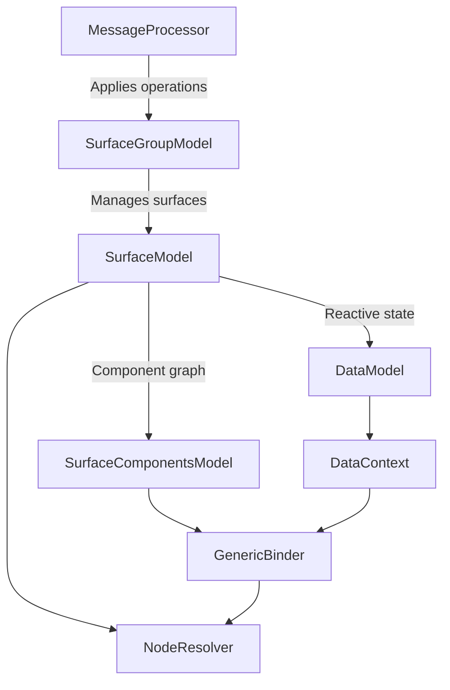

# A2UI Core (`a2ui_core`)

`a2ui_core` is the framework-agnostic Dart SDK for the A2UI protocol (v0.9, v0.9.1, and v1.0). It provides protocol envelopes, catalog schemas and function evaluation, reactive surface and data state models, payload validation, component tree resolution, and bidirectional RPC handling.

## Features

- Protocol message parsing and validation for v0.9, v0.9.1, and v1.0 envelopes (`createSurface`, `updateComponents`, `updateDataModel`, `deleteSurface`).
- Reactive state management built on `preact_signals` (`SurfaceGroupModel`, `SurfaceModel`, `SurfaceComponentsModel`, `DataModel`) and typed lifecycle notifications (`EventSource`, `EventNotifier`, `Subscription`).
- Built-in basic catalogs (`BasicCatalog.v0_9()` and `BasicCatalog.v1_0()`) implementing the 14 standard validation, formatting, and logic functions, plus `Catalog.fromJson` for custom JSON Schema catalogs.
- Reactive component resolution (`NodeResolver`, `ComponentNode`, `GenericBinder`, `DataContext`, `ComponentContext`) with `ResolvedBinding<T>` and `WritableBinding<T>` wrappers for framework adapters.
- Bidirectional RPC coordination (`RpcHandler`) for v1.0 agent-to-renderer and renderer-to-agent function calls, heartbeats, cancellation, and structured error reporting.

> [!IMPORTANT]
> `a2ui_core` targets A2UI protocol v0.9 and later (`v0.9`, `v0.9.1`, and `v1.0`). Legacy v0.8 payloads are not supported by the runtime processor.

## Architecture



### Package Structure (`lib/src/`)

#### Core State & Catalogs (`lib/src/core/`)

`Catalog`, `ComponentApi`, `FunctionApi`, `FunctionImplementation`, `SurfaceGroupModel`, `SurfaceModel`, `SurfaceComponentsModel`, `ComponentModel`, `DataModel`, `CommonSchemas`, and `A2uiRendererCapabilities`.

#### Basic Catalog (`lib/src/basic_catalog/`)

`BasicCatalog.v0_9()` and `BasicCatalog.v1_0()` with evaluable implementations of `required`, `regex`, `length`, `numeric`, `email`, `formatString`, `formatNumber`, `formatCurrency`, `formatDate`, `pluralize`, `openUrl`, `and`, `or`, and `not`, plus standalone `FormatStringFunction`.

#### Message Processing (`lib/src/processing/`)

`MessageProcessor` and version adapters (`VersionAdapter`, `V0_9Adapter`, `V1_0Adapter`, `VersionAdapterRegistry`) that normalize wire envelopes into `InternalOperation` records.

#### Expressions (`lib/src/expressions/`)

`ExpressionParser` for `${...}` string interpolation, JSON Pointer path bindings, and nested function call expressions.

#### Resolution & Binding (`lib/src/resolution/`)

`DataContext`, `ComponentContext`, `GenericBinder`, `NodeResolver`, `ComponentNode`, `ResolvedBinding`, and `WritableBinding`.

#### Validation (`lib/src/validation/`)

`PayloadValidator`, `ValidationConfig`, `resolveSchemaRefs`, and `inlineLocalRefs` for JSON Schema Draft 2020-12 validation, topological graph checks, and composition constraints.

#### Bidirectional RPC (`lib/src/rpc/`)

`RpcHandler`, `CallOptions`, and `PendingAgentCall` for v1.0 remote function calls.

## Usage

### Processing Protocol Messages

```dart
import 'package:a2ui_core/a2ui_core.dart';

void main() {
  final catalog = BasicCatalog.v1_0();
  final processor = MessageProcessor(
    catalogs: [catalog],
    defaultVersion: A2uiProtocolVersion.v1_0,
  );

  final Subscription sub = processor.model.onSurfaceCreated.subscribe((surface) {
    print('Created surface: ${surface.id}');
  });

  processor.processMessages([
    {
      'version': '1.0',
      'createSurface': {
        'surfaceId': 'main',
        'catalogId': BasicCatalog.v1_0Id,
      },
    },
    {
      'version': '1.0',
      'updateDataModel': {
        'surfaceId': 'main',
        'path': '/user/name',
        'value': 'Ada',
      },
    },
  ]);

  sub.unsubscribe();
  processor.dispose();
}
```

### Resolving a Reactive Component Tree

```dart
import 'package:a2ui_core/a2ui_core.dart';

void bindSurface(SurfaceModel<ComponentApi> surface) {
  final resolver = NodeResolver(surface);
  final Subscription sub = resolver.root.subscribe((ComponentNode? root) {
    if (root == null) return;
    final Object? textProp = root.props['text'];
    if (textProp is ResolvedBinding) {
      print('Resolved text: ${textProp.value}');
    }
  });

  // Dispose when finished:
  sub.unsubscribe();
  resolver.dispose();
}
```

## Development & Testing

Run static analysis, formatting checks, and the unit and conformance test suites from `dart/a2ui_core`:

```bash
dart analyze --fatal-infos
dart format --output=none --set-exit-if-changed .
dart test
```
