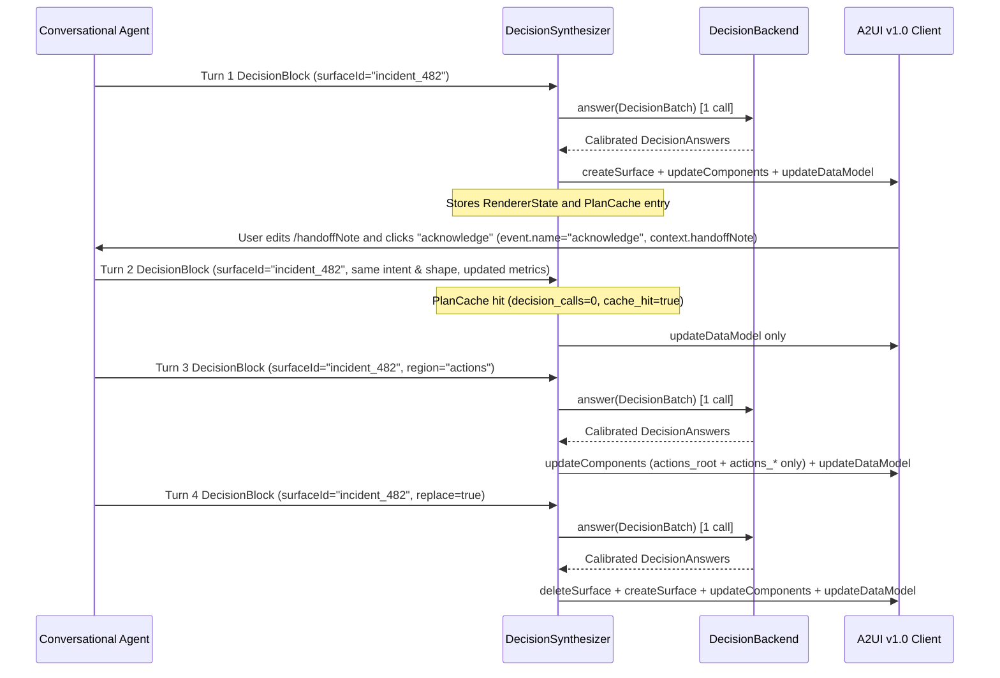
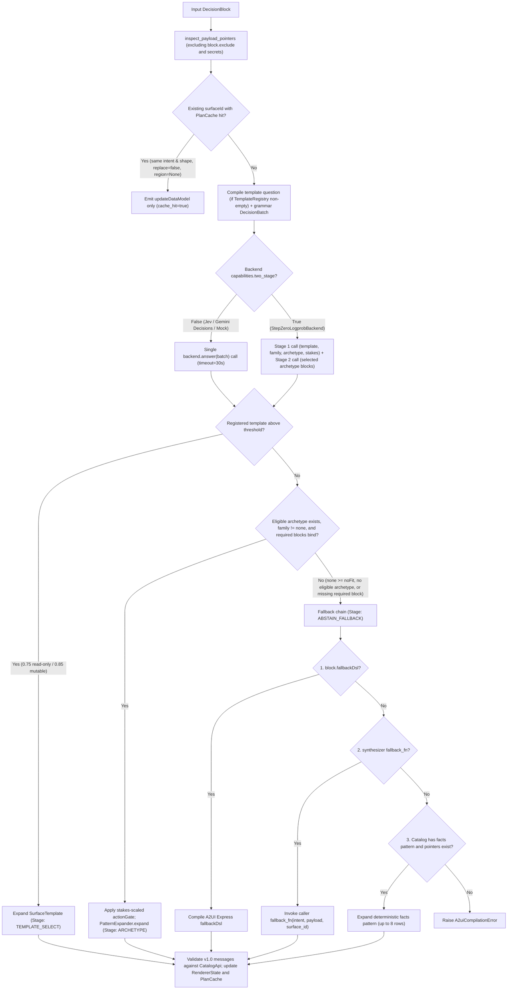

# Decision inference format

**Status:** Experimental proposal (`a2ui-decision`, A2UI v1.0)

This document specifies the `a2ui-decision` inference format implemented in `a2ui.inference_formats.decision` and its catalog assets under `catalogs/decision/v1/` and `catalogs/basic/v1/patterns.json`. It is written for engineers who already know A2UI v1.0 and want to understand how `a2ui-decision` turns agent intent and structured data into A2UI v1.0 wire messages.

---

## 1. Problem and idea

In direct A2UI formats such as `a2ui-json` and `a2ui-express`, the conversational model authors the component tree itself. It must know every active component name, property signature, child layout rule, data binding path, and event payload convention. That approach works well when an agent needs custom free-form layouts, but it carries three structural costs for routine data-display and input turns:

1. The system prompt grows with the size and schema detail of the active component catalogs.
2. The model spends its output tokens on layout boilerplate (`Card`, `Column`, `Row`, `Text`, child IDs, and data binding objects) before a surface can render.
3. Component selection and visual hierarchy drift across turns unless the prompt includes domain-specific templates or few-shot examples.

`a2ui-decision` separates what to show from how to lay it out. The conversational model emits a compact JSON block (`DecisionBlock`) containing a plain-language `intent`, a structured JSON `payload`, optional user `actions`, and optional hints such as `mutablePaths`, `exclude`, `labels`, and a short `layout` brief. It does not name components or build a tree.

Inside the agent process, a synthesis pipeline inspects the JSON Pointers of `payload` and compiles a batch of narrow multiple-choice questions (`DecisionBatch`) from a declarative layout grammar (`ArchetypeGrammar`). A small decision model (`DecisionBackend`) scores the batch in a single call, and deterministic catalog pattern templates (`PatternLibrary` and `PatternExpander`) expand the winning layout plan (`LayoutPlan`) into validated A2UI v1.0 messages (`createSurface`, `updateComponents`, `updateDataModel`, and `deleteSurface`).

---

## 2. Goals and non-goals

### Goals

1. Keep the conversational model's output restricted to application intent, data payload, action identifiers, and field mutability or visibility constraints.
2. Target A2UI v1.0 only, validating every synthesized message against the active v1.0 catalogs and protocol schemas.
3. Keep the synthesis runtime vendor-independent across hosted TypeSafe Jev (`JevHttpBackend`), the Google Gemini Decisions API (`JevHttpBackend` over `/v1beta/decisions`, see https://ai.google.dev/gemini-api/docs/decisions-api), any step-zero chat completion model with single-token logprobs (`StepZeroLogprobBackend`), and deterministic test mocks (`DeterministicMockBackend`).
4. Score all layout decisions for a turn in one batched backend call (or two calls when a backend declares `BackendCapabilities.two_stage = True`), with an explicit HTTP timeout (`DEFAULT_TIMEOUT_SECONDS = 30.0`) that raises `DecisionBackendError` (or `A2uiCompilationError` wrapping `DecisionBackendError` in chat-mode `DecisionParser`) rather than hiding backend outages behind silent short-timeout fallbacks.
5. Support multi-turn surface creation, in-place root updates, single-region updates, full surface replacement, and cached data-only updates when the block signature does not change.
6. Provide calibrated confidence gates for template selection, abstention (`none` family and `noFit` threshold), and stakes-scaled action suppression, backed by a deterministic fallback chain (`fallbackDsl`, caller `fallback_fn`, or the catalog's `facts` pattern).

### Non-goals

1. Supporting pre-1.0 protocol versions (`v0.8`, `v0.9`, `v0.9.1`). Passing a pre-1.0 catalog to `DecisionFormat`, `DecisionSynthesizer`, or `PatternLibrary` raises `ValueError`.
2. Generating arbitrary bespoke visual layouts outside the archetype grammar. The format has a bounded layout ceiling defined by the 14 archetypes and 20 abstract block patterns in `catalogs/decision/v1/archetypes.json`. Interfaces that need custom component graphs beyond those archetypes should use a registered `SurfaceTemplate`, `fallbackDsl` (A2UI Express), or the `a2ui-express` format directly.
3. Hiding network or model failures behind a low-latency timeout fallback. When a configured decision backend times out or returns an HTTP error, it raises `DecisionBackendError` with `backend_kind` and `model_id` (wrapped in `A2uiCompilationError` when invoked through `DecisionParser`) so the caller sees the failure immediately.
4. Allowing the decision model to invent component properties or arbitrary wire JSON. The decision model only answers closed-choice questions; all component JSON comes from validated catalog patterns or registered templates.

---

## 3. Core concepts and worked example

Every synthesis turn flows through eight stages. We trace one incident-response turn from the block emitted by the agent to the final A2UI v1.0 wire messages.

| Stage                    | Primary types and functions                                     | Responsibility                                                                                                                                        |
| :----------------------- | :-------------------------------------------------------------- | :---------------------------------------------------------------------------------------------------------------------------------------------------- |
| 1. Decision block        | `DecisionBlock`, `ActionSpec`, `LayoutBrief`                    | Parses the agent's JSON block from chat tags or a tool call.                                                                                          |
| 2. Payload inspection    | `inspect_payload_pointers`, `PointerSummary`, `SemanticType`    | Walks `payload`, filters secrets and `exclude` pointers from planner inspection, classifies semantic types, and attaches `labels` and `mutable_hint`. |
| 3. Question batching     | `LayoutPlanner`, `DecisionBatch`, `DecisionQuestion`            | Prunes ineligible archetypes by shape and catalog support, then compiles closed-choice questions for family, archetype, blocks, variants, and stakes. |
| 4. Backend scoring       | `DecisionBackend.answer`, `DecisionAnswer`, `Calibration`       | Scores every question in the batch and returns temperature-calibrated probability distributions.                                                      |
| 5. Layout planning       | `ArchetypeGrammar`, `LayoutPlan`, `PlannedBlock`, `PlanOutcome` | Applies grammar thresholds and the stakes-scaled action gate, binds slots to JSON Pointers, and computes `fit_score`.                                 |
| 6. Pattern lookup        | `PatternLibrary`, `MergedPatternLibrary`, `CatalogPattern`      | Resolves abstract pattern names and variants against the active v1.0 catalogs.                                                                        |
| 7. Pattern expansion     | `PatternExpander`, `Expansion`                                  | Expands `$slot`, `$text`, `$if`, `$repeat`, `$byInstance`, `$event`, and `$actionContext` directives into flat A2UI v1.0 components.                  |
| 8. Wire message emission | `DecisionSynthesizer`, `SynthesisOutput`, `RendererState`       | Diffs against surface state, consults `PlanCache`, emits A2UI v1.0 messages, and validates them against the catalog.                                  |

### Worked example: Stage 1 (`DecisionBlock`)

An incident-response agent wants to show an active checkout latency alert (`incident_482`), let the on-call engineer edit a handoff note, and expose actions to roll back the release, acknowledge the page, or inspect an individual event row:

```xml
<a2ui>
{
  "surfaceId": "incident_482",
  "intent": "Review the checkout latency incident, edit the operator handoff note, and acknowledge or roll back the release",
  "title": "Incident INC-482: Checkout latency spike",
  "summary": "Elevated p99 latency in us-east1 after build 2026.11.10-rc3",
  "payload": {
    "service": "checkout-api",
    "severity": "SEV-2",
    "p99LatencyMs": 840,
    "errorRate": 0.042,
    "handoffNote": "Investigating connection pool saturation on read replica 2.",
    "internalTraceId": "tr_99182a7f",
    "events": [
      {
        "id": "ev_1",
        "time": "2026-11-10T20:11:00Z",
        "summary": "Canary shifted to 25% traffic"
      },
      {
        "id": "ev_2",
        "time": "2026-11-10T20:14:00Z",
        "summary": "Alert fired: p99 latency above 500 ms"
      }
    ]
  },
  "actions": {
    "rollback_release": {
      "label": "Roll back release",
      "style": "destructive",
      "context": {"service": "/service"}
    },
    "acknowledge": {
      "label": "Acknowledge",
      "style": "primary"
    },
    "inspect_event": {
      "label": "View event",
      "scope": "/events",
      "key": "id"
    }
  },
  "mutablePaths": ["handoffNote"],
  "exclude": ["/internalTraceId"],
  "labels": {
    "/p99LatencyMs": "p99 latency (ms)",
    "/errorRate": "Error rate"
  },
  "layout": [
    "collection:/events",
    "facts:service,severity,p99LatencyMs,errorRate",
    "form:handoffNote",
    "actions:rollback_release,acknowledge"
  ]
}
</a2ui>
```

`DecisionBlock.from_mapping` parses this object into typed fields: `actions` becomes a tuple of three `ActionSpec` records in declaration order (`rollback_release`, `acknowledge`, `inspect_event`), the bare key `"handoffNote"` in `mutablePaths` is normalized to `"/handoffNote"`, `exclude` and `labels` are validated as `/`-prefixed JSON Pointers, and `layout` is kept as four raw brief strings for `LayoutBrief.parse`.

### Worked example: Stage 2 (`inspect_payload_pointers`)

The synthesizer runs `inspect_payload_pointers(payload, mutable_paths=block.mutable_paths)`, filters out pointers covered by `exclude` (`/internalTraceId`) or `is_secret_pointer` (keys naming tokens, passwords, secrets, or API keys unless listed in `mutablePaths`), and applies `block.labels` overrides before passing the pointer summaries to `LayoutPlanner`:

```python
(
    PointerSummary(
        path="/service",
        value_type="string",
        cardinality=1,
        semantic_type=SemanticType.NAME,
        key="service",
        label="Service",
    ),
    PointerSummary(
        path="/severity",
        value_type="string",
        cardinality=1,
        semantic_type=SemanticType.STATUS,
        key="severity",
        label="Severity",
    ),
    PointerSummary(
        path="/p99LatencyMs",
        value_type="number",
        cardinality=1,
        semantic_type=SemanticType.INTEGER,
        key="p99LatencyMs",
        label="p99 latency (ms)",
    ),
    PointerSummary(
        path="/errorRate",
        value_type="number",
        cardinality=1,
        semantic_type=SemanticType.NUMBER,
        key="errorRate",
        label="Error rate",
    ),
    PointerSummary(
        path="/handoffNote",
        value_type="string",
        cardinality=1,
        mutable_hint=True,
        semantic_type=SemanticType.LONG_TEXT,
        key="handoffNote",
        label="Handoff Note",
    ),
    PointerSummary(
        path="/events",
        value_type="array",
        cardinality=2,
        element_keys=("id", "time", "summary"),
        element_semantic_types={
            "id": SemanticType.IDENTIFIER,
            "time": SemanticType.DATETIME,
            "summary": SemanticType.STRING,
        },
        semantic_type=SemanticType.ARRAY,
        key="events",
        label="Events",
    ),
)
```

Notice that `/internalTraceId` is filtered out of the planner's `PointerSummary` tuple so no component slot can bind to it, `/handoffNote` has `mutable_hint=True`, `/events` classifies its ISO-8601 `"time"` column as `SemanticType.DATETIME`, and `/p99LatencyMs` and `/errorRate` carry the caller's custom `labels`.

### Worked example: Stages 3 and 4 (`DecisionBatch` and `DecisionBackend`)

`LayoutPlanner.build_batch` combines the user `intent`, the pointer table, the declared `actions`, and the `layout` brief into `shared_context`, and emits a `DecisionBatch` of closed-choice `DecisionQuestion` records:

1. `family`: Chooses among `browse`, `monitor`, `inspect`, `act`, `input`, `follow`, and `none`.
2. `archetype:act`: Chooses among `result`, `confirm`, and `checkout` (whose grammar blocks are `["banner?", "collection", "facts!", "form?", "actions!"]`).
3. `stakes` and `urgency`: Score the operational risk and time pressure of the intent across four levels (`0.0` to `3.0`).
4. Block gate, anatomy knob, salience, and instance questions: Score optional blocks, variant knobs (such as `collection` `variant: "rows"`), pointer ordering, and the input control for `/handoffNote` (`instance:form.control:/handoffNote` -> `"longText"`, chosen from `form.fieldVariants`: `shortText`, `longText`, `number`, `obscured`, `toggle`, `choice`, `multiChoice`, `range`, `date`).

The backend (`backend.answer(batch)`) scores all questions in one call and applies temperature scaling via `Calibration.apply` from `calibration_profiles.json`.

### Worked example: Stage 5 (`LayoutPlan`)

`LayoutPlanner.read(state, answers)` checks the calibrated probabilities against the grammar thresholds in `catalogs/decision/v1/archetypes.json`:

1. `family` selects `act` (`p = 0.96 >= 0.40`).
2. `archetype:act` selects `checkout` (`p = 0.94 >= 0.40`), giving overall plan confidence `0.94`.
3. `stakes` is `2.4` on the `[0.0, 3.0]` scale (`clamped_stakes = 0.8`), which sets the stakes-scaled action gate threshold at `conservativeness = 0.5` to `0.70 + (0.95 - 0.70) * 0.8 = 0.90`. Because `plan.confidence` (`0.94`) is at least `0.90`, `actions_allowed` is `True`.
4. The planner honors the `layout` brief roles (`collection`, `facts`, `form`, `actions`), binds the page title from `AuthoredCopy`, attaches the scoped `inspect_event` action to `/events` (`rows` variant, where `"id"` is bound on each repeated row), and computes `fit_score = 0.88` via `compute_fit_score`.

### Worked example: Stages 6, 7, and 8 (`PatternExpander` and v1.0 messages)

`PatternExpander` expands the `page`, `collection`, `facts`, `form`, and `actions` patterns from `catalogs/basic/v1/patterns.json`. Every v1.0 data binding uses `{"@path": "..."}` and function calls use `{"@call": "..."}`. In the `actions` pattern (`"order": "primaryLast"`), the primary action (`acknowledge`, `actions_action_button_1`) is ordered last with `"variant": "primary"`, while `rollback_release` (`actions_action_button_0`) renders with `"variant": "default"`.

Because `acknowledge` omits an explicit `ActionSpec.context` and the surface has a mutable `form` block (`/handoffNote`), `acknowledge`'s `$actionContext` automatically binds `{"handoffNote": {"@path": "/handoffNote"}}`. Since every non-item action button has a non-empty `event.context`, `Expansion.send_data_model` is `False`. For the new `surfaceId` (`"incident_482"`), `DecisionSynthesizer` emits three A2UI v1.0 messages (`"version": "1.0"`):

```json
[
  {
    "version": "1.0",
    "createSurface": {
      "surfaceId": "incident_482",
      "catalogId": "https://a2ui.org/specification/v1_0/catalogs/basic/catalog.json"
    }
  },
  {
    "version": "1.0",
    "updateComponents": {
      "surfaceId": "incident_482",
      "components": [
        {
          "id": "root",
          "component": "Column",
          "children": [
            "page_head",
            "collection_root",
            "facts_root",
            "form_root",
            "actions_root"
          ]
        },
        {
          "id": "page_head",
          "component": "Row",
          "align": "center",
          "children": ["page_title"]
        },
        {
          "id": "page_title",
          "component": "Text",
          "text": "## Incident INC-482: Checkout latency spike"
        },
        {
          "id": "form_fields_0",
          "component": "TextField",
          "label": "Handoff Note",
          "value": {"@path": "/handoffNote"},
          "variant": "longText"
        },
        {
          "id": "actions_root",
          "component": "Row",
          "justify": "end",
          "children": ["actions_action_button_0", "actions_action_button_1"]
        },
        {
          "id": "actions_action_button_0",
          "component": "Button",
          "child": "actions_action_label_0",
          "variant": "default",
          "action": {
            "event": {
              "name": "rollback_release",
              "context": {"service": {"@path": "/service"}}
            }
          }
        },
        {
          "id": "actions_action_label_0",
          "component": "Text",
          "text": "Roll back release"
        },
        {
          "id": "actions_action_button_1",
          "component": "Button",
          "child": "actions_action_label_1",
          "variant": "primary",
          "action": {
            "event": {
              "name": "acknowledge",
              "context": {"handoffNote": {"@path": "/handoffNote"}}
            }
          }
        },
        {
          "id": "actions_action_label_1",
          "component": "Text",
          "text": "Acknowledge"
        }
      ]
    }
  },
  {
    "version": "1.0",
    "updateDataModel": {
      "surfaceId": "incident_482",
      "path": "/",
      "value": {
        "service": "checkout-api",
        "severity": "SEV-2",
        "p99LatencyMs": 840,
        "errorRate": 0.042,
        "handoffNote": "Investigating connection pool saturation on read replica 2.",
        "internalTraceId": "tr_99182a7f",
        "events": [
          {
            "id": "ev_1",
            "time": "2026-11-10T20:11:00Z",
            "summary": "Canary shifted to 25% traffic"
          },
          {
            "id": "ev_2",
            "time": "2026-11-10T20:14:00Z",
            "summary": "Alert fired: p99 latency above 500 ms"
          }
        ]
      }
    }
  }
]
```

Every emitted message passes `CatalogApi.validator.validate` before leaving `DecisionSynthesizer`. Note that `exclude` (`["/internalTraceId"]`) prevents `LayoutPlanner` from inspecting or binding `/internalTraceId` to any UI component; `updateDataModel.value` transmits the caller's `payload` mapping without mutating it in place.

---

## 4. Decision block contract

In chat mode, the conversational model emits a JSON object (or a JSON array of objects, one per surface) inside `<a2ui>...</a2ui>`. In tool mode, the model passes the same JSON fields as arguments to `DecisionRenderTool` (default tool name `"render_a2ui_decision"`).

### Block fields and `DecisionBlock.from_mapping` normalization

`DecisionBlock.from_mapping` accepts both the camelCase wire names below and their snake_case aliases (`surface_id`, `mutable_paths`, `fallback_dsl`):

| Field                            | Type                                | Required | Description                                                                                                                                                                                                                                                                                                                                                                                                                                                                                                           |
| :------------------------------- | :---------------------------------- | :------- | :-------------------------------------------------------------------------------------------------------------------------------------------------------------------------------------------------------------------------------------------------------------------------------------------------------------------------------------------------------------------------------------------------------------------------------------------------------------------------------------------------------------------- |
| `intent`                         | `string`                            | Yes      | Non-empty natural-language description of what the data represents and how the user should inspect or interact with it.                                                                                                                                                                                                                                                                                                                                                                                               |
| `payload` (`data` alias)         | `object`, `array`, or JSON `string` | Yes      | The data to bind. If passed as a JSON-encoded string, `from_mapping` decodes it and requires a JSON object or array. An array payload is wrapped at `{"items": [...]}` so bindings address `/items/0/...`. `from_mapping` accepts `"data"` as a wire alias when `"payload"` is absent and serializes back to `"payload"`.                                                                                                                                                                                             |
| `surfaceId` (`surface_id`)       | `string`                            | No       | Target surface identifier. When omitted: chat mode (`DecisionFormat` / `DecisionParser`) defaults to `"main"` (or `"main_1"`, `"main_2"` when a single `<a2ui>` block contains a JSON array of multiple blocks without explicit `surfaceId`s); tool mode (`DecisionRenderTool`) defaults to the tool's configured `surface_id` (or `SynthesisConfig.default_surface_id`, `"default_surface"`); direct `DecisionSynthesizer.synthesize()` calls default to `SynthesisConfig.default_surface_id` (`"default_surface"`). |
| `replace`                        | `boolean`                           | No       | Defaults to `false`. When `true` on an existing `surfaceId`, the synthesizer emits `deleteSurface` followed by `createSurface`, `updateComponents`, and `updateDataModel`. Setting both `replace: true` and `region` raises `ValueError` in `DecisionBlock.__post_init__`.                                                                                                                                                                                                                                            |
| `region`                         | `string`                            | No       | Block role name (such as `"headline"` or `"actions"`) of a single planned block to re-plan and update on an existing cached archetype surface. Cannot be combined with `replace: true`.                                                                                                                                                                                                                                                                                                                               |
| `actions`                        | `object`                            | No       | Ordered map from a non-empty string action ID to either a button label string or an options object (`{"label", "scope"?, "key"?, "context"?, "style"?}`). The action ID becomes the wire `event.name`.                                                                                                                                                                                                                                                                                                                |
| `mutablePaths` (`mutable_paths`) | `array<string>`                     | No       | JSON Pointers in `payload` that the user can edit. Bare field names without a leading slash (such as `"handoffNote"`) are automatically normalized to RFC 6901 pointers (`"/handoffNote"`). Forms and settings surfaces must list their editable pointers here, or those fields render as read-only views.                                                                                                                                                                                                            |
| `exclude`                        | `array<string>`                     | No       | `/`-prefixed JSON Pointers in `payload` (requiring a leading `"/"` and not equal to `"/"`) that are stripped from `inspect_payload_pointers` before layout planning so the surface never binds or displays them.                                                                                                                                                                                                                                                                                                      |
| `labels`                         | `object<string, string>`            | No       | Map from `/`-prefixed JSON Pointer (requiring a leading `"/"` and not equal to `"/"`) to a non-empty label override, replacing the default humanized key name.                                                                                                                                                                                                                                                                                                                                                        |
| `layout`                         | `array<string>` or `LayoutBrief`    | No       | Up to 6 (`MAX_BRIEF_SECTIONS`) brief strings formatted as `"<role>:<key>,<key>"`. Valid roles come from `ArchetypeGrammar.brief_roles()`. Keys may be top-level names or `/`-prefixed JSON Pointers.                                                                                                                                                                                                                                                                                                                  |
| `title`                          | `string`                            | No       | Surface title placed directly into the page heading or banner without LLM rewriting (`AuthoredCopy.title`).                                                                                                                                                                                                                                                                                                                                                                                                           |
| `summary`                        | `string`                            | No       | One-line surface subtitle or caption placed directly into supporting prose without rewriting (`AuthoredCopy.summary`).                                                                                                                                                                                                                                                                                                                                                                                                |
| `fallbackDsl` (`fallback_dsl`)   | `string`                            | No       | A2UI Express source compiled and rendered if the decision pipeline abstains or cannot satisfy required blocks.                                                                                                                                                                                                                                                                                                                                                                                                        |

### The `actions` map contract

Buttons never come from an `"actions"` array inside `payload`. All interactive triggers live in the top-level `actions` map, which preserves insertion order and separates the stable machine identifier (the map key, used as `event.name`) from the human-readable button label:

```json
{
  "actions": {
    "sign_in": "Sign In",
    "reset_password": {
      "label": "Forgot password?",
      "style": "secondary",
      "context": {"email": "/email"}
    },
    "cancel_order": {
      "label": "Cancel",
      "scope": "/orders",
      "key": "orderId",
      "style": "destructive"
    }
  }
}
```

Each entry is parsed via `ActionSpec.from_block_value` into `ActionSpec(id, label, scope=None, key=None, context={}, style=None)`:

1. `id`: The map key, stripped of leading and trailing whitespace. Must be a non-empty string.
2. `label`: Non-empty text for the button.
3. `style`: Optional `ActionStyle` (`"primary"`, `"secondary"`, or `"destructive"`). Under the grammar's one-primary-action rule, at most one top-level action is marked `primary = true` (the first action with `style: "primary"`, or the first non-destructive action when none specifies `"primary"`, unless `stakes >= 2.0` downgrades a destructive primary).
4. `context`: Optional map from event context key to a `/`-prefixed JSON Pointer (for example `{"email": "/email"}`). When explicit `ActionSpec.context` is provided, it takes precedence over automatic form-mutable and collection-item key context bindings.
5. `scope` and `key`: When `scope` is a `/`-prefixed JSON Pointer to an array in `payload` (such as `"/orders"` or `"/events"`), the action is attached to each repeated item in that collection rather than the page-level action bar, and `key` names the item property sent in `event.context`. When `key` is omitted and `context` is empty, `$actionContext` defaults to binding the item's `"id"` slot whenever `"id"` is bound on that collection item (supported by the `collection` pattern's `rows` and `cards` variants in `catalogs/basic/v1/patterns.json`). When an item has no bound `"id"` slot and the action omits `key` and `context`, the item action sends an empty `event.context`.

### System-prompt scaling with catalog size

`DecisionPromptGenerator` emits two sections:

1. `generate_base_rules()`: The fixed 13-field `DecisionBlock` contract and one example block (`decision_rules(archetypes)`).
2. `generate_catalog_instructions()`: A bulleted list of root-eligible component names from the active catalogs (`CatalogDecisionGraph.root_candidates()`), without property schemas, type definitions, or structural nesting rules.

Because `generate_catalog_instructions()` lists only component names (`- Card`, `- Text`, `- Button`, and so on) so the conversational model knows what kinds of widgets exist, the system prompt grows by one short line per component rather than by full JSON Schema definitions. Passing `include_schema=False` to `generate_catalog_instructions` omits the component name list entirely.

---

## 5. Multi-turn conversation behavior

### `RendererState` ownership

Multi-turn surface updates require tracking which `surfaceId` values already exist and whether each active surface was created with `sendDataModel: true`. `RendererState` owns that per-conversation surface state, while `PlanCache` retains the most recent `CachedPlan` (including expanded components by block role) for each surface:

1. Explicit caller state: An application managing its own session object can pass `state=RendererState()` to `parser.parse_response(..., state=state)` or `synthesizer.synthesize(..., state=state)`.
2. Per-conversation state map: Calling `format.create_parser(conversation_id="conv_42")` or `format.state_for("conv_42")` returns a dedicated `RendererState` for that conversation ID from `DecisionFormat._conversation_states` (a bounded LRU cache with `clear_conversation` for explicit eviction). Calling `create_parser()` with no `conversation_id` allocates a fresh isolated `RendererState` for that turn so concurrent conversations never bleed surface state into one another.

### Surface lifecycle operations and `sendDataModel`

For every block, `resolve_surface_operation` (together with `_as_fresh_surface` for fallback turns) determines the `SurfaceOperation` from `RendererState`, `block.replace`, `block.region`, and `Expansion.send_data_model`:

| Scenario                                                                                                                                       | `SurfaceOperation`                                            | Wire messages emitted                                                                                                                      |
| :--------------------------------------------------------------------------------------------------------------------------------------------- | :------------------------------------------------------------ | :----------------------------------------------------------------------------------------------------------------------------------------- |
| `surfaceId` is not active in `RendererState`                                                                                                   | `SurfaceOperation.CREATE`                                     | `createSurface`, `updateComponents`, `updateDataModel` (when payload is non-empty)                                                         |
| `surfaceId` is active, `replace: false`, `region` unset, and `PlanCache` hits (identical `PlanCacheKey`, including `intent` and pointer shape) | `SurfaceOperation.UPDATE_ROOT` (cache hit)                    | `updateDataModel` only (`decision_calls = 0`, `cache_hit = True`)                                                                          |
| `surfaceId` is active, `replace: false`, `region` unset, and `intent`, payload shape, or layout changes                                        | `SurfaceOperation.UPDATE_ROOT`                                | `updateComponents` (with root component `"id": "root"`), `updateDataModel`                                                                 |
| `surfaceId` is active, `replace: false`, and `region: "<role>"` matches a block role in the cached archetype plan (`cached.plan.block_ids()`)  | `SurfaceOperation.UPDATE_ROOT` (region)                       | `updateComponents` (containing only the re-expanded `<role>_root` and `<role>_*` components for incremental v1.0 merge), `updateDataModel` |
| `surfaceId` is active and `replace: true`                                                                                                      | `SurfaceOperation.REPLACE`                                    | `deleteSurface`, `createSurface`, `updateComponents`, `updateDataModel`                                                                    |
| `surfaceId` is active without `sendDataModel: true`, and an update requires `Expansion.send_data_model == True`                                | `SurfaceOperation.REPLACE` (escalated)                        | `deleteSurface`, `createSurface` (with `"sendDataModel": true`), `updateComponents`, `updateDataModel`                                     |
| `surfaceId` is active, planning abstains, and `fallbackDsl` or `fallback_fn` returns a fresh `createSurface` message                           | `SurfaceOperation.REPLACE` (escalated by `_as_fresh_surface`) | `deleteSurface`, followed by the fallback's `createSurface`, `updateComponents`, and `updateDataModel`                                     |

`PatternExpander` sets `Expansion.send_data_model = True` only when the surface has mutable pointers (`_has_mutable`, from a `form` or `groups` block or mutable pointer hints) AND at least one non-item action button resolves to an empty `event.context` (or the surface has mutable controls with no action buttons at all). In a standard `form` block where the submit button has no explicit `ActionSpec.context`, `$actionContext` automatically binds every editable pointer in the form into the button's `event.context` (using each pointer's leaf segment as the context key, or `"_"`-joined path segments when two pointers share the same leaf name), so `send_data_model` remains `False`. By contrast, in a `groups` settings surface (or when a surface has mutable controls and an action button with an empty `event.context`), `send_data_model` is `True` so the client attaches the full surface data model to outgoing events.

### Plan cache, data-only updates, and `region` constraints

`DecisionSynthesizer` maintains a bounded LRU `PlanCache` (`max_entries = 64`) keyed by `PlanCacheKey(surface_id, catalog_id, grammar_version, shape_signature)`. `plan_shape_signature` (`models.py`) hashes `intent` along with the sorted `(path, value_type, semantic_type, element_keys, element_semantic_types, mutable_hint)` tuples of the inspected pointers, `actions`, `exclude`, `mutable_paths`, `labels`, `layout`, `title`, `summary`, `template_ids`, `conservativeness`, and `model_id`.

When a subsequent turn targets an existing `surfaceId` with `replace=False` and `region=None`, and the new block produces the exact same `PlanCacheKey` (meaning `intent`, pointer schema, and action contract stayed constant while scalar values or array length changed, such as during live metric refreshes or tool-mode polling), `DecisionSynthesizer` skips the decision backend and component expansion entirely. It emits a single `updateDataModel` message with `cache_hit=True` and `decision_calls=0`. If the agent changes `intent` on Turn 2, `plan_shape_signature` changes, `PlanCache` misses, and the synthesizer re-plans and emits `updateComponents` plus `updateDataModel` (`SurfaceOperation.UPDATE_ROOT`).

Returning to the `incident_482` worked example, suppose Turn 2 refreshes the telemetry values while keeping `intent`, fields, and actions unchanged:

```json
[
  {
    "version": "1.0",
    "updateDataModel": {
      "surfaceId": "incident_482",
      "path": "/",
      "value": {
        "service": "checkout-api",
        "severity": "SEV-2",
        "p99LatencyMs": 210,
        "errorRate": 0.004,
        "handoffNote": "Canary drained; monitoring recovery.",
        "internalTraceId": "tr_99182a7f",
        "events": [
          {
            "id": "ev_1",
            "time": "2026-11-10T20:11:00Z",
            "summary": "Canary shifted to 25% traffic"
          },
          {
            "id": "ev_2",
            "time": "2026-11-10T20:14:00Z",
            "summary": "Alert fired: p99 latency above 500 ms"
          }
        ]
      }
    }
  }
]
```

In Turn 3, the agent sets `"region": "actions"` to replace the action bar with a single `"close_incident"` button, leaving the rest of `"incident_482"` untouched. `DecisionSynthesizer` retrieves the cached plan via `plan_cache.get_for_surface(state, "incident_482", catalog_id=..., grammar_version=...)`, re-plans and expands only the `"actions"` block (`"actions_root"` and `"actions_*"`), updates its cached full component snapshot via `replace_block_components`, and emits `updateComponents` containing only `list(expanded.components)` (the `"actions_root"` and `"actions_*"` components, which the v1.0 client merges by ID into the existing surface tree) plus `updateDataModel`.

Two hard constraints govern `region`:

1. The surface must already be active in `RendererState` and have a cached archetype `LayoutPlan` in `PlanCache` (surfaces rendered via `SurfaceTemplate` or an uncached fallback do not have a cached archetype plan; attempting a `region` update on them raises `A2uiCompilationError`).
2. `region` must name a block role that is already present in `cached.plan.block_ids()` (you cannot insert a brand-new block role into the page root via `region`; unknown or uncached roles raise `A2uiCompilationError`).

### User action round-trip

When the user interacts with a rendered surface, the client sends an A2UI v1.0 action event back to the agent:

1. Top-level action with explicit `context`: Clicking `"Roll back release"` dispatches `event.name = "rollback_release"` (the action ID from `block.actions`, never the button text) with `event.context = {"service": "checkout-api"}` resolved from `{"@path": "/service"}`.
2. Top-level action with automatic form context: Clicking `"Acknowledge"` dispatches `event.name = "acknowledge"` with `event.context = {"handoffNote": "..."}` because `acknowledge` omitted explicit `context` on a surface with a mutable `form` pointer `/handoffNote`.
3. Collection-scoped action button: Clicking `"View event"` on the second row of `/events` dispatches `event.name = "inspect_event"` with `event.context = {"id": "ev_2"}` resolved via `$actionContext` inside the `$repeat` template.



---

## 6. Synthesis pipeline

`DecisionSynthesizer.synthesize` (and its synchronous wrapper `synthesize_sync`) orchestrates template matching, cache lookup, batch scoring, threshold gating, pattern expansion, and fallback recovery, returning a `SynthesisOutput`.



### Single-batch scoring and two-stage mode

By default (`BackendCapabilities.two_stage = False`), `LayoutPlanner.build_batch` includes questions for every shape-eligible archetype in a single `DecisionBatch`, including the optional `"template"` choice question (whose options are matching registered template IDs plus `"compose"`). The backend scores the entire turn in one network round-trip (`decision_calls = 1`).

When a backend sets `BackendCapabilities.two_stage = True` (used by `StepZeroLogprobBackend`, where each question requires a separate chat completion request), `DecisionSynthesizer` runs a compact first batch containing `"template"`, `"family"`, `"stakes"`, `"urgency"`, and `"archetype:<family>"`, then builds a second batch containing only the block, knob, salience, and instance questions for the winning archetype (`decision_calls = 2`, or `1` if `"template"` or `family == "none"` short-circuits after the first batch).

### Thresholds, gates, and `fit_score`

All grammar thresholds live in `catalogs/decision/v1/archetypes.json` and are validated on load by `validate_threshold_relations`:

| Threshold key     | Value  | Meaning                                                                                                                                                                                                    |
| :---------------- | :----- | :--------------------------------------------------------------------------------------------------------------------------------------------------------------------------------------------------------- |
| `template`        | `0.75` | Minimum calibrated probability on the `"template"` question to pick a registered `SurfaceTemplate` when `block.mutable_paths` is empty and the template has `is_mutable = False`.                          |
| `templateMutable` | `0.85` | Higher minimum probability required to pick a registered `SurfaceTemplate` when `block.mutable_paths` is non-empty or `template.is_mutable` is `True`.                                                     |
| `family`          | `0.40` | Minimum probability for the winning layout family (`browse`, `monitor`, `inspect`, `act`, `input`, `follow`). If the top non-`none` family falls below `0.40`, planning abstains (`PlanReason.NO_FAMILY`). |
| `noFit`           | `0.50` | Minimum probability for the `"none"` option on the `family` question to abstain directly with `PlanReason.NO_FIT` (`chosen == "none" and prob >= 0.50`).                                                   |
| `archetype`       | `0.40` | Minimum probability for the winning archetype within the chosen family (`PlanReason.NO_ARCHETYPE` on failure).                                                                                             |
| `expected`        | `0.50` | Minimum probability to include an expected (`name`) block in an archetype. Required (`name!`) blocks are always included if their slots can bind.                                                          |
| `optional`        | `0.75` | Minimum probability to include an optional (`name?`) block in an archetype (`expected <= optional`).                                                                                                       |
| `instance`        | `0.50` | Minimum probability for per-pointer widget selection (`$byInstance`).                                                                                                                                      |
| `actionGateFloor` | `0.70` | Base confidence floor for emitting interactive action blocks when `stakes` is `0.0` (or `conservativeness` is `0.0`).                                                                                      |
| `actionGateCap`   | `0.95` | Maximum action confidence cap when `stakes` is at its maximum (`3.0`) or `conservativeness` is `1.0`.                                                                                                      |

For every resolved `LayoutPlan`, `compute_fit_score` computes a diagnostic `fit_score` in `[0.0, 1.0]` combining four factors:

```text
fit_score = p * (1.0 - 0.35 * h) * (1.0 - 0.50 * o) * (1.0 - 0.40 * w)
```

Here `p` is the winning archetype probability, `h` is the normalized Shannon entropy of the archetype distribution, `o = len(state.orphan_pointers & bound) / len(bound)` is the fraction of bound pointers that came from `state.orphan_pointers` (pointers swept into an unrequested fallback `facts` block, capped at `MAX_ORPHAN_FACTS_ROWS = 8`), and `w` is the share of required slots whose binding confidence fell below `thresholds.instance` (`0.50`).

### Stakes-scaled action gate

Even when a payload or archetype can render an `actions` or `outcome` block, `_compute_action_gate` checks whether interactive triggers are safe to emit for the turn's inferred operational stakes (`stakes` in `[0.0, 3.0]`, normalized to `clamped_stakes = min(max(stakes, 0.0), 3.0) / 3.0`) and `SynthesisConfig.conservativeness` (`c` in `[0.0, 1.0]`, default `0.5`):

```text
base = floor + (cap - floor) * clamped_stakes
gate = floor + (base - floor) * (c / 0.5)          if c <= 0.5
gate = base  + (cap  - base)  * ((c - 0.5) / 0.5)  if c >  0.5
```

This piecewise linear interpolation anchors `c = 0.0` at `actionGateFloor` (`0.70`), `c = 0.5` at `base`, and `c = 1.0` at `actionGateCap` (`0.95`). With the default `conservativeness = 0.5`, a low-stakes turn (`stakes = 0.0`) requires `0.70` plan confidence (`plan.confidence >= gate`), a medium-stakes turn (`stakes = 1.5`) requires `0.825`, and a high-stakes turn (`stakes = 3.0`) requires `0.95`. When `plan.confidence < gate`, `actions_allowed` is `False`; if the chosen archetype or a block requires `actions_allowed` (such as `confirm` or `checkout`), the planner abstains with `PlanReason.ACTION_GATE`.

### Deterministic fallback chain

When template selection does not match and the archetype planner abstains, `DecisionSynthesizer` transitions to `SynthesisStage.ABSTAIN_FALLBACK` (`fallback_reason` records the `PlanReason` value, such as `"no eligible archetype"` when the active catalog has no pattern library) and tries three fallbacks in order:

1. `block.fallback_dsl`: If the block includes an A2UI Express string in `fallbackDsl`, the synthesizer compiles it against the active catalogs, populates `updateDataModel` with the payload, and sets `fallback_source = FallbackSource.DSL` (`"fallback_dsl"`).
2. `fallback_fn`: If the caller configured a `fallback_fn(intent, payload, surface_id)` callback (`FallbackCallback`) on `DecisionSynthesizer` or `DecisionFormat`, the synthesizer invokes it, validates the returned v1.0 messages, and sets `fallback_source = FallbackSource.CALLBACK` (`"fallback_fn"`).
3. `facts` pattern: If the active `MergedPatternLibrary` defines the terminal `facts` pattern (plus `page`) and the inspected payload has at least one bindable pointer, `_facts_plan` deterministically binds up to **8** pointers (`facts.slots.rows.max = 8`, matching `MAX_ORPHAN_FACTS_ROWS = 8`) into a `facts` key-value layout and sets `fallback_source = FallbackSource.FACTS` (`"fallback_facts"`).

If none of the three fallbacks can produce messages, `DecisionSynthesizer` raises `A2uiCompilationError`.

### Backend timeout and error semantics

`JevHttpBackend` and `StepZeroLogprobBackend` enforce `DEFAULT_TIMEOUT_SECONDS = 30.0` (configurable via `timeout_seconds`). The pipeline never uses a short timeout to silently fall back to `facts` when a backend is slow or unreachable. Direct callers of `DecisionSynthesizer` and `DecisionRenderTool` receive `DecisionBackendError(message, backend_kind=..., model_id=..., cause=...)` on any HTTP timeout, transport failure, malformed response, or status error. In chat mode, `DecisionParser` catches `DecisionBackendError` and raises `A2uiCompilationError` with the original `DecisionBackendError` attached as `__cause__`, still with zero silent fallback.

---

## 7. Backends and calibration

### `DecisionBackend` protocol and capabilities

All decision model integrations implement the asynchronous `DecisionBackend` protocol defined in `a2ui.inference_formats.decision.backends`:

```python
class DecisionBackend(Protocol):
    backend_kind: str
    model_id: str
    capabilities: BackendCapabilities

    async def answer(
        self, batch: DecisionBatch
    ) -> tuple[DecisionAnswer, ...]: ...
```

`BackendCapabilities(two_stage: bool = False, max_questions_per_call: int | None = None)` tells `DecisionSynthesizer` whether to send one combined `DecisionBatch` or split planning into two stages, and automatically chunks large batches when `max_questions_per_call` is set.

### Concrete backends

| Class                                                          | `backend_kind`        | Default `model_id`                                                                              | Wire contract and usage                                                                                                                                                                                                                                                                                                                                                                                                                                                                                                                                                                                                  |
| :------------------------------------------------------------- | :-------------------- | :---------------------------------------------------------------------------------------------- | :----------------------------------------------------------------------------------------------------------------------------------------------------------------------------------------------------------------------------------------------------------------------------------------------------------------------------------------------------------------------------------------------------------------------------------------------------------------------------------------------------------------------------------------------------------------------------------------------------------------------- |
| `JevHttpBackend` (TypeSafe Jev or Google Gemini Decisions API) | `"jev"` or `"gemini"` | `DEFAULT_TYPESAFE_MODEL = "jev-1.14.0"` / `DEFAULT_GEMINI_DECISION_MODEL = "gemini-decision-1"` | Speaks the native Jev batch schema (`{"shared_context": {...}, "questions": [...]}`), the `/v1/systemone` wire schema (`{"model": ..., "state": ..., "questions": {qid: {"type": ..., "instructions": ..., "criteria": ...}}}`), or the Google Gemini Decisions API `/v1beta/decisions` schema (`{"model": "gemini-decision-1", "input": ..., "questions": {...}}` with `true_description`/`false_description` criteria and `x-goog-api-key` authentication; see https://ai.google.dev/gemini-api/docs/decisions-api). Auto-detects wire format from the URL path (`DecisionWireFormat.AUTO`), with `two_stage = False`. |
| `StepZeroLogprobBackend`                                       | `"step0"`             | Caller-supplied (for example `"gemini-2.5-flash"`)                                              | Prompts an OpenAI-compatible `/v1/chat/completions` endpoint to output a single choice token (`A` through `J`, supporting up to 10 options per question) with `max_tokens = 1` and `top_logprobs = 20` (`max_logprobs = 20`), converts token logprobs into a normalized distribution, and runs with `two_stage = True`.                                                                                                                                                                                                                                                                                                  |
| `DeterministicMockBackend`                                     | `"mock"`              | `"mock"`                                                                                        | Rule-based in-memory backend for unit tests, CI, and offline conformance checks. Requires no network access.                                                                                                                                                                                                                                                                                                                                                                                                                                                                                                             |

`create_decision_backend(kind=None, *, endpoint_url=None, model=None, auth=None, calibration=None, timeout_seconds=30.0)` constructs any of the backends (`"jev"`, `"gemini"`, `"step0"`, or `"mock"`) from explicit arguments or environment variables. Every backend model ID is pinned (such as `"jev-1.14.0"` or `"gemini-decision-1"`); floating aliases are not used.

### Temperature calibration (`calibration_profiles.json`)

Different backends produce raw probability distributions with different sharpness. Before comparing answers against the fixed grammar thresholds in `archetypes.json`, every backend applies `Calibration(temperature: float)` via `Calibration.apply`, scaling log-probabilities by `1 / T` and re-normalizing (`T = 1.0` is an identity transform, `T < 1.0` sharpens flat distributions, and `T > 1.0` softens overconfident ones).

Bundled calibration profiles live in `python/a2ui_agent/src/a2ui/inference_formats/decision/calibration_profiles.json`, stored as a flat map keyed by `"<backend_kind>/<model_id>"`:

```json
{
  "jev/jev-1.14.0": {
    "temperature": 1.0
  },
  "gemini/gemini-decision-1": {
    "temperature": 0.25
  }
}
```

When a backend is instantiated without an explicit `Calibration`, `Calibration.load(path, backend_kind=..., model_id=...)` resolves its profile from `calibration_profiles.json` (falling back to `"<backend_kind>"`, then `Calibration(temperature=1.0)`). To fit a temperature for a new backend or model checkpoint, the companion evaluation harness provides `eval/bin/calibrate_decision_backend.py`, which minimizes negative log-likelihood on the `"tuning"` split of `decision_bench` only (never on the `"heldout"` split) and writes the fitted temperature into `calibration_profiles.json`.

---

## 8. Catalog patterns and authoring workflow

### Ownership and versioning

The archetype grammar (`catalogs/decision/v1/archetypes.json`) is catalog-agnostic: it knows abstract block pattern names (`page`, `banner`, `picture`, `media`, `filters`, `headline`, `chart`, `facts`, `prose`, `collection`, `comparison`, `steps`, `timeline`, `conversation`, `compose`, `map`, `form`, `groups`, `actions`, `outcome`), slot names, and variant knobs, but zero concrete component names.

Each v1.0 component catalog owns a `patterns.json` file beside its `catalog.json` (for example `catalogs/basic/v1/patterns.json`) that validates against `catalogs/decision/v1/pattern_definition.json`. Note that the basic v1.0 catalog omits a dedicated `timeline` pattern in `catalogs/basic/v1/patterns.json`, so the `timeline` block automatically degrades along its grammar fallback chain (`["timeline", "steps", "collection"]`) to the `steps` pattern when using basic v1.0. A pattern file maps one v1.0 `catalogId` and one `grammarVersion` (`"1"`) to the abstract patterns that catalog can draw:

```json
{
  "$schema": "https://a2ui.org/specification/v1_0/decision/pattern_definition.json",
  "catalogId": "https://a2ui.org/specification/v1_0/catalogs/basic/catalog.json",
  "grammarVersion": "1",
  "patterns": {
    "page": { "...": "..." },
    "headline": { "...": "..." },
    "facts": { "...": "..." }
  }
}
```

Each pattern file targets a single `catalogId`. `MergedPatternLibrary.for_catalogs(catalogs)` automatically loads SDK-bundled pattern assets (such as `basic_v1_0.json` for the basic v1.0 catalog). Custom catalog authors load their sidecar file via `PatternLibrary.from_file(path)` or `PatternLibrary.from_json(data)` (wrapped in `MergedPatternLibrary((library,))` when combining multiple catalogs) and pass `patterns=...` to `DecisionFormat` or `DecisionSynthesizer`.

### Pattern template directives

Inside a pattern's `components` and `fieldVariants`, JSON objects whose keys begin with `$` are expansion directives interpreted by `PatternExpander`:

| Directive        | Value shape                                      | Expansion behavior                                                                                                                                                                                                                                                                                                                                                               |
| :--------------- | :----------------------------------------------- | :------------------------------------------------------------------------------------------------------------------------------------------------------------------------------------------------------------------------------------------------------------------------------------------------------------------------------------------------------------------------------- |
| `$slot`          | `"slotName"` or `"slotName.field"`               | Emits a v1.0 data binding `{"@path": "..."}` to the pointer bound to that slot (or a relative field path inside `$repeat`). Falls back to sibling `$default` when unbound.                                                                                                                                                                                                       |
| `$text`          | String with `{slot}` or `{$index1}` placeholders | Substitutes authored literals directly, or emits a v1.0 `{"@call": "formatString", "args": {"value": ...}}` function call when any placeholder resolves to a data-bound pointer.                                                                                                                                                                                                 |
| `$default`       | Any literal value                                | Fallback value emitted when a sibling `$slot`, `$knobValue`, or `$event` is unbound.                                                                                                                                                                                                                                                                                             |
| `$if`            | `"slotName"`                                     | Includes the component (or child ID reference in a `children` array) only when the named slot is bound.                                                                                                                                                                                                                                                                          |
| `$ifKnob`        | `{"knob": ["val1", ...]}`                        | Includes the component or child reference only when every listed variant knob matches.                                                                                                                                                                                                                                                                                           |
| `$ifSelf`        | `{"true": "...", "false": "..."}`                | Selects between two values or child IDs depending on whether a conversation item's author matches the `self` knob.                                                                                                                                                                                                                                                               |
| `$ifInstance`    | `{"questionKey": "val"}`                         | Emits the enclosing property only when the per-pointer instance answer matches.                                                                                                                                                                                                                                                                                                  |
| `$byType`        | `"slotName"` with type-keyed siblings            | Dispatches to the sibling child ID matching the bound pointer's `SemanticType` (or `"default"`).                                                                                                                                                                                                                                                                                 |
| `$byInstance`    | `"instanceKey"`                                  | Selects an entry from the pattern's `fieldVariants` map (or a sibling key) matching the decision model's per-pointer widget choice (for example `shortText`, `longText`, `number`, `obscured`, `toggle`, `choice`, `multiChoice`, `range`, or `date` on `form`).                                                                                                                 |
| `$repeat`        | `"slotName"` with sibling `"component"`          | Expands a v1.0 template child list `{"path": "/arrayPath", "componentId": "..."}` bound to the repeated array slot, switching child `$slot` lookups inside the template to relative element paths.                                                                                                                                                                               |
| `$map`           | `"knobOrInstanceKey"`                            | Emits the sibling literal matching the current knob or instance value.                                                                                                                                                                                                                                                                                                           |
| `$event`         | `"actionSlotName"`                               | Emits `{"event": {"name": "<action.id>", "context": ...}}` from the bound `ActionSpec`. Never uses the button label as `event.name`.                                                                                                                                                                                                                                             |
| `$actionContext` | `true`                                           | Inside `$event.context`: resolves to the explicit `ActionSpec.context` pointer bindings when present; otherwise, inside `$repeat`, binds the item identity field (`ActionSpec.key`, or `"id"` when `"id"` is bound on the item); otherwise, on a surface with mutable pointers, binds every editable pointer by its leaf name (or `"_"`-joined path segments on leaf collision). |
| `$blocks`        | `true`                                           | Used inside the `page` pattern's `children` list to splice the expanded root IDs of all planned blocks in archetype order.                                                                                                                                                                                                                                                       |
| `$knobValue`     | `"knob.property"`                                | Reads a planned knob value from the `PlannedBlock`, falling back to `$default`.                                                                                                                                                                                                                                                                                                  |

### Authoring and validating patterns with `a2ui-generate-catalog-patterns`

Catalog authors do not have to map every archetype by hand. The companion `a2ui-generate-catalog-patterns` skill (`.agents/skills/a2ui-generate-catalog-patterns/SKILL.md`, backed by `a2ui.inference_formats.decision.catalog_patterns_tool`, tracked as a companion tooling deliverable) provides two deterministic commands:

1. `inspect`: Runs `inspect_catalog(catalog_path)` to classify the catalog's components by role (containers, text, media, collection templates, input controls, and action triggers), reports which of the 20 abstract patterns and 14 archetypes the catalog can support, and lists the recommended pattern mappings.
2. `validate`: Runs `validate_patterns(catalog_path, patterns_path)` across five checks: JSON Schema conformance against `pattern_definition.json`, `catalogId` and `grammarVersion` match against `catalog.json` and `archetypes.json`, directive and slot integrity against the grammar's `BlockSpec` definitions, dry-run `PatternExpander` expansion of every pattern variant and `fieldVariants` entry against synthetic `BlockBindings` verified by `CatalogApi.validator`, and archetype eligibility coverage (`eligible_archetypes`).

### Behavior when a catalog has no `patterns.json`

When an active v1.0 catalog has no loaded `PatternLibrary`, `eligible_archetypes` is empty. `DecisionSynthesizer` still checks `TemplateRegistry` first. If no registered `SurfaceTemplate` matches above the template threshold, the planner abstains with `fallback_reason = "no eligible archetype"` (`PlanReason.NO_ARCHETYPE`) and runs the deterministic fallback chain (`block.fallback_dsl` -> `fallback_fn`). When those fallbacks are absent, the synthesizer raises `A2uiCompilationError`.

---

## 9. Using tool mode or chat mode

Applications can expose `a2ui-decision` to the conversational model in two ways:

| Dimension          | Chat mode (`DecisionFormat`)                                                                                                                                                      | Tool mode (`DecisionRenderTool`)                                                                                                                                                                                                               |
| :----------------- | :-------------------------------------------------------------------------------------------------------------------------------------------------------------------------------- | :--------------------------------------------------------------------------------------------------------------------------------------------------------------------------------------------------------------------------------------------- |
| Model interface    | Emits `<a2ui>{...}</a2ui>` blocks inside assistant text responses (`default_surface_id = "main"`).                                                                                | Calls the structured tool (`tool.name`, defaulting to `"render_a2ui_decision"`) with JSON arguments matching `tool.parameters_json_schema()`.                                                                                                  |
| Prompt footprint   | `DecisionPromptGenerator` injects the 13-field contract and available component names into the system prompt.                                                                     | `tool.name`, `tool.description`, and `tool.parameters_json_schema()` carry the contract; no `<a2ui>` tag parser is needed.                                                                                                                     |
| Lifecycle state    | `DecisionFormat.create_parser(conversation_id=...)` binds a per-conversation `RendererState` (enabling `UPDATE_ROOT`, data-only `updateDataModel` hits, `region`, and `REPLACE`). | `DecisionRenderTool` uses a tool-level `PlanCache` without a `RendererState`; tool-cache hits skip the backend (`decision_calls = 0`, `cache_hit = True`) and emit `CREATE` messages (`createSurface`, `updateComponents`, `updateDataModel`). |
| Template promotion | Templates are registered ahead of time in `TemplateRegistry`.                                                                                                                     | `tool.promote(template_id, description, is_mutable=...)` promotes the most recent synthesized plan into a reusable `SurfaceTemplate` in `TemplateRegistry` at runtime.                                                                         |

### Promoting a live plan to a template in tool mode

During interactive development or multi-step agent sessions, a tool-mode agent can freeze the most recently synthesized layout plan into a named `SurfaceTemplate` in `TemplateRegistry`:

```python
tool = DecisionRenderTool.create(catalogs=[basic_catalog], backend=backend)
output = await tool.run_async({
    "intent": "Review the checkout latency incident",
    "payload": incident_payload,
    "surfaceId": "incident_482",
    "actions": {"acknowledge": "Acknowledge"},
})
template = tool.promote(
    "incident_summary_v1",
    "Incident status header, event timeline, and operator actions",
    is_mutable=True,
)
```

Once promoted, future turns still make 1 backend call (`decision_calls = 1`) to score the `"template"` choice question (`SynthesisStage.TEMPLATE_SELECT`), bypassing full archetype block planning when the template wins above threshold (`0.75` read-only / `0.85` mutable). Note that a `SurfaceTemplate` expands a fixed component snapshot rather than an archetype block tree (while honoring `template.is_mutable` for `sendDataModel` on `createSurface`), so `region` updates require archetype synthesis rather than a promoted static template.

### When to author a static `SurfaceTemplate` directly

Use `a2ui-decision` archetype synthesis when payload shapes vary across turns or come from external APIs, database queries, or user-defined schemas. Author a static `SurfaceTemplate` in `TemplateRegistry` (or use `a2ui-express` directly) when a surface has a fixed product design that requires exact pixel-level component arrangement, custom conditional visibility expressions not expressible in the 14 grammar archetypes, or branding layouts that must never vary across model versions.

---

## 10. Observability and evaluation

### `SynthesisOutput` telemetry

Calling `await synthesizer.synthesize(intent, payload, ..., state=state)` (or `await tool.run_async(args)`) returns a frozen `SynthesisOutput` containing both the validated A2UI v1.0 wire messages and per-turn telemetry:

| Field                  | Type                           | Description                                                                                                                                                              |
| :--------------------- | :----------------------------- | :----------------------------------------------------------------------------------------------------------------------------------------------------------------------- |
| `stage`                | `SynthesisStage`               | Which path produced the messages: `TEMPLATE_SELECT`, `ARCHETYPE`, or `ABSTAIN_FALLBACK`.                                                                                 |
| `messages`             | `list[AgentToRendererMessage]` | Validated A2UI v1.0 protocol messages (`createSurface`, `updateComponents`, `updateDataModel`, `deleteSurface`).                                                         |
| `operation`            | `SurfaceOperation`             | Lifecycle operation executed (`CREATE`, `UPDATE_ROOT`, or `REPLACE`).                                                                                                    |
| `backend_kind`         | `str`                          | Backend identifier (`"jev"`, `"systemone"`, `"gemini"`, `"step0"`, or `"mock"`).                                                                                         |
| `model_id`             | `str`                          | Pinned model identifier used for scoring (such as `"jev-1.14.0"`).                                                                                                       |
| `decision_calls`       | `int`                          | Number of `backend.answer` calls made during the turn (`0` on `PlanCache` hit, `1` for single-batch backends, `1` or `2` for two-stage backends).                        |
| `decision_latency_ms`  | `float`                        | Wall-clock time spent inside `backend.answer` calls in milliseconds.                                                                                                     |
| `cache_hit`            | `bool`                         | `True` when `PlanCache` served a cached plan without calling the backend.                                                                                                |
| `confidence`           | `float`                        | Overall confidence of the chosen template or `LayoutPlan` (`0.0` on fallback).                                                                                           |
| `entropy`              | `float`                        | Normalized Shannon entropy (in `[0.0, 1.0]`) of the winning archetype distribution (or family distribution when no archetype question ran).                              |
| `layout_plan`          | `LayoutPlan \| None`           | The resolved `LayoutPlan` (including `fit_score`, `family`, `archetype`, `blocks`, `stakes`, `urgency`, and `actions_allowed`) when `stage == SynthesisStage.ARCHETYPE`. |
| `selected_template_id` | `str \| None`                  | Winning template ID when `stage == SynthesisStage.TEMPLATE_SELECT`.                                                                                                      |
| `fallback_source`      | `FallbackSource \| None`       | Which fallback branch ran (`"fallback_dsl"`, `"fallback_fn"`, or `"fallback_facts"`) when `stage == SynthesisStage.ABSTAIN_FALLBACK`.                                    |
| `fallback_reason`      | `str \| None`                  | Why planning abstained (for example `"no matching family"`, `"no eligible archetype"`, `"required block ..."`, `"action gate"`, or `"no_fit"`).                          |
| `trace`                | `tuple[DecisionRecord, ...]`   | Thresholded decision records for the template and planner gates evaluated during the turn.                                                                               |
| `decision_answers`     | `tuple[DecisionAnswer, ...]`   | Raw calibrated `DecisionAnswer` distributions returned by `backend.answer` across all questions in the batch.                                                            |

### Evaluation suite (`decision_bench` and `decision_scorecard`)

The companion evaluation suite under `eval/a2ui_eval/decision_bench.py`, `eval/bin/decision_bench.py`, and `eval/bin/decision_scorecard.py` (shipped in the companion evaluation package PR) measures the decision pipeline across a stratified corpus of cases in `eval/datasets/decision_plans/`. Cases are split into `"tuning"` (used for prompt tuning and temperature calibration via `eval/bin/calibrate_decision_backend.py`) and `"heldout"` (reserved strictly for final release scoring; tuning or calibrating on `"heldout"` is rejected by the calibration script).

The benchmark and scorecard measure:

1. Schema and catalog validity rate across all synthesized v1.0 messages.
2. Family and archetype accuracy against human-labeled ground truth (`expected_family`, `expected_archetypes`).
3. Abstention precision and recall on unsuited or conversational-only payloads (`family == "none"` and `noFit` cases, tracked via `forced_fit_rate` and `false_no_fit_rate`) and high-stakes action suppression accuracy.
4. Correctness of multi-turn surface lifecycles (`CREATE`, `UPDATE_ROOT` cache hits, `region` updates, and `REPLACE`), mutable path preservation (`sendDataModel: true`), `exclude` pointer stripping (`sensitive_leak_rate`), and action `event.name == action.id` fidelity (`action_accuracy`).
5. Backend call count (`mean_round_trips`), decision latency distribution (`p50_latency_ms`, `p95_latency_ms`), and Expected Calibration Error (ECE) on the held-out split.

What is not yet measured by the automated scorecard: live end-user task completion time in browser studies and cross-catalog visual rendering parity outside the basic v1.0 catalog and custom test fixture catalogs.

---

## 11. Status and roadmap

### Experimental status of `catalogs/decision/v1/`

The grammar and JSON schemas under `catalogs/decision/v1/` (`archetypes.json`, `archetype_definition.json`, `pattern_definition.json`) and `catalogs/basic/v1/patterns.json` are currently **experimental and non-normative**. The Python Agent SDK package (`a2ui.inference_formats.decision`) is the reference implementation.

### Path to a normative specification

Before `a2ui-decision` becomes a normative, multi-language A2UI specification:

1. The block contract, archetype grammar schema, pattern definition schema, and deterministic expansion rules will move under `specification/inference_formats/decision/` with versioned JSON Schemas.
2. A model-free conformance suite under `conformance/` will pair fixed `DecisionBlock` inputs and recorded `DecisionAnswer` fixtures with expected A2UI v1.0 wire messages, verifying that the TypeScript, Dart, and Swift SDKs expand each plan identically without requiring a live model in CI.

### Held-out benchmark status

The 111-case held-out split (`eval/datasets/decision_plans/heldout_v1.yaml`: 79 in-grammar cases across all 6 families and 14 archetypes, 32 out-of-grammar `none` cases, 55 chat-mode and 56 tool-mode cases, 24 sensitive-pointer cases, and 13 multi-turn lifecycle cases) and 16-case tuning split (`eval/datasets/decision_plans/v1.yaml`) have been reviewed and frozen (`verified: true`). Evaluated against the pinned `jev/jev-1.14.0` (`T = 1.0`) and `gemini/gemini-decision-1` (`T = 0.25`, [Google Gemini Decisions API](https://ai.google.dev/gemini-api/docs/decisions-api)) backends:

| Split     | Backend                    | Cases | Family Acc | Archetype Acc | Forced-Fit (<=5%) | False No-Fit (<=10%) | Slot Bind | Action Acc | Sens Leak | Round Trips | Cache Hit | P50 ms | P95 ms | Target Pass |
| :-------- | :------------------------- | ----: | ---------: | ------------: | ----------------: | -------------------: | --------: | ---------: | --------: | ----------: | --------: | -----: | -----: | :---------- |
| `tuning`  | `jev/jev-1.14.0`           |    16 |     100.0% |        100.0% |              0.0% |                 0.0% |    100.0% |     100.0% |      0.0% |        1.00 |      0.0% |   90.2 |  138.8 | pass        |
| `tuning`  | `gemini/gemini-decision-1` |    16 |     100.0% |         93.8% |              0.0% |                 0.0% |    100.0% |     100.0% |      0.0% |        1.00 |      0.0% |  239.2 |  402.7 | pass        |
| `heldout` | `jev/jev-1.14.0`           |   111 |     100.0% |        100.0% |              3.1% |                 0.0% |    100.0% |     100.0% |      0.0% |        0.94 |    100.0% |   86.6 |  114.2 | pass        |
| `heldout` | `gemini/gemini-decision-1` |   111 |      97.5% |         94.9% |             12.5% |                 0.0% |     92.4% |      96.8% |      0.0% |        0.94 |    100.0% |  210.0 |  358.4 | FAIL        |

---

## 12. Alternatives considered

### A2UI Express DSL alone (`a2ui-express`)

`a2ui-express` reduces token count compared to raw A2UI JSON by giving the conversational model a compact shorthand syntax for component trees. However, the conversational model still authors every component, layout container, and property binding on every turn, and its system prompt must still describe every component signature in the active catalog. `a2ui-decision` complements `a2ui-express` rather than replacing it: `a2ui-decision` handles structured data views, forms, and action flows with zero component syntax from the conversational model, and falls back to `a2ui-express` (`fallbackDsl`) whenever a surface needs a custom layout outside the archetype grammar.

### Static templates only (`TemplateRegistry`)

A pure template-selection system avoids LLM layout generation by matching each turn to a hand-written component tree. Static templates work well for fixed, recurring screens, and `a2ui-decision` includes a `TemplateRegistry` gate (`SynthesisStage.TEMPLATE_SELECT`) plus runtime `DecisionRenderTool.promote()` for that reason. On their own, static templates cannot adapt when an API payload has optional sections, varying field types, collection-scoped actions, or ad-hoc key-value structures.

### Direct component-graph decisions (`jev2ui`)

An earlier prototype (`jev2ui`) used a decision model to walk the raw component schema graph directly, asking per-component and per-property questions (`Card` vs `Column`, child counts, and individual widget properties). Walking raw component schemas required dozens of sequential or deeply nested decision queries per surface, coupled prompts tightly to one catalog's component tree, and frequently produced valid component JSON with poor visual hierarchy. Introducing the intermediate `ArchetypeGrammar` and per-catalog `patterns.json` bounded the decision space to one batch of layout-level questions while letting catalog authors control the exact component idioms for their design system.
