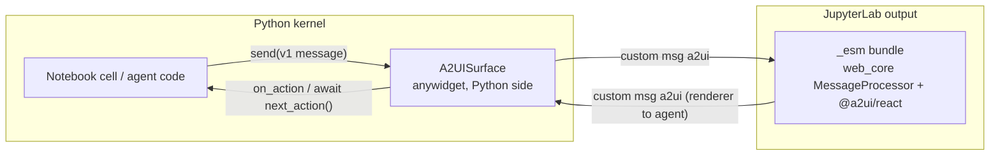

# JupyterLab renderer for A2UI v1.0

_Status: Draft_

_Author: A2UI Team_

_Created: 2026-11-11_

## Summary

This proposal adds a JupyterLab renderer that displays A2UI v1.0 surfaces as notebook output and returns user actions to the Python kernel. The renderer is an [anywidget](https://anywidget.dev) that wraps the React renderer in [typescript/renderers/react](../../typescript/renderers/react). It depends only on JupyterLab, ipykernel, and anywidget. It does not depend on xeus-x.

Two capabilities are required:

- **Enriched display**: a surface renders as cell output.
- **Enriched input**: a cell can wait for a user action and continue with the submitted data.

A feasibility spike confirmed both on a stock ipykernel (see [Feasibility](#feasibility)). Enriched input works only as an awaited wait. A blocking wait never receives frontend messages.

## Feasibility

### Method

The spike ran a real kernel through `jupyter_client` with ipykernel 7.4.0, anywidget 0.11.0, ipywidgets 8.1.9, and Python 3.14. It sent the same shell-channel `comm_msg` frames that the frontend widget manager sends. It did not run the JupyterLab browser UI, so browser rendering is still unverified (see [Open items](#open-items)).

### Results

| Check                       | Question                                                                                                | Result                                                                                               |
| --------------------------- | ------------------------------------------------------------------------------------------------------- | ---------------------------------------------------------------------------------------------------- |
| A. Display                  | Does a widget as the last expression produce the widget-view MIME and ship `_esm` on comm open?         | Pass. `application/vnd.jupyter.widget-view+json` is present, and `_esm` is in the `comm_open` state. |
| B. Awaited input            | Can a cell `await` a frontend submit and resume with its values?                                        | Pass. The cell printed `SUBMITTED {'name': 'Ada'}`.                                                  |
| C. Blocking input (control) | Does a blocking loop receive the same submit?                                                           | Fails, as expected. The loop saw `[]`. Blocking waits must not be used.                              |
| D. Non-blocking input       | Are a custom message and a state update stored while the kernel is idle and readable from a later cell? | Pass. A later cell read `[{'type': 'submit', ...}]` and `{'name': 'Ada'}`.                           |

Check B depends on a branch in ipykernel 7.4.0's `kernelbase.py` that dispatches `comm_msg` while an async cell is running. The system ipykernel 7.3.0 does not have that branch, so this design requires `ipykernel>=7.4`.

Test pitfall: ipywidgets opens an extra comm at import time. A test must read the widget's comm ID from the kernel (`probe.comm.comm_id`), not from the first `comm_open` it sees. Using the first one sends the submit to the wrong comm and makes B and D look broken.

**Conclusion:** both features are feasible on stock JupyterLab and ipykernel. Enriched input must be awaited, not blocking.

## Protocol target

- **Version:** A2UI v1.0, defined in [specification/v1_0](../../specification/v1_0). Every message carries `"version": "1.0"`. The normative reference is [specification/v1_0/docs/a2ui_protocol.md](../../specification/v1_0/docs/a2ui_protocol.md).
- **Agent to renderer** (sent by the kernel): `createSurface` (with `catalogId`), `updateComponents`, `updateDataModel`, `deleteSurface`, `callRendererFunction`, `agentFunctionResponse`.
- **Renderer to agent** (sent by the browser): `action` (required `name`, `surfaceId`, `sourceComponentId`, `timestamp`, `context`; optional `userMessage`, `metadata`), `callAgentFunction`, `rendererFunctionResponse`, `error`. Schema: [specification/v1_0/json/renderer_to_agent.json](../../specification/v1_0/json/renderer_to_agent.json).
- **Catalog:** the v1 basic catalog, `@a2ui/web_core/catalogs/basic/v1`.
- **v0.9 (optional):** web_core's adapter registry in [factory.ts](../../typescript/core/web_core/src/processing/adapters/factory.ts) also handles 0.9 and 0.9.1.

## Existing renderer

`@a2ui/react` (version 0.15.0) exposes `A2uiSurface`, which takes a web_core `SurfaceModel`.

- Its source imports `@a2ui/web_core/v0_9/*`, and its build entries are `index`, `v0_8/index`, and `v0_9/index` ([tsup.config.ts](../../typescript/renderers/react/tsup.config.ts)). **v0.9 is native to the React renderer.**
- Its source has no v1.0 entry point. The only v1.0 wiring is [v1_0_surface.test.tsx](../../typescript/renderers/react/tests/v1_0_surface.test.tsx). That test builds a `MessageProcessor` from `@a2ui/web_core` with the v1 basic catalog and passes `processor.model.getSurface(...)` to `A2uiSurface`. It passes 13 of 13 tests after `web_core` is built (`corepack yarn build` in `typescript/core/web_core`). It does not cover action dispatch.

**Design consequence:** the browser side runs web_core's `MessageProcessor` for the chosen version, and `A2uiSurface` renders the resulting surface. Rendering for v1.0 is verified. Action dispatch is not, and the fix must be tested before the bridge ships. If the pattern needs more wiring, add a `v1_0` entry point to the React package. That change is out of scope for this proposal.

The React build externalizes `react`, `react-dom`, and `markdown-it` ([tsup.config.ts](../../typescript/renderers/react/tsup.config.ts)). anywidget needs one self-contained ES module, so the bundle must inline them. A v1.0 entry (`A2uiSurface`, `MessageProcessor`, and the v1 basic catalog) bundled with esbuild in production mode is 709,076 bytes minified and 198,002 bytes gzipped, with React 19.2.7 inlined.

## Architecture



### Components

1. **Bundle** (proposed `typescript/renderers/jupyter/`): a Yarn workspace, `@a2ui/jupyter`. esbuild bundles web_core, `@a2ui/react`, and React into one ES module (`_esm`). The React styles entry is emitted as `_css`. The workspace provides the five canonical scripts from [AGENTS.md](../../AGENTS.md) section 5 and is registered in the root `workspaces`.
2. **Python package** (proposed `python/a2ui_jupyter/`): an `AnyWidget` subclass. `_esm` and `_css` point at the built files. anywidget reads file paths and uses their contents. The public API is exported from the package's `__init__.py`.
3. **Message bridge** (type-agnostic):
    - Kernel to browser: each v1 message is sent as a custom message `{"type": "a2ui", "message": ...}`, in the order it was sent.
    - Browser to kernel: every renderer-to-agent message is forwarded as `{"type": "a2ui", "message": ...}`. The bridge does not inspect message types.
    - Custom messages carry the message stream. Synced traits carry state only.
4. **Replay log:** the widget keeps the ordered v1 messages in a synced trait, so a reopened notebook can rebuild its surfaces. Live updates still use custom messages.
5. **Data flow:** user input stays in the browser's web_core data model. An `action` carries the resolved `context`, so the kernel gets input from the action. This avoids a second data-model sync. The spec ([a2ui_protocol.md](../../specification/v1_0/docs/a2ui_protocol.md)) requires the renderer to resolve all dynamic bindings in `context` before sending `action`. web_core's `resolveActionEventObject` ([data-context.ts](../../typescript/core/web_core/src/resolution/data-context.ts)) resolves `context` entries in declared order, then `userMessage`. It stops at the first failure, so no action is sent. Asynchronous agent-function calls settle before the next entry. The bridge must therefore handle a delayed or dropped action.
6. **Interrupt and restart:** the kernel behaviour the bridge must handle is in the [Python API](#python-api-proposed) section.
7. **IOPub rate limit:** `jupyter_server` drops iopub messages silently once a rate limit is exceeded (see [Testing plan](#testing-plan)). A2UI updates can exceed the default limit, so the bridge must batch or throttle them.

## Python API (proposed)

```python
from a2ui_jupyter import A2UISurface

surface = A2UISurface()               # enriched display: renders as cell output
surface.send(messages)                # v1 createSurface, updateComponents, ...

surface.on_action(handle)             # non-blocking: called when the user acts
action = await surface.next_action()  # enriched input: the cell resumes with the action
```

- `on_action` and `next_action` both receive the same renderer-to-agent `action` message.
- `next_action` requires top-level `await` on `ipykernel>=7.4`. A blocking wait cannot receive it (check C).
- **Interrupt:** an interrupt (SIGINT or `interrupt_request`) cancels the awaited future with `asyncio.CancelledError`. It does not raise `KeyboardInterrupt`. The `CancelledError` is not shown until the next `execute_request`, and the first cell after an interrupt loses its own output. Shell replies then run one behind. The kernel is usable again after about two follow-up cells. `next_action` must not swallow `CancelledError`. Clients must match `execute_reply` by `parent_header.msg_id`, not by order.
- **Restart:** a restart drops the pending cell silently. It produces no output and no reply. The namespace and the widget are lost. The replay log must be re-sent in the new kernel, which requires re-running the cell that creates the widget. An existing frontend widget cannot reach the new kernel.
- The default protocol is v1.0. `A2UISurface(version="0.9")` selects the web_core v0.9 adapter, as an optional later addition.

## Security

- The bridge accepts only JSON A2UI messages. The browser never evaluates agent-supplied code.
- The kernel validates every inbound `action` against the v1 schema before it reaches user code.
- Agent-supplied Markdown must not enable raw HTML. The implementation should use the React renderer's defaults.

## Testing plan

- **Kernel (Python):** a pytest suite using `jupyter_client` reproduces checks A, B, and D from the spike. Check C stays as a documented negative control. The suite reads the widget's comm ID from the kernel. It also covers interrupt and restart: the cancel path, reply correlation by `msg_id`, and kernel recovery after two follow-up cells.
- **IOPub rate limit:** the rate-limit logic is in `jupyter_server/services/kernels/connection/channels.py` (`_limit_rate`). Defaults are 1000 messages per second (`iopub_msg_rate_limit`), 1,000,000 bytes per second for `stream` output (`iopub_data_rate_limit`), and a 3-second window. Only `status`, `comm_open`, and `execute_input` are exempt from the message count, so `comm_msg` counts. A test must send a burst above the limit and check that the client still gets every A2UI message.
- **Bundle (TypeScript):** vitest tests for the bridge: in-order delivery, action forwarding, and v1.0 surface rendering using the pattern from `v1_0_surface.test.tsx`. Add v0.9 coverage if the optional version is implemented.
- **Browser:** run JupyterLab 4 headless, execute a cell that displays a surface, click a button, and check that `next_action()` resolves in the kernel. This is the gate for enriched input in the real frontend.

## Open items

Verified:

1. **Context rules:** the spec and web_core agree. The renderer resolves `context` before sending `action`, and the agent gets values only through `context`. See [Architecture](#architecture), item 5.
2. **Interrupt and restart:** probed on ipykernel 7.4.0 with a real kernel. See [Python API](#python-api-proposed).
3. **React v1.0 rendering:** `v1_0_surface.test.tsx` passes 13 of 13 after `web_core` is built.
4. **Bundle size:** 709,076 bytes minified, 198,002 bytes gzipped, with React inlined (v1.0 entry, production mode).
5. **IOPub rate limit:** confirmed from the `jupyter_server` source (defaults above). The end-to-end effect is not yet tested.

Remaining:

1. **Browser rendering** in JupyterLab is unverified. The spike drove only the kernel protocol. A headless JupyterLab test is the gate for enriched input.
2. **v1.0 action dispatch:** `v1_0_surface.test.tsx` covers rendering only. Action dispatch and `context` resolution need a test before the bridge ships.
3. **ipykernel floor:** JupyterLab 4.6.6 requires `ipykernel>=6.5.0,!=6.30.0`, not 7.4. The interrupt and reply behaviour was tested only on 7.4.0. The package must declare `ipykernel>=7.4` so pip upgrades the host kernel. Older versions must be tested before they are supported.
4. **Replay log limits:** not measured. The state lives in the widget trait, and its size is unknown. Tornado's default `max_message_size` is 10 MB, but it limits only inbound client messages. Whether the trait is saved into the notebook file has not been checked.
5. **IOPub rate limit end to end:** whether the default limit drops A2UI messages in practice has not been tested. The bridge design depends on the answer.

## Relationship to xeus-x

This design does not use xeus-x or its APIs. It depends only on ipykernel and anywidget.
