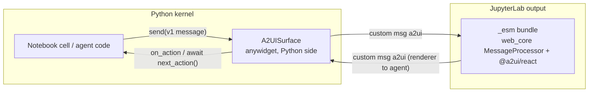

# JupyterLab renderer for A2UI v1.0

_Status: Draft_

_Author: A2UI Team_

_Created: 2026-11-11_

## Summary

This proposal adds a JupyterLab renderer that displays A2UI v1.0 surfaces as notebook output and returns user actions to the Python kernel. The renderer is an [anywidget](https://anywidget.dev) that wraps the React renderer in [typescript/renderers/react](../../typescript/renderers/react). It depends only on anywidget. It does not require a specific kernel package, and it does not depend on xeus-x.

Two capabilities are required:

- **Enriched display**: a surface renders as cell output.
- **Enriched input**: a cell can wait for a user action and continue with the submitted data.

The recorded feasibility spike reports that both capabilities work with a stock IPython kernel (see [Feasibility](#feasibility)). Treat the result as preliminary: the probe is not checked in, and enriched input must be awaited rather than blocked.

## Feasibility

### Method

The proposal records a spike against a real kernel using `jupyter_client`, IPython kernel 7.4.0, anywidget 0.11.0, ipywidgets 8.1.9, and Python 3.14. The spike script and its environment are not in this repository, so these results are reported rather than independently reproducible here. It did not run the JupyterLab browser UI.

### Results

| Check                       | Question                                                                                                | Result                                                                                                          |
| --------------------------- | ------------------------------------------------------------------------------------------------------- | --------------------------------------------------------------------------------------------------------------- |
| A. Display                  | Does a widget as the last expression produce the widget-view MIME and ship `_esm` on comm open?         | Reported pass. `application/vnd.jupyter.widget-view+json` was present, and `_esm` was in the `comm_open` state. |
| B. Awaited input            | Can a cell `await` a frontend submit and resume with its values?                                        | Reported pass. The cell printed `SUBMITTED {'name': 'Ada'}`.                                                    |
| C. Blocking input (control) | Does a blocking loop receive the same submit?                                                           | Reported failure, as expected. The loop saw `[]`. Do not use blocking waits.                                    |
| D. Non-blocking input       | Are a custom message and a state update stored while the kernel is idle and readable from a later cell? | Reported pass. A later cell read `[{'type': 'submit', ...}]` and `{'name': 'Ada'}`.                             |

The report attributes check B to a branch in IPython kernel 7.4.0's `kernelbase.py` that dispatches `comm_msg` while an async cell is running.

### Kernel compatibility

A real-kernel integration suite, since removed from [python/a2ui_jupyter/tests](../../python/a2ui_jupyter/tests), was run against IPython kernel 6.9.2 on Python 3.11, 6.29.0 on Python 3.12, 6.29.5, 7.0.1, 7.3.0, and 7.4.0. The form example was run in JupyterLab 4.6 with 7.0.1 and 7.4.0. The 6.9.2 run used jupyter-client 7.4.9 and tornado 6.6.1, which are the versions 6.9.2 resolves to; the browser UI was not tested with 6.9.2.

1. IPython kernel 7.4 and newer deliver `comm_msg` to a waiting async cell natively.
2. IPython kernel 6.9.2 to 7.0 do not. While the queue is empty, `a2ui-jupyter` calls [`jupyter-ui-poll`](https://github.com/Kirill888/jupyter-ui-poll), which runs `Kernel.do_one_iteration` to process pending comm messages. `execute_request` messages that arrive during the wait are deferred and run after the cell finishes. The kernel can publish an extra `idle` status while the cell is still waiting; the cell's own `execute_reply` and final `idle` still arrive afterwards.
3. IPython kernel 7.1 to 7.3 removed `do_one_iteration`, so polling cannot run. `jupyter-ui-poll` still lets messages through by replacing the kernel's main lock, but the concurrent dispatch overwrites the shell parent header and the waiting cell's final `idle` is published with the wrong parent. JupyterLab can then show the cell as still running. Awaiting raises `RuntimeError` when one of these versions is installed. On Python 3.12 and newer, a 6.9.2 kernel fails at startup with `ModuleNotFoundError: No module named 'imp'`, because 6.9.2 imports the standard-library `imp` module, which Python 3.12 removed. The package cannot detect this because the kernel never starts.
4. Polling is not used on 7.4, because `jupyter-ui-poll` replaces the main lock with an object that 7.4's `shell_main` cannot use.

Test pitfall: ipywidgets opens an extra comm at import time. A test must read the widget's comm ID from the kernel (`probe.comm.comm_id`), not from the first `comm_open` it sees. Using the first one sends the submit to the wrong comm and makes B and D look broken.

**Conclusion:** the reported kernel-level checks support the feasibility of display and awaited input. They do not verify JupyterLab browser rendering or the complete renderer-to-agent protocol.

## Protocol target

- **Version:** A2UI v1.0, defined in [specification/v1_0](../../specification/v1_0). Every message carries `"version": "1.0"`. The normative reference is [specification/v1_0/docs/a2ui_protocol.md](../../specification/v1_0/docs/a2ui_protocol.md).
- **Agent to renderer** (sent by the kernel): `createSurface` (with `catalogId`), `updateComponents`, `updateDataModel`, `deleteSurface`, `callRendererFunction`, `agentFunctionResponse`.
- **Renderer to agent** (sent by the browser): `action` (required `name`, `surfaceId`, `sourceComponentId`, `timestamp`, `context`; optional `userMessage`, `metadata`), `callAgentFunction`, `rendererFunctionResponse`, `error`. Schema: [specification/v1_0/json/renderer_to_agent.json](../../specification/v1_0/json/renderer_to_agent.json).
- **Catalog:** the v1 basic catalog, `@a2ui/web_core/catalogs/basic/v1`.
- **v0.9 (optional):** web_core's adapter registry in [factory.ts](../../typescript/core/web_core/src/processing/adapters/factory.ts) also handles 0.9 and 0.9.1.

## Existing renderer

`@a2ui/react` (version 0.15.0) exposes `A2uiSurface`, which takes a web_core `SurfaceModel`.

- Its source imports `@a2ui/web_core/v0_9/*`, and its build entries are `index`, `v0_8/index`, and `v0_9/index` ([tsup.config.ts](../../typescript/renderers/react/tsup.config.ts)). **v0.9 is native to the React renderer.**
- Its source has no v1.0 entry point. The only v1.0 wiring is [v1_0_surface.test.tsx](../../typescript/renderers/react/tests/v1_0_surface.test.tsx). That test builds a `MessageProcessor` from `@a2ui/web_core` with the v1 basic catalog and passes `processor.model.getSurface(...)` to `A2uiSurface`. It contains 13 tests, all about rendering and component behavior; it does not cover action dispatch or the message bridge. After building `web_core`, `corepack yarn workspace @a2ui/react exec vitest run tests/v1_0_surface.test.tsx` passed all 13 tests in this checkout.

**Design consequence:** the browser side runs web_core's `MessageProcessor` for the chosen version, and `A2uiSurface` renders the resulting surface. The checked-in test source covers v1.0 rendering, but not action dispatch. Action dispatch and the bridge must be tested before release. If the pattern needs more wiring, add a `v1_0` entry point to the React package. That change is out of scope for this proposal.

The React build externalizes `react`, `react-dom`, and `markdown-it` ([tsup.config.ts](../../typescript/renderers/react/tsup.config.ts)). anywidget needs one self-contained ES module, so the bundle must inline them. A v1.0 entry (`A2uiSurface`, `MessageProcessor`, and the v1 basic catalog) bundled with esbuild in production mode is 709,076 bytes minified and 198,002 bytes gzipped, with React 19.2.7 inlined.

## Architecture



### Components

1. **Bundle** (proposed `typescript/renderers/jupyter/`): a Yarn workspace, `@a2ui/jupyter`. esbuild bundles web_core, `@a2ui/react`, and React into one ES module (`_esm`). The React styles entry is emitted as `_css`. The workspace provides the five canonical scripts from [AGENTS.md](../../AGENTS.md) section 5 and is registered in the root `workspaces`.
2. **Python package** (proposed `python/a2ui_jupyter/`): an `AnyWidget` subclass. `_esm` and `_css` point at the built files. anywidget reads file paths and uses their contents. The public API is exported from the package's `__init__.py`.
3. **Message bridge**:
    - Kernel to browser: each v1 message is sent as a custom message `{"type": "a2ui", "message": ...}`, in the order it was sent.
    - Browser to kernel: every renderer-to-agent message is forwarded as `{"type": "a2ui", "message": ...}`. The bridge validates the full v1 renderer-to-agent schema before exposing a message to Python code.
    - The Python API exposes every valid renderer-to-agent message. This includes `action`, `callAgentFunction`, `rendererFunctionResponse`, and `error`; agent code can answer `callAgentFunction` with an `agentFunctionResponse`.
    - Custom messages carry the message stream. Synced traits carry state only.
4. **Replay log:** the widget keeps the ordered v1 messages in a synced trait so views displayed later can replay the surface. Live updates use one custom message per message. The trait is synced at most every 200 ms and whenever the surface is displayed, not on every `send`; the frontend orders entries by sequence number and ignores duplicates, so a late sync is safe. Reassigning the trait on every `send` made a burst quadratic: 1,000 updates took 2.6 s in the kernel and 2.9 s end to end, compared with 74 ms and 353 ms after coalescing (JupyterLab 4.6, IPython kernel 7.4). The log is unbounded, and saved widget state includes it and the ~900 KB `_esm` bundle for every widget.
5. **Data flow:** for an `action`, the renderer resolves the declared `context` bindings before sending the action. The v1 schema requires `context`; web_core's `resolveActionEventObject` ([data-context.ts](../../typescript/core/web_core/src/resolution/data-context.ts)) resolves context entries in declared order, then `userMessage`, and stops on the first failure. Its `SurfaceModel` awaits the resolved payload before emitting `onAction` ([surface-model.ts](../../typescript/core/web_core/src/state/surface-model.ts)). This contract applies to `action` only: `callAgentFunction.callFunction.args` is a separate renderer-to-agent data path and may contain resolved values. Do not synchronize the full data model as part of this design. Async context expressions can call an agent function, so the bridge must receive that call and return its matching `agentFunctionResponse` while the action is pending.
6. **Interrupt and restart:** awaited waits are cancellable and volatile kernel state is lost on restart. The specific behavior recorded by the spike is not yet a tested API guarantee; see [Python API](#python-api-proposed) and [Open items](#open-items).
7. **IOPub rate limit:** preserve message order and do not silently drop updates. The applicable `jupyter_server` version and rate-limit configuration vary by host and were not available in this checkout; test the transport strategy against supported JupyterLab deployments before choosing batching or throttling.

## Python API (proposed)

```python
from a2ui_jupyter import A2UISurface

surface = A2UISurface()               # enriched display: renders as cell output
surface.send(messages)                # validated v1 agent-to-renderer messages
surface.on_message(handle)            # all renderer-to-agent messages
message = await surface.next_message()

surface.on_action(handle)             # non-blocking: called when the user acts
action = await surface.next_action()  # enriched input: the cell resumes with the action
```

- `on_action` and `next_action` both receive the same renderer-to-agent `action` message.
- `on_message` and `next_message` expose all validated renderer-to-agent messages, including function calls and renderer responses. Agent code must return `agentFunctionResponse` messages through `send` to settle renderer-initiated function calls.
- `next_action` and `next_message` require top-level `await`; blocking waits cannot receive frontend messages. See [Kernel compatibility](#kernel-compatibility) for supported IPython kernel versions. Installing a package dependency does not upgrade an already-running kernel; the package and kernel must use a compatible environment.
- The renderer never hides or disables a surface after an action. As in the other renderers and sample hosts, the agent owns the surface lifecycle: after an action it sends `updateComponents`, `updateDataModel`, or `deleteSurface`, or it disables the Button with an `@checks` rule bound to the data model. Clicks made before that update arrives are queued, so a later `next_action()` can return a stale action.
- **Interrupt:** the spike report says an interrupt cancels the awaited future with `asyncio.CancelledError`, not `KeyboardInterrupt`, and describes delayed error display and shell replies running behind. These details have not been independently reproduced. The API must propagate cancellation and must not swallow `CancelledError`. Tests must correlate `execute_reply` by `parent_header.msg_id`, not arrival order.
- **Restart:** a restart loses the pending cell, namespace, and widget connection. Re-running the cell that creates the widget is required; an existing frontend widget cannot connect to the new kernel. The report's exact no-reply behavior remains to be reproduced, and replay state persistence is a separate open question.
- The default protocol is v1.0. `A2UISurface(version="0.9")` selects the web_core v0.9 adapter, as an optional later addition.

## Security

- The bridge accepts only JSON A2UI messages. The browser never evaluates agent-supplied code.
- The kernel validates every inbound renderer-to-agent message against the v1 schema before it reaches user code.
- Agent-supplied Markdown must not enable raw HTML. The implementation should use the React renderer's defaults.

## Testing plan

- **Kernel (Python):** check in a pytest suite that runs against a real kernel to reproduce checks A-D and interrupt/restart behavior. Read the widget's comm ID from the kernel. Cover cancellation, reply correlation by `msg_id`, kernel recovery, and delivery of every renderer-to-agent message type.
- **IOPub rate limit:** record the tested `jupyter_server` version and configuration. Send a burst above the configured limit and verify that the bridge preserves order and delivers every A2UI message; do not assume one version's defaults apply to all hosts.
- **Bundle (TypeScript):** add bridge tests for validation, ordered delivery, actions, `callAgentFunction`/`agentFunctionResponse` round trips, renderer responses, and errors. Keep v0.9 out of scope unless the optional version is implemented.
- **Browser:** run JupyterLab headless, execute a cell that displays a surface, click a button, and check that `next_action()` resolves in the kernel. Also verify a context that waits for `callAgentFunction`. This is the gate for enriched input in the real frontend.
- **Replay:** save and reopen a notebook with widget state, verify surface reconstruction, and measure trait/log growth for repeated updates before setting a retention or compaction policy.

## Open items

Checked in repository source:

1. **Action context:** the v1 schema requires `action.context`; web_core resolves action context before dispatch and suppresses dispatch on resolution failure. `callAgentFunction` is a separate renderer-to-agent path, so the previous claim that values reach the agent only through `context` was incorrect.
2. **React v1.0 rendering coverage:** `v1_0_surface.test.tsx` passes 13 of 13 after building `web_core`. The tests have no action or bridge assertions.
3. **Message contract:** the v1 schema includes `action`, `callAgentFunction`, `rendererFunctionResponse`, and `error` from renderer to agent, plus `agentFunctionResponse` from agent to renderer. The bridge and Python API must support these messages, not only actions.

Not independently verified:

1. **Kernel spike:** the results above, including the IPython kernel 7.4.0 behavior, are recorded in this proposal, but the probe and environment are not checked in.
2. **Interrupt/restart:** no reproducible test artifact is available. Keep the cancellation and reply behavior provisional until the Python integration suite covers it.
3. **Bundle size:** 709,076 bytes minified and 198,002 bytes gzipped were reported for an esbuild production bundle with React inlined. The bundle entry, command, and generated artifact are not checked in, so the measurement cannot be repeated from this checkout.
4. **IOPub limit:** the cited `jupyter_server` source and version are not available here. Verify the defaults and end-to-end delivery behavior against each supported host configuration.
5. **Replay:** replaying 1,302 messages into a newly displayed view took 78 ms, but notebook save/reopen behavior and a log retention policy have not been tested.
6. **Browser and action flow:** JupyterLab rendering, action dispatch, asynchronous context resolution, and the full agent-function round trip remain untested.
7. **Compatibility:** the kernel versions in [Kernel compatibility](#kernel-compatibility) were tested locally. CI runs only the version resolved in `uv.lock`, and only JupyterLab 4.6 was tried in a browser.

## Relationship to xeus-x

This design does not use xeus-x or its APIs. It depends only on anywidget.
