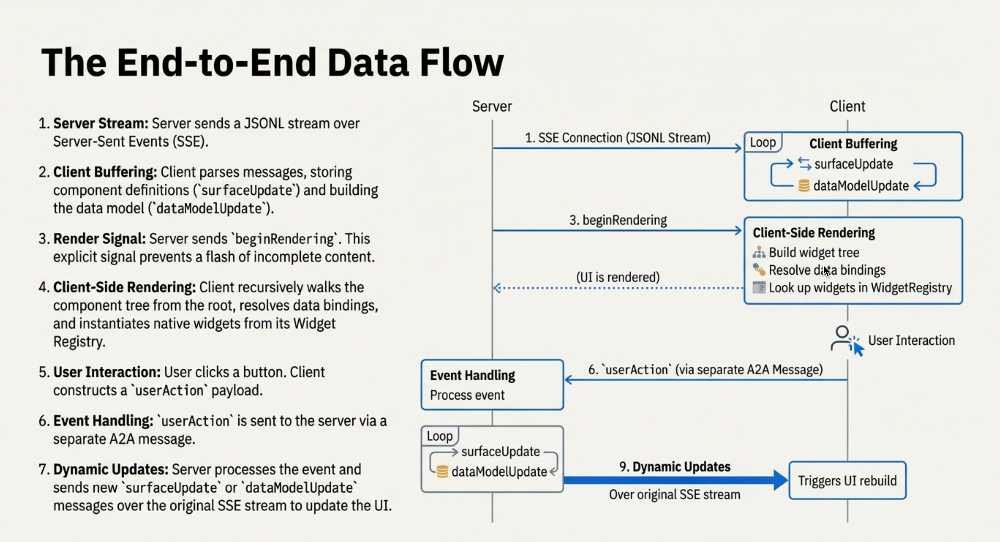

# Data Flow

How messages flow from agents to UI.

## Architecture

```
Agent (LLM) → A2UI Generator → Transport (SSE/WS/A2A)
                                      ↓
Client (Stream Reader) → Message Parser → Renderer → Native UI
```



## Message Format

A2UI defines a sequence of JSON messages that describe the UI. When streamed, these messages are often formatted as **JSON Lines (JSONL)**, where each line is a complete JSON object.

=== "v1.0"

    ```jsonl
    {
      "version": "1.0",
      "createSurface": {
        "surfaceId": "main",
        "catalogId": "https://a2ui.org/specification/v1_0/catalogs/basic/catalog.json"
      }
    }
    {
      "version": "1.0",
      "updateComponents": {
        "surfaceId": "main",
        "components": [...]
      }
    }
    {
      "version": "1.0",
      "updateDataModel": {
        "surfaceId": "main",
        "path": "/user",
        "value": { "name": "Alice" }
      }
    }
    ```

=== "v0.9.1"

    ```jsonl
    {
      "version": "v0.9",
      "createSurface": {
        "surfaceId": "main",
        "catalogId": "https://a2ui.org/specification/v0_9/catalogs/basic/catalog.json"
      }
    }
    {
      "version": "v0.9",
      "updateComponents": {
        "surfaceId": "main",
        "components": [...]
      }
    }
    {
      "version": "v0.9",
      "updateDataModel": {
        "surfaceId": "main",
        "path": "/user",
        "value": { "name": "Alice" }
      }
    }
    ```

**Why this format?**

A sequence of self-contained JSON objects is streaming-friendly, easy for LLMs to generate incrementally, and resilient to errors.

## Lifecycle Example: Restaurant Booking

**User:** "Book a table for 2 tomorrow at 7pm"

=== "v1.0"

    **1. Agent creates surface:**

    ```json
    {
      "version": "1.0",
      "createSurface": {
        "surfaceId": "booking",
        "catalogId": "https://a2ui.org/specification/v1_0/catalogs/basic/catalog.json"
      }
    }
    ```

    **2. Agent defines UI structure:**

    ```json
    {
      "version": "1.0",
      "updateComponents": {
        "surfaceId": "booking",
        "components": [
          {
            "id": "root",
            "component": "Column",
            "children": {"@child": ["header", "guests-field", "submit-btn"]}
          },
          {
            "id": "header",
            "component": "Text",
            "text": "# Confirm Reservation"
          },
          {
            "id": "guests-field",
            "component": "TextField",
            "label": "Guests",
            "value": { "@path": "/reservation/guests" }
          },
          {
            "id": "submit-btn",
            "component": "Button",
            "child": {"@child": "submit-text"},
            "variant": "primary",
            "action": {
              "@action": {
                "name": "confirm",
                "context": {
                  "details": { "@path": "/reservation" }
                }
              }
            }
          },
          {
            "id": "submit-text",
            "component": "Text",
            "text": "Confirm"
          }
        ]
      }
    }
    ```

    **3. Agent populates data:**

    ```json
    {
      "version": "1.0",
      "updateDataModel": {
        "surfaceId": "booking",
        "path": "/reservation",
        "value": {
          "datetime": "2025-12-16T19:00:00Z",
          "guests": "2"
        }
      }
    }
    ```

    In v1.0, `createSurface` can also carry the initial `components` and `dataModel`, so steps 1 to 3 can be one message.

    **4. User edits guests to "3"** → Client updates `/reservation/guests` automatically

    **5. User clicks "Confirm"** → Client sends action:

    ```json
    {
      "version": "1.0",
      "action": {
        "name": "confirm",
        "surfaceId": "booking",
        "sourceComponentId": "submit-btn",
        "timestamp": "2025-12-15T18:30:00Z",
        "context": {
          "details": {
            "datetime": "2025-12-16T19:00:00Z",
            "guests": "3"
          }
        }
      }
    }
    ```

    **6. Agent responds** → Updates UI or sends:

    ```json
    {
      "version": "1.0",
      "deleteSurface": { "surfaceId": "booking" }
    }
    ```

=== "v0.9.1"

    **1. Agent creates surface:**

    ```json
    {
      "version": "v0.9",
      "createSurface": {
        "surfaceId": "booking",
        "catalogId": "https://a2ui.org/specification/v0_9/catalogs/basic/catalog.json"
      }
    }
    ```

    **2. Agent defines UI structure:**

    ```json
    {
      "version": "v0.9",
      "updateComponents": {
        "surfaceId": "booking",
        "components": [
          {
            "id": "root",
            "component": "Column",
            "children": ["header", "guests-field", "submit-btn"]
          },
          {
            "id": "header",
            "component": "Text",
            "text": "Confirm Reservation",
            "variant": "h1"
          },
          {
            "id": "guests-field",
            "component": "TextField",
            "label": "Guests",
            "value": { "path": "/reservation/guests" }
          },
          {
            "id": "submit-btn",
            "component": "Button",
            "child": "submit-text",
            "variant": "primary",
            "action": {
              "event": {
                "name": "confirm",
                "context": {
                  "details": { "path": "/reservation" }
                }
              }
            }
          },
          {
            "id": "submit-text",
            "component": "Text",
            "text": "Confirm"
          }
        ]
      }
    }
    ```

    **3. Agent populates data:**

    ```json
    {
      "version": "v0.9",
      "updateDataModel": {
        "surfaceId": "booking",
        "path": "/reservation",
        "value": {
          "datetime": "2025-12-16T19:00:00Z",
          "guests": "2"
        }
      }
    }
    ```

    **4. User edits guests to "3"** → Client updates `/reservation/guests` automatically

    **5. User clicks "Confirm"** → Client sends action:

    ```json
    {
      "version": "v0.9",
      "action": {
        "name": "confirm",
        "surfaceId": "booking",
        "sourceComponentId": "submit-btn",
        "timestamp": "2025-12-15T18:30:00Z",
        "context": {
          "details": {
            "datetime": "2025-12-16T19:00:00Z",
            "guests": "3"
          }
        }
      }
    }
    ```

    **6. Agent responds** → Updates UI or sends:

    ```json
    {
      "version": "v0.9",
      "deleteSurface": { "surfaceId": "booking" }
    }
    ```

## Transport Options

A2UI is transport-agnostic — any mechanism that can deliver JSON messages works:

- **[A2A Protocol](https://a2a-protocol.org/)**: Standardized agent-to-agent communication, also used for agent-to-UI delivery
- **[AG-UI](https://ag-ui.com/)**: Bidirectional, real-time agent-UI protocol
- **REST / HTTP**: Simple request-response or Server-Sent Events (SSE) for one-way streaming
- **WebSocket**: Persistent bidirectional connection, ideal for real-time updates and user actions
- **Any other transport**: gRPC, message queues, custom protocols — if it can carry JSON, it works

See [transports](transports.md) for implementation details.

## Progressive Rendering

Instead of waiting for the entire response to be generated before showing anything to the user, chunks of the response can be streamed to the client as they are generated and progressively rendered.

Users see UI building in real-time instead of staring at a spinner.

## Error Handling

The system handles errors as follows:

- **Malformed messages:** Skip and continue, or send error back to agent for correction.
- **Network interruptions:** Display error state, reconnect, agent resends or resumes.

## Performance

To optimize performance:

- **Batching:** Buffer updates for 16ms, batch render together.
- **Diffing:** Compare old/new components, update only changed properties.
- **Granular updates:** Update `/user/name` not entire `/` model.
