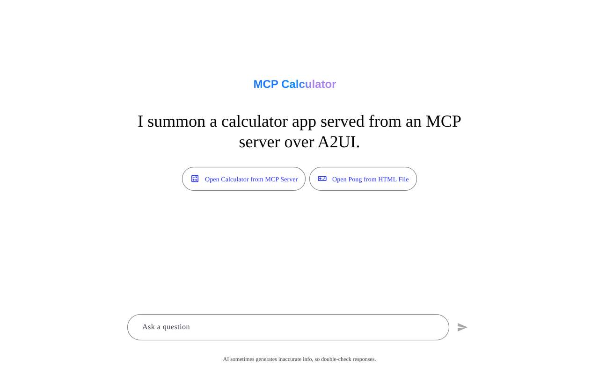
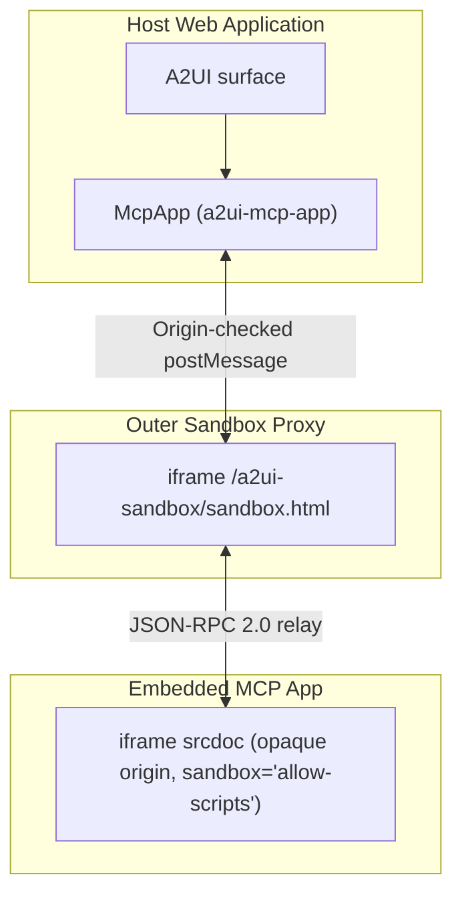
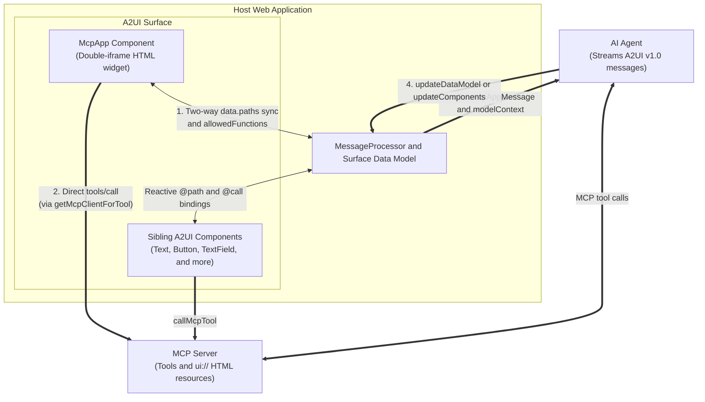
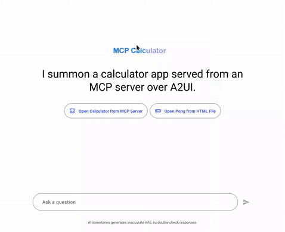
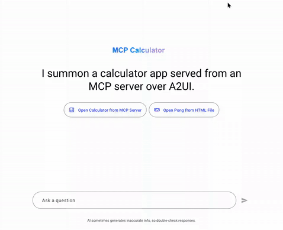

# MCP Apps in A2UI

**[Model Context Protocol (MCP) Apps](https://github.com/modelcontextprotocol/ext-apps)** let MCP servers deliver interactive HTML user interfaces, such as a 3D canvas or a drag-and-drop Kanban board, alongside their tools. A2UI runs these third-party applications inside an isolated sandbox on the surface while synchronizing state and tool calls with sibling A2UI components and your agent.

This guide explains how `McpApp` isolates untrusted HTML inside a double-iframe sandbox and how JSON-RPC messages synchronize state and tool calls across the widget, the surface, and your agent. It also walks through running the multi-service sample applications locally.

!!! tip "Looking for package setup?"

    To install `@a2ui/catalog-mcp`, invoke MCP tools with `callMcpTool`, or add `McpApp` to your own web app, start with the [MCP catalog](mcp-catalog.md) guide. If you are building an MCP server that returns A2UI JSON layouts instead of HTML widgets, see [A2UI over MCP](a2ui_over_mcp.md).



---

## Double-iframe isolation

To run untrusted third-party HTML and JavaScript safely inside your web app, `@a2ui/catalog-mcp` isolates every `McpApp` instance inside two nested iframes connected by a validated JSON-RPC `postMessage` relay.

### Why a single iframe is not enough

A single iframe with both `allow-scripts` and `allow-same-origin` shares your application's origin. Any script running inside that frame can reach `window.parent.document`, read host cookies or web storage, or remove its own `sandbox` attribute.

To prevent container escapes, the innermost iframe where the third-party HTML runs never receives `allow-same-origin`. The browser assigns it a unique opaque origin (`null`), blocking access to the host DOM and host storage.

### Outer proxy and inner frame

Each `McpApp` instance sets up two frames:

1. The outer frame loads `sandbox.html` from `/a2ui-sandbox/` on your app's origin (or from a separate sandbox origin configured with `configureMcpCatalog({sandbox: {baseUrl}})`). The host element does not sandbox this outer frame; instead, `sandbox.html` checks that incoming messages come from the expected parent window and origin, configures the inner frame, and relays JSON-RPC messages between the two sides. When `sandbox.html` is hosted on a separate origin, it runs a startup self-test verifying that it cannot reach `window.top`; on the same origin, `@a2ui/catalog-mcp` disables that check automatically.
2. The inner frame renders the untrusted `htmlContent` via `srcdoc` with `sandbox="allow-scripts"` only. Omitting `allow-same-origin` isolates cookies and storage, omitting `allow-top-navigation` and `allow-top-navigation-by-user-activation` stops frame-busting redirects (`window.top.location = "..."`), and omitting `allow-popups`, `allow-forms`, and `allow-modals` blocks unprompted windows, form submissions, and modal dialogs. Before injecting `srcdoc`, the outer proxy applies any Content Security Policy domain allowlists from `csp` (`_meta.ui.csp`) and browser capability flags from `permissions` (`_meta.ui.permissions`, such as `camera`, `microphone`, `geolocation`, and `clipboard-write`).

The physical frame hierarchy looks like this:



To serve `/a2ui-sandbox/` in your bundler and configure `McpApp` properties on a surface, see [Embedding interactive MCP Apps](mcp-catalog.md#embedding-interactive-mcp-apps) in the MCP catalog guide. For the two-phase startup handshake (`ui/notifications/sandbox-proxy-ready`, `ui/notifications/sandbox-resource-ready`, and `ui/initialize`) and full JSON-RPC schemas, see the [MCP App component specification](../../../catalogs/mcp/v1/mcp_app_specification.md).

---

## How embedded apps communicate with the surface and agent

Once the sandbox finishes initializing, `McpApp` communicates with the embedded app over JSON-RPC 2.0 using `@modelcontextprotocol/ext-apps/app-bridge` plus A2UI v1.0 extensions for local data binding and catalog functions. State updates and tool calls can complete directly in the browser or flow through your backend agent:



An embedded app interacts with the surrounding surface and backend through four channels:

1. Two-way local data binding (`data.paths`). When a bound path in the surface data model changes (from a sibling input, a client function, or an `updateDataModel` message from the agent), `McpApp` pushes `ui/notifications/data-model-update` to the embedded app (plus standard `ui/notifications/tool-input` and `ui/notifications/tool-result` notifications when `toolInput` or `toolResult` are bound). When the embedded app emits `ui/notifications/data-model-change`, `McpApp` writes the new value to the bound path so sibling A2UI components update in the browser without waiting for an agent turn.
2. Direct MCP tool execution (`tools/call`). When the embedded app requests a tool listed in `allowedTools` and the host has registered `getMcpClientForTool` via `configureMcpCatalog`, `McpApp` calls the MCP server directly and returns the `CallToolResult` to the app. If no browser MCP client is configured, `McpApp` dispatches an A2UI action named after the tool so a backend proxy agent can execute it instead. Unlisted tool names are rejected with a JSON-RPC error.
3. Local catalog function calls (`ui/requests/function-call`). When `allowedFunctions` maps A2UI catalog function names to JSON Schemas for their arguments, the embedded app can validate arguments and invoke those functions locally on the surface.
4. Agent context and follow-up turns (`ui/update-model-context` and `ui/message`). Calling `ui/update-model-context` inside the app writes the widget's active selection or filter state to the bound `modelContext` path in the surface data model, where your host can attach it to the next user turn. Calling `ui/message` dispatches an `a2ui.mcpAppMessage` action so the host can forward a prompt or event from the widget to the agent, which can then mutate state and stream `updateDataModel` or `updateComponents` back to the surface.

### Sandbox constraints for MCP App authors

Because the inner iframe runs with `sandbox="allow-scripts"` on an opaque `null` origin, keep these constraints in mind when building or debugging an MCP App:

1. Browser storage APIs (`localStorage`, `sessionStorage`, `IndexedDB`, and cookies) throw security errors inside an opaque origin. Store state on the MCP server via `tools/call` or synchronize it with the host surface via `data.paths`.
2. Direct parent DOM access (`window.parent.document` or `window.top`) is blocked by the browser. Request container height updates with `ui/notifications/size-changed`, and open external `http:` or `https:` URLs in a new tab with `ui/open-link`.
3. External network requests, images, fonts, and subframes inside `srcdoc` are blocked by default unless the MCP resource declares the required domains under `_meta.ui.csp` (`connectDomains`, `resourceDomains`, `frameDomains`, `baseUriDomains`).

---

## Running the sample applications

The repository includes runnable multi-process samples under `samples/community/`. Start with the A2UI v1.0 Kanban board showcase, which uses `@a2ui/catalog-mcp` directly. Two earlier pre-v1.0 samples are available in the collapsible section below it.

### Prerequisites

To run the sample applications from a clone of the A2UI repository, install the following tools:

1. Python 3.10 or later for the agent and Python MCP server backends.
2. [`uv`](https://docs.astral.sh/uv/) to install dependencies and launch the Python processes.
3. Node.js 18 or later with Corepack enabled (`corepack enable`) so `yarn` uses the monorepo's configured Yarn workspace manager. In your own standalone projects outside this repository, you can use any Node package manager (such as `npm` or `pnpm`).
4. A `GEMINI_API_KEY` from [Google AI Studio](https://aistudio.google.com/apikey), exported in your shell or saved in a `.env` file inside the agent directory (`echo 'GEMINI_API_KEY=your-api-key' > .env`). The Kanban board showcase can also run without an API key by setting `KANBAN_AGENT=scripted`.

### Kanban board showcase (v1.0)

The Kanban showcase ([`samples/community/mcp/a2ui-kanban/`](../../../samples/community/mcp/a2ui-kanban/README.md)) pairs a Streamable HTTP MCP server (`http://localhost:8788/mcp`) serving a drag-and-drop board app (`ui://kanban/board`), a Python ADK and A2A agent (`http://localhost:10007`), and a Lit chat host (`http://localhost:5173`) built on `basicCatalog` and `mcpCatalog`.

It exercises five interaction paths across the host, the sandboxed widget, the MCP server, and the agent:

1. Agent to `McpApp`: asking the agent to move or create tasks invokes MCP server tools and streams an `updateDataModel` message writing `/kanban/board`, which `McpApp` forwards to the iframe via `ui/notifications/data-model-update`.
2. Agent reading `McpApp` state: selecting a card or filtering by assignee calls `ui/update-model-context`, writing `/kanban/modelContext` and `/kanban/selection` so the agent can answer questions about the selected card on the next turn.
3. `McpApp` to sibling A2UI components: dragging a card across columns sends `ui/notifications/data-model-change` for `board`, updating `/kanban/board` locally and recomputing the sibling `Text` column and WIP badges (bound with `@call: transformData`) before any agent turn runs.
4. `McpApp` to agent: dropping a card (`tools/call` plus `ui/message`) or clicking "Ask agent to split" (`ui/message`) dispatches an `a2ui.mcpAppMessage` action that the chat host forwards to the agent.
5. Sibling A2UI controls to MCP server: entering a title and assignee in the Quick-Add Task Bar and clicking "Add task" chains `callMcpTool("create_task")`, `transformData`, and `updateDataModel` in the browser, updating both the `McpApp` board and the sibling badges with zero agent turns.

Run the showcase across three terminals from the repository root.

#### 1. Build workspace packages and start the MCP server

Build `@a2ui/catalog-mcp` and `@a2ui/lit`, install the `samples/community` workspace dependencies, and start the Kanban MCP server on `http://localhost:8788/mcp`:

```bash
yarn install
yarn workspace @a2ui/catalog-mcp run build
yarn workspace @a2ui/lit run build

cd samples/community
yarn install

cd mcp/a2ui-kanban/mcp-server
yarn build
yarn start
```

#### 2. Start the Kanban agent

In a second terminal, start the Python A2A agent on `http://localhost:10007` (or set `KANBAN_AGENT=scripted` to try the deterministic walkthrough without a Gemini API key):

```bash
cd samples/community/mcp/a2ui-kanban/agent
export GEMINI_API_KEY="your-api-key"  # or: export KANBAN_AGENT=scripted
uv run .
```

#### 3. Start the Lit chat host

In a third terminal, start the Vite dev server on `http://localhost:5173`:

```bash
cd samples/community/mcp/a2ui-kanban/client
yarn dev
```

Open `http://localhost:5173/` in your browser and click **"Show me the sprint board"**. You can also open the collapsible Protocol Debug Inspector on the right side of the page to inspect live A2UI messages, `postMessage` JSON-RPC frames between the host and `McpApp`, browser-to-MCP HTTP calls, and `/kanban` data model writes.

??? note "Legacy pre-v1.0 samples"

    The two samples below predate A2UI v1.0 and `@a2ui/catalog-mcp` (the Calculator and Pong sample uses protocol v0.9 and the standalone Lit sample uses protocol v0.8). Each defines its own sample-local custom component rather than importing `McpApp` from `@a2ui/catalog-mcp`.

    #### Calculator and Pong (Angular v0.9 + proxy agent + MCP server)

    This sample runs an SSE Calculator MCP server, a Python ADK proxy agent, and an Angular client hosting calculator and Pong widgets in separate sandboxed iframes:

    1. Start the Calculator MCP server on `http://localhost:8000` (pass `--port 8001` if port `8000` is in use):

        ```bash
        cd samples/community/mcp/mcp-apps-calculator/
        uv run .
        ```

    2. In a second terminal, start the MCP proxy agent on `http://localhost:10006`:

        ```bash
        cd samples/community/agent/adk/mcp_app_proxy/
        export GEMINI_API_KEY="your-api-key"
        uv run .
        ```

    3. Build the monorepo renderer packages from the repository root, then install and start the Angular client on `http://localhost:4200` (which bundles the sample's sandbox proxy before serving):

        ```bash
        yarn build:all
        cd samples/community/client/angular/
        yarn install
        yarn start mcp_calculator
        ```

    4. Open `http://localhost:4200/?disable_security_self_test=true` in your browser. Because this pre-v1.0 sample serves its proxy iframe on the same `localhost` origin without `@a2ui/catalog-mcp`'s automatic origin check, pass `?disable_security_self_test=true` in the URL to skip the cross-origin self-test during local development:

        | Calculator App | Pong App |
        | :------------: | :------: |
        |  |  |

    #### Standalone Lit MCP App sample (Lit v0.8 + ADK agent)

    This minimal two-process sample pairs an ADK agent with a Lit client to test button actions inside a sandboxed iframe:

    1. Start the ADK agent on `http://localhost:8000`:

        ```bash
        cd samples/community/agent/adk/mcp-apps-in-a2ui-sample
        export GEMINI_API_KEY="your-api-key"
        uv run agent.py
        ```

    2. In a second terminal, install dependencies and start the Lit client on `http://localhost:5173`:

        ```bash
        cd samples/community/client/lit/mcp-apps-in-a2ui-sample
        yarn install
        yarn dev
        ```

    3. Open `http://localhost:5173/` and click **"Call Agent Tool"** inside the iframe to send a tool action through the host to the agent.

---

## Troubleshooting the samples

If a sample fails to build or load, check these common issues:

| Symptom                                                           | Fix                                                                                                                                              |
| :---------------------------------------------------------------- | :----------------------------------------------------------------------------------------------------------------------------------------------- |
| `GEMINI_API_KEY environment variable not set`                     | Export `GEMINI_API_KEY` in that terminal, add a `.env` file in the agent directory, or set `KANBAN_AGENT=scripted` for the Kanban agent.         |
| Kanban client fails to compile `@a2ui/catalog-mcp` or `@a2ui/lit` | Run `yarn install`, `yarn workspace @a2ui/catalog-mcp run build`, and `yarn workspace @a2ui/lit run build` from the repository root first.       |
| Port `8788` or `10007` is already in use on Kanban                | Start the service on another port and pass `?mcp_url=http://localhost:<port>/mcp&agent_url=http://localhost:<port>` to `http://localhost:5173/`. |
| Angular client shows a blank page or missing renderer imports     | Run `yarn build:all` at the repository root before running `yarn start mcp_calculator` in `samples/community/client/angular/`.                   |
| `ng serve` not found in the Angular sample                        | Run `yarn install` inside `samples/community/client/angular/` to install `@angular/cli`.                                                         |
| `"URL with hostname not allowed"` in Angular                      | Open `http://localhost:4200/` rather than `0.0.0.0` (Angular's dev server restricts allowed hosts by default).                                   |
| Security self-test error in the legacy Angular sample             | Append `?disable_security_self_test=true` to `http://localhost:4200/`.                                                                           |

---

## Next steps

1. Install and configure `@a2ui/catalog-mcp` in your own application in the [MCP catalog](mcp-catalog.md) guide.
2. Review the full handshake lifecycle, JSON-RPC message schemas, and cycle-prevention rules in the [MCP App component specification](../../../catalogs/mcp/v1/mcp_app_specification.md).
3. Build an MCP server that returns reusable A2UI component layouts in [A2UI over MCP](a2ui_over_mcp.md).
4. Render A2UI surfaces inside an MCP App in [A2UI in MCP Apps](a2ui-in-mcp-apps.md).
