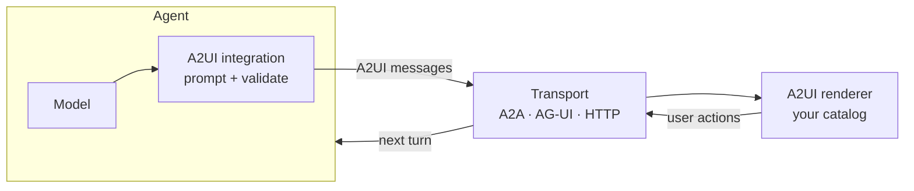

# Agent Integrations

An A2UI agent describes a user interface as data and streams it to a client,
which renders it with components the client already trusts. Your agent
framework does not need to know anything about rendering. It only needs a way
to:

1. **Teach the model your catalog.** Describe the components it may use and
   the A2UI message format.
2. **Capture and validate the output.** Turn what the model writes into A2UI
   messages and check them against the catalog before they reach the client.
3. **Deliver the messages.** Send them to the client over a
   [transport](../concepts/transports.md) such as A2A, AG-UI, or HTTP
   streaming.
4. **Handle user actions.** Treat a button press or form submission on a
   surface as the next turn in the conversation.

The integrations in this section do these four things for you in the agent
framework you already use.

## Choose an integration

| Integration                                   | Agent language                    | Transport                    | Client renderers                                         | Choose it when                                                                                     |
| --------------------------------------------- | --------------------------------- | ---------------------------- | -------------------------------------------------------- | -------------------------------------------------------------------------------------------------- |
| **[ADK](adk.md)**                             | Python                            | A2A, or AG-UI via CopilotKit | Any A2UI renderer                                        | Your agent runs on Google's Agent Development Kit.                                                 |
| **[Genkit](genkit.md)**                       | Dart                              | Genkit streaming HTTP        | Flutter ([GenUI SDK](https://docs.flutter.dev/ai/genui)) | You want one language from server to client with Genkit Dart and Flutter.                          |
| **[CopilotKit](copilotkit.md)**               | Any AG-UI framework               | AG-UI                        | React, Angular, Vue, Slack, any A2UI renderer            | Your agent runs on ADK, LangGraph, Mastra, Strands, CrewAI, or another AG-UI-compatible framework. |
| **[Agent Development](agent-development.md)** | Python (TypeScript, Dart preview) | Any                          | Any A2UI renderer                                        | You use another framework, or no framework, and want to call the A2UI agent SDK directly.          |

Every integration produces the same A2UI messages, so you can change the
agent side later without touching the client, and the reverse.

## Before you start

- **Pick a protocol version.** The SDKs and renderers implement
  [v0.9.1](../specification/v0.9.1-a2ui.md), the current version. Use it
  unless a client you support needs v0.8.
- **Pick a catalog.** Start with the Basic Catalog, then
  [define your own catalog](../guides/defining-your-own-catalog.md) when the
  agent should use your design system's components.
- **Pick a renderer.** See [Client Setup](../guides/client-setup.md) and the
  list of [renderers](../reference/renderers.md).

## Related

- **[Quickstart](../quickstart.md)**: Run an ADK agent with a web client in
  five minutes.
- **[Transports](../concepts/transports.md)**: How A2UI travels over A2A,
  AG-UI, MCP, and HTTP.
- **[Actions](../concepts/actions.md)**: How user interactions return to the
  agent.
- **[A2UI over MCP](../guides/a2ui_over_mcp.md)**: Return A2UI from MCP tools.
