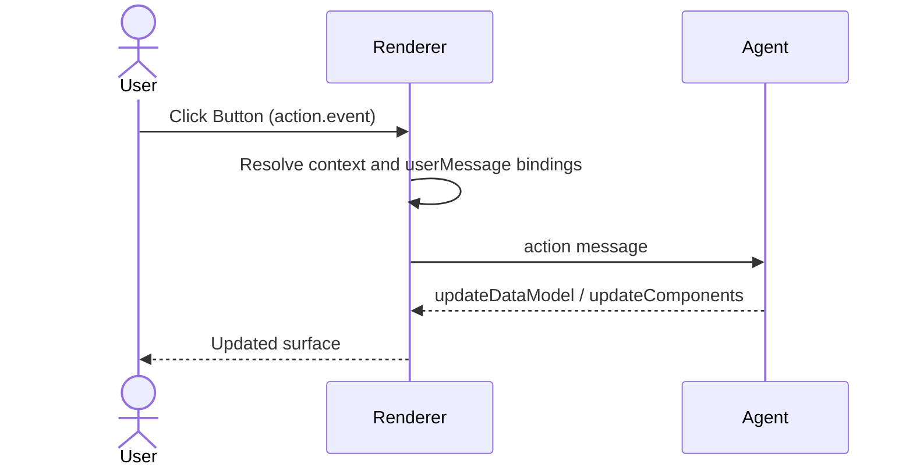

import {Tabs, TabItem, Aside} from '@astrojs/starlight/components';
import ActionFunctionBranches from '@components/docs/actions/ActionFunctionBranches.astro';

An action decides what happens when a user interacts with a component, and a function is a typed operation, defined in a [catalog](../catalogs/), that computes a value, validates input, or performs a client side effect. An action either sends an event to the agent or calls a function. Functions are also used outside actions: to compute component properties, to validate input, and (in v1.0) when the agent asks the renderer to run one.

## Actions, events, and functions

The diagram below starts with a user gesture on a component's `action` property, such as a click on a `Button`. The action has exactly one of two branches. The event branch (`action.event`) resolves its `context` and `userMessage` values from the data model, sends an `action` message to the agent, and the agent responds by streaming UI updates. The function branch (`action.functionCall`) looks up the function name in the renderer's catalog: a registered function runs on the renderer, and in v1.0 an unregistered name is sent to the agent as a `callAgentFunction` request. The lower row shows the three places where functions run without a user gesture: property bindings, validation checks, and `callRendererFunction` requests from the agent.

<ActionFunctionBranches />

The three terms have distinct meanings:

1. An **action** is a property on an interactive component, such as `Button.action`. It is configuration, not a message. Its schema is [`Action`](/specification/v1.0/schemas/#common_types.json/$defs/Action).
2. An **event** is what an action sends to the agent when it uses the `event` branch. It arrives as an `action` message and lets the agent take its next turn.
3. A **function** is a named, typed operation with an `args` object. Components call functions from actions, property bindings, and validation checks.

| Aspect       | Event (`action.event`)               | Function (`@call` in v1.0, `call` in v0.9.1)                    |
| :----------- | :----------------------------------- | :-------------------------------------------------------------- |
| Purpose      | Tells the agent what the user did    | Computes a value, validates input, or performs a side effect    |
| Triggered by | A user gesture on a component action | Actions, property bindings, validation checks, or the agent     |
| Runs on      | The agent, after an `action` message | The renderer, or the agent through `callAgentFunction` (v1.0)   |
| Result       | The agent streams UI updates         | A typed return value, or nothing for side effects such as links |

Use `action.event` when the interaction needs the agent to decide what happens next, for example "Book flight" or "Confirm order". Use `action.functionCall` when the renderer can handle the interaction without an agent turn, for example opening a help link with `openUrl`.

---

## Events

An event carries a user interaction back to the agent as an `action` message.

The following sequence diagram shows what happens when a user clicks a button whose action uses the event branch. The renderer resolves any data bindings in the event's `context` and `userMessage` against the surface data model, sends the resulting `action` message to the agent, and the agent processes the turn and streams `updateDataModel` or `updateComponents` messages back. The renderer then re-renders the surface.



When the renderer sends an event:

1. It resolves each value in `event.context`. Data bindings such as `{"@path": "/selection/seat"}` (v1.0) or `{"path": "/selection/seat"}` (v0.9.1) are replaced with their current values, and literal values are sent unchanged.
2. In v1.0, it also resolves `event.userMessage`, a `DynamicString` that gives the agent a human-readable description of what the user did, such as `"Confirmed flight reservation for ${/passenger/fullName}"`.
3. It sends an [`action`](/specification/v1.0/schemas/#renderer_to_agent.json/properties/action) message with the event name, the surface and component IDs, a timestamp, and the resolved values.

A `Button` can declare validation `checks`. If any check fails, the renderer disables the button, so the event cannot be sent until the data is valid. See [Validation checks](#validation-checks).

If the surface was created with `sendDataModel: true`, the transport also attaches the full surface data model to each outbound message, under `a2uiRendererDataModel` in v1.0 or `a2uiClientDataModel` in v0.9.1. For details, see [Data Model and Data Binding](../data-binding/).

The following example shows a confirmation button and the `action` message the renderer sends when the user clicks it.

<Tabs syncKey="protocol-version">
  <TabItem label="v1.0 (Candidate)">
    ```json
    // Button component:
    {
      "id": "confirm_button",
      "component": "Button",
      "child": "confirm_label",
      "variant": "primary",
      "action": {
        "event": {
          "name": "confirmReservation",
          "userMessage": "Confirmed flight reservation for ${/passenger/fullName}",
          "context": {
            "flightNumber": "UA-402",
            "seat": { "@path": "/selection/seatNumber" }
          }
        }
      }
    }

    // action message sent on click:
    {
      "version": "1.0",
      "action": {
        "name": "confirmReservation",
        "surfaceId": "booking_surface",
        "sourceComponentId": "confirm_button",
        "timestamp": "2026-11-02T03:45:00Z",
        "userMessage": "Confirmed flight reservation for Alex Rivera",
        "context": {
          "flightNumber": "UA-402",
          "seat": "14B"
        }
      }
    }
    ```

  </TabItem>
  <TabItem label="v0.9.1 (Active)">
    ```json
    // Button component:
    {
      "id": "confirm_button",
      "component": "Button",
      "child": "confirm_label",
      "variant": "primary",
      "action": {
        "event": {
          "name": "confirmReservation",
          "context": {
            "flightNumber": "UA-402",
            "seat": { "path": "/selection/seatNumber" }
          }
        }
      }
    }

    // action message sent on click:
    {
      "version": "v0.9",
      "action": {
        "name": "confirmReservation",
        "surfaceId": "booking_surface",
        "sourceComponentId": "confirm_button",
        "timestamp": "2026-11-02T03:45:00Z",
        "context": {
          "flightNumber": "UA-402",
          "seat": "14B"
        }
      }
    }
    ```

  </TabItem>
</Tabs>

<Aside type="note" title="Version differences">

v1.0 uses `@path` for data bindings and adds `userMessage` to events. v0.9.1 uses `path` and has no `userMessage`, so put everything the agent needs in `context`.

</Aside>

---

## Functions

Functions are typed operations declared in a catalog. Each call names the function and passes an `args` object. In v1.0 the name goes in `@call` and data bindings use `@path`; in v0.9.1 the same call uses `call` and `path`.

### Where functions run

A function runs either on the renderer or, in v1.0, on the agent.

The renderer decides where to run a call by looking up the function name in its local catalog. If the name is registered, the renderer runs the function itself, with no network request. In v1.0, if the name is not registered, the renderer sends a `callAgentFunction` message to the agent and waits for an `agentFunctionResponse`. The diagram in [Actions, events, and functions](#actions-events-and-functions) shows this lookup on the function branch.

#### Renderer functions

Renderer functions are implemented by the renderer and registered with the catalog. The [Basic Catalog](../catalogs/) defines these functions in both v1.0 and v0.9.1:

1. Formatting: `formatString`, `formatNumber`, `formatCurrency`, `formatDate`, `pluralize`.
2. Validation: `required`, `regex`, `length`, `numeric`, `email`.
3. Logic: `and`, `or`, `not`.
4. Side effects: `openUrl`.

Catalogs are domain-specific, so your own catalog can define different functions.

#### Agent functions (v1.0)

In v1.0, a function can run on the agent. This lets a component use server-side logic, such as checking inventory, without starting a new agent turn.

When the renderer calls an agent function:

1. It sends a [`callAgentFunction`](/specification/v1.0/schemas/#renderer_to_agent.json/properties/callAgentFunction) message with a unique `functionCallId`, the `surfaceId`, and the `callFunction` payload.
2. It shows a pending state for the affected binding while it waits, such as a loading indicator or the previous value.
3. The agent replies with an [`agentFunctionResponse`](/specification/v1.0/schemas/#agent_to_renderer.json/$defs/AgentFunctionResponseMessage) that has the same `functionCallId` and either a `value` or an `error`.
4. The renderer applies the value, or handles the error. A failed property binding resolves to `null`, and a failed validation check is treated as invalid.

<Tabs syncKey="protocol-version">
  <TabItem label="v1.0 (Candidate)">
    ```json
    // Renderer sends callAgentFunction:
    {
      "version": "1.0",
      "callAgentFunction": {
        "surfaceId": "checkout_surface",
        "functionCallId": "call_inv_check_881",
        "callFunction": {
          "@call": "checkInventory",
          "args": {
            "sku": "SKU-99201",
            "quantity": 2
          }
        }
      }
    }

    // Agent replies with a value:
    {
      "version": "1.0",
      "agentFunctionResponse": {
        "functionCallId": "call_inv_check_881",
        "value": {
          "available": true,
          "remainingStock": 14
        }
      }
    }

    // Or with an error:
    {
      "version": "1.0",
      "agentFunctionResponse": {
        "functionCallId": "call_inv_check_881",
        "error": {
          "code": "OUT_OF_STOCK",
          "message": "Item SKU-99201 is temporarily unavailable."
        }
      }
    }
    ```

  </TabItem>
  <TabItem label="v0.9.1 (Active)">
    v0.9.1 has no agent functions and no `callAgentFunction` message. Every function runs on the renderer. To run logic on the agent, send an event with `action.event` and let the agent respond in its next turn.
  </TabItem>
</Tabs>

<Aside type="caution" title="Misspelled function names become network calls">

In v1.0, any function name that is not registered on the renderer is sent to the agent. If you misspell a renderer function, for example `"@call": "formatCurrncy"` instead of `"formatCurrency"`, the renderer does not report a local error. It sends a `callAgentFunction` message, and the agent replies with an `UNKNOWN_FUNCTION` error. Check function names against your catalog.

</Aside>

### Where functions are called

Functions are called from four places. Only the first one involves a user gesture:

1. A component action, through `action.functionCall`.
2. A property binding, where a component property such as `Text.text` is computed by a function call.
3. A validation check, in a component's `checks` list.
4. A `callRendererFunction` message from the agent (v1.0).

#### Component actions

A component's action can call a function directly instead of sending an event. This example opens a help page when the user clicks the button.

<Tabs syncKey="protocol-version">
  <TabItem label="v1.0 (Candidate)">
    ```json
    {
      "id": "help_link",
      "component": "Button",
      "child": "help_text",
      "variant": "borderless",
      "action": {
        "functionCall": {
          "@call": "openUrl",
          "args": {
            "url": "https://support.example.com/billing"
          }
        }
      }
    }
    ```
  </TabItem>
  <TabItem label="v0.9.1 (Active)">
    ```json
    {
      "id": "help_link",
      "component": "Button",
      "child": "help_text",
      "variant": "borderless",
      "action": {
        "functionCall": {
          "call": "openUrl",
          "args": {
            "url": "https://support.example.com/billing"
          }
        }
      }
    }
    ```
  </TabItem>
</Tabs>

#### Property bindings

Properties typed as `DynamicString`, `DynamicNumber`, `DynamicBoolean`, or `DynamicStringList` accept a function call in place of a literal value. The renderer calls the function again whenever a bound data path changes. This `Text` component shows the order subtotal as a formatted currency string.

<Tabs syncKey="protocol-version">
  <TabItem label="v1.0 (Candidate)">
    ```json
    {
      "id": "order_total_text",
      "component": "Text",
      "text": {
        "@call": "formatCurrency",
        "args": {
          "value": { "@path": "/order/subtotal" },
          "currency": "USD"
        }
      }
    }
    ```
  </TabItem>
  <TabItem label="v0.9.1 (Active)">
    ```json
    {
      "id": "order_total_text",
      "component": "Text",
      "text": {
        "call": "formatCurrency",
        "args": {
          "value": { "path": "/order/subtotal" },
          "currency": "USD"
        }
      }
    }
    ```
  </TabItem>
</Tabs>

#### Validation checks

Components that accept `checks`, such as `TextField`, `CheckBox`, and `Button`, list validation rules in that array. Each rule has a `condition`, usually a function call, and a `message` to show when the condition fails. In v1.0 a condition returns a boolean or a `ValidationResult` object, and `message` is optional. In v0.9.1 a condition returns a boolean, and `message` is required.

<Tabs syncKey="protocol-version">
  <TabItem label="v1.0 (Candidate)">
    ```json
    {
      "id": "user_email_input",
      "component": "TextField",
      "label": "Email",
      "value": { "@path": "/formData/email" },
      "checks": [
        {
          "condition": {
            "@call": "required",
            "args": { "value": { "@path": "/formData/email" } }
          },
          "message": "Email address is required."
        },
        {
          "condition": {
            "@call": "email",
            "args": { "value": { "@path": "/formData/email" } }
          },
          "message": "Enter a valid email address."
        }
      ]
    }
    ```
  </TabItem>
  <TabItem label="v0.9.1 (Active)">
    ```json
    {
      "id": "user_email_input",
      "component": "TextField",
      "label": "Email",
      "value": { "path": "/formData/email" },
      "checks": [
        {
          "condition": {
            "call": "required",
            "args": { "value": { "path": "/formData/email" } }
          },
          "message": "Email address is required."
        },
        {
          "condition": {
            "call": "email",
            "args": { "value": { "path": "/formData/email" } }
          },
          "message": "Enter a valid email address."
        }
      ]
    }
    ```
  </TabItem>
</Tabs>

#### Agent requests (v1.0)

In v1.0, the agent can ask the renderer to run a function by sending a [`callRendererFunction`](/specification/v1.0/schemas/#agent_to_renderer.json/$defs/CallRendererFunctionMessage) message. The agent uses this to read client state, such as the screen size, or to run a local operation. The `callFunction` payload must include a `catalogId`. The renderer always answers with a `rendererFunctionResponse` that carries the same `functionCallId` and either a `value` or an `error`.

<Tabs syncKey="protocol-version">
  <TabItem label="v1.0 (Candidate)">
    ```json
    // Agent sends callRendererFunction:
    {
      "version": "1.0",
      "callRendererFunction": {
        "functionCallId": "hw_screen_001",
        "callFunction": {
          "catalogId": "https://example.com/catalogs/device.json",
          "@call": "getScreenResolution",
          "args": {
            "screenIndex": 0
          }
        }
      }
    }

    // Renderer replies with rendererFunctionResponse:
    {
      "version": "1.0",
      "rendererFunctionResponse": {
        "functionCallId": "hw_screen_001",
        "value": {
          "width": 1920,
          "height": 1080
        }
      }
    }
    ```

  </TabItem>
  <TabItem label="v0.9.1 (Active)">
    v0.9.1 has no `callRendererFunction` message, so the agent cannot ask the renderer to run a function. The client describes itself once, in the `a2uiClientCapabilities` transport metadata.
  </TabItem>
</Tabs>

---

## Who can call a function (v1.0)

Some functions open URLs or read client state, so a v1.0 [catalog definition](/specification/v1.0/schemas/#catalog_definition.json) declares who may call each function and whether it needs a user gesture.

`allowedCallers` takes one of three values:

1. `"rendererOnly"` (the default): only the renderer can call the function, from actions, property bindings, or validation checks. If the agent sends a `callRendererFunction` for it, the renderer rejects the call with an `INVALID_FUNCTION_CALL` error.
2. `"agentOnly"`: only the agent can call the function, through `callRendererFunction`. Components cannot bind to it.
3. `"rendererOrAgent"`: both the renderer and the agent can call the function, for example `getScreenResolution`.

`requiresUserActivation: true` marks a function that must run in response to a user gesture, such as a tap or click. Browsers and mobile platforms require this for operations like opening a URL with `openUrl`. The renderer runs such a function only from a component action. In a property binding or a validation check, the renderer blocks the call and reports an `EXPRESSION_ERROR`.

The catalog schema requires every function with `requiresUserActivation: true` to set `allowedCallers` to `"rendererOnly"`:

```json
{
  "if": {
    "properties": {
      "requiresUserActivation": {"const": true}
    },
    "required": ["requiresUserActivation"]
  },
  "then": {
    "properties": {
      "allowedCallers": {"enum": ["rendererOnly"]}
    }
  }
}
```

An agent message arrives over the network and cannot carry a user gesture, so this rule keeps the agent from triggering gesture-only operations. For more on trust between agents and renderers, see [Security and Trust Boundaries](../security/).

---

## Related topics

- [Messages](../messages/): the full message reference for `action`, `callAgentFunction`, and `callRendererFunction`.
- [Data Model and Data Binding](../data-binding/): how `@path` bindings and `${...}` string interpolation resolve.
- [Catalogs, Components and Functions](../catalogs/): how to declare functions in a catalog.
- [Security and Trust Boundaries](../security/): security guidance for the boundary between agent and renderer.
