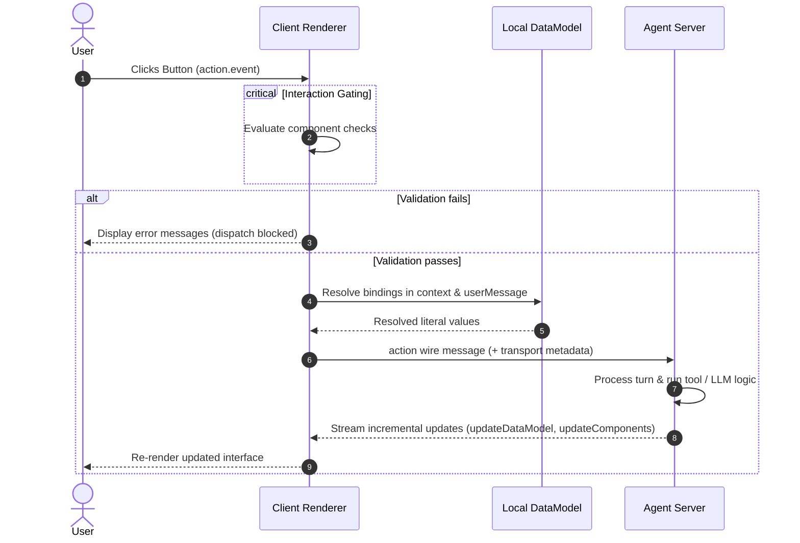
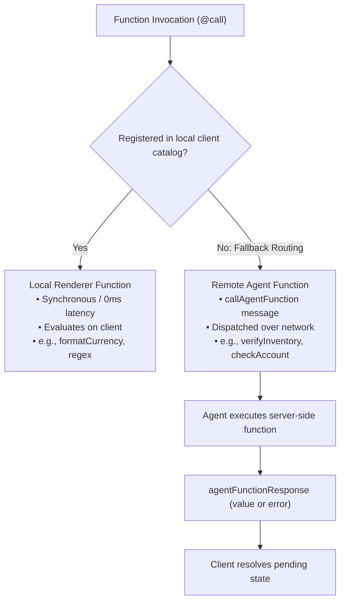
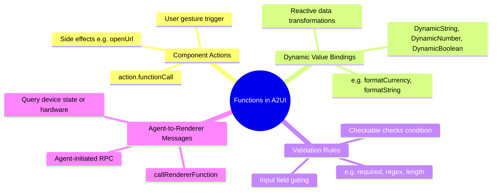
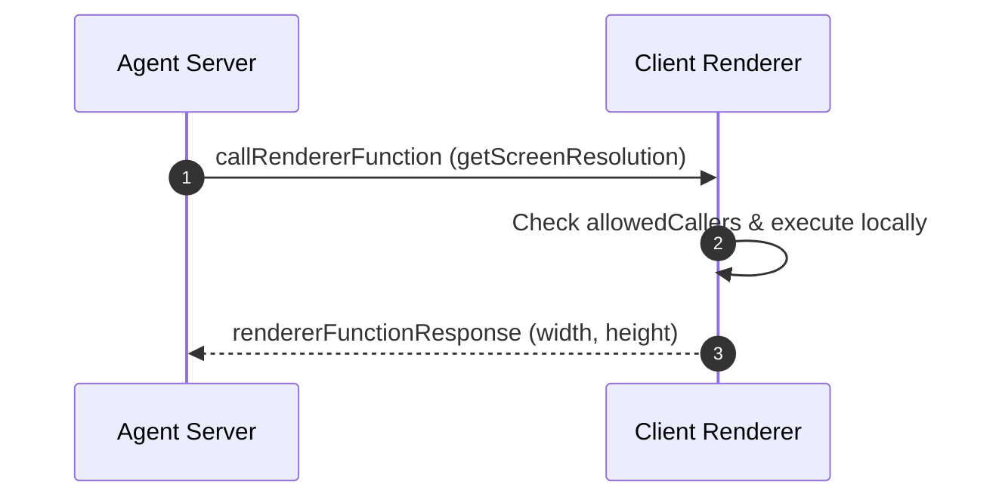

import { Tabs, TabItem, Aside } from '@astrojs/starlight/components';
import DiagramCard from '../../../components/docs/common/DiagramCard.astro';

A2UI separates interactive user behavior into component Actions, agent Events, and typed Functions across local and remote execution contexts. This division ensures a clean boundary between conversational turn advancement, reactive data computation, and client system operations.

A2UI organizes interaction across three distinct constructs:

- **Actions**: Interaction slots attached to UI components (such as a button click or form submission).
- **Events**: High-level semantic notifications dispatched across the network to advance agent turns.
- **Functions**: Typed, catalog-registered operations that execute locally on the client or remotely on the agent via bidirectional RPC.

---

## Disambiguating Actions, Events, and Functions

Because conversational interfaces blend client UI with remote agent reasoning, interaction handlers can be easily conflated. In A2UI, the specification defines an explicit relationship between component slots, agent notifications, and executable operations.

The following diagram illustrates how component action slots branch into either agent events or executable function calls. When an action defines an event (`action.event`), the renderer evaluates contextual values and dispatches an `action` message across the network to advance the agent's turn. When an action defines a function call (`action.functionCall`), the renderer checks its local catalog registry: registered functions execute locally with zero network latency, while unregistered functions fall back to a remote `callAgentFunction` RPC to the agent.

<DiagramCard
  title="Action, Event, and Function Taxonomy"
  mermaid={`flowchart TD
    Component["Component (e.g. Button)"] -->|defines| ActionSlot["Action Slot"]
    ActionSlot -->|oneOf union| EventBranch["Event (action.event)"]
    ActionSlot -->|oneOf union| FunctionBranch["FunctionCall (action.functionCall)"]
    EventBranch -->|gated by checks| EventEval["Evaluate context & userMessage"]
    EventEval -->|dispatches| ActionMsg["action Wire Message"]
    ActionMsg -->|advances turn| AgentServer["Agent Server"]
    FunctionBranch -->|registry lookup| LocalCheck{"Registered in local catalog?"}
    LocalCheck -->|Yes| LocalExec["Local Renderer Execution (0ms)"]
    LocalCheck -->|No: Fallback Routing| RemoteRPC["callAgentFunction RPC"]
    RemoteRPC -->|executes remotely| AgentServer`}
>
  <div class="grid grid-cols-1 md:grid-cols-3 gap-4">
    <div class="p-4 rounded-lg border bg-background/50">
      <div class="text-xs font-mono font-semibold uppercase tracking-wider text-primary mb-1">Component Slot</div>
      <div class="text-base font-bold text-foreground mb-2">Action</div>
      <p class="text-xs text-muted-foreground leading-relaxed mb-3">
        The declarative property on interactive components (<code class="text-xs">Button.action</code>) that serves as the entry point for user gestures.
      </p>
      <div class="text-xs font-medium text-foreground/80 space-y-1">
        <div><strong>Schema:</strong> <code class="text-xs">oneOf [event, functionCall]</code></div>
        <div><strong>Trigger:</strong> Direct user interaction</div>
        <div><strong>Execution:</strong> Delegates to chosen branch</div>
      </div>
    </div>

    <div class="p-4 rounded-lg border bg-background/50">
      <div class="text-xs font-mono font-semibold uppercase tracking-wider text-emerald-500 mb-1">Network Intent</div>
      <div class="text-base font-bold text-foreground mb-2">Event</div>
      <p class="text-xs text-muted-foreground leading-relaxed mb-3">
        An outbound notification transmitted to the agent to signal user decisions and advance conversational turns.
      </p>
      <div class="text-xs font-medium text-foreground/80 space-y-1">
        <div><strong>Wire Message:</strong> <code class="text-xs">action</code></div>
        <div><strong>Scope:</strong> High-level turn progression</div>
        <div><strong>Result:</strong> Incremental UI updates</div>
      </div>
    </div>

    <div class="p-4 rounded-lg border bg-background/50">
      <div class="text-xs font-mono font-semibold uppercase tracking-wider text-sky-500 mb-1">Executable Logic</div>
      <div class="text-base font-bold text-foreground mb-2">Function</div>
      <p class="text-xs text-muted-foreground leading-relaxed mb-3">
        A typed, catalog-registered operation computing values, validating inputs, or executing discrete side effects.
      </p>
      <div class="text-xs font-medium text-foreground/80 space-y-1">
        <div><strong>Invocation:</strong> <code class="text-xs">@call</code> / <code class="text-xs">call</code></div>
        <div><strong>Scope:</strong> UI bindings, checks, actions, RPC</div>
        <div><strong>Execution:</strong> Local (0ms) or Remote RPC</div>
      </div>
    </div>
  </div>
</DiagramCard>

### The Component `Action` Contract

In the A2UI specification, an **`Action`** is not a message or an executable function. It is a configuration object attached to interactive components defined in [`common_types.json#/$defs/Action`](/specification/v1.0/schemas/#common_types.json/$defs/Action).

An `Action` represents a strict `oneOf` union:

```json
{
  "description": "Defines an interaction handler that can either trigger an agent-side event or execute a local renderer-side function.",
  "oneOf": [
    {
      "type": "object",
      "description": "Triggers an agent-side event.",
      "properties": {
        "event": {
          "type": "object",
          "properties": {
            "name": { "type": "string" },
            "userMessage": { "$ref": "#/$defs/DynamicString" },
            "context": {
              "type": "object",
              "additionalProperties": { "$ref": "#/$defs/DynamicValue" }
            }
          },
          "required": ["name"]
        }
      },
      "required": ["event"]
    },
    {
      "type": "object",
      "description": "Executes a renderer or agent-side function.",
      "properties": {
        "functionCall": { "$ref": "#/$defs/FunctionCall" }
      },
      "required": ["functionCall"]
    }
  ]
}
```

When authoring a component, you choose whether user interaction notifies the agent (`action.event`) or runs an operational function (`action.functionCall`):

- **Use `action.event`** when the user makes a choice that requires agent reasoning, workflow progression, or server-side orchestration (for example, clicking "Book Flight", "Generate Report", or "Confirm Order").
- **Use `action.functionCall`** when the user triggers a targeted client side effect or deterministic operation that does not require an LLM turn (for example, clicking a button that calls `openUrl` or triggering a client-side clipboard copy).

### Contrasting Roles: Events vs. Functions

The following comparison clarifies how Events and Functions operate across different stages of the application lifecycle:

| Dimension | Event (`action.event`) | Function (`@call` / `call`) |
| :--- | :--- | :--- |
| **Primary Role** | Notifies the agent of user intent to advance a conversational turn. | Computes values, validates inputs, or performs discrete operations. |
| **Invocation Contexts** | Triggered exclusively from a component `Action` slot via user gesture. | Triggered in 4 contexts: Actions, dynamic bindings, validation checks, or agent RPC. |
| **Network Cost** | Always travels over the network as an `action` message. | Runs locally with 0ms latency when registered on the client, or via `callAgentFunction` RPC. |
| **State Resolution** | Evaluates bound `context` and `userMessage` expressions at moment of dispatch. | Evaluates dynamically whenever input dependencies or bound data paths update. |
| **Output / Return** | Returns no direct value to the component; prompts the agent to stream updates. | Returns a typed value (e.g., `string`, `boolean`, `number`) or executes a `void` side effect. |
| **Validation Gating** | Gated by component `checks`; dispatch halts if validation rules fail. | Evaluates as the validation rule itself (`checks[].condition`). |

---

## Events (`action.event` $\rightarrow$ `action` Wire Message)

An event is the mechanism by which user interactions on the client travel back to the agent. It translates interactive gestures into structured conversational context.

The following sequence diagram details the event dispatch lifecycle when a user clicks an interactive component. The renderer first evaluates local validation checks; if validation fails, error messages are displayed and network dispatch is blocked. When validation passes, the renderer resolves bound data pointers for `context` and `userMessage` against the local data model, packages them into an `action` wire message, and transmits it to the agent server. The agent then processes the turn and streams incremental updates back to the client.



### Event Dispatch Lifecycle

When a user triggers an interaction on a component configured with `action.event`, the renderer executes the following sequence:

1. **Check Validation (`checks` Gating)**:
   If the component implements `Checkable` (such as a form submission `Button`), the renderer evaluates all rules in `checks`. If any check condition evaluates to false or returns a failing `ValidationResult`, the dispatch is immediately aborted, error messages are rendered on the associated controls, and no network message is sent.

2. **Context Resolution**:
   The renderer inspects the `event.context` map. Any values defined as dynamic path bindings (such as `{"@path": "/formData/email"}` in v1.0 or `{"path": "/formData/email"}` in v0.9.1) are resolved against the active surface data model. Static values (such as fixed IDs or categories) are preserved as literals.

3. **User Message Interpolation (v1.0)**:
   In v1.0, `event.userMessage` accepts a `DynamicString`. The renderer interpolates any dynamic string templates (for example, `"Submitting order ${/order/id} for ${/order/total}"`) using current data model state. This string provides human-readable context directly to the agent's conversational turn.

4. **Wire Message Transmission**:
   The renderer constructs and dispatches an [`action`](/specification/v1.0/schemas/#renderer_to_agent.json/properties/action) message to the agent over the transport layer.

5. **Transport Metadata Synchronization (`sendDataModel`)**:
   If the surface was created with `sendDataModel: true`, the client transport layer automatically attaches the full surface data model to the outbound transport metadata (`a2uiRendererDataModel` in v1.0 or `a2uiClientDataModel` in v0.9.1). This ensures the agent has access to all client-side state without requiring manual inclusion of every field in `event.context`. For details, see [Data Model and Data Binding](/concepts/data-binding/).

6. **Agent Turn Processing**:
   The agent processes the action, invokes external tools or models as needed, and replies with incremental UI updates (such as `updateDataModel`, `updateComponents`, or surface replacements).

### Component Definition and Resulting Wire Message

The following example shows a confirmation button defined within a surface, followed by the outbound `action` wire message emitted when the user clicks the button.

<Tabs syncKey="protocol-version">
  <TabItem label="v1.0 (Candidate)">
    ```json
    // 1. Component definition inside surface components list:
    {
      "id": "confirm_button",
      "component": "Button",
      "child": "confirm_label",
      "variant": "primary",
      "action": {
        "event": {
          "name": "confirmReservation",
          "userMessage": "Confirmed flight reservation for ${/passenger/fullName}",
          "context": {
            "flightNumber": "UA-402",
            "seat": { "@path": "/selection/seatNumber" },
            "mealPreference": { "@path": "/selection/meal" }
          }
        }
      }
    }

    // 2. Outbound renderer_to_agent wire message emitted on click:
    {
      "version": "1.0",
      "action": {
        "name": "confirmReservation",
        "surfaceId": "booking_surface",
        "sourceComponentId": "confirm_button",
        "timestamp": "2026-11-02T03:45:00Z",
        "userMessage": "Confirmed flight reservation for Alex Rivera",
        "context": {
          "flightNumber": "UA-402",
          "seat": "14B",
          "mealPreference": "Vegetarian"
        }
      }
    }
    ```
  </TabItem>
  <TabItem label="v0.9.1 (Active)">
    ```json
    // 1. Component definition inside surface components list:
    {
      "id": "confirm_button",
      "component": "Button",
      "child": "confirm_label",
      "variant": "primary",
      "action": {
        "event": {
          "name": "confirmReservation",
          "context": {
            "flightNumber": "UA-402",
            "seat": { "path": "/selection/seatNumber" },
            "mealPreference": { "path": "/selection/meal" }
          }
        }
      }
    }

    // 2. Outbound client_to_server wire message emitted on click:
    {
      "version": "v0.9",
      "action": {
        "name": "confirmReservation",
        "surfaceId": "booking_surface",
        "sourceComponentId": "confirm_button",
        "timestamp": "2026-11-02T03:45:00Z",
        "context": {
          "flightNumber": "UA-402",
          "seat": "14B",
          "mealPreference": "Vegetarian"
        }
      }
    }
    ```
  </TabItem>
</Tabs>

<Aside type="note" title="Protocol Version Differences">
  - **Dynamic User Message**: In v1.0, `action.event.userMessage` provides an interpolated `DynamicString` that renders directly into the outbound wire message. In v0.9.1, `userMessage` does not exist; all context is passed via the `context` dictionary.
  - **Path Syntax**: Dynamic data paths use `@path` in v1.0 and `path` in v0.9.1.
  - **Transport Keys**: In v1.0, wire messages use `"version": "1.0"` with transport metadata `a2uiRendererDataModel`. In v0.9.1, payloads use `"version": "v0.9"` (or `"v0.9.1"`) with `a2uiClientDataModel`.
</Aside>

---

## Functions (`@call` in v1.0 / `call` in v0.9.1)

Functions are typed, catalog-registered operations. Unlike events, functions are not tied to a single wire message or conversational turn. They execute across multiple contexts within the protocol to compute values, enforce validation, or run client side effects.

### Execution Locations: Renderer vs. Agent

A2UI distinguishes between two execution locations for functions:

The following flowchart shows how function execution routes based on catalog registration. When a component evaluates a function call (`@call`), the client checks whether the function is registered in the local catalog. If registered, it executes immediately on the client renderer with zero network latency. If not registered, the client falls back to dispatching a `callAgentFunction` message to the agent server, awaiting an `agentFunctionResponse` before resolving the pending UI state.



#### Renderer-Side Functions (Local Execution)

Renderer-side functions are registered directly within the client runtime (via framework adapters such as Flutter, React, Lit, or SwiftUI). When evaluated, they execute immediately in memory on the client device without a network round-trip.

The [Basic Catalog](/concepts/catalogs/) includes a standard library of built-in renderer functions:

- **Formatting**: `formatString`, `formatNumber`, `formatCurrency`, `formatDate`, `pluralize`
- **Validation**: `required`, `regex`, `length`, `numeric`, `email`
- **Logic**: `and`, `or`, `not`
- **Client Side Effects**: `openUrl`

Local functions provide immediate feedback for text interpolation, form validation, and numeric transformations while keeping UI rendering responsive.

#### Agent-Side Functions (Remote RPC — New in v1.0)

In v1.0, functions can execute remotely on the agent server via bidirectional RPC. This capability allows components to invoke server-side operations (such as validating an address against an internal database or checking real-time inventory) without triggering a full conversational turn.

When an agent-side function is invoked:

1. The renderer dispatches a [`callAgentFunction`](/specification/v1.0/schemas/#renderer_to_agent.json/properties/callAgentFunction) wire message containing a unique `functionCallId`, the target `surfaceId`, and the `callFunction` payload.
2. The renderer places the affected component into an asynchronous pending state (for example, displaying a subtle inline loader while preserving current inputs).
3. The agent executes the server logic and streams back an [`agentFunctionResponse`](/specification/v1.0/schemas/#agent_to_renderer.json/$defs/AgentFunctionResponseMessage) containing the matching `functionCallId` and either a `value` or structured `error`.
4. The renderer resolves the pending state, updating bound properties or surfacing error messages.

<Tabs syncKey="protocol-version">
  <TabItem label="v1.0 (Candidate)">
    ```json
    // 1. Renderer dispatches callAgentFunction:
    {
      "version": "1.0",
      "callAgentFunction": {
        "surfaceId": "checkout_surface",
        "functionCallId": "call_inv_check_881",
        "callFunction": {
          "@call": "checkInventory",
          "args": {
            "sku": "SKU-99201",
            "quantity": 2
          }
        }
      }
    }

    // 2. Agent returns agentFunctionResponse (Success):
    {
      "version": "1.0",
      "agentFunctionResponse": {
        "functionCallId": "call_inv_check_881",
        "value": {
          "available": true,
          "remainingStock": 14
        }
      }
    }

    // Alternative: Agent returns agentFunctionResponse (Error):
    {
      "version": "1.0",
      "agentFunctionResponse": {
        "functionCallId": "call_inv_check_881",
        "error": {
          "code": "OUT_OF_STOCK",
          "message": "Item SKU-99201 is temporarily unavailable."
        }
      }
    }
    ```
  </TabItem>
  <TabItem label="v0.9.1 (Active)">
    ```json
    // In v0.9.1, functions execute exclusively on the local client.
    // Remote agent RPCs via callAgentFunction are not supported in v0.9.1.
    // All remote operations must be initiated as actions (action.event)
    // that advance conversational turns.
    ```
  </TabItem>
</Tabs>

<Aside type="caution" title="Implicit Fallback Routing & Developer Trap">
  In v1.0, the protocol specifies **implicit fallback routing** for functions:

  When evaluating any `FunctionCall`, the renderer checks its local catalog table first. If the function name is **not registered locally**, the renderer assumes it is an agent-side function and automatically emits a `callAgentFunction` message across the network.

  **The Pitfall**: If a developer misspells a local function name (for example, writing `@call: "formatCurrncy"` instead of `"formatCurrency"`), the renderer will not fail immediately with a local error. Instead, it dispatches an unexpected network RPC to the agent, which responds with `code: "UNKNOWN_FUNCTION"` after network round-trip latency. Always verify function names against the catalog schema.
</Aside>

---

### Trigger Contexts

Functions operate across four distinct contexts in A2UI:

The following diagram summarizes the four contexts where functions are triggered in A2UI: component actions (triggered by user gestures via `action.functionCall`), dynamic value bindings (reactively evaluating property values like `formatCurrency`), validation rules (evaluating input checks prior to action dispatch), and explicit agent-to-renderer messages (agent-initiated device queries via `callRendererFunction`).



#### Component Actions (`action.functionCall`)

A component's interaction slot can execute a function directly upon a user gesture instead of dispatching an agent event.

```json
{
  "id": "help_link",
  "component": "Button",
  "child": "help_text",
  "variant": "borderless",
  "action": {
    "functionCall": {
      "@call": "openUrl",
      "args": {
        "url": "https://support.example.com/billing"
      }
    }
  }
}
```

#### Dynamic Value Bindings (`DynamicValue`)

Functions can be bound directly to component properties (`DynamicString`, `DynamicNumber`, `DynamicBoolean`, `DynamicStringList`). Whenever the underlying data model values mutate, the renderer re-evaluates the function reactively:

```json
{
  "id": "order_total_text",
  "component": "Text",
  "text": {
    "@call": "formatCurrency",
    "args": {
      "value": { "@path": "/order/subtotal" },
      "currency": "USD"
    }
  }
}
```

#### Validation Rules (`Checkable` `checks`)

Any component implementing `Checkable` (such as `TextField`, `CheckBox`, or `Button`) can declare validation rules in its `checks` array. Each rule defines a `condition` function that must return a boolean or structured `ValidationResult`:

```json
{
  "id": "user_email_input",
  "component": "TextField",
  "value": { "@path": "/formData/email" },
  "checks": [
    {
      "condition": {
        "@call": "required",
        "args": { "value": { "@path": "/formData/email" } }
      },
      "message": "Email address is required."
    },
    {
      "condition": {
        "@call": "email",
        "args": { "value": { "@path": "/formData/email" } }
      },
      "message": "Please enter a valid email address."
    }
  ]
}
```

#### Agent-to-Renderer Messages (`callRendererFunction` — New in v1.0)

In v1.0, the agent can initiate a function call on the client mid-session by sending a [`callRendererFunction`](/specification/v1.0/schemas/#agent_to_renderer.json/$defs/CallRendererFunctionMessage) message. This enables the agent to query client-side state (such as screen dimensions or timezone) or request local operations.

The following sequence diagram shows an agent-initiated function execution. The agent sends a `callRendererFunction` message specifying the target function and arguments. The renderer verifies caller permissions via `allowedCallers`, runs the function locally, and returns the computed result in a `rendererFunctionResponse` message.



The matching message exchange over the wire:

<Tabs syncKey="protocol-version">
  <TabItem label="v1.0 (Candidate)">
    ```json
    // 1. Agent sends callRendererFunction to query client hardware:
    {
      "version": "1.0",
      "callRendererFunction": {
        "functionCallId": "hw_screen_001",
        "callFunction": {
          "catalogId": "https://example.com/catalogs/hardware.json",
          "@call": "getScreenResolution",
          "args": {
            "screenIndex": 0
          }
        }
      }
    }

    // 2. Renderer replies with rendererFunctionResponse:
    {
      "version": "1.0",
      "rendererFunctionResponse": {
        "functionCallId": "hw_screen_001",
        "value": {
          "width": 1920,
          "height": 1080,
          "pixelRatio": 2.0
        }
      }
    }
    ```
  </TabItem>
  <TabItem label="v0.9.1 (Active)">
    ```json
    // In v0.9.1, the agent cannot initiate function calls on the client.
    // Client capabilities and display metrics are exchanged during initial
    // session setup via transport metadata (a2uiClientCapabilities).
    ```
  </TabItem>
</Tabs>

---

### Caller and Gesture Security Constraints (v1.0)

Because functions can trigger external side effects or access client capabilities, the v1.0 catalog schema ([`catalog_definition.json`](/specification/v1.0/schemas/#catalog_definition.json/properties/functions)) enforces strict caller and user-activation constraints.

#### `allowedCallers`

The `allowedCallers` property specifies which roles are authorized to invoke a function:

- `"rendererOnly"` *(default)*: The function can only be invoked by the client renderer (from component actions, property bindings, or validation checks). If an agent attempts to invoke this function via `callRendererFunction`, the renderer rejects the call with an `INVALID_FUNCTION_CALL` error.
- `"agentOnly"`: The function can only be invoked by the agent via `callRendererFunction`. Components cannot call it in UI bindings.
- `"rendererOrAgent"`: Both UI component bindings and agent messages are permitted to invoke the function (e.g., `getScreenResolution`).

#### `requiresUserActivation`

The `requiresUserActivation` boolean property specifies whether the function requires a direct user gesture (such as a tap or click) to execute:

- **Browser & OS Security**: Operations such as opening URLs (`openUrl`), accessing the clipboard, or launching external intents require active user activation in modern browsers and mobile platforms.
- **Strict Invariant**: The A2UI catalog schema enforces that if `requiresUserActivation` is `true`, `allowedCallers` **must** be set to `"rendererOnly"`:

```json
// In catalog_definition.json:
{
  "if": {
    "properties": {
      "requiresUserActivation": { "const": true }
    },
    "required": ["requiresUserActivation"]
  },
  "then": {
    "properties": {
      "allowedCallers": { "enum": ["rendererOnly"] }
    }
  }
}
```

Because an agent operates remotely over the network, it cannot produce a trusted user gesture context. Enforcing `rendererOnly` guarantees that untrusted or remote agent messages can never trigger user-activated capabilities without direct user interaction.

For more details on trust domains and runtime isolation, consult [Security and Trust Boundaries](/concepts/security/).

---

## Related Topics

- **[Messages](/concepts/messages/)**: Complete envelope reference for `action`, `callAgentFunction`, and `callRendererFunction`.
- **[Data Model and Data Binding](/concepts/data-binding/)**: Learn how relative pointers and dynamic string interpolation resolve at runtime.
- **[Catalogs, Components and Functions](/concepts/catalogs/)**: How to register custom functions and define catalog schemas.
- **[Security and Trust Boundaries](/concepts/security/)**: Comprehensive security guidelines for client-agent boundaries.
