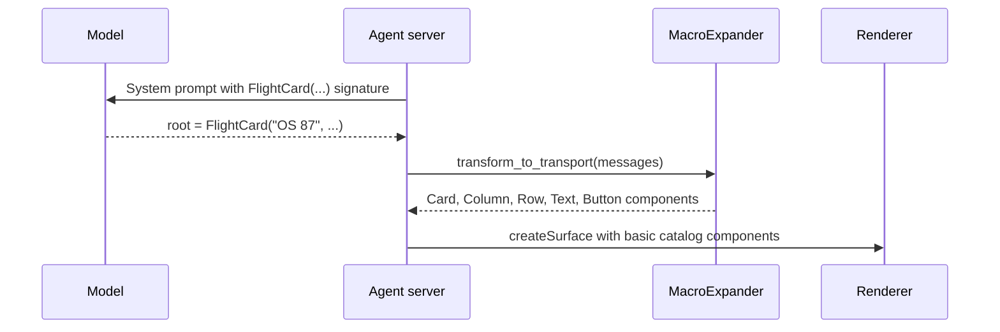

import {Aside, Tabs, TabItem} from '@astrojs/starlight/components';

Macros let you give a language model high-level, domain-specific components, such as a flight card or an album list, that the agent server expands into standard [catalog](/concepts/catalogs/) components before it sends any messages. The renderer only sees components it already implements, so you can add or change a macro without shipping new client code.

<Aside type="note" title="Python only, newer than 0.10.0">
  Macros are implemented in the Python agent SDK (`a2ui-agent-sdk`, module
  `a2ui.transformers.macros`). The TypeScript and Dart agent SDKs do not have macros yet. The
  examples on this page use features that are newer than the 0.10.0 release on PyPI, including v1.0
  support, `on_error`, `transform_catalogs`, and `surface_catalogs`. Until the next release, install
  the SDK from source as shown in [Wiring macros into an agent](#wiring-macros-into-an-agent).
</Aside>

## What are macros?

A macro is a Python function decorated with `@macro`. It takes typed arguments and returns a tree of builder components, for example a `Card` that contains a `Column` of `Text` and `Button` components. [`MacroExpander`](/concepts/glossary/#macroexpander) uses the macro in two places:

1. At prompt time, it adds a component schema for each macro to the catalog that the model sees. The schema comes from the function's type hints and docstring, so the model sees a `FlightCard` component next to the basic components. [Stage 2](#stage-2-the-model-writes-one-call) shows how the Express prompt presents it.
2. At send time, `transform_to_transport` finds each macro call in the model's output, runs the Python function, and replaces the call with the flat list of components the function returned.

The sequence below shows one turn. The model writes a macro call in its response. The agent parses it, `MacroExpander` expands it into catalog components on the server, and the renderer receives only those components.



## Benefits and design considerations

Macros move repeated layout work from the model to your server code:

1. Fewer output tokens. The model writes one call instead of a nested tree with bindings and actions. In the walkthrough below, one `FlightCard` call expands into nine components.
2. Consistent layouts. Every flight card has the same structure, because your code builds it rather than the model.
3. Server-side data. A macro is ordinary Python, so it can read from a database or service while it expands. The model can pass an ID and leave the facts to your code (see [Data-driven macros](#data-driven-macros)).
4. No client changes. The output uses components the renderer already supports, so a new macro needs only a server deploy.

Keep these behaviors in mind when you design macros:

1. A parameter typed as a plain Python type, such as `str` or `int`, is a static value. The macro bakes it into the components, and later data model updates don't change it. A parameter typed as `DynamicString` (or another `Dynamic*` type) also accepts a [data binding](/concepts/data-binding/) such as `{"@path": "/flight/status"}`. If you pass that value through to a component property, the binding stays live on the renderer. A plain `str` parameter rejects a binding.
2. Expanded component IDs are scoped to the macro instance. Each expanded component gets an ID prefixed with the macro instance's ID, such as `root__text_1`. Two instances of the same macro on one surface, for example two `FlightCard` calls inside a `Column`, get different prefixes (`root_children_0__text_1` and `root_children_1__text_1`), so their IDs never collide.
3. Macro arguments come from the model. Treat them like any other model output. Validate IDs and look them up rather than trusting free text, and raise an error for unknown values.
4. Each macro and `MacroExpander` targets one protocol family, either v1.0 or v0.9. Mixing `a2ui.builder.v1_0` and `a2ui.builder.v0_9` types, catalogs, or returned components raises `A2uiValidationError`.

## Walkthrough: from macro to wire components

This walkthrough defines a flight card macro, shows the Express call the model writes, and shows the components the renderer receives.

### Stage 1: define the macro

The `@macro` decorator reads the type hints and the Google-style `Args:` docstring to build the component schema. `status` is a `DynamicString`, so it can stay bound to the data model. `on_rebook` is an `Action`, so the model can pass an event:

```python title="flight_macros.py"
from a2ui.builder.v1_0 import (
    Action,
    Button,
    Card,
    Column,
    DynamicString,
    Icon,
    Row,
    Text,
)
from a2ui.transformers.macros import macro


@macro
def FlightCard(
    flight: str,
    origin: str,
    destination: str,
    status: DynamicString,
    on_rebook: Action,
) -> Card:
    """Flight summary with a live status line and a rebook button.

    Args:
        flight: Flight number, for example "OS 87".
        origin: Departure city.
        destination: Arrival city.
        status: Current flight status. Bind it to the data model to keep it live.
        on_rebook: Action sent when the user taps Rebook.
    """
    return Card(
        child=Column(
            children=[
                Row(children=[Icon(name="send"), Text(text=flight)]),
                Text(text=f"{origin} → {destination}", variant="caption"),
                Text(text=status),
                Button(child=Text(text="Rebook"), action=on_rebook),
            ]
        )
    )
```

The macro name is the function name converted to PascalCase. Pass a name or description to override them, as in `@macro("FlightCard")` or `@macro(name="FlightCard", description="...")`. In v1.0, macro names must be valid UAX #31 identifiers and cannot be `Surface`.

### Stage 2: the model writes one call

The [Express](/concepts/inference-formats/) prompt lists the macro next to the basic components, as `FlightCard(flight (static), origin (static), destination (static), status, on_rebook (static))`. The model then answers with a single call, binding `status` to the data model:

```text title="Model output"
Your flight is boarding.
<a2ui>
$/flight/status = "Boarding"
root = FlightCard("OS 87", "Vienna", "New York", $/flight/status, Event("rebook", {flight: "OS 87"}))
</a2ui>
```

### Stage 3: the renderer receives catalog components

`transform_to_transport` runs `FlightCard` and replaces the call with nine basic catalog components. The flight number and cities are baked in as literals, while the status `Text` keeps its data binding. In v1.0 the components and the data model travel in `createSurface`. In v0.9.1 the same components arrive in `updateComponents`, with the data model in `updateDataModel` and bindings written as `path` instead of `@path`:

<Tabs syncKey="protocol-version">
  <TabItem label="v1.0">

```json
[
  {
    "version": "1.0",
    "createSurface": {
      "surfaceId": "main",
      "catalogId": "https://a2ui.org/specification/v1_0/catalogs/basic/catalog.json",
      "components": [
        {"component": "Icon", "id": "root__icon_1", "name": "send"},
        {"component": "Text", "id": "root__text_1", "text": "OS 87", "variant": "body"},
        {
          "component": "Row",
          "id": "root__row_1",
          "children": ["root__icon_1", "root__text_1"],
          "justify": "start",
          "align": "stretch"
        },
        {
          "component": "Text",
          "id": "root__text_2",
          "text": "Vienna → New York",
          "variant": "caption"
        },
        {
          "component": "Text",
          "id": "root__text_3",
          "text": {"@path": "/flight/status"},
          "variant": "body"
        },
        {"component": "Text", "id": "root__text_4", "text": "Rebook", "variant": "body"},
        {
          "component": "Button",
          "id": "root__button_1",
          "child": "root__text_4",
          "variant": "default",
          "action": {"event": {"name": "rebook", "context": {"flight": "OS 87"}}}
        },
        {
          "component": "Column",
          "id": "root__column_1",
          "children": ["root__row_1", "root__text_2", "root__text_3", "root__button_1"],
          "justify": "start",
          "align": "stretch"
        },
        {"component": "Card", "id": "root", "child": "root__column_1"}
      ],
      "dataModel": {"flight": {"status": "Boarding"}}
    }
  }
]
```

  </TabItem>
  <TabItem label="v0.9.1">

```json
[
  {
    "version": "v0.9",
    "createSurface": {
      "surfaceId": "main",
      "catalogId": "https://a2ui.org/specification/v0_9/catalogs/basic/catalog.json"
    }
  },
  {
    "version": "v0.9",
    "updateComponents": {
      "surfaceId": "main",
      "components": [
        {"component": "Icon", "id": "root__icon_1", "name": "send"},
        {"component": "Text", "id": "root__text_1", "text": "OS 87", "variant": "body"},
        {
          "component": "Row",
          "id": "root__row_1",
          "children": ["root__icon_1", "root__text_1"],
          "justify": "start",
          "align": "stretch"
        },
        {
          "component": "Text",
          "id": "root__text_2",
          "text": "Vienna → New York",
          "variant": "caption"
        },
        {
          "component": "Text",
          "id": "root__text_3",
          "text": {"path": "/flight/status"},
          "variant": "body"
        },
        {"component": "Text", "id": "root__text_4", "text": "Rebook", "variant": "body"},
        {
          "component": "Button",
          "id": "root__button_1",
          "child": "root__text_4",
          "variant": "default",
          "action": {"event": {"name": "rebook", "context": {"flight": "OS 87"}}}
        },
        {
          "component": "Column",
          "id": "root__column_1",
          "children": ["root__row_1", "root__text_2", "root__text_3", "root__button_1"],
          "justify": "start",
          "align": "stretch"
        },
        {"component": "Card", "id": "root", "child": "root__column_1"}
      ]
    }
  },
  {
    "version": "v0.9",
    "updateDataModel": {
      "surfaceId": "main",
      "path": "/",
      "value": {"flight": {"status": "Boarding"}}
    }
  }
]
```

  </TabItem>
</Tabs>

For v0.9.1, write the macro with the same structure but import the types from `a2ui.builder.v0_9` and the components from `a2ui.builder.v0_9.catalogs.basic`, and pass `BasicCatalog("0.9.1")` to `transform_to_inference_catalog`.

### Parameter types

`@macro` maps each parameter annotation to a JSON Schema type for the prompt, and converts the model's values before it calls your function. The most common mappings, with v1.0 schema names:

| Annotation                                         | Schema the model sees                                                                                   | Value your function receives                                           |
| :------------------------------------------------- | :------------------------------------------------------------------------------------------------------ | :--------------------------------------------------------------------- |
| `str`, `int`, `float`, `bool`                      | `string`, `integer`, `number`, `boolean`                                                                | The literal value. Data bindings are rejected.                         |
| `Literal[...]` or `Enum`                           | `enum`                                                                                                  | The literal value.                                                     |
| `Sequence[str]`, `dict[str, V]`                    | `array`, `object`                                                                                       | The list or dict, with values converted to `V`.                        |
| `DynamicString`, `DynamicNumber`, `DynamicBoolean` | [`DynamicString`](/specification/v1.0/schemas/#common_types.json/$defs/DynamicString) and related types | A literal, or a `DataBinding` / `FunctionCall` from `@path` / `@call`. |
| `Action`                                           | [`Action`](/specification/v1.0/schemas/#common_types.json/$defs/Action)                                 | An `Action` built from an event name, event object, or function call.  |
| `Child` or a component class                       | `Child` (a component ID; `ComponentId` in v0.9)                                                         | A `ComponentRef` to another component.                                 |
| `ChildList` or `Sequence[Child]`                   | `ChildList`                                                                                             | A list of `ComponentRef` values, or a template for dynamic lists.      |

The [macros README](https://github.com/a2ui-project/a2ui/blob/main/python/a2ui_agent/src/a2ui/transformers/macros/README.md#parameter-type-mapping) lists every supported annotation, including checks, accessibility attributes, extensions, catalog sub-models such as `TabItem`, and unions.

## Wiring macros into an agent

Install the Python agent SDK. The examples on this page need a release newer than 0.10.0, so install from the repository until that release is out:

```bash
pip install "a2ui-agent-sdk @ git+https://github.com/a2ui-project/a2ui.git#subdirectory=python/a2ui_agent"
```

After the next release, `pip install a2ui-agent-sdk` (or `uv add a2ui-agent-sdk`) is enough.

`MacroExpander` is not a [`CatalogTransformer`](/concepts/glossary/#catalog-transformer), so you can't add it to `CatalogConfig.transformers`. It works on both sides of the model call, so you wrap the inference format yourself: give the format the macro-augmented catalog, then expand the parsed messages before you send them. It works with any inference format, such as Express or Direct JSON; the examples on this page use Express. With a single catalog, use `transform_to_inference_catalog`:

```python title="agent.py"
from a2ui.core.basic_catalog import BasicCatalog
from a2ui.inference_formats.express import ExpressFormat
from a2ui.parser import A2uiPart
from a2ui.transformers.macros import MacroExpander

from flight_macros import FlightCard

expander = MacroExpander([FlightCard], on_error="raise")
inference_catalog = expander.transform_to_inference_catalog(BasicCatalog("1.0"))

fmt = ExpressFormat([inference_catalog], surface_id="main")
system_prompt = fmt.prompt_generator.generate()  # Add to your model's system instruction.

# ... call the model with system_prompt and get llm_output ...

parts = fmt.create_parser().parse_response(llm_output)
transport_messages = [
    msg
    for part in parts
    if isinstance(part, A2uiPart)
    for msg in expander.transform_to_transport(part.a2ui)
]
# Send transport_messages to the renderer, for example as
# [m.model_dump(by_alias=True, exclude_none=True) for m in transport_messages].
```

`MacroExpander` takes a few options that matter in production:

1. `on_error` controls what happens when a macro fails. With the default, `"passthrough"`, a macro that fails to expand is logged and left in the message unexpanded, and the renderer then rejects it because it doesn't know the component. Pass `on_error="raise"` to get an `A2uiValidationError` instead, and send the error text back to the model so it can correct its output. Structural errors, such as a recursion limit or a catalog conflict, always raise.
2. `passthrough_components` limits which base components the model sees. By default the model sees every base catalog component alongside your macros. `MacroExpander([FlightCard], passthrough_components=["Button"])` exposes only `Button` and the macros, and `passthrough_components=[]` exposes only the macros. Fewer components means a shorter prompt and less room for the model to improvise layouts.
3. `surface_catalogs` tells the expander each surface's default catalog. Otherwise `transform_to_transport` remembers it from the `createSurface` messages it sees. If one expander serves many sessions, pass the surfaces explicitly, as in `expander.transform_to_transport(messages, surface_catalogs={"main": inference_catalog.catalog_id})`, or create one expander per session. Use `None` for a v1.0 surface without a default catalog.

### Data-driven macros

Because a macro runs on your server, it can take an ID and load the data itself. The model never copies the facts, so it can't get them wrong, and its output stays short:

```python
# Same imports as flight_macros.py.
FLIGHTS = {
    "OS87": {"number": "OS 87", "origin": "Vienna", "destination": "New York", "gate": "B12"},
}


@macro
def FlightStatus(flight_id: str) -> Card:
    """Status card for a flight, loaded on the server.

    Args:
        flight_id: Flight identifier, for example "OS87".
    """
    flight = FLIGHTS[flight_id]
    return Card(
        child=Column(
            children=[
                Text(text=f"**{flight['number']}** {flight['origin']} → {flight['destination']}"),
                Text(text=f"Gate {flight['gate']}", variant="caption"),
            ]
        )
    )
```

The model writes `root = FlightStatus("OS87")`. With `on_error="raise"`, an unknown ID raises `A2uiValidationError: Failed to expand macro 'FlightStatus' (id='root'): 'XX1'`. If you raise your own exception with a list of valid IDs, the model can use that message to correct itself.

## Macros with custom catalogs

In v1.0, one surface can mix components from several catalogs, and each component names its catalog with `catalogId`. A macro can combine basic catalog layout with components from your own catalog. The expander adds the macros as a separate inference-only catalog, and stamps the right `catalogId` on each expanded component.

Multi-catalog surfaces are a v1.0 feature. In v0.9.1 a surface binds one catalog, so put your custom components and the basic components you need into a single catalog, and use `transform_to_inference_catalog` with it as shown in [Wiring macros into an agent](#wiring-macros-into-an-agent).

The example below uses a small travel catalog with one component, `BoardingPass`:

```json title="travel_catalog.json"
{
  "$schema": "https://json-schema.org/draft/2020-12/schema",
  "catalogId": "https://example.com/catalogs/travel/v1/catalog.json",
  "protocolVersion": "1.0",
  "components": {
    "BoardingPass": {
      "type": "object",
      "description": "A boarding pass with a scannable code.",
      "properties": {
        "component": {"const": "BoardingPass"},
        "passenger": {"type": "string"},
        "seat": {"type": "string"},
        "gate": {"$ref": "common_types.json#/$defs/DynamicString"}
      },
      "required": ["component", "passenger", "seat", "gate"]
    }
  },
  "$defs": {
    "anyComponent": {
      "oneOf": [{"$ref": "#/components/BoardingPass"}],
      "discriminator": {"propertyName": "component"}
    },
    "anyFunction": {"not": {}}
  }
}
```

See [Catalogs](/concepts/catalogs/) for the full catalog format. The renderer must implement `BoardingPass` and register this catalog alongside the basic catalog.

### Generate builder classes with the A2UI CLI

Macros build components with typed Python classes. The A2UI CLI (`a2ui`) generates those classes from a catalog JSON file, so you don't write them by hand.

Install a prebuilt binary. The scripts verify the SHA-256 checksum of the download and don't need `sudo`:

<Tabs syncKey="os">
  <TabItem label="macOS and Linux">

```bash
curl -fsSL https://raw.githubusercontent.com/a2ui-project/a2ui/main/scripts/public/install_cli.sh | sh
```

The script installs `a2ui` into `${XDG_BIN_HOME:-~/.local/bin}`. Set `A2UI_INSTALL_DIR` to choose another directory, or `A2UI_VERSION` to pin a release.

  </TabItem>
  <TabItem label="Windows">

```powershell
irm https://raw.githubusercontent.com/a2ui-project/a2ui/main/scripts/public/install_cli.ps1 | iex
```

The script installs `a2ui.exe` into `%LOCALAPPDATA%\Programs\a2ui\bin` and adds it to your `PATH`. Set `$env:A2UI_INSTALL_DIR` or `$env:A2UI_VERSION` to change the directory or pin a release.

  </TabItem>
  <TabItem label="From source (Dart SDK)">

```bash
git clone https://github.com/a2ui-project/a2ui.git
cd a2ui
dart pub global activate --source path dart/a2ui_cli
```

Make sure `~/.pub-cache/bin` is on your `PATH` so the shell finds `a2ui`. You can also skip activation and run `dart run dart/a2ui_cli/bin/a2ui.dart codegen ...` from the repository root.

  </TabItem>
</Tabs>

Generate a Python module from the catalog. `--out` takes a file or a directory. `--catalog-name` names the catalog in the generated module, and the file when `--out` is a directory. Without it, the CLI infers a name from the end of the catalog ID, which is `v1` for this catalog:

```bash
a2ui codegen --catalog travel_catalog.json --out travel_builders.py --catalog-name travel
```

The generated module has one class per component, plus type aliases for enums and models for nested objects:

```python title="travel_builders.py (excerpt)"
class BoardingPass(ComponentBuilderNode):
    r"""A boarding pass with a scannable code."""

    component: Literal["BoardingPass"] = "BoardingPass"
    passenger: str
    seat: str
    gate: str | DataBinding | FunctionCall
```

Regenerate the module whenever the catalog changes. Don't edit it by hand.

### Combine catalogs in a macro

Import the generated class and use it next to basic components:

```python title="trip_macros.py"
from a2ui.builder.v1_0 import Card, Column, DynamicString, Text
from a2ui.transformers.macros import macro

from travel_builders import BoardingPass


@macro
def TripSummary(passenger: str, seat: str, gate: DynamicString) -> Card:
    """Trip summary with a boarding pass.

    Args:
        passenger: Passenger name.
        seat: Seat number.
        gate: Departure gate.
    """
    return Card(
        child=Column(
            children=[
                Text(text=f"### Have a good trip, {passenger}"),
                BoardingPass(passenger=passenger, seat=seat, gate=gate),
            ]
        )
    )
```

Pass all of the renderer's catalogs to `transform_catalogs`. It registers them with the expander and returns them plus a sidecar catalog for the macros (`https://a2ui.org/catalogs/macros` by default). Give all three to the inference format:

```python title="agent.py"
import json

from a2ui.core import Catalog
from a2ui.core.basic_catalog import BasicCatalog
from a2ui.inference_formats.express import ExpressFormat
from a2ui.parser import A2uiPart
from a2ui.transformers.macros import MacroExpander

from trip_macros import TripSummary

basic_catalog = BasicCatalog("1.0")
with open("travel_catalog.json") as f:
    travel_catalog = Catalog.from_json(json.load(f))

expander = MacroExpander([TripSummary], on_error="raise")
inference_catalogs = expander.transform_catalogs([basic_catalog, travel_catalog])

fmt = ExpressFormat(inference_catalogs, surface_id="trip")
system_prompt = fmt.prompt_generator.generate()

# ... call the model with system_prompt and get llm_output ...

parts = fmt.create_parser().parse_response(llm_output)
transport_messages = [
    msg
    for part in parts
    if isinstance(part, A2uiPart)
    for msg in expander.transform_to_transport(part.a2ui)
]
```

For `root = TripSummary("Ada Lovelace", "14A", "B12")`, the renderer receives a surface with no default catalog. Each component names its own catalog, and the macro sidecar catalog never reaches the renderer:

```json
[
  {
    "version": "1.0",
    "createSurface": {
      "surfaceId": "trip",
      "components": [
        {
          "component": "Text",
          "id": "root__text_1",
          "text": "### Have a good trip, Ada Lovelace",
          "variant": "body",
          "catalogId": "https://a2ui.org/specification/v1_0/catalogs/basic/catalog.json"
        },
        {
          "component": "BoardingPass",
          "id": "root__boardingpass_1",
          "passenger": "Ada Lovelace",
          "seat": "14A",
          "gate": "B12",
          "catalogId": "https://example.com/catalogs/travel/v1/catalog.json"
        },
        {
          "component": "Column",
          "id": "root__column_1",
          "children": ["root__text_1", "root__boardingpass_1"],
          "justify": "start",
          "align": "stretch",
          "catalogId": "https://a2ui.org/specification/v1_0/catalogs/basic/catalog.json"
        },
        {
          "component": "Card",
          "id": "root",
          "child": "root__column_1",
          "catalogId": "https://a2ui.org/specification/v1_0/catalogs/basic/catalog.json"
        }
      ]
    }
  }
]
```

The generated `BoardingPass` class doesn't declare a catalog. `transform_to_transport` stamps the `catalogId` because `BoardingPass` exists in exactly one registered catalog. If a component name exists in more than one registered catalog, stamping fails with `A2uiCatalogError`. In that case, pass `catalog_id` when you create the component, which works with generated classes unchanged:

```python
TRAVEL_CATALOG_ID = "https://example.com/catalogs/travel/v1/catalog.json"

BoardingPass(passenger=passenger, seat=seat, gate=gate, catalog_id=TRAVEL_CATALOG_ID)
```

If you write builder classes by hand, you can instead set the catalog once on a base class with the `catalog_id` class keyword, as in `class TravelNode(ComponentBuilderNode, catalog_id=TRAVEL_CATALOG_ID)`, and every subclass inherits it.

If you chain several sidecar expanders over the same messages, give each one its own `catalog_id="https://..."` so their sidecar catalogs don't share the default ID.

## Learn more

1. The [macros README](https://github.com/a2ui-project/a2ui/blob/main/python/a2ui_agent/src/a2ui/transformers/macros/README.md) is the full reference for `@macro` and `MacroExpander`, including how a component's catalog is resolved during expansion.
2. The [macros community sample](https://github.com/a2ui-project/a2ui/tree/main/samples/community/macros) is a FastAPI agent and React client that use macros with the basic catalog.
3. [Swappable Inference Formats](/concepts/inference-formats/) explains Express, the format the examples on this page use.
