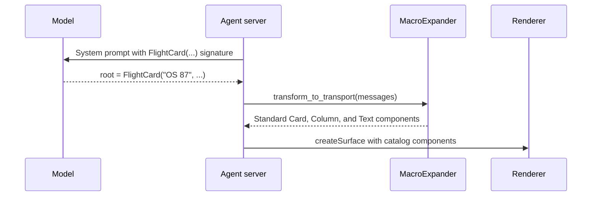

import {Aside, Tabs, TabItem} from '@astrojs/starlight/components';

Macros let you define composite UI components in Python on the server that expand into standard [catalog](/concepts/catalogs/) components before any messages reach the renderer. Because the renderer only receives components it already implements, you can add or update macros on the server without shipping new client code.

<Aside type="note" title="Python agent SDK support">
  Macros are currently implemented in the Python [agent SDK](/concepts/agent-sdks/)
  (`a2ui-agent-sdk`, module `a2ui.transformers.macros`). Several features on this page, including
  v1.0 support, `on_error`, and `transform_catalogs`, are newer than the `0.10.0` release on PyPI.
  Until the next release, install the package from GitHub as shown in [Step 1: Install the Python
  agent SDK](#step-1-install-the-python-agent-sdk).
</Aside>

## How macros work

When a language model builds UI from low-level primitives on every turn, repeated patterns like flight summaries or product cards take many lines of nested components. With `@macro`, you write a Python function once to assemble that pattern on the server.

Macros are useful when you want to:

1. Reduce output tokens and latency by letting the model write one call instead of a nested component tree.
2. Keep layouts consistent across turns because your Python code constructs the component hierarchy.
3. Load data on the server by accepting an identifier from the model and looking up the details in Python.
4. Ship new domain components with a server deployment alone, using catalog components the client already renders.

In the sequence below, [`MacroExpander`](/concepts/glossary/#macroexpander) works on both sides of the model call. Before inference, it adds each macro's component schema to the catalog included in the system prompt. After inference, it intercepts each macro call in the parsed messages, runs your Python function, and outputs flat catalog components for the renderer.



### Example: macro, model call, and expanded output

Here is a `FlightCard` macro that wraps three `Text` components inside a `Card` and `Column`. The `flight` and `route` parameters are static strings, while `status` uses `DynamicString` so it can bind to the [data model](/concepts/data-binding/):

```python title="flight_macros.py"
from a2ui.builder.v1_0 import Card, Column, DynamicString, Text
from a2ui.transformers.macros import macro


@macro
def FlightCard(flight: str, route: str, status: DynamicString) -> Card:
    """Summary card for a flight with a live status line.

    Args:
        flight: Flight number, such as "OS 87".
        route: Departure and arrival cities, such as "Vienna to New York".
        status: Current status text or data binding.
    """
    return Card(
        child=Column(
            children=[
                Text(text=f"### {flight}"),
                Text(text=route, variant="caption"),
                Text(text=status),
            ]
        )
    )
```

In the [Express](/concepts/inference-formats/) format, the model sets `/flight/status` in the data model and calls `FlightCard` in a single line:

```text title="Model output"
Your flight is boarding.
<a2ui>
$/flight/status = "Boarding"
root = FlightCard("OS 87", "Vienna to New York", $/flight/status)
</a2ui>
```

Before the agent sends the response over the wire, `MacroExpander` runs `FlightCard` and replaces it with five basic catalog components. Notice that `"### OS 87"` and `"Vienna to New York"` are baked in as static strings, while `root__text_3` keeps its live data binding (`/flight/status`). In v1.0, the components and initial `dataModel` travel together in `createSurface`; in v0.9.1, they travel as separate `createSurface`, `updateComponents`, and `updateDataModel` messages:

<Tabs syncKey="protocol-version">
  <TabItem label="v1.0">

```json
[
  {
    "version": "1.0",
    "createSurface": {
      "surfaceId": "main",
      "catalogId": "https://a2ui.org/specification/v1_0/catalogs/basic/catalog.json",
      "components": [
        {
          "component": "Text",
          "id": "root__text_1",
          "text": "### OS 87",
          "variant": "body"
        },
        {
          "component": "Text",
          "id": "root__text_2",
          "text": "Vienna to New York",
          "variant": "caption"
        },
        {
          "component": "Text",
          "id": "root__text_3",
          "text": {"@path": "/flight/status"},
          "variant": "body"
        },
        {
          "component": "Column",
          "id": "root__column_1",
          "children": ["root__text_1", "root__text_2", "root__text_3"],
          "justify": "start",
          "align": "stretch"
        },
        {
          "component": "Card",
          "id": "root",
          "child": "root__column_1"
        }
      ],
      "dataModel": {
        "flight": {"status": "Boarding"}
      }
    }
  }
]
```

  </TabItem>
  <TabItem label="v0.9.1">

```json
[
  {
    "version": "v0.9",
    "createSurface": {
      "surfaceId": "main",
      "catalogId": "https://a2ui.org/specification/v0_9/catalogs/basic/catalog.json"
    }
  },
  {
    "version": "v0.9",
    "updateComponents": {
      "surfaceId": "main",
      "components": [
        {
          "component": "Text",
          "id": "root__text_1",
          "text": "### OS 87",
          "variant": "body"
        },
        {
          "component": "Text",
          "id": "root__text_2",
          "text": "Vienna to New York",
          "variant": "caption"
        },
        {
          "component": "Text",
          "id": "root__text_3",
          "text": {"path": "/flight/status"},
          "variant": "body"
        },
        {
          "component": "Column",
          "id": "root__column_1",
          "children": ["root__text_1", "root__text_2", "root__text_3"],
          "justify": "start",
          "align": "stretch"
        },
        {
          "component": "Card",
          "id": "root",
          "child": "root__column_1"
        }
      ]
    }
  },
  {
    "version": "v0.9",
    "updateDataModel": {
      "surfaceId": "main",
      "path": "/",
      "value": {
        "flight": {"status": "Boarding"}
      }
    }
  }
]
```

  </TabItem>
</Tabs>

## Configure a macro

The steps below integrate a macro into a Python agent using `BasicCatalog("1.0")`. You do not need to use the Basic Catalog: the same workflow applies to your own custom catalogs, as shown in [Macros with custom catalogs](#macros-with-custom-catalogs).

### Step 1: Install the Python agent SDK

Install `a2ui-agent-sdk` from GitHub until the next release after `0.10.0` is published:

```bash
pip install "a2ui-agent-sdk @ git+https://github.com/a2ui-project/a2ui.git#subdirectory=python/a2ui_agent"
```

Once the next release is out on PyPI, `pip install a2ui-agent-sdk` (or `uv add a2ui-agent-sdk`) is sufficient.

### Step 2: Define a macro

Decorate a Python function with `@macro` and return a single root builder component. `@macro` inspects the parameter type hints and the `Args:` block in the docstring to generate the component schema that the model sees:

```python title="flight_macros.py"
from a2ui.builder.v1_0 import (
    Action,
    Button,
    Card,
    Column,
    DynamicString,
    Text,
)
from a2ui.transformers.macros import macro


@macro
def FlightCard(
    flight: str,
    route: str,
    status: DynamicString,
    on_rebook: Action,
) -> Card:
    """Summary card for a flight with a live status line and rebook button.

    Args:
        flight: Flight number, such as "OS 87".
        route: Departure and arrival cities, such as "Vienna to New York".
        status: Current status text or data binding.
        on_rebook: Action sent when the user clicks Rebook.
    """
    return Card(
        child=Column(
            children=[
                Text(text=f"### {flight}"),
                Text(text=route, variant="caption"),
                Text(text=status),
                Button(child=Text(text="Rebook"), action=on_rebook),
            ]
        )
    )
```

Because a macro is regular Python running on your server, it can also take an identifier (such as `flight_id: str`), look up the record in a database or service, and populate the returned components directly.

### Step 3: Set up the expander and request processor

Create a `MacroExpander` with your macro list, create an inference catalog that includes the macro schemas, and pass that catalog to `A2uiRequestProcessor`:

```python title="agent.py"
from a2ui.core.basic_catalog import BasicCatalog
from a2ui.processor import A2uiRequestProcessor
from a2ui.transformers.macros import MacroExpander

from flight_macros import FlightCard

expander = MacroExpander([FlightCard], on_error="raise")
inference_catalog = expander.transform_to_inference_catalog(BasicCatalog("1.0"))

processor = A2uiRequestProcessor(catalogs=[inference_catalog])
system_prompt = processor.prompt_snippet  # Append to your model's system instruction.
```

`MacroExpander` wraps `A2uiRequestProcessor` rather than plugging into `CatalogConfig.transformers` because it operates both before inference (adding macro schemas to the catalog) and after parsing (expanding macro calls in outgoing messages). `A2uiRequestProcessor` uses the Express inference format by default, and works with any format factory you pass via `format_factory`.

### Step 4: Parse model output and expand macros

After your model responds, parse the response with `processor.parse_response` and pass each `A2uiPart` through `expander.transform_to_transport` before serializing the messages for the client:

```python title="agent.py (continued)"
from a2ui.parser import A2uiPart, TextPart

# llm_output = call_your_model(system_prompt, user_message)
parts = processor.parse_response(llm_output)

text_reply: list[str] = []
transport_messages = []

for part in parts:
    if isinstance(part, TextPart):
        text_reply.append(part.text)
    elif isinstance(part, A2uiPart):
        transport_messages.extend(expander.transform_to_transport(part.a2ui))

wire_payload = [
    msg.model_dump(by_alias=True, exclude_none=True)
    for msg in transport_messages
]
```

Send `wire_payload` over your transport to the renderer alongside any conversational text in `text_reply`.

## Macros with custom catalogs

Macros build component trees using typed Python builder classes. Builder classes for the Basic Catalog ship in `a2ui.builder.v1_0` and `a2ui.builder.v0_9`. When you define a [custom catalog](/guides/defining-a-catalog/), the A2UI CLI (`a2ui`) generates those Python builder classes directly from your catalog JSON file.

### Step 1: Install the A2UI CLI

Install the standalone `a2ui` binary using the release installer script. Both scripts verify the SHA-256 checksum of the downloaded archive and do not require administrator privileges:

<Tabs syncKey="os">
  <TabItem label="macOS and Linux">

```bash
curl -fsSL https://raw.githubusercontent.com/a2ui-project/a2ui/main/scripts/public/install_cli.sh | sh
```

Installs `a2ui` into `${XDG_BIN_HOME:-~/.local/bin}`. Make sure that directory is on your `PATH`, or set `A2UI_INSTALL_DIR` (and optionally `A2UI_VERSION`) before running the script.

  </TabItem>
  <TabItem label="Windows">

```powershell
irm https://raw.githubusercontent.com/a2ui-project/a2ui/main/scripts/public/install_cli.ps1 | iex
```

Installs `a2ui.exe` into `%LOCALAPPDATA%\Programs\a2ui\bin` and adds it to your user `PATH`. Set `$env:A2UI_INSTALL_DIR` or `$env:A2UI_VERSION` to customize the directory or version.

  </TabItem>
</Tabs>

### Step 2: Generate builder classes for your catalog

Suppose you have a `travel_catalog.json` file that defines a `BoardingPass` component (and your client renderer registers the matching `BoardingPass` widget).

<details>
<summary>Example <code>travel_catalog.json</code></summary>

```json title="travel_catalog.json"
{
  "$schema": "https://json-schema.org/draft/2020-12/schema",
  "catalogId": "https://example.com/catalogs/travel/v1/catalog.json",
  "protocolVersion": "1.0",
  "components": {
    "BoardingPass": {
      "type": "object",
      "description": "A boarding pass with a scannable code.",
      "properties": {
        "component": {"const": "BoardingPass"},
        "passenger": {"type": "string"},
        "seat": {"type": "string"},
        "gate": {"$ref": "common_types.json#/$defs/DynamicString"}
      },
      "required": ["component", "passenger", "seat", "gate"]
    }
  },
  "$defs": {
    "anyComponent": {
      "oneOf": [{"$ref": "#/components/BoardingPass"}],
      "discriminator": {"propertyName": "component"}
    },
    "anyFunction": {"not": {}}
  }
}
```

</details>

Run `a2ui codegen` to generate a Python builder module from your catalog schema:

```bash
a2ui codegen --catalog travel_catalog.json --out travel_builders.py --catalog-name travel
```

The generated `travel_builders.py` file contains a typed `ComponentBuilderNode` subclass for every component in your catalog:

```python title="travel_builders.py (excerpt)"
class BoardingPass(ComponentBuilderNode):
    r"""A boarding pass with a scannable code."""

    component: Literal["BoardingPass"] = "BoardingPass"
    passenger: str
    seat: str
    gate: str | DataBinding | FunctionCall
```

Re-run `a2ui codegen` whenever `travel_catalog.json` changes rather than editing the generated file by hand.

### Step 3: Write a macro with the generated builders

Import your generated builder classes into a macro. In A2UI v1.0, a single surface can combine components from multiple catalogs, so a macro can mix your custom `BoardingPass` with layout components from `BasicCatalog("1.0")`:

```python title="trip_macros.py"
from a2ui.builder.v1_0 import Card, Column, DynamicString, Text
from a2ui.transformers.macros import macro

from travel_builders import BoardingPass


@macro
def TripSummary(passenger: str, seat: str, gate: DynamicString) -> Card:
    """Trip summary card containing a boarding pass.

    Args:
        passenger: Passenger full name.
        seat: Assigned seat number.
        gate: Departure gate text or data binding.
    """
    return Card(
        child=Column(
            children=[
                Text(text=f"### Have a good trip, {passenger}"),
                BoardingPass(passenger=passenger, seat=seat, gate=gate),
            ]
        )
    )
```

Load your custom catalog with `Catalog.from_json` and pass all transport catalogs to `expander.transform_catalogs`. If your agent uses only your custom catalog without the Basic Catalog, pass `[travel_catalog]` instead:

```python title="agent.py"
import json
from pathlib import Path

from a2ui.core import Catalog
from a2ui.core.basic_catalog import BasicCatalog
from a2ui.parser import A2uiPart
from a2ui.processor import A2uiRequestProcessor
from a2ui.transformers.macros import MacroExpander

from trip_macros import TripSummary

travel_catalog = Catalog.from_json(
    json.loads(Path("travel_catalog.json").read_text())
)
basic_catalog = BasicCatalog("1.0")

expander = MacroExpander([TripSummary], on_error="raise")
inference_catalogs = expander.transform_catalogs([basic_catalog, travel_catalog])

processor = A2uiRequestProcessor(catalogs=inference_catalogs)
system_prompt = processor.prompt_snippet

# After receiving llm_output from the model:
parts = processor.parse_response(llm_output)
transport_messages = [
    msg
    for part in parts
    if isinstance(part, A2uiPart)
    for msg in expander.transform_to_transport(part.a2ui)
]
```

In v1.0, `transform_catalogs` registers your base catalogs on the expander and appends an inference-only sidecar catalog for the macros. When `transform_to_transport` expands `TripSummary`, it removes the sidecar catalog and stamps the owning `catalogId` onto each expanded `Card`, `Column`, `Text`, and `BoardingPass` component automatically.

## Reference

### Supported parameter types

Parameter annotations control both the JSON Schema shown to the model and whether a value is static or reactive:

1. Plain Python types (`str`, `int`, `float`, `bool`) accept only static literal values, which are baked into the expanded components when the macro runs. Passing a data binding to a plain `str` parameter fails validation.
2. Reactive A2UI types (`DynamicString`, `DynamicNumber`, `DynamicBoolean`, `DynamicStringList`) accept either a literal value or a `@path` / `@call` binding. When you pass that parameter to a child component property, the binding remains live on the renderer.
3. Always treat macro arguments as untrusted model output. Validate identifiers against your backend data rather than trusting arbitrary strings.

The table below lists the most common parameter annotations (showing v1.0 schema definitions):

| Python annotation                                  | Schema exposed to the model                                                                               | Value passed to your macro                                             |
| :------------------------------------------------- | :-------------------------------------------------------------------------------------------------------- | :--------------------------------------------------------------------- |
| `str`, `int`, `float`, `bool`                      | `string`, `integer`, `number`, `boolean`                                                                  | Static literal value (data bindings rejected).                         |
| `Literal[...]` or `Enum`                           | `enum`                                                                                                    | Static enum value.                                                     |
| `Sequence[V]`, `dict[str, V]`                      | `array`, `object`                                                                                         | List or dict with elements converted to `V`.                           |
| `DynamicString`, `DynamicNumber`, `DynamicBoolean` | [`DynamicString`](/specification/v1.0/schemas/#common_types.json/$defs/DynamicString) and related types   | Literal value, `DataBinding`, or `FunctionCall`.                       |
| `Action`                                           | [`Action`](/specification/v1.0/schemas/#common_types.json/$defs/Action)                                   | `Action` built from an event name, event object, or function call.     |
| `Child` or component class                         | [`Child`](/specification/v1.0/schemas/#common_types.json/$defs/Child) (`ComponentId` in v0.9.1)           | `ComponentRef` pointing to another component ID.                       |
| `ChildList` or `Sequence[Child]`                   | [`ChildList`](/specification/v1.0/schemas/#common_types.json/$defs/ChildList)                             | List of `ComponentRef` items, or `DynamicChildList` for list bindings. |
| `CheckRule` or `Sequence[CheckRule]`               | [`CheckRule`](/specification/v1.0/schemas/#common_types.json/$defs/CheckRule)                             | `CheckRule` instance(s) for input validation.                          |
| `AccessibilityAttributes`                          | [`AccessibilityAttributes`](/specification/v1.0/schemas/#common_types.json/$defs/AccessibilityAttributes) | `AccessibilityAttributes` model.                                       |

`@macro` reads parameter descriptions from Google-style (`Args:`) docstrings, Sphinx-style (`:param name:`) docstrings, or `typing.Annotated[T, Field(description="...")]`. For additional annotations, including `DynamicValue`, `Extensions`, catalog sub-models (`TabItem`, `ChoicePickerOption`), and union types, see the [parameter type mapping table in the macros README](https://github.com/a2ui-project/a2ui/blob/main/python/a2ui_agent/src/a2ui/transformers/macros/README.md#parameter-type-mapping).

### Protocol versions: v1.0 vs. v0.9.1

Each macro and `MacroExpander` instance targets a single protocol family (`1.0` or `0.9`). Mixing `a2ui.builder.v1_0` and `a2ui.builder.v0_9` types, catalogs, or returned components raises `A2uiValidationError`.

| Feature                | A2UI v1.0                                                                     | A2UI v0.9.1                                                            |
| :--------------------- | :---------------------------------------------------------------------------- | :--------------------------------------------------------------------- |
| Builder imports        | `from a2ui.builder.v1_0 import ...`                                           | `from a2ui.builder.v0_9 import ...`                                    |
| Basic Catalog instance | `BasicCatalog("1.0")`                                                         | `BasicCatalog("0.9.1")`                                                |
| Wire binding keys      | `{"@path": "/..."}` and `{"@call": "..."}`                                    | `{"path": "/..."}` and `{"call": "..."}`                               |
| Catalogs per surface   | Multiple catalogs per surface (`transform_catalogs([...])`) or single catalog | Single catalog per surface (`transform_to_inference_catalog(catalog)`) |
| Macro naming rules     | Defaults to PascalCase; must be a valid UAX #31 identifier and not `Surface`  | Defaults to PascalCase                                                 |

Additional version notes:

1. To override a macro's name or schema description in either version, pass arguments to the decorator: `@macro("CustomCard")` or `@macro(name="CustomCard", description="...")`.
2. In v0.9.1, a surface binds a single catalog. To use custom components alongside basic components in v0.9.1, include all needed component definitions in one catalog JSON file, generate builders with `a2ui codegen`, and pass that catalog to `transform_to_inference_catalog`.
3. If a v1.0 macro uses only version-neutral Python types (such as `str`, `int`, or `Child`) and you call `expander.to_catalog()` before registering any v1.0 catalogs, pass `protocol_version="1.0"` to `MacroExpander(...)`.

### Expander options and runtime behavior

1. With the default `on_error="passthrough"`, a macro that raises an exception during expansion is logged and left unexpanded in the message. Pass `on_error="raise"` to `MacroExpander` to raise `A2uiValidationError` instead so your agent retry loop can send the error message back to the model for self-correction. Structural errors, such as exceeding the maximum recursion depth (16) or mixing protocol versions, always raise.
2. By default, all components from your base catalogs remain visible to the model alongside your macros. Pass `passthrough_components=["Button"]` to `MacroExpander` to expose only specific base components plus your macros, or `passthrough_components=[]` to expose only your macros.
3. Expanded child components receive deterministic IDs prefixed with the macro call's ID, such as `root__text_1`. Multiple calls to the same macro on one surface receive distinct prefixes, such as `root_children_0__text_1` and `root_children_1__text_1`, preventing ID collisions.
4. `MacroExpander` remembers up to 256 active surfaces from `createSurface` and `deleteSurface` messages so later `updateComponents` calls know each surface's default catalog. In a multi-tenant server, either create one `MacroExpander` per session or pass `surface_catalogs={"main": catalog_id}` (`None` for a v1.0 multi-catalog surface) to `transform_to_transport`.
5. When using multiple v1.0 catalogs, if two registered catalogs define a component with the same name, `transform_to_transport` raises `A2uiCatalogError` unless you specify which catalog the builder node belongs to. Pass `catalog_id="https://..."` when instantiating that builder class, as in `BoardingPass(..., catalog_id=TRAVEL_CATALOG_ID)`.
6. If you run more than one sidecar `MacroExpander` across the same v1.0 message stream, pass a distinct `catalog_id="https://..."` to each expander so their sidecar catalogs do not share the default `https://a2ui.org/catalogs/macros` identifier.

### Related resources

1. [Macros README](https://github.com/a2ui-project/a2ui/blob/main/python/a2ui_agent/src/a2ui/transformers/macros/README.md) for full `@macro` and `MacroExpander` API details, including nested sub-model coercion and catalog resolution rules.
2. [Macros community sample](https://github.com/a2ui-project/a2ui/tree/main/samples/community/macros) for a runnable FastAPI agent and React client using server-side macros.
3. [Swappable Inference Formats](/concepts/inference-formats/) for details on Express and Direct JSON.
