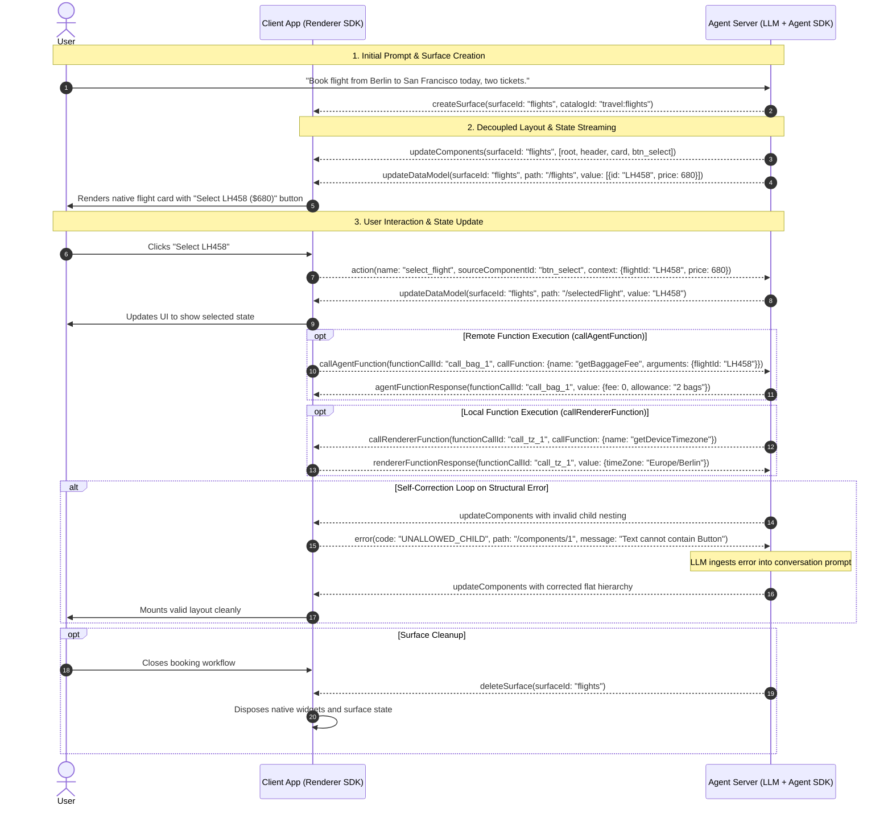

import {Aside, Tabs, TabItem} from '@astrojs/starlight/components';

A2UI coordinates agent runtimes and client renderers through an asynchronous, bidirectional JSON messaging protocol. This page covers top-level message envelopes, agent-to-renderer and renderer-to-agent message payloads, flat component array rules, and full interaction lifecycles. Rather than transferring opaque HTML, images, or executable code, both endpoints exchange structured JSON message envelopes.

These messages govern two concerns:

1. **Layout**: The component hierarchy and visual structure of a surface, streamed by the agent and assembled by the client renderer.
2. **State**: The reactive JSON data model bound to component properties, updated independently by the agent or modified locally by user interactions.

This separation keeps token consumption low, enables incremental rendering while an agent generates responses, and allows client applications to render native UI components across Web, Flutter, SwiftUI, and Jetpack Compose.

---

## Protocol architecture and envelope rename

A2UI messages travel across standard transport mechanisms without assuming HTTP request-response symmetry. Depending on the hosting environment, A2UI runs over:

- **Agent-to-Agent (A2A)**: Asynchronous task messages between autonomous agents.
- **Model Context Protocol (MCP)**: Tool calls and resource notifications in MCP clients and servers.
- **Agent-GUI (AG-UI)**: Direct streaming connections between agent backends and web or native client applications.
- **WebSocket and Server-Sent Events (SSE)**: Duplex sockets or SSE streams paired with upstream HTTP POST requests.

Every message payload is an independent JSON object on the wire.

### Separation of layout and state

A core design principle of A2UI is the strict separation of layout structure from surface data:

- **Layout messages** ([`updateComponents`](/specification/v1.0/schemas/#agent_to_renderer.json/$defs/UpdateComponentsMessage)) describe the component tree using a flat list of component definitions. The agent emits layout once, or sends targeted structural updates when the UI topology changes.
- **State messages** ([`updateDataModel`](/specification/v1.0/schemas/#agent_to_renderer.json/$defs/UpdateDataModelMessage)) mutate a reactive JSON data model scoped to the surface using [RFC 6901 JSON Pointers](https://datatracker.ietf.org/doc/html/rfc6901).

When dynamic values change—such as a live flight price, a countdown timer, or a selected dropdown index—the agent sends an `updateDataModel` message targeting only that JSON path. The client updates its reactive signals, triggering re-renders only on the specific widgets bound to that path. The agent never re-transmits the surrounding component tree just to refresh data.

### Top-level envelope rename in v1.0

The protocol envelope schemas were renamed between v0.9.1 and v1.0 to reflect agentic architectures:

- In **v0.9.1**, envelopes were named `server_to_client.json` and `client_to_server.json`.
- In **v1.0**, envelopes are named `agent_to_renderer.json` and `renderer_to_agent.json`.

This rename decouples the protocol roles from physical hosting infrastructure. An agent may run on a remote server, locally on a user's machine, or inside an embedded agent runtime. Similarly, a renderer may run inside a web browser, a mobile operating system, a terminal, or an automated testing harness.

The top-level envelope requires a `"version"` property:

- In **v1.0**, the version value is strictly `"1.0"` (without a `"v"` prefix).
- In **v0.9.1**, the version value is `"v0.9"` or `"v0.9.1"`.

<Tabs syncKey="protocol-version">
  <TabItem label="v1.0 (Candidate)">
```json
{
  "version": "1.0",
  "createSurface": {
    "surfaceId": "flight_booking",
    "catalogId": "travel:flights"
  }
}
```
  </TabItem>
  <TabItem label="v0.9.1 (Active)">
```json
{
  "version": "v0.9",
  "createSurface": {
    "surfaceId": "flight_booking",
    "catalogId": "travel:flights"
  }
}
```
  </TabItem>
</Tabs>

---

## Agent-to-renderer messages

Messages sent from the agent to the renderer are governed by [`agent_to_renderer.json`](/specification/v1.0/schemas/#agent_to_renderer.json) in v1.0 and [`server_to_client.json`](/specification/v0.9.1/schemas/#server_to_client.json) in v0.9.1.

The top-level object is a discriminated union containing the `"version"` field and exactly one message payload key.

### `createSurface`

The `createSurface` message allocates a new UI surface identified by a unique `surfaceId`. Creating a surface implicitly instantiates the canonical `Surface` container component (`common_types.json#/$defs/Surface`) with `child: "root"`. The `surfaceId` must be globally unique for the renderer's lifetime.

- Canonical Schema (v1.0): [`CreateSurfaceMessage`](/specification/v1.0/schemas/#agent_to_renderer.json/$defs/CreateSurfaceMessage)
- Canonical Schema (v0.9.1): [`CreateSurfaceMessage`](/specification/v0.9.1/schemas/#server_to_client.json/$defs/CreateSurfaceMessage)

#### Properties

| Property              | Type    | Required                            | Description                                                                                                                                                                                                      |
| :-------------------- | :------ | :---------------------------------- | :--------------------------------------------------------------------------------------------------------------------------------------------------------------------------------------------------------------- |
| `surfaceId`           | string  | Yes                                 | Unique identifier for the surface.                                                                                                                                                                               |
| `catalogId`           | string  | Optional (v1.0) / Required (v0.9.1) | Default catalog URI for this surface (e.g. `travel:flights`). In v1.0, individual components can declare their own `catalogId` if omitted here.                                                                  |
| `sendDataModel`       | boolean | Optional                            | When `true`, the renderer transmits the full surface data model alongside every upstream message in transport metadata (`a2uiRendererDataModel` in v1.0 / `a2uiClientDataModel` in v0.9.1). Defaults to `false`. |
| `components`          | array   | Optional (v1.0 only)                | Inline component definitions. Allows the agent to instantiate a complete UI tree in a single wire message.                                                                                                       |
| `dataModel`           | object  | Optional (v1.0 only)                | Initial root data model object for the surface.                                                                                                                                                                  |
| `metadata.extensions` | object  | Optional (v1.0 only)                | Extensibility map for custom protocol extensions. Extension keys must adhere to UAX #31.                                                                                                                         |

#### Structural changes between v0.9.1 and v1.0

1. **`theme` removed**: v0.9.1 included an optional `theme` object. In v1.0, hardcoded theme overrides are removed from protocol envelopes so visual styling defers entirely to native host application themes.
2. **`catalogId` optional**: In v0.9.1, `catalogId` was required on `createSurface`. In v1.0, `catalogId` is optional; components and function calls that omit `catalogId` fall back to the surface default when provided.
3. **Single-message instantiation**: In v1.0, `components` and `dataModel` can be passed inline inside `createSurface`, eliminating the need to send subsequent `updateComponents` and `updateDataModel` messages for initial renders.

<Tabs syncKey="protocol-version">
  <TabItem label="v1.0 (Candidate)">
```json
{
  "version": "1.0",
  "createSurface": {
    "surfaceId": "flight_search",
    "catalogId": "travel:flights",
    "sendDataModel": false,
    "components": [
      {
        "id": "root",
        "component": "Column",
        "children": ["title", "flight_card"]
      },
      {
        "id": "title",
        "component": "Text",
        "text": "Available Flights"
      },
      {
        "id": "flight_card",
        "component": "Card",
        "child": "flight_info"
      },
      {
        "id": "flight_info",
        "component": "Text",
        "text": {"@path": "/flights/0/summary"}
      }
    ],
    "dataModel": {
      "flights": [
        {"summary": "LH458 · BER -> SFO · $680"}
      ]
    }
  }
}
```
  </TabItem>
  <TabItem label="v0.9.1 (Active)">
```json
{
  "version": "v0.9",
  "createSurface": {
    "surfaceId": "flight_search",
    "catalogId": "travel:flights",
    "sendDataModel": false
  }
}
```
  </TabItem>
</Tabs>

---

### `updateComponents`

The `updateComponents` message updates the component hierarchy of an existing surface. The agent can send this message multiple times during a session to add new nodes, replace existing nodes, or reorganize subtrees.

- Canonical Schema (v1.0): [`UpdateComponentsMessage`](/specification/v1.0/schemas/#agent_to_renderer.json/$defs/UpdateComponentsMessage)
- Canonical Schema (v0.9.1): [`UpdateComponentsMessage`](/specification/v0.9.1/schemas/#server_to_client.json/$defs/UpdateComponentsMessage)

#### Properties

| Property     | Type   | Required | Description                                                                                                                      |
| :----------- | :----- | :------- | :------------------------------------------------------------------------------------------------------------------------------- |
| `surfaceId`  | string | Yes      | The identifier of the surface to update.                                                                                         |
| `components` | array  | Yes      | A flat array of component objects. Exactly one component must have `id: "root"` (or refer to a previously mounted subtree root). |

When the renderer receives `updateComponents`, it merges the components into its internal component registry for that `surfaceId`. Any component whose `id` already exists in the surface is replaced with the new definition.

<Tabs syncKey="protocol-version">
  <TabItem label="v1.0 (Candidate)">
```json
{
  "version": "1.0",
  "updateComponents": {
    "surfaceId": "flight_search",
    "components": [
      {
        "id": "root",
        "component": "Column",
        "children": ["header", "flight_list"]
      },
      {
        "id": "header",
        "component": "Text",
        "text": "Outbound Flights"
      },
      {
        "id": "flight_list",
        "component": "Column",
        "children": ["flight_lh458"]
      },
      {
        "id": "flight_lh458",
        "component": "Button",
        "text": "Select LH458 ($680)",
        "action": {
          "event": {
            "name": "select_flight",
            "context": {
              "flightId": "LH458",
              "price": 680
            }
          }
        }
      }
    ]
  }
}
```
  </TabItem>
  <TabItem label="v0.9.1 (Active)">
```json
{
  "version": "v0.9",
  "updateComponents": {
    "surfaceId": "flight_search",
    "components": [
      {
        "id": "root",
        "component": "Column",
        "children": ["header", "flight_list"]
      },
      {
        "id": "header",
        "component": "Text",
        "text": "Outbound Flights"
      },
      {
        "id": "flight_list",
        "component": "Column",
        "children": ["flight_lh458"]
      },
      {
        "id": "flight_lh458",
        "component": "Button",
        "text": "Select LH458 ($680)",
        "action": {
          "event": {
            "name": "select_flight",
            "context": {
              "flightId": "LH458",
              "price": 680
            }
          }
        }
      }
    ]
  }
}
```
  </TabItem>
</Tabs>

---

### `updateDataModel`

The `updateDataModel` message updates the surface data model at a targeted location using an RFC 6901 JSON Pointer.

- Canonical Schema (v1.0): [`UpdateDataModelMessage`](/specification/v1.0/schemas/#agent_to_renderer.json/$defs/UpdateDataModelMessage)
- Canonical Schema (v0.9.1): [`UpdateDataModelMessage`](/specification/v0.9.1/schemas/#server_to_client.json/$defs/UpdateDataModelMessage)

#### Properties

| Property    | Type   | Required                            | Description                                                                                                                                                        |
| :---------- | :----- | :---------------------------------- | :----------------------------------------------------------------------------------------------------------------------------------------------------------------- |
| `surfaceId` | string | Yes                                 | The identifier of the target surface.                                                                                                                              |
| `path`      | string | Optional                            | RFC 6901 JSON Pointer indicating where to apply the update (e.g. `"/selectedFlight"`). If omitted or set to `"/"`, the update replaces the entire root data model. |
| `value`     | any    | Required (v1.0) / Optional (v0.9.1) | The new value to store at `path`.                                                                                                                                  |

<Aside type="caution" title="Key deletion version delta">
In **v1.0**, `value` is a required property. To delete a key or path from the data model, set `"value": null` explicitly.

In **v0.9.1**, `value` was optional. Providing `value` replaced or created the value at `path`, whereas omitting `value` entirely deleted the key at `path`.

</Aside>

<Tabs syncKey="protocol-version">
  <TabItem label="v1.0 (Candidate)">
```json
{
  "version": "1.0",
  "updateDataModel": {
    "surfaceId": "flight_search",
    "path": "/selectedFlight",
    "value": {
      "flightId": "LH458",
      "status": "confirmed",
      "passengers": 2
    }
  }
}
```

To delete the `/selectedFlight` key in v1.0:

```json
{
  "version": "1.0",
  "updateDataModel": {
    "surfaceId": "flight_search",
    "path": "/selectedFlight",
    "value": null
  }
}
```

  </TabItem>
  <TabItem label="v0.9.1 (Active)">
```json
{
  "version": "v0.9",
  "updateDataModel": {
    "surfaceId": "flight_search",
    "path": "/selectedFlight",
    "value": {
      "flightId": "LH458",
      "status": "confirmed",
      "passengers": 2
    }
  }
}
```

To delete the `/selectedFlight` key in v0.9.1, omit `value`:

```json
{
  "version": "v0.9",
  "updateDataModel": {
    "surfaceId": "flight_search",
    "path": "/selectedFlight"
  }
}
```

  </TabItem>
</Tabs>

---

### `deleteSurface`

The `deleteSurface` message instructs the renderer to destroy the surface identified by `surfaceId`. The renderer unmounts all native widgets, disposes reactive listeners, and releases associated memory.

- Canonical Schema (v1.0): [`DeleteSurfaceMessage`](/specification/v1.0/schemas/#agent_to_renderer.json/$defs/DeleteSurfaceMessage)
- Canonical Schema (v0.9.1): [`DeleteSurfaceMessage`](/specification/v0.9.1/schemas/#server_to_client.json/$defs/DeleteSurfaceMessage)

<Tabs syncKey="protocol-version">
  <TabItem label="v1.0 (Candidate)">
```json
{
  "version": "1.0",
  "deleteSurface": {
    "surfaceId": "flight_search"
  }
}
```
  </TabItem>
  <TabItem label="v0.9.1 (Active)">
```json
{
  "version": "v0.9",
  "deleteSurface": {
    "surfaceId": "flight_search"
  }
}
```
  </TabItem>
</Tabs>

---

### `callRendererFunction` (v1.0 only)

The `callRendererFunction` message is an agent-initiated remote procedure call (RPC). It directs the renderer to execute a function defined in a catalog locally on the client (such as reading screen geometry, querying device orientation, or opening a native dialog).

- Canonical Schema (v1.0): [`CallRendererFunctionMessage`](/specification/v1.0/schemas/#agent_to_renderer.json/$defs/CallRendererFunctionMessage)

<Aside type="note" title="New in v1.0">
  This message is introduced in protocol v1.0. In v0.9.1, `server_to_client.json` did not define an
  agent-to-renderer function invocation message.
</Aside>

#### Properties

| Property         | Type   | Required | Description                                                                                                                                |
| :--------------- | :----- | :------- | :----------------------------------------------------------------------------------------------------------------------------------------- |
| `functionCallId` | string | Yes      | Unique correlation identifier for this call. The renderer returns this exact ID in `rendererFunctionResponse`.                             |
| `callFunction`   | object | Yes      | The function invocation details. Must include `catalogId`, `name`, and optional `arguments`.                                               |
| `surfaceId`      | string | Optional | Surface ID whose data model provides the evaluation context. If omitted, the function executes in a root context with an empty data model. |

```json
{
  "version": "1.0",
  "callRendererFunction": {
    "surfaceId": "flight_search",
    "functionCallId": "call_geo_101",
    "callFunction": {
      "catalogId": "device:sensors",
      "name": "getDeviceTimezone",
      "arguments": {}
    }
  }
}
```

The renderer must respond with a [`rendererFunctionResponse`](#rendererfunctionresponse-v10-only) containing matching `functionCallId`.

---

### `agentFunctionResponse` (v1.0 only)

The `agentFunctionResponse` message delivers the agent's response to a preceding [`callAgentFunction`](#callagentfunction-v10-only) message initiated by the renderer.

- Canonical Schema (v1.0): [`AgentFunctionResponseMessage`](/specification/v1.0/schemas/#agent_to_renderer.json/$defs/AgentFunctionResponseMessage)

#### Properties

| Property         | Type   | Required | Description                                                                      |
| :--------------- | :----- | :------- | :------------------------------------------------------------------------------- |
| `functionCallId` | string | Yes      | The correlation identifier copied from the original `callAgentFunction` request. |
| `value`          | any    | Optional | The return value produced by the function execution on success.                  |
| `error`          | string | Optional | An error message string if function execution failed on the agent.               |

```json
{
  "version": "1.0",
  "agentFunctionResponse": {
    "functionCallId": "call_baggage_202",
    "value": {
      "allowedBags": 2,
      "maxWeightKg": 23,
      "feePerExtraBag": 75
    }
  }
}
```

---

## Renderer-to-agent messages

Messages sent from the renderer back to the agent are governed by [`renderer_to_agent.json`](/specification/v1.0/schemas/#renderer_to_agent.json) in v1.0 and [`client_to_server.json`](/specification/v0.9.1/schemas/#client_to_server.json) in v0.9.1.

Like agent messages, each payload contains `"version"` and one message key.

### `action`

The `action` message notifies the agent that the user interacted with an interactive component (e.g. clicked a button or submitted a form).

- Canonical Schema (v1.0): [`action`](/specification/v1.0/schemas/#renderer_to_agent.json/properties/action)
- Canonical Schema (v0.9.1): [`action`](/specification/v0.9.1/schemas/#client_to_server.json/properties/action)

#### Properties

| Property              | Type              | Required             | Description                                                                                                                          |
| :-------------------- | :---------------- | :------------------- | :----------------------------------------------------------------------------------------------------------------------------------- |
| `name`                | string            | Yes                  | The action event name declared on the component's `action.event.name`.                                                               |
| `surfaceId`           | string            | Yes                  | The surface ID where the interaction occurred.                                                                                       |
| `sourceComponentId`   | string            | Yes                  | The component `id` that triggered the action.                                                                                        |
| `timestamp`           | string (ISO 8601) | Yes                  | Timestamp indicating when the user triggered the action.                                                                             |
| `context`             | object            | Yes                  | Resolved key-value dictionary from `action.event.context`, with all reactive bindings (`@path` / `path`) resolved to current values. |
| `userMessage`         | string            | Optional (v1.0 only) | Human-readable string resolved from `action.event.userMessage`, suitable for direct ingestion into LLM conversation turns.           |
| `metadata.extensions` | object            | Optional (v1.0 only) | Extensibility map for client-specific metadata.                                                                                      |

#### Full data model transport metadata

When `createSurface` sets `sendDataModel: true`, the client synchronizes the entire surface data model back to the agent with every interaction.

However, the data model is **not** placed inside the `action` payload. Instead, it travels alongside in transport metadata:

- Under **v1.0**, the transport metadata key is `a2uiRendererDataModel`.
- Under **v0.9.1**, the transport metadata key is `a2uiClientDataModel`.

This distinction preserves clean protocol boundaries: the `action` message remains focused on event semantics, while transports (such as A2A message headers or MCP metadata) carry the snapshot.

<Tabs syncKey="protocol-version">
  <TabItem label="v1.0 (Candidate)">
```json
{
  "version": "1.0",
  "action": {
    "name": "select_flight",
    "surfaceId": "flight_search",
    "sourceComponentId": "btn_select_lh458",
    "timestamp": "2026-11-02T10:15:30.000Z",
    "userMessage": "Selected flight LH458 for 2 passengers",
    "context": {
      "flightId": "LH458",
      "cabin": "economy",
      "price": 680
    }
  }
}
```
  </TabItem>
  <TabItem label="v0.9.1 (Active)">
```json
{
  "version": "v0.9",
  "action": {
    "name": "select_flight",
    "surfaceId": "flight_search",
    "sourceComponentId": "btn_select_lh458",
    "timestamp": "2026-11-02T10:15:30.000Z",
    "context": {
      "flightId": "LH458",
      "cabin": "economy",
      "price": 680
    }
  }
}
```
  </TabItem>
</Tabs>

---

### `callAgentFunction` (v1.0 only)

The `callAgentFunction` message is a client-initiated RPC requesting that the agent execute a function remotely (such as querying backend databases, calculating live shipping rates, or checking inventory).

- Canonical Schema (v1.0): [`callAgentFunction`](/specification/v1.0/schemas/#renderer_to_agent.json/properties/callAgentFunction)

#### Properties

| Property         | Type   | Required | Description                                                                                        |
| :--------------- | :----- | :------- | :------------------------------------------------------------------------------------------------- |
| `surfaceId`      | string | Yes      | The surface ID where the call originated.                                                          |
| `functionCallId` | string | Yes      | Unique correlation identifier for this call. The agent returns this ID in `agentFunctionResponse`. |
| `callFunction`   | object | Yes      | The function call details, including `catalogId`, `name`, and optional `arguments`.                |

```json
{
  "version": "1.0",
  "callAgentFunction": {
    "surfaceId": "flight_search",
    "functionCallId": "call_baggage_202",
    "callFunction": {
      "catalogId": "travel:flights",
      "name": "getBaggageAllowance",
      "arguments": {
        "flightId": "LH458",
        "cabin": "economy"
      }
    }
  }
}
```

---

### `rendererFunctionResponse` (v1.0 only)

The `rendererFunctionResponse` message delivers the renderer's return value or execution error to a preceding [`callRendererFunction`](#callrendererfunction-v10-only) message.

- Canonical Schema (v1.0): [`rendererFunctionResponse`](/specification/v1.0/schemas/#renderer_to_agent.json/properties/rendererFunctionResponse)

#### Properties

| Property         | Type   | Required | Description                                                                         |
| :--------------- | :----- | :------- | :---------------------------------------------------------------------------------- |
| `functionCallId` | string | Yes      | The correlation identifier copied from the original `callRendererFunction` request. |
| `value`          | any    | Optional | The return value produced by the renderer function on success.                      |
| `error`          | string | Optional | An error message string if execution failed on the renderer.                        |

```json
{
  "version": "1.0",
  "rendererFunctionResponse": {
    "functionCallId": "call_geo_101",
    "value": {
      "timeZone": "Europe/Berlin",
      "utcOffsetMinutes": 60
    }
  }
}
```

---

### `error` and the self-correction loop

The `error` message reports validation errors, catalog constraint violations, or runtime exceptions encountered by the renderer.

- Canonical Schema (v1.0): [`error`](/specification/v1.0/schemas/#renderer_to_agent.json/properties/error)
- Canonical Schema (v0.9.1): [`error`](/specification/v0.9.1/schemas/#client_to_server.json/properties/error)

#### Error types and codes

The protocol defines two error shapes:

1. **Validation errors**: Fired when incoming messages violate JSON Schema specifications, reference unknown components, or break catalog topological constraints.
   - In **v1.0**, `code` is an enum with three values:
     - `VALIDATION_FAILED`: Schema property mismatch, missing required field, or invalid data type.
     - `UNALLOWED_PARENT`: The component was placed inside a parent component that does not permit it (violating `allowedParents`).
     - `UNALLOWED_CHILD`: The component contains a child component type that is not permitted (violating `allowedChildren`).
   - In **v0.9.1**, `code` was strictly `VALIDATION_FAILED`.
   - Requires `surfaceId`, `path` (JSON Pointer to the failing node), and `message`.
2. **Generic runtime errors**: Fired during function execution or unexpected runtime faults.
   - In **v1.0**, generic errors require `code` and `message`, paired with either `surfaceId` or `functionCallId` (mutually exclusive). This allows function failures to reference their `functionCallId` directly without requiring a surface.
   - In **v0.9.1**, generic errors required `surfaceId`, `code`, and `message`.

#### The self-correction loop

Structured errors enable automatic error recovery without human intervention:

1. The LLM generates an invalid component structure (for example, placing a `Button` inside a `Text` widget, violating `allowedChildren`).
2. The Core SDK validator on the client intercepts the payload before mounting widgets, rejects the subtree, and emits an `error` message with `code: "UNALLOWED_CHILD"` and `path: "/components/1"`.
3. The Agent SDK intercepts this error message and feeds it directly into the LLM conversation context as an observation: `"Renderer rejected component at /components/1: UNALLOWED_CHILD"`.
4. The agent corrects the structure and emits a valid `updateComponents` message. The client mounts the corrected UI cleanly.

<Tabs syncKey="protocol-version">
  <TabItem label="v1.0 (Candidate)">
```json
{
  "version": "1.0",
  "error": {
    "code": "UNALLOWED_CHILD",
    "surfaceId": "flight_search",
    "path": "/components/1/children/0",
    "message": "Component 'Text' does not permit child component of type 'Button'."
  }
}
```

Generic function execution error in v1.0 citing `functionCallId`:

```json
{
  "version": "1.0",
  "error": {
    "code": "GEOLOCATION_PERMISSION_DENIED",
    "functionCallId": "call_geo_101",
    "message": "User denied device location permissions."
  }
}
```

  </TabItem>
  <TabItem label="v0.9.1 (Active)">
```json
{
  "version": "v0.9",
  "error": {
    "code": "VALIDATION_FAILED",
    "surfaceId": "flight_search",
    "path": "/components/1",
    "message": "Component validation failed against catalog schema."
  }
}
```
  </TabItem>
</Tabs>

---

## Flat component trees and identifier rules

A2UI represents UI hierarchies as flat adjacency lists rather than nested JSON trees.

```json
[
  {"id": "root", "component": "Card", "child": "flight_col"},
  {"id": "flight_col", "component": "Column", "children": ["title", "select_btn"]},
  {"id": "title", "component": "Text", "text": "Flight LH458"},
  {"id": "select_btn", "component": "Button", "text": "Book"}
]
```

### Why flat arrays instead of nested trees

Nested JSON trees present practical difficulties for generative AI interfaces:

1. **LLM streaming stability**: Deeply nested trees require language models to maintain long syntactic stacks across streaming chunks. If a token stream is interrupted, deep closing braces break parser integrity. Flat arrays allow models to output discrete component objects line by line.
2. **Surgical, targeted mutations**: In a nested tree, modifying a single leaf node requires replacing the entire ancestor path or calculating complex multi-level JSON pointers. With an adjacency list, sending `{ "id": "select_btn", "text": "Confirmed" }` updates that single node in place, leaving parents, siblings, and child nodes untouched.
3. **Graph flexibility and templating**: Container components reference child IDs through simple strings (`child: "flight_col"`) or slot lists (`children: ["title", "select_btn"]`). Dynamic collection templates (`ChildList`) map an array in the data model to a template component ID with zero duplication of layout logic.

### The single `root` ID rule

Every surface component tree must have exactly one component with `"id": "root"`.

When `createSurface` is processed, the renderer creates an implicit surface container node whose `child` points to `"root"`. The component with `id: "root"` anchors the hierarchy; all other visible components must be reachable as direct or indirect descendants of this root node.

### UAX #31 identifier requirements

For reliable code generation, serialization, and cross-language interoperability across TypeScript, Python, Dart, and Swift, v1.0 requires all identifiers to follow [Unicode Standard Annex #31 (UAX #31)](https://www.unicode.org/reports/tr31/).

This rule applies to:

- Component instance IDs ([`ComponentId`](/specification/v1.0/schemas/#common_types.json/$defs/ComponentId))
- Component types (e.g. `Text`, `Button`)
- Function names (e.g. `formatCurrency`, `getDeviceTimezone`)
- Argument and property keys (e.g. `flightId`, `selected_index`)
- Metadata extension keys (`metadata.extensions`)

#### Syntax rules

1. **Start character**: Must begin with a character in the Unicode property class `XID_Start` or an underscore (`_`, `U+005F`).
2. **Subsequent characters**: Must belong to the Unicode property class `XID_Continue`.
3. **Prohibited starts**: Must not start with a decimal digit (`0`–`9`).
4. **Prohibited punctuation**: Must not contain hyphens (`-`), spaces, periods (`.`), slashes, or symbol characters.

| Identifier        | Status      | Reason                                                      |
| :---------------- | :---------- | :---------------------------------------------------------- |
| `root`            | Valid       | Standard alphabetic string.                                 |
| `flight_card`     | Valid       | Uses underscore in `XID_Continue`.                          |
| `btnSubmit`       | Valid       | CamelCase conforms to `XID_Start` and `XID_Continue`.       |
| `flight_1_select` | Valid       | Digits are permitted after initial character.               |
| `_temp_slot`      | Valid       | Underscore is allowed as initial character.                 |
| `flight-card`     | **Invalid** | Hyphen (`-`) is prohibited by UAX #31.                      |
| `1st_flight`      | **Invalid** | Cannot begin with a decimal digit.                          |
| `flight card`     | **Invalid** | Whitespace is prohibited.                                   |
| `user.name`       | **Invalid** | Periods are reserved for path syntax and prohibited in IDs. |

<Aside type="note" title="Normative prose vs. schema regex">
In [`common_types.json#/$defs/ComponentId`](/specification/v1.0/schemas/#common_types.json/$defs/ComponentId), `ComponentId` is defined simply as `"type": "string"` without an embedded regex pattern.

However, UAX #31 compliance is a **normative prose requirement** specified in the A2UI protocol specification. Official A2UI SDKs, parsers, and conformance test suites enforce UAX #31 to prevent runtime collisions in target languages.

</Aside>

---

## End-to-end flight booking sequence

The following sequence diagram traces the complete lifecycle of a surface across five operational phases in a flight booking scenario. In phase 1, the user's natural language request prompts the agent to allocate an isolated surface via `createSurface`. In phase 2, the agent streams decoupled `updateComponents` layout and `updateDataModel` flight state messages, which the client renders as native cards. In phase 3, the user clicks a flight card, causing the client to dispatch an `action` message with bound context data back to the agent, which responds with an incremental `updateDataModel` state mutation. Optional branches demonstrate remote agent function calls (`callAgentFunction`), agent-initiated device queries (`callRendererFunction`), runtime error reporting (`error` with `UNALLOWED_CHILD` triggering the LLM self-correction loop), and eventual surface disposal via `deleteSurface`.


