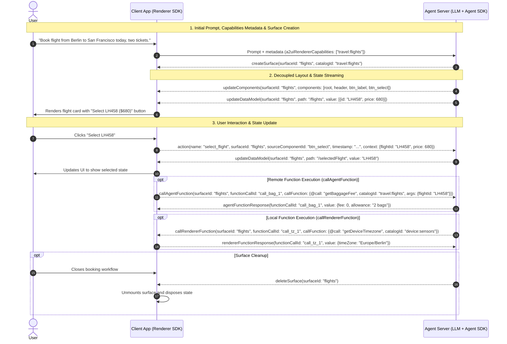

import {Aside, Tabs, TabItem} from '@astrojs/starlight/components';
import SchemaChips from '../../../components/docs/common/SchemaChips.astro';

A2UI agents and client renderers communicate by exchanging explicit, asynchronous JSON messages in both directions: agents send messages to create surfaces, update component trees, update data models, and call renderer functions, while renderers send messages back to report user actions and invoke or respond to function calls. Each wire message is an independent JSON object containing a `"version"` field (`"1.0"` in v1.0, or `"v0.9"` / `"v0.9.1"` in v0.9.1) and a single message key, carried over transports such as [AG-UI](https://docs.ag-ui.com/introduction), [Agent-to-Agent (A2A)](https://a2a-protocol.org), [Model Context Protocol (MCP)](https://modelcontextprotocol.io), WebSockets, or Server-Sent Events (SSE).

Alongside explicit A2UI messages, the protocol uses [metadata](#metadata) when A2UI context needs to piggyback onto requests triggered for other purposes. Transport metadata travels from the renderer to the agent: for example, when a user sends a text prompt, the renderer attaches its supported catalogs (`a2uiRendererCapabilities` in v1.0 / `a2uiClientCapabilities` in v0.9.1) or synchronized surface state (`a2uiRendererDataModel` / `a2uiClientDataModel`) to the outgoing transport request. In v1.0, explicit wire messages in both directions (`createSurface` from agent to renderer, and `action` from renderer to agent) can also carry an optional `metadata` field for custom application extensions.

---

## Agent-to-renderer messages

Agent-to-renderer messages construct surfaces, update component hierarchies and reactive data models, clean up surfaces, invoke client-side functions, and return results for agent-side function calls.

<SchemaChips
  items={[
    {
      version: 'v1.0',
      label: 'agent_to_renderer.json',
      href: '/specification/v1.0/schemas/#agent_to_renderer.json',
      title: 'v1.0 Agent-to-Renderer Message Schema',
    },
    {
      version: 'v0.9.1',
      label: 'server_to_client.json',
      href: '/specification/v0.9.1/schemas/#server_to_client.json',
      title: 'v0.9.1 Server-to-Client Message Schema',
    },
  ]}
/>

### `createSurface`

<SchemaChips
  items={[
    {
      version: 'v1.0',
      label: 'agent_to_renderer.json#CreateSurfaceMessage',
      href: '/specification/v1.0/schemas/#agent_to_renderer.json/$defs/CreateSurfaceMessage',
    },
    {
      version: 'v0.9.1',
      label: 'server_to_client.json#CreateSurfaceMessage',
      href: '/specification/v0.9.1/schemas/#server_to_client.json/$defs/CreateSurfaceMessage',
    },
  ]}
/>

The `createSurface` message allocates a new UI surface identified by `surfaceId`. The `surfaceId` must be globally unique within the rendering context (the `MessageProcessor` instance on the renderer), which is typically a conversation. Creating a surface implicitly instantiates the reserved [`Surface`](/specification/v1.0/schemas/#common_types.json/$defs/Surface) container component with `child: "root"`.

#### Properties

| Property        | Type    | Required                      | Description                                                                                                                                                                                      |
| :-------------- | :------ | :---------------------------- | :----------------------------------------------------------------------------------------------------------------------------------------------------------------------------------------------- |
| `surfaceId`     | string  | Yes                           | Unique identifier for the surface.                                                                                                                                                               |
| `catalogId`     | string  | Optional (v1.0), Yes (v0.9.1) | Default catalog identifier for this surface (for example, `travel:flights`). In v1.0, individual components and function calls can specify their own `catalogId` when omitted here.              |
| `sendDataModel` | boolean | Optional                      | When `true`, the renderer attaches the full surface data model in transport metadata (`a2uiRendererDataModel` in v1.0 / `a2uiClientDataModel` in v0.9.1) on every message to the creating agent. |
| `components`    | array   | Optional (v1.0)               | Initial flat list of component definitions, allowing single-message surface creation.                                                                                                            |
| `dataModel`     | object  | Optional (v1.0)               | Initial root data model JSON object for the surface.                                                                                                                                             |
| `metadata`      | object  | Optional (v1.0)               | Surface-level metadata object containing optional `extensions` ([`Extensions`](/specification/v1.0/schemas/#common_types.json/$defs/Extensions)) with Unicode UAX #31 keys.                      |

<Aside type="note" title="Changes in v1.0">
  In v1.0, `catalogId` is optional, `components` and `dataModel` can be passed inline to initialize
  a surface in a single message, and the v0.9.1 `theme` property is removed in favor of host
  application styling.
</Aside>

<Tabs syncKey="protocol-version">
  <TabItem label="v1.0 (Candidate)">
```json
{
  "version": "1.0",
  "createSurface": {
    "surfaceId": "flight_search",
    "catalogId": "https://a2ui.org/specification/v1_0/catalogs/basic/catalog.json",
    "sendDataModel": false,
    "components": [
      {
        "id": "root",
        "component": "Column",
        "children": ["title", "flight_card"]
      },
      {
        "id": "title",
        "component": "Text",
        "text": "Available Flights"
      },
      {
        "id": "flight_card",
        "component": "Card",
        "child": "flight_info"
      },
      {
        "id": "flight_info",
        "component": "Text",
        "text": {"@path": "/flights/0/summary"}
      }
    ],
    "dataModel": {
      "flights": [
        {"summary": "LH458 · BER -> SFO · $680", "price": 680}
      ]
    }
  }
}
```
  </TabItem>
  <TabItem label="v0.9.1 (Active)">
```json
{
  "version": "v0.9",
  "createSurface": {
    "surfaceId": "flight_search",
    "catalogId": "https://a2ui.org/specification/v0_9/catalogs/basic/catalog.json",
    "sendDataModel": false
  }
}
```
  </TabItem>
</Tabs>

---

### `updateComponents`

<SchemaChips
  items={[
    {
      version: 'v1.0',
      label: 'agent_to_renderer.json#UpdateComponentsMessage',
      href: '/specification/v1.0/schemas/#agent_to_renderer.json/$defs/UpdateComponentsMessage',
    },
    {
      version: 'v0.9.1',
      label: 'server_to_client.json#UpdateComponentsMessage',
      href: '/specification/v0.9.1/schemas/#server_to_client.json/$defs/UpdateComponentsMessage',
    },
  ]}
/>

The `updateComponents` message adds or replaces component definitions in an existing surface. Relationships between components are expressed by ID references in a flat adjacency list rather than nested JSON trees, and one component in the surface must have `id: "root"`.

#### Properties

| Property     | Type   | Required | Description                                                                                                                   |
| :----------- | :----- | :------- | :---------------------------------------------------------------------------------------------------------------------------- |
| `surfaceId`  | string | Yes      | Identifier of the surface to update.                                                                                          |
| `components` | array  | Yes      | Non-empty flat array of component objects. Components whose `id` already exists in the surface replace the stored definition. |

<Tabs syncKey="protocol-version">
  <TabItem label="v1.0 (Candidate)">
```json
{
  "version": "1.0",
  "updateComponents": {
    "surfaceId": "flight_search",
    "components": [
      {
        "id": "root",
        "component": "Column",
        "children": ["header", "btn_select_lh458"]
      },
      {
        "id": "header",
        "component": "Text",
        "text": "Outbound Flights"
      },
      {
        "id": "btn_select_label",
        "component": "Text",
        "text": "Select LH458 ($680)"
      },
      {
        "id": "btn_select_lh458",
        "component": "Button",
        "child": "btn_select_label",
        "variant": "primary",
        "action": {
          "event": {
            "name": "select_flight",
            "userMessage": "Selected flight LH458",
            "context": {
              "flightId": "LH458",
              "price": {"@path": "/flights/0/price"}
            }
          }
        }
      }
    ]
  }
}
```
  </TabItem>
  <TabItem label="v0.9.1 (Active)">
```json
{
  "version": "v0.9",
  "updateComponents": {
    "surfaceId": "flight_search",
    "components": [
      {
        "id": "root",
        "component": "Column",
        "children": ["header", "btn_select_lh458"]
      },
      {
        "id": "header",
        "component": "Text",
        "text": "Outbound Flights"
      },
      {
        "id": "btn_select_label",
        "component": "Text",
        "text": "Select LH458 ($680)"
      },
      {
        "id": "btn_select_lh458",
        "component": "Button",
        "child": "btn_select_label",
        "variant": "primary",
        "action": {
          "event": {
            "name": "select_flight",
            "context": {
              "flightId": "LH458",
              "price": {"path": "/flights/0/price"}
            }
          }
        }
      }
    ]
  }
}
```
  </TabItem>
</Tabs>

---

### `updateDataModel`

<SchemaChips
  items={[
    {
      version: 'v1.0',
      label: 'agent_to_renderer.json#UpdateDataModelMessage',
      href: '/specification/v1.0/schemas/#agent_to_renderer.json/$defs/UpdateDataModelMessage',
    },
    {
      version: 'v0.9.1',
      label: 'server_to_client.json#UpdateDataModelMessage',
      href: '/specification/v0.9.1/schemas/#server_to_client.json/$defs/UpdateDataModelMessage',
    },
  ]}
/>

The `updateDataModel` message updates the surface data model at a targeted location using an [RFC 6901 JSON Pointer](https://datatracker.ietf.org/doc/html/rfc6901), allowing the agent to refresh bound values without resending component definitions.

#### Properties

| Property    | Type   | Required                      | Description                                                                                                                                                             |
| :---------- | :----- | :---------------------------- | :---------------------------------------------------------------------------------------------------------------------------------------------------------------------- |
| `surfaceId` | string | Yes                           | Identifier of the target surface.                                                                                                                                       |
| `path`      | string | Optional                      | RFC 6901 JSON Pointer indicating where to apply the update (for example, `"/selectedFlight"`). When omitted or set to `"/"`, the update replaces the entire data model. |
| `value`     | any    | Yes (v1.0), Optional (v0.9.1) | Value to store at `path`.                                                                                                                                               |

<Aside type="caution" title="Key deletion version delta">
  In **v1.0**, `value` is required; set `"value": null` to delete the key at `path`. In **v0.9.1**,
  `value` is optional, and omitting `value` removes the key at `path`.
</Aside>

<Tabs syncKey="protocol-version">
  <TabItem label="v1.0 (Candidate)">
```json
{
  "version": "1.0",
  "updateDataModel": {
    "surfaceId": "flight_search",
    "path": "/selectedFlight",
    "value": {
      "flightId": "LH458",
      "status": "confirmed",
      "passengers": 2
    }
  }
}
```

To delete `/selectedFlight` in v1.0:

```json
{
  "version": "1.0",
  "updateDataModel": {
    "surfaceId": "flight_search",
    "path": "/selectedFlight",
    "value": null
  }
}
```

  </TabItem>
  <TabItem label="v0.9.1 (Active)">
```json
{
  "version": "v0.9",
  "updateDataModel": {
    "surfaceId": "flight_search",
    "path": "/selectedFlight",
    "value": {
      "flightId": "LH458",
      "status": "confirmed",
      "passengers": 2
    }
  }
}
```

To delete `/selectedFlight` in v0.9.1, omit `value`:

```json
{
  "version": "v0.9",
  "updateDataModel": {
    "surfaceId": "flight_search",
    "path": "/selectedFlight"
  }
}
```

  </TabItem>
</Tabs>

---

### `deleteSurface`

<SchemaChips
  items={[
    {
      version: 'v1.0',
      label: 'agent_to_renderer.json#DeleteSurfaceMessage',
      href: '/specification/v1.0/schemas/#agent_to_renderer.json/$defs/DeleteSurfaceMessage',
    },
    {
      version: 'v0.9.1',
      label: 'server_to_client.json#DeleteSurfaceMessage',
      href: '/specification/v0.9.1/schemas/#server_to_client.json/$defs/DeleteSurfaceMessage',
    },
  ]}
/>

The `deleteSurface` message instructs the renderer to unmount the surface identified by `surfaceId` and release its component tree and data model state.

#### Properties

| Property    | Type   | Required | Description                        |
| :---------- | :----- | :------- | :--------------------------------- |
| `surfaceId` | string | Yes      | Identifier of the surface to drop. |

<Tabs syncKey="protocol-version">
  <TabItem label="v1.0 (Candidate)">
```json
{
  "version": "1.0",
  "deleteSurface": {
    "surfaceId": "flight_search"
  }
}
```
  </TabItem>
  <TabItem label="v0.9.1 (Active)">
```json
{
  "version": "v0.9",
  "deleteSurface": {
    "surfaceId": "flight_search"
  }
}
```
  </TabItem>
</Tabs>

---

### `callRendererFunction` (v1.0 only)

<SchemaChips
  items={[
    {
      version: 'v1.0',
      label: 'agent_to_renderer.json#CallRendererFunctionMessage',
      href: '/specification/v1.0/schemas/#agent_to_renderer.json/$defs/CallRendererFunctionMessage',
    },
  ]}
/>

The `callRendererFunction` message is an agent-initiated remote procedure call (RPC) that directs the renderer to execute a catalog function registered on the client (for example, reading device timezone or screen dimensions). Only catalog functions declaring `allowedCallers` as `"agentOnly"` or `"rendererOrAgent"` may be called by the agent.

<Aside type="note" title="New in v1.0">
  `callRendererFunction` is introduced in protocol v1.0. In v0.9.1, `server_to_client.json` does not
  define an agent-to-renderer function invocation message.
</Aside>

#### Properties

| Property         | Type   | Required | Description                                                                                                                                                  |
| :--------------- | :----- | :------- | :----------------------------------------------------------------------------------------------------------------------------------------------------------- |
| `functionCallId` | string | Yes      | Unique correlation identifier for this call, copied verbatim into [`rendererFunctionResponse`](#rendererfunctionresponse-v10-only).                          |
| `callFunction`   | object | Yes      | [`FunctionCall`](/specification/v1.0/schemas/#common_types.json/$defs/FunctionCall) object with required `@call`, required `catalogId`, and optional `args`. |
| `surfaceId`      | string | Optional | Surface ID whose data model provides the evaluation context. When omitted, the function executes in an isolated root context with `{}`.                      |

```json
{
  "version": "1.0",
  "callRendererFunction": {
    "surfaceId": "flight_search",
    "functionCallId": "call_tz_101",
    "callFunction": {
      "@call": "getDeviceTimezone",
      "catalogId": "device:sensors",
      "args": {}
    }
  }
}
```

---

### `agentFunctionResponse` (v1.0 only)

<SchemaChips
  items={[
    {
      version: 'v1.0',
      label: 'agent_to_renderer.json#AgentFunctionResponseMessage',
      href: '/specification/v1.0/schemas/#agent_to_renderer.json/$defs/AgentFunctionResponseMessage',
    },
  ]}
/>

The `agentFunctionResponse` message returns the execution result or structured error for a preceding [`callAgentFunction`](#callagentfunction-v10-only) message sent by the renderer.

#### Properties

| Property         | Type   | Required    | Description                                                                                                                        |
| :--------------- | :----- | :---------- | :--------------------------------------------------------------------------------------------------------------------------------- |
| `functionCallId` | string | Yes         | Correlation identifier matching the initiating `callAgentFunction` message.                                                        |
| `value`          | any    | Conditional | Return value produced on success. Exactly one of `value` or `error` must be present.                                               |
| `error`          | object | Conditional | Error object with required `code` (`string`) and `message` (`string`) fields if execution failed. Mutually exclusive with `value`. |

```json
{
  "version": "1.0",
  "agentFunctionResponse": {
    "functionCallId": "call_baggage_202",
    "value": {
      "allowedBags": 2,
      "maxWeightKg": 23,
      "feePerExtraBag": 75
    }
  }
}
```

---

## Renderer-to-agent messages

Renderer-to-agent messages report user interactions, invoke remote functions on the agent, and return results from agent-initiated client function calls.

<SchemaChips
  items={[
    {
      version: 'v1.0',
      label: 'renderer_to_agent.json',
      href: '/specification/v1.0/schemas/#renderer_to_agent.json',
      title: 'v1.0 Renderer-to-Agent Event Schema',
    },
    {
      version: 'v0.9.1',
      label: 'client_to_server.json',
      href: '/specification/v0.9.1/schemas/#client_to_server.json',
      title: 'v0.9.1 Client-to-Server Event Schema',
    },
  ]}
/>

### `action`

<SchemaChips
  items={[
    {
      version: 'v1.0',
      label: 'renderer_to_agent.json#action',
      href: '/specification/v1.0/schemas/#renderer_to_agent.json/properties/action',
    },
    {
      version: 'v0.9.1',
      label: 'client_to_server.json#action',
      href: '/specification/v0.9.1/schemas/#client_to_server.json/properties/action',
    },
  ]}
/>

The `action` message notifies the agent that the user triggered an event action on an interactive component (such as clicking a `Button` configured with `action.event`). Before dispatching the message, the renderer resolves any data bindings inside `action.event.context` and `action.event.userMessage` against the local data model.

#### Properties

| Property            | Type   | Required        | Description                                                                                                                                       |
| :------------------ | :----- | :-------------- | :------------------------------------------------------------------------------------------------------------------------------------------------ |
| `name`              | string | Yes             | Event name declared on the component's `action.event.name`.                                                                                       |
| `surfaceId`         | string | Yes             | Surface ID where the interaction originated.                                                                                                      |
| `sourceComponentId` | string | Yes             | Component `id` that triggered the action.                                                                                                         |
| `timestamp`         | string | Yes             | ISO 8601 date-time string indicating when the event occurred.                                                                                     |
| `context`           | object | Yes             | Resolved key-value dictionary from `action.event.context` with all data bindings evaluated to current values.                                     |
| `userMessage`       | string | Optional (v1.0) | Human-readable string resolved from `action.event.userMessage`, suitable for adding to LLM conversation history.                                  |
| `metadata`          | object | Optional (v1.0) | Renderer-side action metadata containing optional `extensions` ([`Extensions`](/specification/v1.0/schemas/#common_types.json/$defs/Extensions)). |

<Tabs syncKey="protocol-version">
  <TabItem label="v1.0 (Candidate)">
```json
{
  "version": "1.0",
  "action": {
    "name": "select_flight",
    "surfaceId": "flight_search",
    "sourceComponentId": "btn_select_lh458",
    "timestamp": "2026-11-02T10:15:30.000Z",
    "userMessage": "Selected flight LH458",
    "context": {
      "flightId": "LH458",
      "price": 680
    }
  }
}
```
  </TabItem>
  <TabItem label="v0.9.1 (Active)">
```json
{
  "version": "v0.9",
  "action": {
    "name": "select_flight",
    "surfaceId": "flight_search",
    "sourceComponentId": "btn_select_lh458",
    "timestamp": "2026-11-02T10:15:30.000Z",
    "context": {
      "flightId": "LH458",
      "price": 680
    }
  }
}
```
  </TabItem>
</Tabs>

---

### `callAgentFunction` (v1.0 only)

<SchemaChips
  items={[
    {
      version: 'v1.0',
      label: 'renderer_to_agent.json#callAgentFunction',
      href: '/specification/v1.0/schemas/#renderer_to_agent.json/properties/callAgentFunction',
    },
  ]}
/>

The `callAgentFunction` message is a renderer-initiated RPC requesting that the agent execute a function remotely (for example, checking live baggage rules or verifying a backend identifier).

#### Properties

| Property         | Type   | Required | Description                                                                                                                                                  |
| :--------------- | :----- | :------- | :----------------------------------------------------------------------------------------------------------------------------------------------------------- |
| `surfaceId`      | string | Yes      | Surface ID where the call originated.                                                                                                                        |
| `functionCallId` | string | Yes      | Unique correlation identifier for this call, copied verbatim into [`agentFunctionResponse`](#agentfunctionresponse-v10-only).                                |
| `callFunction`   | object | Yes      | [`FunctionCall`](/specification/v1.0/schemas/#common_types.json/$defs/FunctionCall) object with required `@call`, optional `catalogId`, and optional `args`. |

```json
{
  "version": "1.0",
  "callAgentFunction": {
    "surfaceId": "flight_search",
    "functionCallId": "call_baggage_202",
    "callFunction": {
      "@call": "getBaggageAllowance",
      "catalogId": "travel:flights",
      "args": {
        "flightId": "LH458",
        "cabin": "economy"
      }
    }
  }
}
```

---

### `rendererFunctionResponse` (v1.0 only)

<SchemaChips
  items={[
    {
      version: 'v1.0',
      label: 'renderer_to_agent.json#rendererFunctionResponse',
      href: '/specification/v1.0/schemas/#renderer_to_agent.json/properties/rendererFunctionResponse',
    },
  ]}
/>

The `rendererFunctionResponse` message delivers the renderer's return value or structured execution error for a preceding [`callRendererFunction`](#callrendererfunction-v10-only) message.

#### Properties

| Property         | Type   | Required    | Description                                                                                                                        |
| :--------------- | :----- | :---------- | :--------------------------------------------------------------------------------------------------------------------------------- |
| `functionCallId` | string | Yes         | Correlation identifier matching the initiating `callRendererFunction` message.                                                     |
| `value`          | any    | Conditional | Return value produced on success. Exactly one of `value` or `error` must be present.                                               |
| `error`          | object | Conditional | Error object with required `code` (`string`) and `message` (`string`) fields if execution failed. Mutually exclusive with `value`. |

```json
{
  "version": "1.0",
  "rendererFunctionResponse": {
    "functionCallId": "call_tz_101",
    "value": {
      "timeZone": "Europe/Berlin",
      "utcOffsetMinutes": 60
    }
  }
}
```

---

### Metadata

A2UI uses transport metadata when renderer context needs to piggyback on an external transport request (such as `message.metadata` in A2A or request metadata in MCP), and message-level extension metadata (`metadata.extensions` in v1.0) when custom vendor or application fields travel inside explicit `createSurface` or `action` messages. Transport metadata flows from the renderer to the agent, whereas v1.0 `metadata.extensions` can be attached in both directions without violating `additionalProperties: false` schema validation.

| Metadata key / field       | Direction         | Carrier            | Purpose                                                                                                                           |
| :------------------------- | :---------------- | :----------------- | :-------------------------------------------------------------------------------------------------------------------------------- |
| `a2uiRendererCapabilities` | Renderer to Agent | Transport metadata | Advertises supported protocol version, `supportedCatalogIds`, and optional `inlineCatalogs` (`a2uiClientCapabilities` in v0.9.1). |
| `a2uiRendererDataModel`    | Renderer to Agent | Transport metadata | Sends full local data models for surfaces created with `sendDataModel: true` (`a2uiClientDataModel` in v0.9.1).                   |
| `action.metadata`          | Renderer to Agent | Wire message       | Optional v1.0 `extensions` map attached to an `action` event (such as client attestations or audit context).                      |
| `createSurface.metadata`   | Agent to Renderer | Wire message       | Optional v1.0 surface-level `extensions` map attached to `createSurface` (such as session telemetry IDs or access policies).      |

#### Capabilities and data model transport metadata

<SchemaChips
  items={[
    {
      version: 'v1.0',
      label: 'renderer_capabilities.json',
      href: '/specification/v1.0/schemas/#renderer_capabilities.json',
    },
    {
      version: 'v0.9.1',
      label: 'client_capabilities.json',
      href: '/specification/v0.9.1/schemas/#client_capabilities.json',
    },
    {
      version: 'v1.0',
      label: 'renderer_data_model.json',
      href: '/specification/v1.0/schemas/#renderer_data_model.json',
    },
    {
      version: 'v0.9.1',
      label: 'client_data_model.json',
      href: '/specification/v0.9.1/schemas/#client_data_model.json',
    },
  ]}
/>

When a user sends a text prompt or triggers an action, the renderer attaches `a2uiRendererCapabilities` (to negotiate supported catalogs) and, when `sendDataModel: true` is active on any surface, `a2uiRendererDataModel` (to synchronize local input state without embedding full data models inside `action`). Agents can optionally advertise their own static catalog support ahead of time via [`agent_capabilities.json`](/specification/v1.0/schemas/#agent_capabilities.json) (v1.0) or [`server_capabilities.json`](/specification/v0.9.1/schemas/#server_capabilities.json) (v0.9.1), such as in an A2A Agent Card.

<Tabs syncKey="protocol-version">
  <TabItem label="v1.0 (Candidate)">
```json
{
  "metadata": {
    "a2uiRendererCapabilities": {
      "1.0": {
        "supportedCatalogIds": [
          "https://a2ui.org/specification/v1_0/catalogs/basic/catalog.json",
          "travel:flights"
        ]
      }
    },
    "a2uiRendererDataModel": {
      "version": "1.0",
      "surfaces": {
        "flight_search": {
          "selectedFlight": "LH458",
          "passengers": 2
        }
      }
    }
  }
}
```
  </TabItem>
  <TabItem label="v0.9.1 (Active)">
```json
{
  "metadata": {
    "a2uiClientCapabilities": {
      "v0.9": {
        "supportedCatalogIds": [
          "https://a2ui.org/specification/v0_9/catalogs/basic/catalog.json",
          "travel:flights"
        ]
      }
    },
    "a2uiClientDataModel": {
      "version": "v0.9",
      "surfaces": {
        "flight_search": {
          "selectedFlight": "LH458",
          "passengers": 2
        }
      }
    }
  }
}
```
  </TabItem>
</Tabs>

#### Surface and action extension metadata (v1.0)

<SchemaChips
  items={[
    {
      version: 'v1.0',
      label: 'common_types.json#Extensions',
      href: '/specification/v1.0/schemas/#common_types.json/$defs/Extensions',
    },
  ]}
/>

In v1.0, both `createSurface.metadata` (agent to renderer) and `action.metadata` (renderer to agent) accept an `extensions` object whose keys are Unicode UAX #31 identifiers. Official extensions use the reserved `a2ui_` prefix, while custom extensions prefix keys with a reversed domain or organization identifier.

Surface metadata (`createSurface.metadata`, agent to renderer):

```json
{
  "version": "1.0",
  "createSurface": {
    "surfaceId": "flight_search",
    "catalogId": "travel:flights",
    "metadata": {
      "extensions": {
        "com_acme_telemetry": {"sessionTraceId": "tr_9042"}
      }
    }
  }
}
```

Action metadata (`action.metadata`, renderer to agent):

```json
{
  "version": "1.0",
  "action": {
    "name": "select_flight",
    "surfaceId": "flight_search",
    "sourceComponentId": "btn_select_lh458",
    "timestamp": "2026-11-02T10:15:30.000Z",
    "context": {"flightId": "LH458"},
    "metadata": {
      "extensions": {
        "com_acme_attestation": {"verifiedUserGesture": true}
      }
    }
  }
}
```

---

## End-to-end flight booking sequence

The following sequence diagram traces the lifecycle of a surface in a flight booking scenario. When the user submits an initial prompt, the client app piggybacks `a2uiRendererCapabilities` in transport metadata so the agent knows which catalogs the renderer supports before allocating a surface via `createSurface`. Next, the agent streams `updateComponents` layout definitions and `updateDataModel` flight state, which the client renders as native UI. When the user clicks a flight button, the renderer sends an `action` message with resolved context back to the agent, which replies with an incremental `updateDataModel` update. Optional blocks show remote agent function calls (`callAgentFunction`), agent-initiated renderer function calls (`callRendererFunction`), and surface cleanup (`deleteSurface`).


