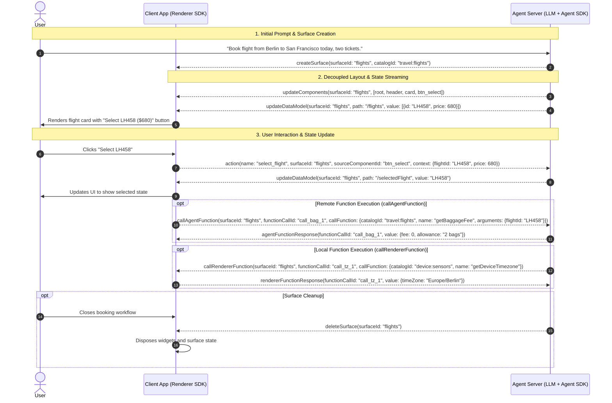

import {Aside, Tabs, TabItem} from '@astrojs/starlight/components';

A2UI agents and client renderers communicate by exchanging asynchronous, bidirectional JSON messages that define surface layouts, update reactive data models, and handle user actions and function calls. Rather than transferring opaque HTML, images, or executable code, both endpoints exchange independent JSON message objects that can run over different transports (such as Agent-to-Agent (A2A), Model Context Protocol (MCP), AG-UI, WebSockets, or Server-Sent Events).

These messages govern two concerns:

1. **Layout**: The component hierarchy and visual structure of a surface, streamed by the agent and assembled by the client renderer.
2. **State**: The reactive JSON data model bound to component properties, updated independently by the agent or modified locally by user interactions.

---

## Agent-to-renderer messages

Messages sent from the agent to the renderer are governed by [`agent_to_renderer.json`](/specification/v1.0/schemas/#agent_to_renderer.json) in v1.0 and [`server_to_client.json`](/specification/v0.9.1/schemas/#server_to_client.json) in v0.9.1.

### `createSurface`

The `createSurface` message allocates a new UI surface identified by a unique `surfaceId`. It must be globally unique within the rendering context (the `MessageProcessor` instance on the renderer), which is typically a conversation. Creating a surface implicitly instantiates the canonical `Surface` container component (`common_types.json#/$defs/Surface`) with `child: "root"`.

- Canonical Schema (v1.0): [`CreateSurfaceMessage`](/specification/v1.0/schemas/#agent_to_renderer.json/$defs/CreateSurfaceMessage)
- Canonical Schema (v0.9.1): [`CreateSurfaceMessage`](/specification/v0.9.1/schemas/#server_to_client.json/$defs/CreateSurfaceMessage)

#### Properties

| Property              | Type    | Required                            | Description                                                                                                                                                                                                      |
| :-------------------- | :------ | :---------------------------------- | :--------------------------------------------------------------------------------------------------------------------------------------------------------------------------------------------------------------- |
| `surfaceId`           | string  | Yes                                 | Unique identifier for the surface.                                                                                                                                                                               |
| `catalogId`           | string  | Optional (v1.0) / Required (v0.9.1) | Default catalog URI for this surface (e.g. `travel:flights`). In v1.0, individual components can declare their own `catalogId` if omitted here.                                                                  |
| `sendDataModel`       | boolean | Optional                            | When `true`, the renderer transmits the full surface data model alongside every upstream message in transport metadata (`a2uiRendererDataModel` in v1.0 / `a2uiClientDataModel` in v0.9.1). Defaults to `false`. |
| `components`          | array   | Optional (v1.0 only)                | Inline component definitions. Allows the agent to instantiate a complete UI tree in a single wire message.                                                                                                       |
| `dataModel`           | object  | Optional (v1.0 only)                | Initial root data model object for the surface.                                                                                                                                                                  |
| `metadata.extensions` | object  | Optional (v1.0 only)                | Extensibility map for custom protocol extensions. Extension keys must adhere to UAX #31.                                                                                                                         |

<Aside type="note" title="Changes in v1.0">
  In v1.0, `catalogId` is optional, `components` and `dataModel` can be passed inline to initialize
  a surface in a single message, and the v0.9 `theme` property is removed in favor of host
  application styling.
</Aside>

<Tabs syncKey="protocol-version">
  <TabItem label="v1.0 (Candidate)">
```json
{
  "version": "1.0",
  "createSurface": {
    "surfaceId": "flight_search",
    "catalogId": "travel:flights",
    "sendDataModel": false,
    "components": [
      {
        "id": "root",
        "component": "Column",
        "children": ["title", "flight_card"]
      },
      {
        "id": "title",
        "component": "Text",
        "text": "Available Flights"
      },
      {
        "id": "flight_card",
        "component": "Card",
        "child": "flight_info"
      },
      {
        "id": "flight_info",
        "component": "Text",
        "text": {"@path": "/flights/0/summary"}
      }
    ],
    "dataModel": {
      "flights": [
        {"summary": "LH458 · BER -> SFO · $680"}
      ]
    }
  }
}
```
  </TabItem>
  <TabItem label="v0.9.1 (Active)">
```json
{
  "version": "v0.9",
  "createSurface": {
    "surfaceId": "flight_search",
    "catalogId": "travel:flights",
    "sendDataModel": false
  }
}
```
  </TabItem>
</Tabs>

---

### `updateComponents`

The `updateComponents` message updates the component hierarchy of an existing surface. The agent can send this message multiple times during a session to add new nodes, replace existing nodes, or reorganize subtrees.

- Canonical Schema (v1.0): [`UpdateComponentsMessage`](/specification/v1.0/schemas/#agent_to_renderer.json/$defs/UpdateComponentsMessage)
- Canonical Schema (v0.9.1): [`UpdateComponentsMessage`](/specification/v0.9.1/schemas/#server_to_client.json/$defs/UpdateComponentsMessage)

#### Properties

| Property     | Type   | Required | Description                                                                                                                      |
| :----------- | :----- | :------- | :------------------------------------------------------------------------------------------------------------------------------- |
| `surfaceId`  | string | Yes      | The identifier of the surface to update.                                                                                         |
| `components` | array  | Yes      | A flat array of component objects. Exactly one component must have `id: "root"` (or refer to a previously mounted subtree root). |

When the renderer receives `updateComponents`, it merges the components into its internal component registry for that `surfaceId`. Any component whose `id` already exists in the surface is replaced with the new definition.

<Tabs syncKey="protocol-version">
  <TabItem label="v1.0 (Candidate)">
```json
{
  "version": "1.0",
  "updateComponents": {
    "surfaceId": "flight_search",
    "components": [
      {
        "id": "root",
        "component": "Column",
        "children": ["header", "flight_list"]
      },
      {
        "id": "header",
        "component": "Text",
        "text": "Outbound Flights"
      },
      {
        "id": "flight_list",
        "component": "Column",
        "children": ["flight_lh458"]
      },
      {
        "id": "flight_lh458",
        "component": "Button",
        "text": "Select LH458 ($680)",
        "action": {
          "event": {
            "name": "select_flight",
            "context": {
              "flightId": "LH458",
              "price": 680
            }
          }
        }
      }
    ]
  }
}
```
  </TabItem>
  <TabItem label="v0.9.1 (Active)">
```json
{
  "version": "v0.9",
  "updateComponents": {
    "surfaceId": "flight_search",
    "components": [
      {
        "id": "root",
        "component": "Column",
        "children": ["header", "flight_list"]
      },
      {
        "id": "header",
        "component": "Text",
        "text": "Outbound Flights"
      },
      {
        "id": "flight_list",
        "component": "Column",
        "children": ["flight_lh458"]
      },
      {
        "id": "flight_lh458",
        "component": "Button",
        "text": "Select LH458 ($680)",
        "action": {
          "event": {
            "name": "select_flight",
            "context": {
              "flightId": "LH458",
              "price": 680
            }
          }
        }
      }
    ]
  }
}
```
  </TabItem>
</Tabs>

---

### `updateDataModel`

The `updateDataModel` message updates the surface data model at a targeted location using an RFC 6901 JSON Pointer.

- Canonical Schema (v1.0): [`UpdateDataModelMessage`](/specification/v1.0/schemas/#agent_to_renderer.json/$defs/UpdateDataModelMessage)
- Canonical Schema (v0.9.1): [`UpdateDataModelMessage`](/specification/v0.9.1/schemas/#server_to_client.json/$defs/UpdateDataModelMessage)

#### Properties

| Property    | Type   | Required                            | Description                                                                                                                                                        |
| :---------- | :----- | :---------------------------------- | :----------------------------------------------------------------------------------------------------------------------------------------------------------------- |
| `surfaceId` | string | Yes                                 | The identifier of the target surface.                                                                                                                              |
| `path`      | string | Optional                            | RFC 6901 JSON Pointer indicating where to apply the update (e.g. `"/selectedFlight"`). If omitted or set to `"/"`, the update replaces the entire root data model. |
| `value`     | any    | Required (v1.0) / Optional (v0.9.1) | The new value to store at `path`.                                                                                                                                  |

<Aside type="caution" title="Key deletion version delta">
In **v1.0**, `value` is a required property. To delete a key or path from the data model, set `"value": null` explicitly.

In **v0.9.1**, `value` was optional. Providing `value` replaced or created the value at `path`, whereas omitting `value` entirely deleted the key at `path`.

</Aside>

<Tabs syncKey="protocol-version">
  <TabItem label="v1.0 (Candidate)">
```json
{
  "version": "1.0",
  "updateDataModel": {
    "surfaceId": "flight_search",
    "path": "/selectedFlight",
    "value": {
      "flightId": "LH458",
      "status": "confirmed",
      "passengers": 2
    }
  }
}
```

To delete the `/selectedFlight` key in v1.0:

```json
{
  "version": "1.0",
  "updateDataModel": {
    "surfaceId": "flight_search",
    "path": "/selectedFlight",
    "value": null
  }
}
```

  </TabItem>
  <TabItem label="v0.9.1 (Active)">
```json
{
  "version": "v0.9",
  "updateDataModel": {
    "surfaceId": "flight_search",
    "path": "/selectedFlight",
    "value": {
      "flightId": "LH458",
      "status": "confirmed",
      "passengers": 2
    }
  }
}
```

To delete the `/selectedFlight` key in v0.9.1, omit `value`:

```json
{
  "version": "v0.9",
  "updateDataModel": {
    "surfaceId": "flight_search",
    "path": "/selectedFlight"
  }
}
```

  </TabItem>
</Tabs>

---

### `deleteSurface`

The `deleteSurface` message instructs the renderer to destroy the surface identified by `surfaceId`. The renderer unmounts all widgets, disposes reactive listeners, and releases associated state.

- Canonical Schema (v1.0): [`DeleteSurfaceMessage`](/specification/v1.0/schemas/#agent_to_renderer.json/$defs/DeleteSurfaceMessage)
- Canonical Schema (v0.9.1): [`DeleteSurfaceMessage`](/specification/v0.9.1/schemas/#server_to_client.json/$defs/DeleteSurfaceMessage)

<Tabs syncKey="protocol-version">
  <TabItem label="v1.0 (Candidate)">
```json
{
  "version": "1.0",
  "deleteSurface": {
    "surfaceId": "flight_search"
  }
}
```
  </TabItem>
  <TabItem label="v0.9.1 (Active)">
```json
{
  "version": "v0.9",
  "deleteSurface": {
    "surfaceId": "flight_search"
  }
}
```
  </TabItem>
</Tabs>

---

### `callRendererFunction` (v1.0 only)

The `callRendererFunction` message is an agent-initiated remote procedure call (RPC). It directs the renderer to execute a function defined in a catalog locally on the client (such as reading screen geometry, querying device timezone, or opening a client dialog).

- Canonical Schema (v1.0): [`CallRendererFunctionMessage`](/specification/v1.0/schemas/#agent_to_renderer.json/$defs/CallRendererFunctionMessage)

<Aside type="note" title="New in v1.0">
  This message is introduced in protocol v1.0. In v0.9.1, `server_to_client.json` did not define an
  agent-to-renderer function invocation message.
</Aside>

#### Properties

| Property         | Type   | Required | Description                                                                                                                                |
| :--------------- | :----- | :------- | :----------------------------------------------------------------------------------------------------------------------------------------- |
| `functionCallId` | string | Yes      | Unique correlation identifier for this call. The renderer returns this exact ID in `rendererFunctionResponse`.                             |
| `callFunction`   | object | Yes      | The function invocation details. Must include `catalogId`, `name`, and optional `arguments`.                                               |
| `surfaceId`      | string | Optional | Surface ID whose data model provides the evaluation context. If omitted, the function executes in a root context with an empty data model. |

```json
{
  "version": "1.0",
  "callRendererFunction": {
    "surfaceId": "flight_search",
    "functionCallId": "call_geo_101",
    "callFunction": {
      "catalogId": "device:sensors",
      "name": "getDeviceTimezone",
      "arguments": {}
    }
  }
}
```

The renderer must respond with a [`rendererFunctionResponse`](#rendererfunctionresponse-v10-only) containing the matching `functionCallId`.

---

### `agentFunctionResponse` (v1.0 only)

The `agentFunctionResponse` message delivers the agent's response to a preceding [`callAgentFunction`](#callagentfunction-v10-only) message initiated by the renderer.

- Canonical Schema (v1.0): [`AgentFunctionResponseMessage`](/specification/v1.0/schemas/#agent_to_renderer.json/$defs/AgentFunctionResponseMessage)

#### Properties

| Property         | Type   | Required | Description                                                                      |
| :--------------- | :----- | :------- | :------------------------------------------------------------------------------- |
| `functionCallId` | string | Yes      | The correlation identifier copied from the original `callAgentFunction` request. |
| `value`          | any    | Optional | The return value produced by the function execution on success.                  |
| `error`          | string | Optional | An error message string if function execution failed on the agent.               |

```json
{
  "version": "1.0",
  "agentFunctionResponse": {
    "functionCallId": "call_baggage_202",
    "value": {
      "allowedBags": 2,
      "maxWeightKg": 23,
      "feePerExtraBag": 75
    }
  }
}
```

---

## Renderer-to-agent messages

Messages sent from the renderer back to the agent are governed by [`renderer_to_agent.json`](/specification/v1.0/schemas/#renderer_to_agent.json) in v1.0 and [`client_to_server.json`](/specification/v0.9.1/schemas/#client_to_server.json) in v0.9.1.

### `action`

The `action` message notifies the agent that the user interacted with an interactive component (e.g. clicked a button or submitted a form).

- Canonical Schema (v1.0): [`action`](/specification/v1.0/schemas/#renderer_to_agent.json/properties/action)
- Canonical Schema (v0.9.1): [`action`](/specification/v0.9.1/schemas/#client_to_server.json/properties/action)

#### Properties

| Property              | Type              | Required             | Description                                                                                                                          |
| :-------------------- | :---------------- | :------------------- | :----------------------------------------------------------------------------------------------------------------------------------- |
| `name`                | string            | Yes                  | The action event name declared on the component's `action.event.name`.                                                               |
| `surfaceId`           | string            | Yes                  | The surface ID where the interaction occurred.                                                                                       |
| `sourceComponentId`   | string            | Yes                  | The component `id` that triggered the action.                                                                                        |
| `timestamp`           | string (ISO 8601) | Yes                  | Timestamp indicating when the user triggered the action.                                                                             |
| `context`             | object            | Yes                  | Resolved key-value dictionary from `action.event.context`, with all reactive bindings (`@path` / `path`) resolved to current values. |
| `userMessage`         | string            | Optional (v1.0 only) | Human-readable string resolved from `action.event.userMessage`, suitable for direct ingestion into LLM conversation turns.           |
| `metadata.extensions` | object            | Optional (v1.0 only) | Extensibility map for client-specific metadata.                                                                                      |

#### Full data model transport metadata

When `createSurface` sets `sendDataModel: true`, the client synchronizes the entire surface data model back to the agent with every interaction.

However, the data model is **not** placed inside the `action` payload. Instead, it travels alongside in transport metadata:

- Under **v1.0**, the transport metadata key is `a2uiRendererDataModel`.
- Under **v0.9.1**, the transport metadata key is `a2uiClientDataModel`.

This distinction keeps the `action` message focused on event semantics, while transports (such as A2A message headers or MCP metadata) carry the state snapshot.

<Tabs syncKey="protocol-version">
  <TabItem label="v1.0 (Candidate)">
```json
{
  "version": "1.0",
  "action": {
    "name": "select_flight",
    "surfaceId": "flight_search",
    "sourceComponentId": "btn_select_lh458",
    "timestamp": "2026-11-02T10:15:30.000Z",
    "userMessage": "Selected flight LH458 for 2 passengers",
    "context": {
      "flightId": "LH458",
      "cabin": "economy",
      "price": 680
    }
  }
}
```
  </TabItem>
  <TabItem label="v0.9.1 (Active)">
```json
{
  "version": "v0.9",
  "action": {
    "name": "select_flight",
    "surfaceId": "flight_search",
    "sourceComponentId": "btn_select_lh458",
    "timestamp": "2026-11-02T10:15:30.000Z",
    "context": {
      "flightId": "LH458",
      "cabin": "economy",
      "price": 680
    }
  }
}
```
  </TabItem>
</Tabs>

---

### `callAgentFunction` (v1.0 only)

The `callAgentFunction` message is a client-initiated RPC requesting that the agent execute a function remotely (such as querying backend databases, calculating live shipping rates, or checking inventory).

- Canonical Schema (v1.0): [`callAgentFunction`](/specification/v1.0/schemas/#renderer_to_agent.json/properties/callAgentFunction)

#### Properties

| Property         | Type   | Required | Description                                                                                        |
| :--------------- | :----- | :------- | :------------------------------------------------------------------------------------------------- |
| `surfaceId`      | string | Yes      | The surface ID where the call originated.                                                          |
| `functionCallId` | string | Yes      | Unique correlation identifier for this call. The agent returns this ID in `agentFunctionResponse`. |
| `callFunction`   | object | Yes      | The function call details, including `catalogId`, `name`, and optional `arguments`.                |

```json
{
  "version": "1.0",
  "callAgentFunction": {
    "surfaceId": "flight_search",
    "functionCallId": "call_baggage_202",
    "callFunction": {
      "catalogId": "travel:flights",
      "name": "getBaggageAllowance",
      "arguments": {
        "flightId": "LH458",
        "cabin": "economy"
      }
    }
  }
}
```

---

### `rendererFunctionResponse` (v1.0 only)

The `rendererFunctionResponse` message delivers the renderer's return value or execution error to a preceding [`callRendererFunction`](#callrendererfunction-v10-only) message.

- Canonical Schema (v1.0): [`rendererFunctionResponse`](/specification/v1.0/schemas/#renderer_to_agent.json/properties/rendererFunctionResponse)

#### Properties

| Property         | Type   | Required | Description                                                                         |
| :--------------- | :----- | :------- | :---------------------------------------------------------------------------------- |
| `functionCallId` | string | Yes      | The correlation identifier copied from the original `callRendererFunction` request. |
| `value`          | any    | Optional | The return value produced by the renderer function on success.                      |
| `error`          | string | Optional | An error message string if execution failed on the renderer.                        |

```json
{
  "version": "1.0",
  "rendererFunctionResponse": {
    "functionCallId": "call_geo_101",
    "value": {
      "timeZone": "Europe/Berlin",
      "utcOffsetMinutes": 60
    }
  }
}
```

---

## End-to-end flight booking sequence

The following sequence diagram traces the lifecycle of a surface in a flight booking scenario. First, the user's request prompts the agent to allocate a surface via `createSurface`. Next, the agent streams `updateComponents` layout and `updateDataModel` flight state messages, which the client renders as native cards. When the user clicks a flight card, the client sends an `action` message with bound context data back to the agent, which responds with an incremental `updateDataModel` state update. Optional branches show remote agent function calls (`callAgentFunction`), agent-initiated client function calls (`callRendererFunction`), and surface disposal via `deleteSurface`.



---

## Differences between v0.9 and v1.0

Protocol v1.0 introduces several naming and structural updates compared to v0.9 and v0.9.1:

### Top-level envelope rename and version string

The protocol envelope schemas were renamed between v0.9.1 and v1.0 to reflect agentic architectures:

- In **v0.9.1**, envelopes were named [`server_to_client.json`](/specification/v0.9.1/schemas/#server_to_client.json) and [`client_to_server.json`](/specification/v0.9.1/schemas/#client_to_server.json), with `"version"` set to `"v0.9"` or `"v0.9.1"`.
- In **v1.0**, envelopes are named [`agent_to_renderer.json`](/specification/v1.0/schemas/#agent_to_renderer.json) and [`renderer_to_agent.json`](/specification/v1.0/schemas/#renderer_to_agent.json), with `"version"` set to `"1.0"` (without a `"v"` prefix).

This rename decouples protocol roles from physical hosting infrastructure. An agent may run on a remote server, locally on a user's machine, or inside an embedded runtime, while a renderer may run in a web browser, a mobile app, or a test harness.

<Tabs syncKey="protocol-version">
  <TabItem label="v1.0 (Candidate)">
```json
{
  "version": "1.0",
  "createSurface": {
    "surfaceId": "flight_booking",
    "catalogId": "travel:flights"
  }
}
```
  </TabItem>
  <TabItem label="v0.9.1 (Active)">
```json
{
  "version": "v0.9",
  "createSurface": {
    "surfaceId": "flight_booking",
    "catalogId": "travel:flights"
  }
}
```
  </TabItem>
</Tabs>

### Message and payload changes

| Area                         | v0.9 / v0.9.1                                                                                                               | v1.0                                                                                                                  |
| :--------------------------- | :-------------------------------------------------------------------------------------------------------------------------- | :-------------------------------------------------------------------------------------------------------------------- |
| `createSurface`              | `catalogId` required; optional `theme` property supported.                                                                  | `catalogId` optional; `theme` removed; supports inline `components`, `dataModel`, and `metadata.extensions`.          |
| `updateDataModel` deletion   | Omit `value` to delete the key at `path`.                                                                                   | `value` is required; set `"value": null` to delete the key at `path`.                                                 |
| Bidirectional function calls | No wire messages for remote function execution.                                                                             | Adds `callRendererFunction` / `rendererFunctionResponse` and `callAgentFunction` / `agentFunctionResponse`.           |
| `action` payload & metadata  | Carries `name`, `surfaceId`, `sourceComponentId`, `timestamp`, `context`; data model metadata key is `a2uiClientDataModel`. | Adds optional `userMessage` and `metadata.extensions`; data model metadata key is renamed to `a2uiRendererDataModel`. |
