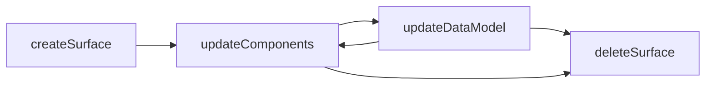

import {Tabs, TabItem} from '@astrojs/starlight/components';

A **surface** is a contiguous, bounded section of the user interface rendered and managed by an [A2UI Renderer](../sdks/#renderer-sdk). While traditional conversational AI models stream text tokens into an append-only message log, A2UI organizes dynamic graphical user interfaces into dedicated surfaces that can be created, updated in-place, and deleted over the lifetime of a session.

Each surface functions as an independent UI boundary:

- It maintains its own component hierarchy rooted at a reserved [`Surface`](/specification/v1.0/schemas/#common_types.json/$defs/Surface) container (identified by `"root"`).
- It maintains its own isolated, reactive [JSON data model](../data-binding/).
- It is bound to an initial default [catalog](../catalogs/) and, in v1.0, can resolve components and functions across multiple catalogs.

---

## The purpose of surfaces: In-place updates

In typical conversational chat applications, providing new information requires appending another message bubble to the end of the history. If an agent wants to update a previous answer or show live progress, it must either overwrite the entire turn or add redundant follow-up messages.

Surfaces solve this by allowing agents to perform **targeted, in-place UI mutations**:

1. **State updates without layout churn**: When a user fills out a form or an agent tool receives fresh data, the agent can send an [`updateDataModel`](../messages/#updatedatamodel) message. Only the widgets bound to those data paths re-render; the rest of the surface and its component tree remain untouched.
2. **Dynamic component restructuring**: An agent can modify an existing surface's layout via [`updateComponents`](../messages/#updatecomponents) without re-emitting the entire screen. For example, a travel agent can replace a loading spinner with a flight card, add options to an existing choice list, or switch a checkout form into a confirmation badge—all within the exact same screen location.
3. **Bandwidth and token efficiency**: Incremental updates allow language models to emit small, targeted patches rather than regenerating hundreds of lines of UI markup on every turn.

---

## Surface lifecycle

Every surface is managed through a sequence of lifecycle messages sent from the agent to the renderer:



1. **[`createSurface`](/specification/v1.0/schemas/#agent_to_renderer.json/$defs/CreateSurfaceMessage)**: Allocates a new surface identified by a unique `surfaceId` and sets its default catalog. In v1.0, it can optionally supply an initial data model inline and declare custom surface extensions.
2. **[`updateComponents`](/specification/v1.0/schemas/#agent_to_renderer.json/$defs/UpdateComponentsMessage)**: Populates or updates the component tree for that `surfaceId`. Components form a directed acyclic graph (DAG) starting at the root component (`"id": "root"`).
3. **[`updateDataModel`](/specification/v1.0/schemas/#agent_to_renderer.json/$defs/UpdateDataModelMessage)**: Modifies values in the surface's reactive data store using [RFC 6901 JSON Pointers](https://datatracker.ietf.org/doc/html/rfc6901).
4. **[`deleteSurface`](/specification/v1.0/schemas/#agent_to_renderer.json/$defs/DeleteSurfaceMessage)**: Tears down the surface when it is no longer needed, disposing of its component hierarchy, local state, and associated client resources.

---

## Surface IDs and architecture patterns

A `surfaceId` is a string that identifies a specific surface within an A2UI rendering context (the client-side `MessageProcessor` instance). All subsequent layout updates, data changes, user [action events](../actions-and-functions/), and function RPC calls include this `surfaceId` so the renderer routes each operation to the correct widget tree.

How you manage surfaces and `surfaceId`s depends on how your client application structures its `MessageProcessor` runtime. There are three common architectural patterns:

### Pattern 1: One MessageProcessor per conversation

In this pattern, a single `MessageProcessor` instance lives for the entire user session or conversation thread.

- **Capabilities**: The agent can create multiple surfaces over time (for example, a flight summary card on turn 1, a hotel picker on turn 2, and a car rental options card on turn 3) and can return to update _any_ previously created surface on subsequent turns.
- **Requirements**: Every surface must have a globally unique `surfaceId` within that conversation. If an agent emits a `createSurface` message with an ID that already exists in the `MessageProcessor`, the request is rejected as a duplicate.

### Pattern 2: One MessageProcessor per turn (Ephemeral)

In this pattern, the host application instantiates a fresh `MessageProcessor` for each conversational turn or creates a new one per chat bubble.

- **Capabilities**: The agent does not need to track previous surface identifiers across turn boundaries. It can use a fixed, constant `surfaceId` (such as `"main"`) on every turn.
- **Trade-offs**: Previous surfaces become static or read-only once their turn completes. The agent cannot update an earlier turn's UI directly unless state is synchronized through external application channels.

### Pattern 3: One MessageProcessor per application (Dashboard / Fixed layout)

In dashboard, enterprise, or multi-panel applications, the host UI defines fixed, named screen slots ahead of time.

- **Capabilities**: The application layout contains dedicated zones (such as `"header"`, `"kpi-summary"`, `"analytics-chart"`, and `"sidebar"`).
- **Workflow**: The host application initializes surfaces for these named slots. The agent generates messages targeting these pre-established `surfaceId`s, updating individual panels dynamically without altering the overall application scaffolding.

### Surface ID allocation strategies

When authoring agents, you can choose how `surfaceId`s are assigned:

- **Predefined constant IDs**: The agent system prompt instructs the model to always use specific IDs (e.g. `"main"`, `"card"`, or slot names like `"kpi_panel"`). This eliminates hallucination risks, prevents ID collisions, and guarantees predictable binding to the host UI.
- **Model-generated IDs**: The language model invents descriptive IDs dynamically (e.g. `"flight-search-results"`, `"hotel-checkout-form"`). This gives the model flexibility to spawn arbitrary numbers of distinct surfaces within a turn, but requires clear prompt guidelines so the model remembers and references the same IDs when updating them later.

---

## Surfaces and catalogs

Every surface interacts closely with component catalogs to determine which native widgets and helper functions it can render.

### Default surface catalog

When creating a surface via `createSurface`, the agent sets `catalogId` to designate the **default catalog** for that surface. Any component declaration in `updateComponents` that omits an explicit catalog specification automatically resolves against this default catalog.

### Multi-catalog surfaces (v1.0)

In A2UI v1.0, a single surface is not limited to a single catalog. An agent can combine components from multiple catalogs on the same surface:

- **Per-component overrides**: A component declaration can include `@catalogId` to specify that it belongs to a secondary catalog (such as pulling `Row` and `Text` from the [basic catalog](../catalogs/#the-basic-catalog), and a custom `FinanceChart` from a specialized analytics catalog).
- **Per-call function overrides**: When invoking dynamic functions in bindings or checks, a call can specify `catalogId` to invoke a function defined in another catalog.

### Single-catalog surfaces (v0.9.1)

In v0.9.1, each surface is locked to the single catalog specified in `createSurface` for its entire lifetime. All components rendered on that surface must be defined within that catalog.

---

## Examples

The following wire messages demonstrate creating a surface, establishing its component tree, and updating its data model:

<Tabs syncKey="protocol-version">
  <TabItem label="v1.0">

In v1.0, `createSurface` designates the default catalog (`basic`). The subsequent `updateComponents` renders a layout using components from both the default catalog and an external domain catalog (`chartsCatalog`), while `updateDataModel` populates the initial reactive state:

```json
[
  {
    "version": "1.0",
    "createSurface": {
      "surfaceId": "analytics-summary",
      "catalogId": "https://a2ui.org/specification/v1_0/catalogs/basic/catalog.json"
    }
  },
  {
    "version": "1.0",
    "updateComponents": {
      "surfaceId": "analytics-summary",
      "components": [
        {
          "id": "root",
          "component": "Card",
          "children": ["chart-widget"]
        },
        {
          "id": "chart-widget",
          "component": "TimeSeriesChart",
          "@catalogId": "https://example.com/catalogs/charts/v1/catalog.json",
          "title": "Quarterly Revenue",
          "data": {
            "@path": "/revenue"
          }
        }
      ]
    }
  },
  {
    "version": "1.0",
    "updateDataModel": {
      "surfaceId": "analytics-summary",
      "path": "/revenue",
      "value": [
        {"period": "Q1", "amount": 125000},
        {"period": "Q2", "amount": 148000}
      ]
    }
  }
]
```

  </TabItem>
  <TabItem label="v0.9.1">

In v0.9.1, the surface is locked to a single catalog across all messages:

```json
[
  {
    "version": "v0.9",
    "createSurface": {
      "surfaceId": "analytics-summary",
      "catalogId": "https://a2ui.org/specification/v0_9_1/catalogs/basic/catalog.json"
    }
  },
  {
    "version": "v0.9",
    "updateComponents": {
      "surfaceId": "analytics-summary",
      "components": [
        {
          "id": "root",
          "component": "Card",
          "children": ["summary-text"]
        },
        {
          "id": "summary-text",
          "component": "Text",
          "text": {
            "path": "/summary"
          }
        }
      ]
    }
  },
  {
    "version": "v0.9",
    "updateDataModel": {
      "surfaceId": "analytics-summary",
      "path": "/summary",
      "value": "All systems operational."
    }
  }
]
```

  </TabItem>
</Tabs>
