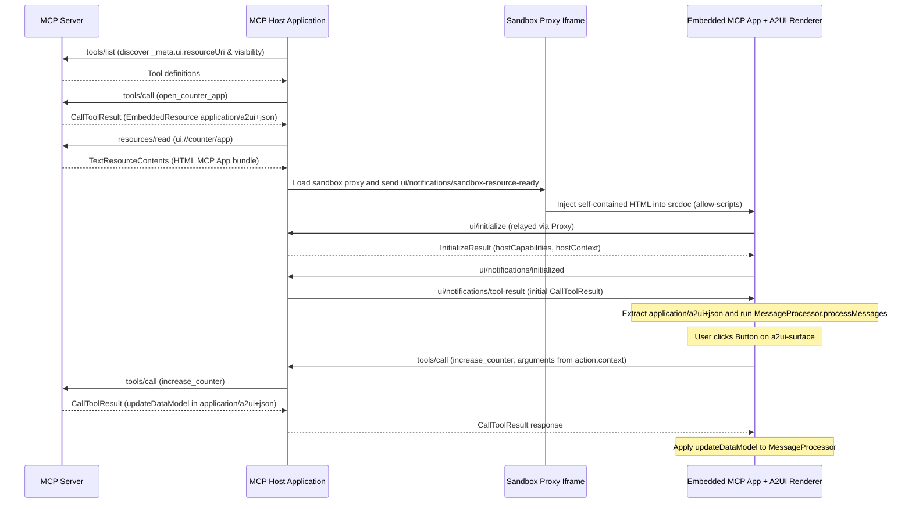

import {Aside, Tabs, TabItem} from '@astrojs/starlight/components';

export const baseUrl = import.meta.env.BASE_URL.replace(/\/$/, '');

An **[MCP App](https://modelcontextprotocol.io/extensions/apps/overview)** can bundle an embedded A2UI web renderer inside its `ui://` HTML resource (`text/html;profile=mcp-app`) so existing [Model Context Protocol (MCP)](https://modelcontextprotocol.io/) hosts display interactive A2UI surfaces without adding A2UI renderer code to the host application.

Instead of requiring every MCP client (such as Claude Desktop, the MCP Inspector, or an IDE) to install an A2UI SDK, your MCP server ships a self-contained HTML bundle that mounts `<a2ui-surface>` inside the host's isolated iframe. When tools on the server return `application/a2ui+json` payloads, the embedded app feeds those messages into its own [`MessageProcessor`](/concepts/sdks/#core-sdk) and forwards user actions back through the MCP Apps `tools/call` channel.

<Aside type="tip" title="Choosing an MCP integration pattern">
  See the [MCP Integration Overview](../mcp-overview/) to compare all four MCP patterns. Use this
  pattern when the outer host supports MCP Apps (`ui://` HTML iframes) rather than A2UI natively.
  For the inverse architecture (embedding third-party MCP App widgets inside your own A2UI host),
  see [Embed MCP Apps in A2UI Surfaces](../mcp-apps-in-a2ui/). If both the host and server support
  A2UI natively and you want to serve reusable A2UI layout templates over MCP without an iframe, see
  [Serve A2UI Layouts from an MCP Server](../a2ui-over-mcp/) and [Call MCP Tools from
  A2UI](../mcp-catalog/).
</Aside>


---

## Quick start: run the community sample

The [`samples/community/mcp/a2ui-in-mcpapps/`](https://github.com/a2ui-project/a2ui/blob/main/samples/community/mcp/a2ui-in-mcpapps/README.md) directory contains a runnable end-to-end sample with a Python MCP server (`server/server.py`), two single-file Angular micro-apps (`ui://editor/app` for a generative document editor and `ui://basic/app` for a counter), and a sample Angular MCP Apps host (`client/`) that runs a double-iframe sandbox on `http://localhost:4200`.

<Aside type="note" title="Sample protocol version">
  The community sample currently emits A2UI `v0.8` messages (`surfaceUpdate`, `dataModelUpdate`, and
  `beginRendering`) rendered by `@a2ui/angular` `0.10.x` inside the micro-apps. The implementation
  walkthrough below updates this pattern to `v1.0` and `v0.9.1` wire payloads with `@a2ui/lit` and
  `@a2ui/web_core`.
</Aside>

### Prerequisites

Install these tools before building and running the sample from a clone of the A2UI repository:

1. Python 3.10 or later and [`uv`](https://docs.astral.sh/uv/) for the Python MCP server (`server/.python-version` targets Python 3.13 when managed by `uv`).
2. Node.js 22.12 or later with Corepack enabled (`corepack enable`) so `yarn` resolves the standalone Yarn workspace under `samples/community/`.
3. A `GOOGLE_API_KEY` from [Google AI Studio](https://aistudio.google.com/apikey) so `server/smart_editor_agent.py` can initialize its Gemini client at startup and generate contextual editor controls (if a Gemini call fails at runtime, the editor falls back to preset slider controls).

### Build the sandbox relay and micro-apps

The server serves single-file HTML bundles from `server/apps/public/`, which are git-ignored in a fresh checkout. Install the `samples/community` workspace dependencies, build the host's outer sandbox relay, and build both micro-apps from the repository root:

```bash
cd samples/community
yarn install

# Build the host's outer sandbox relay (client/public/sandbox_iframe/)
yarn workspace a2ui-in-mcpapps-client run build:sandbox

# Build and inline the Editor micro-app (server/apps/public/editor.html)
yarn workspace basic-mcp-app-angular-editor run build:all

# Build and inline the Basic Counter micro-app (server/apps/public/app.html)
yarn workspace basic-mcp-app-angular run build:all
```

When iterating on a single micro-app, you can run `yarn build:all` directly inside `samples/community/mcp/a2ui-in-mcpapps/server/apps/editor` or `samples/community/mcp/a2ui-in-mcpapps/server/apps/src`.

### Start the MCP server and host client

Open two terminals starting from the repository root.

1. In the first terminal, start the Python MCP server over Server-Sent Events (SSE) on `http://127.0.0.1:8000/sse` (pass `--transport stdio` instead when connecting a desktop MCP host over standard input/output):

   ```bash
   cd samples/community/mcp/a2ui-in-mcpapps/server
   export GOOGLE_API_KEY="your-api-key"  # Required at startup by smart_editor_agent.py
   uv sync
   uv run python server.py --transport sse --port 8000
   ```

2. In the second terminal, start the sample Angular MCP Apps host on `http://localhost:4200`:

   ```bash
   cd samples/community/mcp/a2ui-in-mcpapps/client
   yarn start
   ```

### Try both views in the browser

Open `http://localhost:4200` to test how the sandboxed micro-apps render A2UI payloads returned by the MCP server:

1. Keep **Generative Editor App** selected and click **Load Selected App**. The host calls `get_editor_app` and loads `ui://editor/app` (`editor.html`). Select more than 10 characters of text inside any Editor.js paragraph; the app calls `smart_editor_get_controls`, renders generated A2UI controls (`Slider`, `CheckBox`, or `MultipleChoice`) in the right-hand panel, and calls `smart_editor_apply` when you click **Generate Revision** to rewrite the passage and swap in **Accept** and **Reject** A2UI buttons.
2. Switch the selector to **Basic Counter App** and click **Load Selected App**. The host calls `get_basic_app`, mounts `ui://basic/app` (`app.html`), and delivers the initial A2UI counter surface via `ui/notifications/tool-result`. Clicking **Increase counter** inside the rendered A2UI card calls `increase_counter` on the MCP server and updates `/counter` in place.

---

## Architecture and end-to-end flow

In a native A2UI client integration, the outer host application owns `MessageProcessor` and renders A2UI components directly in its DOM. Embedding A2UI inside an MCP App moves the A2UI runtime across the iframe boundary so any standards-compliant [MCP Apps](https://github.com/modelcontextprotocol/ext-apps) host can render A2UI surfaces unchanged:

1. The **MCP server** publishes one or more self-contained HTML bundles under `ui://` URIs (`mimeType: "text/html;profile=mcp-app"`), alongside entry tools and UI callback tools that return `EmbeddedResource` items carrying `application/a2ui+json` messages.
2. The **MCP host application** connects to the MCP server, inspects `_meta.ui.resourceUri` on the invoked tool, fetches the `ui://` HTML via `resources/read`, and mounts an outer sandbox proxy iframe (`sandbox.html`) that injects the HTML into an inner `srcdoc` iframe with `sandbox="allow-scripts"`.
3. The **embedded MCP App** runs inside that opaque-origin `srcdoc` frame. It bundles its own A2UI web renderer (`MessageProcessor`, component catalogs, and `<a2ui-surface>`), renders `application/a2ui+json` payloads alongside any custom web views (such as the Editor.js canvas in `ui://editor/app`), and translates A2UI action events into JSON-RPC 2.0 `tools/call` requests relayed through the host.

MCP Apps tool descriptors also scope which actor can invoke each tool via `_meta.ui.visibility` (as shown in [`server/server.py`](https://github.com/a2ui-project/a2ui/blob/main/samples/community/mcp/a2ui-in-mcpapps/server/server.py)):

1. Entry tools such as `get_editor_app` and `get_basic_app` declare `_meta.ui.resourceUri` and `visibility: ["model"]`, exposing a single launcher tool to the language model.
2. Fine-grained UI interaction tools such as `increase_counter`, `smart_editor_get_controls`, and `smart_editor_apply` declare `visibility: ["app"]`, allowing the sandboxed view to call them via `tools/call` without adding UI callback noise to the model's tool list.

The sequence diagram below traces the full message lifecycle across the MCP server, the outer MCP host application, the sandbox proxy iframe, and the embedded MCP App running the A2UI renderer. During startup, the host lists tools to discover `_meta.ui.resourceUri` and `_meta.ui.visibility`, invokes the entry tool via `tools/call`, fetches the `ui://` HTML document via `resources/read`, and injects it through the sandbox proxy into the isolated `srcdoc` iframe. Once the embedded app completes the `ui/initialize` and `ui/notifications/initialized` handshake, the host forwards the entry tool's result via `ui/notifications/tool-result`, and the app feeds the embedded `application/a2ui+json` messages into `MessageProcessor` to mount the A2UI surface. When the user clicks a button or submits a form on that surface, `MessageProcessor` dispatches an action, the app sends a JSON-RPC `tools/call` request through the proxy to the host, and the server returns a new `application/a2ui+json` payload (such as `updateDataModel`) that updates the rendered surface in place.



---

## Build an MCP App with an embedded A2UI renderer

The three steps below build a minimal MCP App using `@modelcontextprotocol/ext-apps`, `@a2ui/lit`, `@a2ui/web_core`, and Vite.

### Step 1: Register the ui:// resource and MCP tools

Start by defining the A2UI messages that your server tools return inside `EmbeddedResource` items (`mimeType: "application/a2ui+json"`). The example below uses the Basic Catalog, though A2UI catalogs are domain-specific and your embedded bundle can register any custom catalog (see [How to Define a Catalog](../defining-a-catalog/)).

In `v1.0`, protocol messages set `"version": "1.0"`, expressions use `@path` and `@call`, component IDs follow UAX #31 identifier syntax (such as `main_column`), and `Text` supports Markdown headings. In `v0.9.1`, messages set `"version": "v0.9"`, expressions use `path` and `call` (with `"returnType": "string"` on string-valued function calls), and `Text.variant` includes `"h3"`.

Here is the initial surface payload returned by `open_counter_app`:

<Tabs syncKey="protocol-version">
  <TabItem label="v1.0">

```json
[
  {
    "version": "1.0",
    "createSurface": {
      "surfaceId": "counter_card",
      "catalogId": "https://a2ui.org/specification/v1_0/catalogs/basic/catalog.json"
    }
  },
  {
    "version": "1.0",
    "updateComponents": {
      "surfaceId": "counter_card",
      "components": [
        {
          "id": "root",
          "component": "Card",
          "child": "main_column"
        },
        {
          "id": "main_column",
          "component": "Column",
          "children": ["title_text", "count_text", "increment_button"]
        },
        {
          "id": "title_text",
          "component": "Text",
          "text": "### Live counter"
        },
        {
          "id": "count_text",
          "component": "Text",
          "text": {
            "@call": "formatString",
            "args": {
              "value": "Count: ${/count}"
            }
          }
        },
        {
          "id": "increment_button_text",
          "component": "Text",
          "text": "Increase counter"
        },
        {
          "id": "increment_button",
          "component": "Button",
          "child": "increment_button_text",
          "variant": "primary",
          "action": {
            "event": {
              "name": "increase_counter",
              "context": {
                "step": 1
              }
            }
          }
        }
      ]
    }
  },
  {
    "version": "1.0",
    "updateDataModel": {
      "surfaceId": "counter_card",
      "path": "/",
      "value": {
        "count": 0
      }
    }
  }
]
```

  </TabItem>
  <TabItem label="v0.9.1">

```json
[
  {
    "version": "v0.9",
    "createSurface": {
      "surfaceId": "counter_card",
      "catalogId": "https://a2ui.org/specification/v0_9/catalogs/basic/catalog.json"
    }
  },
  {
    "version": "v0.9",
    "updateComponents": {
      "surfaceId": "counter_card",
      "components": [
        {
          "id": "root",
          "component": "Card",
          "child": "main_column"
        },
        {
          "id": "main_column",
          "component": "Column",
          "children": ["title_text", "count_text", "increment_button"]
        },
        {
          "id": "title_text",
          "component": "Text",
          "text": "Live counter",
          "variant": "h3"
        },
        {
          "id": "count_text",
          "component": "Text",
          "text": {
            "call": "formatString",
            "args": {
              "value": "Count: ${/count}"
            },
            "returnType": "string"
          }
        },
        {
          "id": "increment_button_text",
          "component": "Text",
          "text": "Increase counter"
        },
        {
          "id": "increment_button",
          "component": "Button",
          "child": "increment_button_text",
          "variant": "primary",
          "action": {
            "event": {
              "name": "increase_counter",
              "context": {
                "step": 1
              }
            }
          }
        }
      ]
    }
  },
  {
    "version": "v0.9",
    "updateDataModel": {
      "surfaceId": "counter_card",
      "path": "/",
      "value": {
        "count": 0
      }
    }
  }
]
```

  </TabItem>
</Tabs>

When the embedded app invokes `increase_counter`, the tool returns only an [`updateDataModel`](../../specification/v1.0/schemas/#agent_to_renderer.json/$defs/UpdateDataModelMessage) message (`server_to_client.json` in `v0.9.1`) so the existing surface updates `/count` without rebuilding its component tree:

<Tabs syncKey="protocol-version">
  <TabItem label="v1.0">

```json
[
  {
    "version": "1.0",
    "updateDataModel": {
      "surfaceId": "counter_card",
      "path": "/count",
      "value": 1
    }
  }
]
```

  </TabItem>
  <TabItem label="v0.9.1">

```json
[
  {
    "version": "v0.9",
    "updateDataModel": {
      "surfaceId": "counter_card",
      "path": "/count",
      "value": 1
    }
  }
]
```

  </TabItem>
</Tabs>

Register the `ui://counter/app` HTML resource (`text/html;profile=mcp-app`), the model-facing `open_counter_app` entry tool, and the app-only `increase_counter` callback tool on your MCP server:

<Tabs syncKey="sdk-lang">
  <TabItem label="TypeScript">

```typescript
import fs from 'node:fs';
import {
  RESOURCE_MIME_TYPE,
  registerAppResource,
  registerAppTool,
} from '@modelcontextprotocol/ext-apps/server';
import {McpServer} from '@modelcontextprotocol/sdk/server/mcp.js';
import {z} from 'zod';

const A2UI_MIME_TYPE = 'application/a2ui+json';
const APP_URI = 'ui://counter/app';
let count = 0;

export function createCounterMcpServer(bundlePath: string): McpServer {
  const server = new McpServer({name: 'a2ui-counter-mcp-app', version: '1.0.0'});

  registerAppResource(
    server,
    'Counter MCP App',
    APP_URI,
    {
      description: 'Self-contained MCP App with an embedded A2UI renderer.',
      mimeType: RESOURCE_MIME_TYPE,
    },
    async () => ({
      contents: [
        {
          uri: APP_URI,
          mimeType: RESOURCE_MIME_TYPE,
          text: fs.readFileSync(bundlePath, 'utf8'),
        },
      ],
    }),
  );

  registerAppTool(
    server,
    'open_counter_app',
    {
      title: 'Open Counter App',
      description: 'Opens the counter view and returns its initial A2UI surface.',
      inputSchema: {},
      _meta: {
        ui: {
          resourceUri: APP_URI,
          visibility: ['model'],
        },
      },
    },
    async () => ({
      content: [
        {type: 'text', text: `Counter opened at ${count}.`},
        {
          type: 'resource',
          resource: {
            uri: 'a2ui://counter-card',
            mimeType: A2UI_MIME_TYPE,
            text: JSON.stringify(buildInitialSurfacePayload(count)),
          },
        },
      ],
    }),
  );

  server.registerTool(
    'increase_counter',
    {
      title: 'Increase Counter',
      description: 'Increments the counter and returns an A2UI updateDataModel payload.',
      inputSchema: {
        step: z.number().int().default(1),
      },
      _meta: {
        ui: {
          visibility: ['app'],
        },
      },
    },
    async ({step}) => {
      count += step;
      const update = [
        {
          version: '1.0',
          updateDataModel: {
            surfaceId: 'counter_card',
            path: '/count',
            value: count,
          },
        },
      ];
      return {
        content: [
          {type: 'text', text: `Count is now ${count}.`},
          {
            type: 'resource',
            resource: {
              uri: 'a2ui://counter-card/data',
              mimeType: A2UI_MIME_TYPE,
              text: JSON.stringify(update),
            },
          },
        ],
      };
    },
  );

  return server;
}
```

  </TabItem>
  <TabItem label="Python">

```python
import json
from pathlib import Path
from typing import Any
from mcp import types
from mcp.server.lowlevel import Server
from mcp.server.lowlevel.helper_types import ReadResourceContents

A2UI_MIME_TYPE = "application/a2ui+json"
MCP_APP_MIME_TYPE = "text/html;profile=mcp-app"
APP_URI = "ui://counter/app"
BUNDLE_PATH = Path(__file__).parent / "dist" / "index.html"

app = Server("a2ui-counter-mcp-app")
count = 0


# Requires mcp<2 (pip install "mcp>=1.20,<2") for the 1.x low-level Server decorators.
@app.list_resources()
async def list_resources() -> list[types.Resource]:
    return [
        types.Resource(
            uri=APP_URI,
            name="Counter MCP App",
            mimeType=MCP_APP_MIME_TYPE,
            description="Self-contained MCP App with an embedded A2UI renderer.",
        )
    ]


@app.read_resource()
async def read_resource(uri: str) -> list[ReadResourceContents]:
    if str(uri) != APP_URI:
        raise ValueError(f"Unknown resource: {uri}")
    return [
        ReadResourceContents(
            content=BUNDLE_PATH.read_text(encoding="utf-8"),
            mime_type=MCP_APP_MIME_TYPE,
        )
    ]


@app.list_tools()
async def list_tools() -> list[types.Tool]:
    return [
        types.Tool(
            name="open_counter_app",
            title="Open Counter App",
            description="Opens the counter view and returns its initial A2UI surface.",
            inputSchema={"type": "object", "properties": {}},
            _meta={"ui": {"resourceUri": APP_URI, "visibility": ["model"]}},
        ),
        types.Tool(
            name="increase_counter",
            title="Increase Counter",
            description="Increments the counter and returns an A2UI updateDataModel payload.",
            inputSchema={
                "type": "object",
                "properties": {"step": {"type": "integer", "default": 1}},
            },
            _meta={"ui": {"visibility": ["app"]}},
        ),
    ]


@app.call_tool()
async def handle_call_tool(
    name: str, arguments: dict[str, Any]
) -> types.CallToolResult:
    global count
    if name == "open_counter_app":
        payload = build_initial_surface_payload(count)
        return types.CallToolResult(
            content=[
                types.TextContent(type="text", text=f"Counter opened at {count}."),
                types.EmbeddedResource(
                    type="resource",
                    resource=types.TextResourceContents(
                        uri="a2ui://counter-card",
                        mimeType=A2UI_MIME_TYPE,
                        text=json.dumps(payload),
                    ),
                ),
            ]
        )

    if name == "increase_counter":
        count += int(arguments.get("step", 1))
        update = [
            {
                "version": "1.0",
                "updateDataModel": {
                    "surfaceId": "counter_card",
                    "path": "/count",
                    "value": count,
                },
            }
        ]
        return types.CallToolResult(
            content=[
                types.TextContent(type="text", text=f"Count is now {count}."),
                types.EmbeddedResource(
                    type="resource",
                    resource=types.TextResourceContents(
                        uri="a2ui://counter-card/data",
                        mimeType=A2UI_MIME_TYPE,
                        text=json.dumps(update),
                    ),
                ),
            ]
        )

    raise ValueError(f"Unknown tool: {name}")
```

  </TabItem>
</Tabs>

### Step 2: Embed the A2UI renderer and forward actions in the MCP App

Inside the MCP App project, install `@a2ui/lit`, `@a2ui/markdown-it`, `@a2ui/web_core`, `lit`, and `@modelcontextprotocol/ext-apps`:

```bash
npm install @a2ui/lit @a2ui/markdown-it @a2ui/web_core lit @modelcontextprotocol/ext-apps
```

Create an `index.html` entry point with a mount element for your surface:

```html
<!doctype html>
<html lang="en">
  <head>
    <meta charset="UTF-8" />
    <meta name="viewport" content="width=device-width, initial-scale=1.0" />
    <title>Counter MCP App</title>
  </head>
  <body>
    <main id="surface-root"></main>
    <script type="module" src="/src/main.ts"></script>
  </body>
</html>
```

In `src/main.ts`, register `renderMarkdown` via `setMarkdownRenderer`, initialize `MessageProcessor` with `basicCatalog` (or your custom catalog), mount `<a2ui-surface>` when a surface is created, and use `App` from `@modelcontextprotocol/ext-apps` to handle the `ui/initialize` handshake, incoming `ui/notifications/tool-result` payloads, automatic iframe resizing (`autoResize: true`), and outbound `tools/call` requests whenever a component dispatches an [action](../../concepts/actions-and-functions/):

<Tabs syncKey="protocol-version">
  <TabItem label="v1.0">

```typescript
import {html, render} from 'lit';
import '@a2ui/lit';
import {renderMarkdown} from '@a2ui/markdown-it';
import {
  basicCatalog,
  MessageProcessor,
  setMarkdownRenderer,
  type ProcessableMessagePayload,
} from '@a2ui/web_core/v1_0';
import {App} from '@modelcontextprotocol/ext-apps';
import type {CallToolResult} from '@modelcontextprotocol/sdk/types.js';

setMarkdownRenderer(renderMarkdown);

const A2UI_MIME_TYPE = 'application/a2ui+json';
const rootEl = document.getElementById('surface-root')!;

const app = new App(
  {name: 'counter-mcp-app', version: '1.0.0'},
  {availableDisplayModes: ['inline']},
  {autoResize: true},
);

function applyToolResult(result: CallToolResult): void {
  for (const block of result.content ?? []) {
    if (
      block.type === 'resource' &&
      'text' in block.resource &&
      (block.resource.mimeType === A2UI_MIME_TYPE ||
        block.resource.mimeType === 'application/json+a2ui')
    ) {
      const messages = JSON.parse(block.resource.text) as ProcessableMessagePayload;
      processor.processMessages(messages);
    }
  }
}

const processor = new MessageProcessor([basicCatalog], async action => {
  const result = await app.callServerTool({
    name: action.name,
    arguments: action.context,
  });
  applyToolResult(result);
});

processor.onSurfaceCreated(surface => {
  render(html`<a2ui-surface .surface=${surface}></a2ui-surface>`, rootEl);
});

app.ontoolresult = params => {
  applyToolResult(params);
};

await app.connect();
```

  </TabItem>
  <TabItem label="v0.9.1">

```typescript
import {html, render} from 'lit';
import {basicCatalog} from '@a2ui/lit/v0_9';
import {renderMarkdown} from '@a2ui/markdown-it';
import {
  MessageProcessor,
  setMarkdownRenderer,
  type ProcessableMessagePayload,
} from '@a2ui/web_core/v0_9';
import {App} from '@modelcontextprotocol/ext-apps';
import type {CallToolResult} from '@modelcontextprotocol/sdk/types.js';

setMarkdownRenderer(renderMarkdown);

const A2UI_MIME_TYPE = 'application/a2ui+json';
const rootEl = document.getElementById('surface-root')!;

const app = new App(
  {name: 'counter-mcp-app', version: '1.0.0'},
  {availableDisplayModes: ['inline']},
  {autoResize: true},
);

function applyToolResult(result: CallToolResult): void {
  for (const block of result.content ?? []) {
    if (
      block.type === 'resource' &&
      'text' in block.resource &&
      (block.resource.mimeType === A2UI_MIME_TYPE ||
        block.resource.mimeType === 'application/json+a2ui')
    ) {
      const messages = JSON.parse(block.resource.text) as ProcessableMessagePayload;
      processor.processMessages(messages);
    }
  }
}

const processor = new MessageProcessor([basicCatalog], async action => {
  const result = await app.callServerTool({
    name: action.name,
    arguments: action.context,
  });
  applyToolResult(result);
});

processor.onSurfaceCreated(surface => {
  render(html`<a2ui-surface .surface=${surface}></a2ui-surface>`, rootEl);
});

app.ontoolresult = params => {
  applyToolResult(params);
};

await app.connect();
```

  </TabItem>
</Tabs>

If you need to include full form state from the surface `DataModel` alongside explicit `action.context` entries (as the Editor sample does when submitting slider and checkbox adjustments to `smart_editor_apply`), read `processor.getSurface(action.surfaceId)?.dataModel.get('/')` inside the action callback and merge it into `arguments`. You can also speak the underlying JSON-RPC 2.0 `window.parent.postMessage` protocol directly without `@modelcontextprotocol/ext-apps`; see [`server/apps/src/src/main.ts`](https://github.com/a2ui-project/a2ui/blob/main/samples/community/mcp/a2ui-in-mcpapps/server/apps/src/src/main.ts) for a zero-wrapper reference.

### Step 3: Bundle into a single self-contained HTML file

MCP Apps load inside a `srcdoc` iframe with `sandbox="allow-scripts"` and no base server URL, so external `<script src="...">`, `<link rel="stylesheet" href="...">`, or code-split ES module chunks cannot resolve relative paths. Bundle your renderer and application code into one standalone HTML file before serving it from `resources/read`:

<Tabs syncKey="bundler">
  <TabItem label="Vite (Lit or React)">

Install [`vite-plugin-singlefile`](https://github.com/richardtallent/vite-plugin-singlefile) (`npm install -D vite vite-plugin-singlefile`) and enable it in `vite.config.ts` so `vite build` inlines every JavaScript and CSS asset directly into `dist/index.html`:

```typescript
import {defineConfig} from 'vite';
import {viteSingleFile} from 'vite-plugin-singlefile';

export default defineConfig({
  plugins: [viteSingleFile()],
  build: {
    outDir: 'dist',
    emptyOutDir: true,
  },
});
```

  </TabItem>
  <TabItem label="Angular CLI + esbuild">

Angular production builds emit split ES module chunks and `<link rel="modulepreload">` tags by default. Follow [`samples/community/mcp/a2ui-in-mcpapps/server/apps/inline.js`](https://github.com/a2ui-project/a2ui/blob/main/samples/community/mcp/a2ui-in-mcpapps/server/apps/inline.js): run `ng build`, bundle `main.js` into one ESM file with `esbuild --bundle --format=esm`, inline `<script type="module">` and `<style>` blocks into `index.html`, and strip `<link rel="modulepreload">` tags so the iframe does not issue blocked relative requests.

  </TabItem>
</Tabs>

---

## Advanced considerations

### Sandbox and Content Security Policy constraints

An MCP App runs inside a double-iframe sandbox where the inner `srcdoc` frame carries `sandbox="allow-scripts"` without `allow-same-origin`. Keep three browser constraints in mind when building surfaces for this environment:

1. Because the inner frame runs under an opaque `null` origin (`window.location.origin === "null"`), `localStorage`, `sessionStorage`, `IndexedDB`, and `document.cookie` throw `SecurityError`. Store transient UI state in the A2UI surface [Data Model](../../concepts/data-binding/) and persist durable state on the MCP server through `tools/call`.
2. When writing custom `window.addEventListener('message', ...)` handlers instead of using `App` from `@modelcontextprotocol/ext-apps`, check `event.source === window.parent` before trusting incoming JSON-RPC messages, and pass an explicit target origin to `window.parent.postMessage` whenever the outer host origin is known.
3. MCP App hosts enforce a restrictive Content Security Policy (`connect-src 'none'`, with external media and fonts blocked unless allowlisted). If A2UI components such as `Image`, `Video`, or `AudioPlayer` reference external HTTPS URLs, declare those origins in `_meta.ui.csp` on the HTML content item returned from `resources/read` so the outer sandbox proxy adds them to the frame's CSP header:

```json
{
  "contents": [
    {
      "uri": "ui://counter/app",
      "mimeType": "text/html;profile=mcp-app",
      "text": "<!doctype html><html>...</html>",
      "_meta": {
        "ui": {
          "csp": {
            "resourceDomains": ["https://images.example.com"],
            "connectDomains": []
          }
        }
      }
    }
  ]
}
```

### Synchronizing light and dark themes with the MCP host

The Basic Catalog stylesheet in `@a2ui/web_core` defines its design tokens (`--a2ui-color-background`, `--a2ui-color-surface`, `--a2ui-color-on-surface`, `--a2ui-color-primary`, and `--a2ui-color-border`) with CSS `light-dark()`, and supports explicit `.a2ui-light` and `.a2ui-dark` root classes.

To match the outer MCP host's active color scheme rather than only the operating system default, apply the theme reported by `app.getHostContext()` on startup and update it whenever `ui/notifications/host-context-changed` fires:

```typescript
function applyHostTheme(theme: string | undefined): void {
  const root = document.documentElement;
  root.classList.toggle('a2ui-dark', theme === 'dark');
  root.classList.toggle('a2ui-light', theme === 'light');
}

// Register before the existing await app.connect() call in src/main.ts:
app.onhostcontextchanged = context => {
  applyHostTheme(context.theme);
};

// After the existing await app.connect() call in src/main.ts resolves:
applyHostTheme(app.getHostContext()?.theme);
```

You can also override `--a2ui-color-primary`, `--a2ui-border-radius`, or `--a2ui-font-family-title` on `:root` in your app's CSS to match your product's typography and accent palette.

### Validating server payloads before returning tool results

Because A2UI JSON messages travel inside MCP `CallToolResult` payloads and are parsed inside the client's sandboxed iframe, an invalid component property or missing child ID fails inside the iframe rather than at the server boundary. Validate generated or static message arrays on your MCP server before returning them from `tools/call` using `validatePayload` (`validate_payload` in Python) from the A2UI Agent SDK.

Swift (`A2UISwiftCore` and `A2UISwiftUI`) and Kotlin (`androidx.a2ui` and `androidx.a2ui.compose`) focus on client-side rendering rather than server-side generation, so Agent SDK payload validation is available in TypeScript, Python, and Dart:

<Tabs syncKey="sdk-lang">
  <TabItem label="TypeScript">

```typescript
import {validatePayload} from '@a2ui/agent';
import {basicCatalog} from '@a2ui/web_core/v1_0';

// Throws A2uiValidationError if a v1.0 renderer holding basicCatalog would reject the messages.
validatePayload([basicCatalog], a2uiPayload);
```

  </TabItem>
  <TabItem label="Python">

```python
from a2ui.core.basic_catalog import BasicCatalog
from a2ui.utils import validate_payload

# Raises A2uiValidationError if a v1.0 renderer holding BasicCatalog would reject the messages.
validate_payload([BasicCatalog("1.0")], a2ui_payload)
```

  </TabItem>
  <TabItem label="Dart">

```dart
import 'package:a2ui_agent/a2ui_agent.dart';
import 'package:a2ui_core/a2ui_core.dart';

// Throws A2uiValidationError if a v1.0 renderer holding BasicCatalog.v1_0() would reject the messages.
final parsed = AgentToRendererMessagePayload.fromJson(
  a2uiPayload,
  protocolVersion: A2uiProtocolVersion.v1_0,
);
validatePayload([BasicCatalog.v1_0()], parsed.messages);
```

  </TabItem>
</Tabs>

---

## Next steps

1. Explore the inverse pattern (embedding `ui://` MCP App widgets inside a native A2UI host with `McpApp`) in [Embed MCP Apps in A2UI Surfaces](../mcp-apps-in-a2ui/).
2. Serve cached `a2ui://` layout templates and `updateDataModel` tool results to native A2UI hosts in [Serve A2UI Layouts from an MCP Server](../a2ui-over-mcp/).
3. Connect web surfaces directly to MCP tools with `@a2ui/catalog-mcp` and `callMcpTool` in [Call MCP Tools from A2UI](../mcp-catalog/).
4. Package custom web components into your embedded renderer bundle in [How to Define a Catalog](../defining-a-catalog/) and [Authoring Universal Web Components](../authoring-universal-components/).
