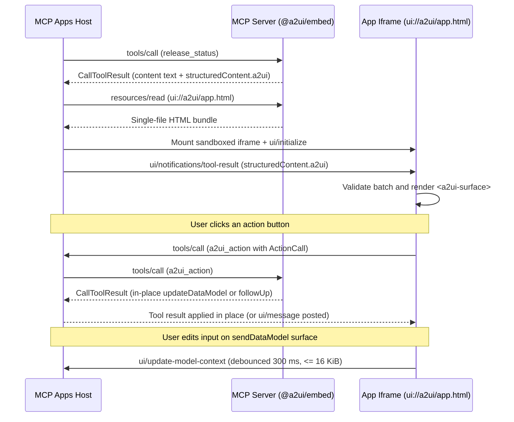

import {Aside} from '@astrojs/starlight/components';

export const baseUrl = import.meta.env.BASE_URL.replace(/\/$/, '');

The `@a2ui/embed` library packages an A2UI v1.0 [renderer](../../concepts/glossary/#renderer) and your [catalogs](../../concepts/glossary/#catalog) into a single-file **[MCP App](https://modelcontextprotocol.io/extensions/apps/overview)** (`ui://` HTML resource with MIME type `text/html;profile=mcp-app`), so any [Model Context Protocol (MCP)](https://modelcontextprotocol.io/) Apps host such as Claude Desktop or Antigravity displays interactive A2UI [surfaces](../../concepts/glossary/#surface) without adding A2UI code to the host.

Each tool returns a concise text summary in `content` for the language model and places A2UI v1.0 messages in `structuredContent.a2ui` for the app iframe, keeping UI markup out of the model's context window while routing button clicks and form edits back to your server.

<Aside type="tip" title="Choosing an MCP integration pattern">
  See the [MCP Integration Overview](../mcp-overview/) to compare all four MCP patterns. Use this
  guide when an external host supports MCP Apps (`ui://` HTML iframes) rather than A2UI natively.
  For the inverse pattern (embedding third-party MCP App widgets inside your own A2UI host), see
  [Embed MCP Apps in A2UI Surfaces](../mcp-apps-in-a2ui/). When both host and server support A2UI
  natively, see [Serve A2UI Layouts from an MCP Server](../a2ui-over-mcp/) and [Call MCP Tools from
  A2UI](../mcp-catalog/).
</Aside>

## Step 1: Install dependencies

In a Node.js TypeScript project (`"type": "module"`), install `@a2ui/embed` alongside the A2UI web renderer, the MCP TypeScript SDK, and Zod:

```bash
npm install @a2ui/embed @a2ui/web_core @a2ui/lit lit @modelcontextprotocol/sdk zod
```

`@a2ui/embed` provides the server helper (`@a2ui/embed/mcp/server`), the iframe runtime (`@a2ui/embed/mcp`), the single-file HTML builder (`@a2ui/embed/build`), and the versioned wire contract (`@a2ui/embed/contract`). It includes `@a2ui/markdown-it` out of the box, so Basic Catalog body `Text` components render sanitized Markdown without extra setup.

## Step 2: Configure and build the app HTML

Create `a2ui-embed.config.ts` next to `package.json` to declare which catalogs to inline into the MCP App bundle:

```typescript
// a2ui-embed.config.ts
import {basicCatalog, defineConfig} from '@a2ui/embed/build';

export default defineConfig({
  catalogs: [basicCatalog],
  output: 'dist/a2ui-app.html',
  renderer: 'lit', // Optional (default: 'lit')
  title: 'Release tracker', // Optional (default: 'A2UI app')
  markdown: true, // Optional (default: true)
});
```

Build the app bundle before starting your server:

```bash
npx a2ui-embed build
```

The command writes two files relative to `a2ui-embed.config.ts`:

- `dist/a2ui-app.html`, a self-contained HTML file with the Lit renderer, `basicCatalog`, and Markdown support inlined so the app loads nothing from the network under the default MCP Apps Content Security Policy.
- `dist/a2ui-app.catalog.json`, the JSON Schemas of your bundled catalogs keyed by catalog ID, used by the server to validate outgoing components before sending tool results.

Set `markdown: false` if your surfaces show plain text only; omitting the Markdown parser trims roughly 150 KiB from the HTML file.

## Step 3: Register tools, actions, and follow-ups

Create `src/server.ts` and call `createA2uiApp` to register the `ui://a2ui/app.html` resource and wire tools, in-place UI actions, and conversation follow-ups on an `McpServer` (`getRelease` below represents your application's own domain logic):

```typescript
// src/server.ts
import {createA2uiApp} from '@a2ui/embed/mcp/server';
import type {AgentToRendererMessage} from '@a2ui/web_core/v1_0';
import {McpServer} from '@modelcontextprotocol/sdk/server/mcp.js';
import {z} from 'zod';

const BASIC_CATALOG_ID = 'https://a2ui.org/specification/v1_0/catalogs/basic/catalog.json';

interface ReleaseState {
  version: string;
  approvals: number;
  status: string;
}

const releases = new Map<string, ReleaseState>([
  ['checkout-api', {version: '2.4.0', approvals: 1, status: 'Awaiting sign-off'}],
]);

function getRelease(service: string): ReleaseState {
  return releases.get(service) ?? {version: '1.0.0', approvals: 0, status: 'Draft'};
}

function releaseCardMessages(service: string, state: ReleaseState): AgentToRendererMessage[] {
  return [
    {
      version: '1.0',
      createSurface: {
        surfaceId: 'release_card',
        catalogId: BASIC_CATALOG_ID,
      },
    },
    {
      version: '1.0',
      updateComponents: {
        surfaceId: 'release_card',
        components: [
          {id: 'root', component: 'Card', child: 'layout'},
          {
            id: 'layout',
            component: 'Column',
            children: ['heading', 'summary', 'actions'],
          },
          {
            id: 'heading',
            component: 'Text',
            text: `### ${service} ${state.version}`,
          },
          {
            id: 'summary',
            component: 'Text',
            text: {
              '@call': 'formatString',
              args: {value: '**Status:** ${/status} (${/approvals} approvals)'},
            },
          },
          {
            id: 'actions',
            component: 'Row',
            children: ['approve_btn', 'notes_btn'],
          },
          {id: 'approve_label', component: 'Text', text: 'Approve release'},
          {
            id: 'approve_btn',
            component: 'Button',
            variant: 'primary',
            child: 'approve_label',
            action: {
              event: {
                name: 'approve_release',
                context: {service},
              },
            },
          },
          {id: 'notes_label', component: 'Text', text: 'Draft release notes'},
          {
            id: 'notes_btn',
            component: 'Button',
            child: 'notes_label',
            action: {
              event: {
                name: 'draft_release_notes',
                context: {service, version: state.version},
              },
            },
          },
        ],
      },
    },
    {
      version: '1.0',
      updateDataModel: {
        surfaceId: 'release_card',
        path: '/',
        value: {
          approvals: state.approvals,
          status: state.status,
        },
      },
    },
  ];
}

export function createReleaseServer(): McpServer {
  const server = new McpServer({name: 'release-tracker', version: '1.0.0'});

  const app = createA2uiApp(server, {
    html: new URL('../dist/a2ui-app.html', import.meta.url),
    catalogSchema: new URL('../dist/a2ui-app.catalog.json', import.meta.url),
  });

  app.tool(
    'release_status',
    {
      title: 'Release status',
      description: 'Shows approval status and release controls for a service.',
      inputSchema: {service: z.string()},
    },
    async ({service}) => {
      const state = getRelease(service);
      return {
        text: `${service} ${state.version}: ${state.status} (${state.approvals} approvals).`,
        a2ui: releaseCardMessages(service, state),
      };
    },
  );

  app.action(
    'approve_release',
    {
      description: 'Records an approval and updates the release card in place.',
      argsSchema: {service: z.string()},
    },
    async ({service}, {surfaceId}) => {
      const state = getRelease(service);
      state.approvals += 1;
      state.status = 'Approved for rollout';
      releases.set(service, state);
      return {
        text: `Approved ${service} ${state.version} (${state.approvals} approvals).`,
        a2ui: [
          {
            version: '1.0',
            updateDataModel: {
              surfaceId,
              path: '/',
              value: {approvals: state.approvals, status: state.status},
            },
          },
        ],
      };
    },
  );

  app.followUp('draft_release_notes', {
    template: 'Draft concise customer release notes for {service} version {version}.',
    argsSchema: {service: z.string(), version: z.string()},
    maxValueLength: 60, // Optional (default: 80)
  });

  return server;
}
```

<details>
<summary>View wire payload</summary>

`releaseCardMessages` produces the following A2UI v1.0 message array:

```json
[
  {
    "version": "1.0",
    "createSurface": {
      "surfaceId": "release_card",
      "catalogId": "https://a2ui.org/specification/v1_0/catalogs/basic/catalog.json"
    }
  },
  {
    "version": "1.0",
    "updateComponents": {
      "surfaceId": "release_card",
      "components": [
        {"id": "root", "component": "Card", "child": "layout"},
        {"id": "layout", "component": "Column", "children": ["heading", "summary", "actions"]},
        {"id": "heading", "component": "Text", "text": "### checkout-api 2.4.0"},
        {
          "id": "summary",
          "component": "Text",
          "text": {
            "@call": "formatString",
            "args": {"value": "**Status:** ${/status} (${/approvals} approvals)"}
          }
        },
        {"id": "actions", "component": "Row", "children": ["approve_btn", "notes_btn"]},
        {"id": "approve_label", "component": "Text", "text": "Approve release"},
        {
          "id": "approve_btn",
          "component": "Button",
          "variant": "primary",
          "child": "approve_label",
          "action": {"event": {"name": "approve_release", "context": {"service": "checkout-api"}}}
        },
        {"id": "notes_label", "component": "Text", "text": "Draft release notes"},
        {
          "id": "notes_btn",
          "component": "Button",
          "child": "notes_label",
          "action": {
            "event": {
              "name": "draft_release_notes",
              "context": {"service": "checkout-api", "version": "2.4.0"}
            }
          }
        }
      ]
    }
  },
  {
    "version": "1.0",
    "updateDataModel": {
      "surfaceId": "release_card",
      "path": "/",
      "value": {"approvals": 1, "status": "Awaiting sign-off"}
    }
  }
]
```

`app.tool` validates that array against A2UI v1.0 and `dist/a2ui-app.catalog.json`, then wraps it in an MCP `CallToolResult` where `content` holds the model-facing text summary and `structuredContent.a2ui.messages` holds the A2UI messages shown above:

```json
{
  "content": [
    {
      "type": "text",
      "text": "checkout-api 2.4.0: Awaiting sign-off (1 approvals)."
    }
  ],
  "structuredContent": {
    "a2ui": {
      "contractVersion": "1.0",
      "messages": []
    }
  }
}
```

</details>

Pass `new URL(..., import.meta.url)` rather than relative file paths so the server finds `dist/` regardless of the working directory chosen by the MCP host. `createA2uiApp` re-reads `html` on every `resources/read` request, so running `npx a2ui-embed build` updates the rendered app without restarting your server.

Each registration method handles one interaction path:

- `app.tool` links the tool to `ui://a2ui/app.html` and validates outgoing messages before anything reaches the host. If a component property or ID is invalid, the server returns an MCP `isError: true` message naming the component ID, type, and property. Omitting `a2ui` returns a text-only result and collapses the app frame to height `0`.
- `app.action` handles interactive [actions](../../concepts/actions-and-functions/) routed through the app-only `a2ui_action` tool (`_meta.ui.visibility: ['app']`), validating `event.context` against `argsSchema` and applying returned [`updateDataModel`](/specification/v1.0/schemas/#agent_to_renderer.json/$defs/UpdateDataModelMessage) or `updateComponents` messages in place without starting a model turn.
- `app.followUp` turns a button click into a user chat message via `ui/message`. Each `{placeholder}` token in `template` is replaced with a sanitized, truncated, JSON-quoted string (for example, `Draft concise customer release notes for "checkout-api" version "2.4.0".`) so untrusted values cannot inject instructions into the template.

## Step 4: Connect the server transport

Create `src/index.ts` to connect `createReleaseServer()` over stdio, which desktop and IDE MCP hosts spawn directly:

```typescript
// src/index.ts
import {StdioServerTransport} from '@modelcontextprotocol/sdk/server/stdio.js';
import {createReleaseServer} from './server.js';

const server = createReleaseServer();
const transport = new StdioServerTransport();
await server.connect(transport);
```

Add a `build` script in `package.json` that builds the HTML bundle before compiling TypeScript:

```json
{
  "name": "release-tracker-mcp",
  "version": "1.0.0",
  "type": "module",
  "scripts": {
    "build": "a2ui-embed build && tsc"
  }
}
```

Compile the project (`npm run build`) and register the server in your MCP Apps host configuration (such as Claude Desktop or Antigravity):

```json
{
  "mcpServers": {
    "release-tracker": {
      "command": "node",
      "args": ["/absolute/path/to/release-tracker-mcp/dist/index.js"]
    }
  }
}
```

Ask the host to check the release status for `checkout-api`. The host calls `release_status`, passes the short text summary to the model, mounts `dist/a2ui-app.html` in a sandboxed iframe, and renders the interactive A2UI card.

---

## Register a custom catalog

When a workflow needs domain-specific controls alongside `basicCatalog`, author your custom Web Components first (see [Authoring Universal Web Components](../authoring-universal-components/) and [How to Define a Catalog](../defining-a-catalog/)), group them into a `Catalog`, and register that catalog in `a2ui-embed.config.ts`.

Define a catalog containing only your custom components (for example, a `StatCard` component from `./stat_card.js`):

```typescript
// src/release_catalog.ts
import type {WebComponentImplementation} from '@a2ui/web_core/universal';
import {Catalog} from '@a2ui/web_core/v1_0';
import {StatCard} from './stat_card.js';

export const RELEASE_CATALOG_ID = 'https://example.com/catalogs/release/v1/catalog.json';

export const releaseCatalog = new Catalog<WebComponentImplementation>(RELEASE_CATALOG_ID, '1.0', [
  StatCard,
]);
```

List `releaseCatalog` alongside `basicCatalog` in `a2ui-embed.config.ts` and rerun `npx a2ui-embed build`:

```typescript
// a2ui-embed.config.ts
import {basicCatalog, defineConfig} from '@a2ui/embed/build';
import {releaseCatalog} from './src/release_catalog.js';

export default defineConfig({
  catalogs: [basicCatalog, releaseCatalog],
  output: 'dist/a2ui-app.html',
});
```

`a2ui-embed build` bundles both catalogs into `dist/a2ui-app.html` and writes both schemas into `dist/a2ui-app.catalog.json` keyed by catalog ID. On a surface created with `catalogId: BASIC_CATALOG_ID`, reference components from `releaseCatalog` by setting `'@catalogId': RELEASE_CATALOG_ID` on those component entries (or set `catalogId: RELEASE_CATALOG_ID` on `createSurface` when the surface uses `releaseCatalog` as its default):

```typescript
{
  id: 'approvals_tile',
  '@catalogId': RELEASE_CATALOG_ID,
  component: 'StatCard',
  label: 'Approvals',
  value: String(state.approvals),
}
```

Keep two rules in mind when building custom catalogs with `a2ui-embed build`:

- Component `id` values, function names, and function argument names in A2UI v1.0 must be valid Unicode UAX #31 identifiers (`stat_card`, not `stat-card`), whereas browser custom element tag names require a hyphen (`a2ui-stat-card`).
- `a2ui-embed build` evaluates `a2ui-embed.config.ts` in Node.js to extract `catalog.validationSchema` into `dist/a2ui-app.catalog.json`, then bundles the same module graph for the browser. Keep DOM globals (`document`, `window`) inside component lifecycle or `render()` methods, and keep Node-only imports (`node:fs`) out of the config file and catalog modules.

### Validate model-composed messages on the server

When a tool asks an LLM to compose A2UI layouts against your catalog schema at runtime, call `app.validate(messages)` before returning from `app.tool` so you can feed structured errors back to the model or fall back to a deterministic view:

```typescript
const check = app.validate(candidateMessages);
if (!check.ok) {
  const summary = check.errors.map(err => err.message).join('\n');
  // Retry model generation with `summary` or return a fallback layout.
}
```

---

## Additional steps

### Share surface state with the model

Set `sendDataModel: true` on [`createSurface`](/specification/v1.0/schemas/#agent_to_renderer.json/$defs/CreateSurfaceMessage) when the model should see values the user enters or selects in the UI (such as form fields, filter chips, or a selected table row):

```json
[
  {
    "version": "1.0",
    "createSurface": {
      "surfaceId": "release_card",
      "catalogId": "https://a2ui.org/specification/v1_0/catalogs/basic/catalog.json",
      "sendDataModel": true
    }
  }
]
```

Whenever the user edits a bound input or triggers an action whose response mutates the surface [Data Model](../../concepts/data-binding/), `@a2ui/embed` waits for 300 ms of inactivity and sends `ui/update-model-context` to the host. Supporting hosts attach that JSON snapshot to the user's next chat message without starting a new turn, so the user can ask follow-up questions about their current selection without calling another tool. Initial renders and new tool results do not trigger context updates, and updates default to a 16 KiB size cap (`modelContext.maxBytes`), omitting the largest surface data models by name if exceeded so the model never receives truncated JSON.

### Serve the app bundle from Python or other languages

Any MCP server in Python, Go, Rust, or Java can serve an HTML file built by `a2ui-embed build` by following the [server and app contract](#server-and-app-contract-reference). Run `npx a2ui-embed build` during your build step to produce `dist/a2ui-app.html` (and `dist/a2ui-app.catalog.json` if you validate schemas on the server), then:

1. Register `ui://a2ui/app.html` as an MCP resource with MIME type `text/html;profile=mcp-app`.
2. Attach `_meta: {"ui": {"resourceUri": "ui://a2ui/app.html"}}` to model-facing tools, and return a text summary in `content` plus `{"a2ui": {"contractVersion": "1.0", "messages": [...]}}` in `structuredContent`.
3. Register an app-only `a2ui_action` tool (`_meta: {"ui": {"visibility": ["app"]}}`) accepting `{name, surfaceId, sourceComponentId?, context}` to handle button clicks and follow-ups.

```python
# server.py (requires pip install "mcp>=1.20,<2")
from pathlib import Path
from typing import Any
from mcp import types
from mcp.server.lowlevel import Server
from mcp.server.lowlevel.helper_types import ReadResourceContents

APP_URI = "ui://a2ui/app.html"
APP_MIME_TYPE = "text/html;profile=mcp-app"
BASIC_CATALOG_ID = "https://a2ui.org/specification/v1_0/catalogs/basic/catalog.json"
HTML_PATH = Path(__file__).parent / "dist" / "a2ui-app.html"

server = Server("release-tracker")
approvals = 1


@server.list_resources()
async def list_resources() -> list[types.Resource]:
    return [
        types.Resource(
            uri=APP_URI,
            name="Release tracker",
            mimeType=APP_MIME_TYPE,
        )
    ]


@server.read_resource()
async def read_resource(uri: str) -> list[ReadResourceContents]:
    if str(uri) != APP_URI:
        raise ValueError(f"Unknown resource: {uri}")
    return [
        ReadResourceContents(
            content=HTML_PATH.read_text(encoding="utf-8"),
            mime_type=APP_MIME_TYPE,
        )
    ]


@server.list_tools()
async def list_tools() -> list[types.Tool]:
    return [
        types.Tool(
            name="release_status",
            description="Shows approval status and release controls for a service.",
            inputSchema={
                "type": "object",
                "properties": {"service": {"type": "string"}},
                "required": ["service"],
            },
            _meta={"ui": {"resourceUri": APP_URI}},
        ),
        types.Tool(
            name="a2ui_action",
            description="Routes A2UI surface events from the embedded app.",
            inputSchema={
                "type": "object",
                "properties": {
                    "name": {"type": "string"},
                    "surfaceId": {"type": "string"},
                    "sourceComponentId": {"type": "string"},
                    "context": {"type": "object"},
                },
                "required": ["name", "surfaceId", "context"],
            },
            _meta={"ui": {"visibility": ["app"]}},
        ),
    ]


@server.call_tool()
async def call_tool(name: str, arguments: dict[str, Any]) -> types.CallToolResult:
    global approvals
    if name == "release_status":
        service = str(arguments["service"])
        messages = [
            {
                "version": "1.0",
                "createSurface": {"surfaceId": "release_card", "catalogId": BASIC_CATALOG_ID},
            },
            {
                "version": "1.0",
                "updateComponents": {
                    "surfaceId": "release_card",
                    "components": [
                        {"id": "root", "component": "Card", "child": "col"},
                        {"id": "col", "component": "Column", "children": ["title", "btn"]},
                        {
                            "id": "title",
                            "component": "Text",
                            "text": {
                                "@call": "formatString",
                                "args": {"value": f"{service}: ${{/approvals}} approvals"},
                            },
                        },
                        {"id": "btn_label", "component": "Text", "text": "Approve"},
                        {
                            "id": "btn",
                            "component": "Button",
                            "variant": "primary",
                            "child": "btn_label",
                            "action": {"event": {"name": "approve", "context": {"service": service}}},
                        },
                    ],
                },
            },
            {
                "version": "1.0",
                "updateDataModel": {
                    "surfaceId": "release_card",
                    "path": "/",
                    "value": {"approvals": approvals},
                },
            },
        ]
        return types.CallToolResult(
            content=[types.TextContent(type="text", text=f"{service}: {approvals} approvals.")],
            structuredContent={"a2ui": {"contractVersion": "1.0", "messages": messages}},
        )

    if name == "a2ui_action" and arguments.get("name") == "approve":
        approvals += 1
        surface_id = str(arguments["surfaceId"])
        return types.CallToolResult(
            content=[types.TextContent(type="text", text=f"Approvals: {approvals}.")],
            structuredContent={
                "a2ui": {
                    "contractVersion": "1.0",
                    "messages": [
                        {
                            "version": "1.0",
                            "updateDataModel": {
                                "surfaceId": surface_id,
                                "path": "/approvals",
                                "value": approvals,
                            },
                        }
                    ],
                }
            },
        )

    raise ValueError(f"Unknown tool or action: {name}")
```

### Configure Content Security Policy, theming, and tool names

`createA2uiApp` accepts optional resource metadata and Content Security Policy (CSP) origins:

```typescript
const app = createA2uiApp(server, {
  html: new URL('../dist/a2ui-app.html', import.meta.url),
  catalogSchema: new URL('../dist/a2ui-app.catalog.json', import.meta.url),
  resourceUri: 'ui://releases/app.html', // Optional (default: 'ui://a2ui/app.html')
  resourceName: 'Release tracker', // Optional (default: 'A2UI app')
  csp: {
    resourceDomains: ['https://images.example.com'], // Optional (default: none)
    connectDomains: [], // Optional (default: none)
  },
  prefersBorder: true, // Optional (default: host decides)
});
```

Keep these runtime behaviors in mind when designing surfaces for MCP Apps hosts:

- MCP Apps iframes default to `default-src 'none'` with inline `<script>` and `<style>` tags plus `data:` and `blob:` media. Add `csp.resourceDomains` when components load HTTPS images, media, or external font stylesheets (for example, `https://fonts.googleapis.com` and `https://fonts.gstatic.com` if you use the Basic Catalog `Icon` font rather than inline SVG icons).
- Clicking `http:`, `https:`, or `mailto:` links inside Markdown `Text` components dispatches `ui/open-link` to the host rather than navigating the sandboxed iframe.
- `@a2ui/embed` automatically syncs light and dark color schemes, fonts, and MCP Apps `--color-*` host style variables onto `--a2ui-*` Basic Catalog CSS properties whenever `ui/notifications/host-context-changed` fires.
- Give model-facing tools clear domain names (`release_status`, `triage_inbox`) because hosts that lazy-load MCP tool schemas select tools by name before reading descriptions, and keep full prefixed names (`mcp_<plugin>_<server>_<tool>`) within 64 characters.

<details>
<summary>Host CSS variable mappings and layout overrides</summary>

`@a2ui/embed` maps standard MCP Apps host variables onto Basic Catalog tokens with `:where(.a2ui-embed)` rules (zero CSS specificity), falling back to Basic Catalog defaults when a host omits a variable:

| A2UI CSS property                                                                                             | MCP Apps host variable         |
| :------------------------------------------------------------------------------------------------------------ | :----------------------------- |
| `--a2ui-color-background`                                                                                     | `--color-background-primary`   |
| `--a2ui-color-on-background`, `--a2ui-color-on-surface`, `--a2ui-color-on-secondary`, `--a2ui-color-on-input` | `--color-text-primary`         |
| `--a2ui-color-surface`                                                                                        | `--color-background-secondary` |
| `--a2ui-color-secondary`                                                                                      | `--color-background-tertiary`  |
| `--a2ui-color-input`                                                                                          | `--color-background-primary`   |
| `--a2ui-color-primary`                                                                                        | `--color-ring-primary`         |
| `--a2ui-color-border`                                                                                         | `--color-border-primary`       |
| `--a2ui-text-caption-color`                                                                                   | `--color-text-secondary`       |
| `--a2ui-border-radius`                                                                                        | `--border-radius-md`           |
| `--a2ui-border-width`                                                                                         | `--border-width-regular`       |
| `--a2ui-font-family-monospace`                                                                                | `--font-mono`                  |

Any rule targeting `.a2ui-embed` overrides these defaults as well as the container layout variables:

| App CSS property                  | Default                     |
| :-------------------------------- | :-------------------------- |
| `--a2ui-embed-max-width`          | `960px`                     |
| `--a2ui-embed-padding`            | `0`                         |
| `--a2ui-embed-error-color`        | `--color-text-danger`       |
| `--a2ui-embed-error-background`   | `--color-background-danger` |
| `--a2ui-embed-error-border-color` | `--color-border-danger`     |

</details>

---

## Server and app contract reference

`@a2ui/embed/contract` defines the versioned interface between an MCP server and the embedded app iframe. Minor contract revisions (`major.minor`) only add optional fields; if a server sends a payload with a different major version, the app renders an error card instead of partially applying incompatible messages.

| Contract element    | Value and shape                                                                                                                                                                                                    |
| :------------------ | :----------------------------------------------------------------------------------------------------------------------------------------------------------------------------------------------------------------- |
| Contract version    | `CONTRACT_VERSION` (`'1.0'`). Checked via `checkContractVersion(version)`.                                                                                                                                         |
| App resource        | Default URI `ui://a2ui/app.html` (`DEFAULT_RESOURCE_URI`), MIME type `text/html;profile=mcp-app`. Tools reference it in `_meta.ui.resourceUri`.                                                                    |
| Tool result         | `content: [{type: 'text', text}]` carries the model summary; `structuredContent.a2ui` (`A2UI_STRUCTURED_KEY`) carries `EmbedPayload`, kept out of model context by MCP Apps hosts.                                 |
| `EmbedPayload`      | `{contractVersion: string; messages: AgentToRendererMessage[]; followUp?: {text: string}}` (`EmbedPayloadSchema`). Only `createSurface`, `updateComponents`, `updateDataModel`, and `deleteSurface` are delivered. |
| Action tool         | `a2ui_action` (`ACTION_TOOL_NAME`) with `_meta.ui.visibility: ['app']`. Called with `ActionCall` (`{name: string; surfaceId: string; sourceComponentId?: string; context: Record<string, unknown>}`).              |
| Catalog schema file | `{contractVersion: string; catalogs: Record<string, Record<string, unknown>>}` (`CatalogSchemaFileSchema`), emitted next to the HTML bundle as `*.catalog.json`.                                                   |

TypeScript servers that assemble raw MCP `CallToolResult` objects directly (without `createA2uiApp`) can use `toToolResult`, `readEmbedPayload`, and `checkContractVersion` from `@a2ui/embed/contract`:

```typescript
import {CONTRACT_VERSION, toToolResult} from '@a2ui/embed/contract';

return toToolResult({
  text: 'checkout-api 2.4.0: Awaiting sign-off (1 approvals).',
  payload: {contractVersion: CONTRACT_VERSION, messages},
});
```

<details>
<summary>End-to-end MCP Apps sequence diagram</summary>



</details>

<details>
<summary>Custom iframe entry point (@a2ui/embed/mcp)</summary>

`a2ui-embed build` generates the iframe entry point automatically. If you maintain a custom single-file HTML bundler, call `startEmbedApp` from `@a2ui/embed/mcp` inside your browser entry script:

```typescript
import {startEmbedApp} from '@a2ui/embed/mcp';
import {renderMarkdown} from '@a2ui/markdown-it';
import {basicCatalog} from '@a2ui/web_core/v1_0';

const handle = startEmbedApp({
  catalogs: [basicCatalog],
  appInfo: {name: 'release-tracker', version: '1.0.0'}, // Optional (default: {name: 'a2ui-embed', version: '1.0.0'})
  root: document.getElementById('app')!, // Optional (default: document.body)
  modelContext: {maxBytes: 8192}, // Optional (default: {maxBytes: 16384})
  markdown: renderMarkdown, // Optional (default: plain text)
});

await handle.ready;
```

`startEmbedApp` returns `{app, ready, close}` where `app` is the underlying `@modelcontextprotocol/ext-apps` `App` instance.

</details>

<span id="quick-start-run-the-sample"></span>

### Community editor sample

The [`samples/community/mcp/a2ui-in-mcpapps`](https://github.com/a2ui-project/a2ui/tree/main/samples/community/mcp/a2ui-in-mcpapps) directory contains an earlier standalone prototype with a Python MCP server, Angular micro-apps (`v0.8`), and a local double-iframe test host for contextual text editing.

<details>
<summary>Preview the community editor sample</summary>


</details>

---

## Next steps

- Explore the inverse architecture (embedding `ui://` MCP App widgets inside a native A2UI host with `McpApp`) in [Embed MCP Apps in A2UI Surfaces](../mcp-apps-in-a2ui/).
- Serve reusable `a2ui://` layout templates and `updateDataModel` tool results to native A2UI hosts in [Serve A2UI Layouts from an MCP Server](../a2ui-over-mcp/).
- Connect web surfaces directly to headless MCP tools with `@a2ui/catalog-mcp` and `callMcpTool` in [Call MCP Tools from A2UI](../mcp-catalog/).
- Share custom web components across Lit, React, and Angular in [Authoring Universal Web Components](../authoring-universal-components/) and [How to Define a Catalog](../defining-a-catalog/).
