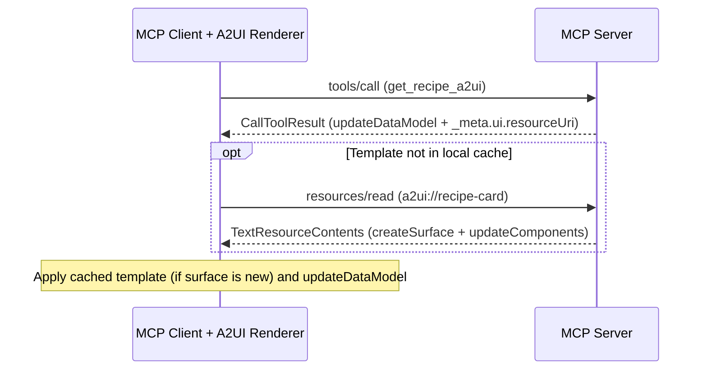

import {Aside, Tabs, TabItem} from '@astrojs/starlight/components';

export const baseUrl = import.meta.env.BASE_URL.replace(/\/$/, '');

A **[Model Context Protocol (MCP)](https://modelcontextprotocol.io/)** server can deliver interactive A2UI surfaces by publishing static layout templates as `a2ui://` resources (`application/a2ui+json`) and returning per-call [`updateDataModel`](../../specification/v1.0/schemas/#agent_to_renderer.json/$defs/UpdateDataModelMessage) messages from tools.

Instead of repeating the component tree on every tool invocation, the server sends the layout once through `resources/read` and returns only JSON values on `tools/call`. Clients cache the layout by URI and update the surface state whenever a tool runs.

<Aside type="tip" title="Connecting a client or embedding HTML widgets?">
  To configure `@a2ui/catalog-mcp` and invoke MCP tools from Lit, React, or Angular surfaces, see
  the [MCP Catalog](../mcp-catalog/) guide. If your MCP server ships a sandboxed HTML widget
  (`ui://`, `text/html;profile=mcp-app`) rather than A2UI JSON messages, see [MCP Apps in A2UI
  Surfaces](../mcp-apps-in-a2ui/).
</Aside>

<video
  width="100%"
  height="auto"
  controls
  playsinline
  style={{
    display: 'block',
    aspectRatio: '16 / 9',
    objectFit: 'cover',
    borderRadius: '8px',
    marginBottom: '24px',
  }}
>
  <source src={`${baseUrl}/assets/guides-a2ui-over-mcp-tour.mp4`} type="video/mp4" />
  Your browser does not support the video tag.
</video>

---

## Quick start: run the recipe sample

The repository includes an end-to-end recipe studio sample ([`samples/community/mcp/a2ui-over-mcp-recipe/`](https://github.com/a2ui-project/a2ui/blob/main/samples/community/mcp/a2ui-over-mcp-recipe/README.md)) with a Python MCP server and a Lit web client. The recipe sample emits A2UI `v0.9` messages; for a client-side A2UI `v1.0` sample built on `basicCatalog` and `mcpCatalog`, see [`samples/community/mcp/a2ui-over-mcp-filesystem/`](https://github.com/a2ui-project/a2ui/blob/main/samples/community/mcp/a2ui-over-mcp-filesystem/README.md).

### Prerequisites

Install these tools before running the sample from a clone of the A2UI repository:

1. Python 3.10 or later for the MCP server.
2. [`uv`](https://docs.astral.sh/uv/) to install Python dependencies and run the server.
3. Node.js 18 or later with Corepack enabled (`corepack enable`) for the MCP Inspector and the web client.

### Start the MCP server

Start the recipe MCP server on `http://127.0.0.1:8000/sse` using Server-Sent Events (SSE):

```bash
cd samples/community/mcp/a2ui-over-mcp-recipe
uv run .
```

<Aside type="note" title="Using the Python Agent SDK outside this repository">
  The sample points at the local Agent SDK package in the monorepo. In standalone Python projects,
  install `a2ui-agent-sdk` from PyPI (`pip install a2ui-agent-sdk` or `uv add a2ui-agent-sdk`).
</Aside>

### Inspect with the MCP Inspector

In a second terminal, open the [MCP Inspector](https://github.com/modelcontextprotocol/inspector) against the running SSE endpoint:

```bash
npx @modelcontextprotocol/inspector@latest --web --transport sse --server-url http://localhost:8000/sse
```

Open `http://localhost:6274` in your browser to inspect the templates and tool outputs directly:

1. Select **List Resources** to view `a2ui://recipe-form` and `a2ui://recipe-card`.
2. Read either resource to inspect the static A2UI template (`createSurface` and `updateComponents`) and its data-binding paths.
3. Select **List Tools** to view `get_recipe_form_a2ui` and `get_recipe_a2ui`, each carrying a `_meta.ui.resourceUri` pointer to its template resource.
4. Run `get_recipe_form_a2ui` to inspect the initial form selection values wrapped in an `updateDataModel` message.
5. Run `get_recipe_a2ui` with `cookingStyle` and `protein` arguments to inspect the generated recipe fields returned as an `updateDataModel` message.

### Run the web client

In a separate terminal starting from the repository root, build the local TypeScript packages used by the sample, install the `samples/community` workspace dependencies, and start Vite:

```bash
yarn install
yarn workspace @a2ui/catalog-mcp run build
yarn workspace @a2ui/lit run build

cd samples/community
yarn install
yarn workspace a2ui-over-mcp-recipe-client run dev
```

Open `http://localhost:5173`. On startup, the client connects to the MCP server over SSE and calls `get_recipe_form_a2ui`. It reads `_meta.ui.resourceUri` to fetch and cache `a2ui://recipe-form`, creates the form surface, and applies the returned `updateDataModel` (`Grilled` and `Chicken`). Selecting new preferences and clicking **Get Recipe** invokes `get_recipe_a2ui`, fetches `a2ui://recipe-card` on first use, and populates the recipe card on the right.


Browse additional MCP integrations in [`samples/community/mcp/`](https://github.com/a2ui-project/a2ui/tree/main/samples/community/mcp).

---

## Separating layout templates from tool data

Delivering A2UI over MCP splits an interface into cached presentation resources and per-call data updates:

1. MCP resources (`resources/read`) publish static component layouts ([`createSurface`](../../specification/v1.0/schemas/#agent_to_renderer.json/$defs/CreateSurfaceMessage) and [`updateComponents`](../../specification/v1.0/schemas/#agent_to_renderer.json/$defs/UpdateComponentsMessage)) under `a2ui://` URIs with MIME type `application/a2ui+json`. Because component properties bind to JSON Pointers such as `/title` and `/cookTime` (see [Data Model and Data Binding](../../concepts/data-binding/)) instead of hardcoded values, clients fetch each template once and reuse it across calls.
2. Tool metadata (`_meta.ui`) connects a tool to its layout resource by setting `resourceUri` (for example, `"a2ui://recipe-card"`) and `mimeType` (`"application/a2ui+json"`) on the tool descriptor in `tools/list`, on the `CallToolResult`, or on both. When a `CallToolResult` sets `_meta.ui.resourceUri`, its URI overrides any default URI declared on the tool descriptor.
3. Tool execution (`tools/call`) computes the values for the current request and returns an `EmbeddedResource` (`mimeType: "application/a2ui+json"`) containing an [`updateDataModel`](../../specification/v1.0/schemas/#agent_to_renderer.json/$defs/UpdateDataModelMessage) message, paired with a plain `TextContent` summary for text-only MCP hosts.
4. Client hydration resolves `_meta.ui.resourceUri` from its local cache (calling `resources/read` only on a cache miss), initializes the surface if it is not already live, and applies the `updateDataModel` payload to update bound components.

The sequence diagram below traces how an MCP client and MCP server exchange these messages: the client invokes `tools/call` for `get_recipe_a2ui`, receives a `CallToolResult` carrying both `_meta.ui.resourceUri` and an inline `updateDataModel` resource, fetches `a2ui://recipe-card` via `resources/read` only when the template is not yet cached, and applies both payloads to its local `MessageProcessor`.



---

## Build an A2UI MCP server

The three steps below build a minimal recipe-card tool over MCP and connect it to a web renderer.

### Step 1: Expose a layout template as an MCP resource

Create a JSON array that initializes the `recipe-card` surface and declares its component tree with data bindings instead of literal values. The example below uses the Basic Catalog, though A2UI catalogs are domain-specific and your template can target any custom catalog your client supports (see [How to Define a Catalog](../defining-a-catalog/)).

In `v1.0`, protocol messages set `"version": "1.0"`, data bindings use `{"@path": "..."}`, component IDs follow UAX #31 identifier syntax (such as `main_column`), and `Text` uses Markdown headings or `"variant": "body" | "caption"`. In `v0.9.1`, messages set `"version": "v0.9"`, data bindings use `{"path": "..."}`, and `Text.variant` includes heading variants such as `"h3"`.

<Tabs syncKey="protocol-version">
  <TabItem label="v1.0 (Candidate)">

```json
[
  {
    "version": "1.0",
    "createSurface": {
      "surfaceId": "recipe-card",
      "catalogId": "https://a2ui.org/specification/v1_0/catalogs/basic/catalog.json"
    }
  },
  {
    "version": "1.0",
    "updateComponents": {
      "surfaceId": "recipe-card",
      "components": [
        {
          "id": "root",
          "component": "Card",
          "child": "main_column"
        },
        {
          "id": "main_column",
          "component": "Column",
          "children": ["recipe_title", "cook_time"]
        },
        {
          "id": "recipe_title",
          "component": "Text",
          "text": {"@path": "/title"}
        },
        {
          "id": "cook_time",
          "component": "Text",
          "text": {"@path": "/cookTime"},
          "variant": "caption"
        }
      ]
    }
  }
]
```

  </TabItem>
  <TabItem label="v0.9.1 (Active)">

```json
[
  {
    "version": "v0.9",
    "createSurface": {
      "surfaceId": "recipe-card",
      "catalogId": "https://a2ui.org/specification/v0_9/catalogs/basic/catalog.json"
    }
  },
  {
    "version": "v0.9",
    "updateComponents": {
      "surfaceId": "recipe-card",
      "components": [
        {
          "id": "root",
          "component": "Card",
          "child": "main-column"
        },
        {
          "id": "main-column",
          "component": "Column",
          "children": ["recipe-title", "cook-time"]
        },
        {
          "id": "recipe-title",
          "component": "Text",
          "text": {"path": "/title"},
          "variant": "h3"
        },
        {
          "id": "cook-time",
          "component": "Text",
          "text": {"path": "/cookTime"},
          "variant": "caption"
        }
      ]
    }
  }
]
```

  </TabItem>
</Tabs>

Publish that JSON array from your MCP server under `a2ui://recipe-card` with MIME type `application/a2ui+json`:

<Tabs syncKey="sdk-lang">
  <TabItem label="TypeScript">

```typescript
import {McpServer} from '@modelcontextprotocol/sdk/server/mcp.js';

const A2UI_MIME_TYPE = 'application/a2ui+json';
const RECIPE_CARD_URI = 'a2ui://recipe-card';

const server = new McpServer({name: 'recipe-server', version: '1.0.0'});

server.registerResource(
  'Recipe Card',
  RECIPE_CARD_URI,
  {
    description: 'Static A2UI recipe card layout template.',
    mimeType: A2UI_MIME_TYPE,
  },
  async () => ({
    contents: [
      {
        uri: RECIPE_CARD_URI,
        mimeType: A2UI_MIME_TYPE,
        text: JSON.stringify(recipeCardTemplate),
      },
    ],
  }),
);
```

  </TabItem>
  <TabItem label="Python">

```python
import json
from mcp import types
from mcp.server.lowlevel import Server
from mcp.server.lowlevel.helper_types import ReadResourceContents

A2UI_MIME_TYPE = "application/a2ui+json"
RECIPE_CARD_URI = "a2ui://recipe-card"

app = Server("recipe-server")


@app.list_resources()
async def list_resources() -> list[types.Resource]:
    return [
        types.Resource(
            uri=RECIPE_CARD_URI,
            name="Recipe Card",
            mimeType=A2UI_MIME_TYPE,
            description="Static A2UI recipe card layout template.",
        )
    ]


@app.read_resource()
async def read_resource(uri: str) -> list[ReadResourceContents]:
    if str(uri) == RECIPE_CARD_URI:
        return [
            ReadResourceContents(
                content=json.dumps(recipe_card_template),
                mime_type=A2UI_MIME_TYPE,
            )
        ]
    raise ValueError(f"Unknown resource: {uri}")
```

  </TabItem>
</Tabs>

### Step 2: Link a tool and return data model updates

Attach `_meta.ui` to the `get_recipe_a2ui` tool and return an `EmbeddedResource` (`mimeType: "application/a2ui+json"`) carrying an `updateDataModel` message for `"surfaceId": "recipe-card"`. Include a `TextContent` item in the same `content` array so MCP clients without an A2UI renderer still receive a readable summary.

Here is the `updateDataModel` payload encoded inside the tool's `EmbeddedResource.resource.text`:

<Tabs syncKey="protocol-version">
  <TabItem label="v1.0 (Candidate)">

```json
[
  {
    "version": "1.0",
    "updateDataModel": {
      "surfaceId": "recipe-card",
      "path": "/",
      "value": {
        "title": "Herb-Crusted Baked Salmon",
        "cookTime": "18 mins"
      }
    }
  }
]
```

  </TabItem>
  <TabItem label="v0.9.1 (Active)">

```json
[
  {
    "version": "v0.9",
    "updateDataModel": {
      "surfaceId": "recipe-card",
      "path": "/",
      "value": {
        "title": "Herb-Crusted Baked Salmon",
        "cookTime": "18 mins"
      }
    }
  }
]
```

  </TabItem>
</Tabs>

Register `get_recipe_a2ui` with `_meta.ui.resourceUri` and return the `CallToolResult`:

<Tabs syncKey="sdk-lang">
  <TabItem label="TypeScript">

```typescript
import {z} from 'zod';

server.registerTool(
  'get_recipe_a2ui',
  {
    title: 'Get Recipe A2UI',
    description: 'Returns recipe data and links to the recipe-card template.',
    inputSchema: {
      cookingStyle: z.array(z.string()).optional(),
      protein: z.array(z.string()).optional(),
    },
    _meta: {
      ui: {
        resourceUri: RECIPE_CARD_URI,
        mimeType: A2UI_MIME_TYPE,
      },
    },
  },
  async ({cookingStyle, protein}) => {
    const style = cookingStyle?.[0] ?? 'Baked';
    const item = protein?.[0] ?? 'Salmon';
    const recipe = lookupRecipe(style, item);

    const dataModelUpdate = [
      {
        version: '1.0',
        updateDataModel: {
          surfaceId: 'recipe-card',
          path: '/',
          value: {
            title: recipe.title,
            cookTime: recipe.cookTime,
          },
        },
      },
    ];

    return {
      content: [
        {type: 'text', text: `Generated recipe: ${recipe.title}`},
        {
          type: 'resource',
          resource: {
            uri: `${RECIPE_CARD_URI}/data`,
            mimeType: A2UI_MIME_TYPE,
            text: JSON.stringify(dataModelUpdate),
          },
        },
      ],
      _meta: {
        ui: {
          resourceUri: RECIPE_CARD_URI,
          mimeType: A2UI_MIME_TYPE,
        },
      },
    };
  },
);
```

  </TabItem>
  <TabItem label="Python">

```python
from typing import Any


@app.list_tools()
async def list_tools() -> list[types.Tool]:
    return [
        types.Tool(
            name="get_recipe_a2ui",
            title="Get Recipe A2UI",
            description="Returns recipe data and links to the recipe-card template.",
            inputSchema={
                "type": "object",
                "properties": {
                    "cookingStyle": {"type": "array", "items": {"type": "string"}},
                    "protein": {"type": "array", "items": {"type": "string"}},
                },
            },
            _meta={
                "ui": {
                    "resourceUri": RECIPE_CARD_URI,
                    "mimeType": A2UI_MIME_TYPE,
                }
            },
        )
    ]


@app.call_tool()
async def handle_call_tool(
    name: str, arguments: dict[str, Any]
) -> types.CallToolResult:
    if name != "get_recipe_a2ui":
        raise ValueError(f"Unknown tool: {name}")

    style = (arguments.get("cookingStyle") or ["Baked"])[0]
    protein = (arguments.get("protein") or ["Salmon"])[0]
    recipe = lookup_recipe(style, protein)

    data_model_update = [
        {
            "version": "1.0",
            "updateDataModel": {
                "surfaceId": "recipe-card",
                "path": "/",
                "value": {
                    "title": recipe["title"],
                    "cookTime": recipe["cookTime"],
                },
            },
        }
    ]

    return types.CallToolResult(
        content=[
            types.TextContent(
                type="text",
                text=f"Generated recipe: {recipe['title']}",
            ),
            types.EmbeddedResource(
                type="resource",
                resource=types.TextResourceContents(
                    uri=f"{RECIPE_CARD_URI}/data",
                    mimeType=A2UI_MIME_TYPE,
                    text=json.dumps(data_model_update),
                ),
            ),
        ],
        _meta={
            "ui": {
                "resourceUri": RECIPE_CARD_URI,
                "mimeType": A2UI_MIME_TYPE,
            }
        },
    )
```

  </TabItem>
</Tabs>

### Step 3: Connect the client and hydrate the surface

On web clients, [`callMcpTool`](../../specification/v1.0/schemas/#mcp_catalog.json/functions/callMcpTool) in `@a2ui/catalog-mcp` handles template discovery, URI caching, and message forwarding automatically once you pass your `MessageProcessor` to `configureMcpCatalog`:

```typescript
import {configureMcpCatalog, mcpCatalog} from '@a2ui/catalog-mcp';
import {basicCatalog, MessageProcessor} from '@a2ui/web_core/v1_0';
import {Client} from '@modelcontextprotocol/sdk/client/index.js';

const mcpClient = new Client({name: 'recipe-web-client', version: '1.0.0'});
// Connect mcpClient to your StreamableHTTPClientTransport or SSEClientTransport.

const processor = new MessageProcessor([basicCatalog, mcpCatalog]);
configureMcpCatalog({
  getMcpClientForTool: () => mcpClient,
  processor,
  // Defaults to '1.0'. Pass defaultVersion: 'v0.9' when connecting to a v0.9 server.
});
```

An interactive A2UI component (such as a **Get Recipe** button on another surface) can then invoke `get_recipe_a2ui` directly through `callMcpTool`:

<Tabs syncKey="protocol-version">
  <TabItem label="v1.0 (Candidate)">

```json
{
  "id": "submit_button",
  "component": "Button",
  "child": "submit_button_text",
  "variant": "primary",
  "action": {
    "functionCall": {
      "@call": "callMcpTool",
      "catalogId": "https://a2ui.org/specification/v1_0/catalogs/mcp/catalog.json",
      "args": {
        "name": "get_recipe_a2ui",
        "arguments": {
          "cookingStyle": {"@path": "/cookingStyle"},
          "protein": {"@path": "/protein"}
        }
      }
    }
  }
}
```

  </TabItem>
  <TabItem label="v0.9.1 (Active)">

```json
{
  "id": "submit-button",
  "component": "Button",
  "child": "submit-button-text",
  "variant": "primary",
  "action": {
    "functionCall": {
      "call": "callMcpTool",
      "args": {
        "name": "get_recipe_a2ui",
        "arguments": {
          "cookingStyle": {"path": "/cookingStyle"},
          "protein": {"path": "/protein"}
        }
      }
    }
  }
}
```

  </TabItem>
</Tabs>

When `callMcpTool` executes, it reads `_meta.ui.resourceUri`, fetches and caches `a2ui://recipe-card` on first use (skipping `createSurface` if `recipe-card` is already active), and forwards the inline `updateDataModel` messages to `processor`. For Lit, React, and Angular setup details, see the [MCP Catalog](../mcp-catalog/) guide.

---

## Advanced topics

### Validate server payloads with the Agent SDK

Before serving static templates or generated tool payloads from an MCP server, validate them against the target catalog with the A2UI Agent SDK. `validatePayload` (`validate_payload` in Python) checks message schemas, component properties, and surface tree topology (such as missing roots or unresolved child IDs) the same way a renderer does.

Swift (`A2UISwiftCore` and `A2UISwiftUI`) targets client-side rendering rather than server-side agent generation, so Agent SDK validation is provided in TypeScript, Python, and Dart:

<Tabs syncKey="sdk-lang">
  <TabItem label="TypeScript">

```typescript
import {validatePayload} from '@a2ui/agent';
import {basicCatalog} from '@a2ui/web_core/v1_0';

// Throws A2uiValidationError if a v1.0 renderer holding basicCatalog would reject the payload.
validatePayload([basicCatalog], a2uiPayload);
```

  </TabItem>
  <TabItem label="Python">

```python
from a2ui.core.basic_catalog import BasicCatalog
from a2ui.utils import validate_payload

# Raises A2uiValidationError if a v1.0 renderer holding BasicCatalog would reject the payload.
validate_payload([BasicCatalog("1.0")], a2ui_payload)
```

  </TabItem>
  <TabItem label="Dart">

```dart
import 'package:a2ui_agent/a2ui_agent.dart';
import 'package:a2ui_core/a2ui_core.dart';

// Throws A2uiValidationError if a v1.0 renderer holding BasicCatalog.v1_0() would reject the payload.
validatePayload([BasicCatalog.v1_0()], a2uiPayload);
```

  </TabItem>
</Tabs>

For prompt generation, streaming parsers, and stateful validation across turns with `RendererState`, see [How to Integrate with My Agent Server](../agent-integration/).

### Negotiate supported catalogs

When an MCP server supports multiple catalogs or protocol versions, the client advertises which catalogs its renderer can display ([`renderer_capabilities.json`](../../specification/v1.0/schemas/#renderer_capabilities.json) in `v1.0`, `client_capabilities.json` in `v0.9.1`). On web clients, `processor.getRendererCapabilities({versions: ['1.0']})` builds this capabilities object from the catalogs registered on `MessageProcessor`.

#### Stateful sessions via MCP initialization

Because MCP sessions are stateful by default, declare A2UI capabilities once in `params.capabilities.a2ui` during the `initialize` handshake and store them on the server for the session lifetime:

<Tabs syncKey="protocol-version">
  <TabItem label="v1.0 (Candidate)">

```json
{
  "jsonrpc": "2.0",
  "method": "initialize",
  "id": "init-123",
  "params": {
    "protocolVersion": "2025-11-25",
    "clientInfo": {
      "name": "a2ui-enabled-client",
      "version": "1.0.0"
    },
    "capabilities": {
      "a2ui": {
        "rendererCapabilities": {
          "1.0": {
            "supportedCatalogIds": [
              "https://a2ui.org/specification/v1_0/catalogs/basic/catalog.json",
              "https://a2ui.org/specification/v1_0/catalogs/mcp/catalog.json"
            ]
          }
        }
      }
    }
  }
}
```

  </TabItem>
  <TabItem label="v0.9.1 (Active)">

```json
{
  "jsonrpc": "2.0",
  "method": "initialize",
  "id": "init-123",
  "params": {
    "protocolVersion": "2025-11-25",
    "clientInfo": {
      "name": "a2ui-enabled-client",
      "version": "1.0.0"
    },
    "capabilities": {
      "a2ui": {
        "clientCapabilities": {
          "v0.9": {
            "supportedCatalogIds": [
              "https://a2ui.org/specification/v0_9/catalogs/basic/catalog.json"
            ]
          }
        }
      }
    }
  }
}
```

  </TabItem>
</Tabs>

#### Stateless servers via per-call metadata

When an HTTP MCP server handles each request without session state, pass the same capabilities object in `params._meta.a2ui` on individual `tools/call` requests:

<Tabs syncKey="protocol-version">
  <TabItem label="v1.0 (Candidate)">

```json
{
  "jsonrpc": "2.0",
  "method": "tools/call",
  "id": "call-123",
  "params": {
    "name": "generate_report",
    "arguments": {"date": "2026-03-01"},
    "_meta": {
      "a2ui": {
        "rendererCapabilities": {
          "1.0": {
            "supportedCatalogIds": [
              "https://a2ui.org/specification/v1_0/catalogs/basic/catalog.json"
            ]
          }
        }
      }
    }
  }
}
```

  </TabItem>
  <TabItem label="v0.9.1 (Active)">

```json
{
  "jsonrpc": "2.0",
  "method": "tools/call",
  "id": "call-123",
  "params": {
    "name": "generate_report",
    "arguments": {"date": "2026-03-01"},
    "_meta": {
      "a2ui": {
        "clientCapabilities": {
          "v0.9": {
            "supportedCatalogIds": [
              "https://a2ui.org/specification/v0_9/catalogs/basic/catalog.json"
            ]
          }
        }
      }
    }
  }
}
```

  </TabItem>
</Tabs>

### Forward user actions and client errors as MCP tools

When a component uses `functionCall` with `callMcpTool` (as in Step 3), the client calls the target MCP tool directly. Alternatively, components can emit an A2UI [`action`](../../specification/v1.0/schemas/#renderer_to_agent.json/properties/action) event (see [Actions and Functions](../../concepts/actions-and-functions/)), and the host application can forward both user actions and renderer [`error`](../../specification/v1.0/schemas/#renderer_to_agent.json/properties/error) events to dedicated MCP tools on the server.

#### Forward `action.event` payloads to `a2ui_action`

Declare an `action.event` on a `Button` with data-bound `context` entries:

<Tabs syncKey="protocol-version">
  <TabItem label="v1.0 (Candidate)">

```json
{
  "id": "confirm_button",
  "component": "Button",
  "child": "confirm_button_text",
  "action": {
    "event": {
      "name": "confirm_booking",
      "context": {
        "start": {"@path": "/dates/start"},
        "end": {"@path": "/dates/end"}
      }
    }
  }
}
```

  </TabItem>
  <TabItem label="v0.9.1 (Active)">

```json
{
  "id": "confirm-button",
  "component": "Button",
  "child": "confirm-button-text",
  "action": {
    "event": {
      "name": "confirm_booking",
      "context": {
        "start": {"path": "/dates/start"},
        "end": {"path": "/dates/end"}
      }
    }
  }
}
```

  </TabItem>
</Tabs>

When clicked, the renderer resolves `/dates/start` and `/dates/end` against the surface `DataModel` and emits an action containing all five required fields (`name`, `surfaceId`, `sourceComponentId`, `timestamp`, and `context`). Your MCP client forwards those fields as arguments to an `a2ui_action` tool:

```json
{
  "jsonrpc": "2.0",
  "method": "tools/call",
  "id": "call-456",
  "params": {
    "name": "a2ui_action",
    "arguments": {
      "name": "confirm_booking",
      "surfaceId": "booking-surface",
      "sourceComponentId": "confirm_button",
      "timestamp": "2026-03-20T12:00:00Z",
      "context": {
        "start": "2026-03-20",
        "end": "2026-03-25"
      }
    }
  }
}
```

Declare all five parameters in the server's `a2ui_action` tool schema so schema-validating MCP SDKs do not strip `surfaceId`, `sourceComponentId`, or `timestamp`:

<Tabs syncKey="sdk-lang">
  <TabItem label="TypeScript">

```typescript
import {z} from 'zod';

server.registerTool(
  'a2ui_action',
  {
    title: 'A2UI Action',
    description: 'Handles user actions emitted by A2UI surfaces.',
    inputSchema: {
      name: z.string(),
      surfaceId: z.string(),
      sourceComponentId: z.string(),
      timestamp: z.string(),
      context: z.record(z.string(), z.unknown()),
    },
  },
  async ({name, surfaceId, context}) => {
    if (name === 'confirm_booking') {
      return {
        content: [
          {
            type: 'text',
            text: `Booking confirmed on ${surfaceId}: ${String(context.start)} to ${String(context.end)}`,
          },
        ],
      };
    }
    throw new Error(`Unknown action: ${name}`);
  },
);
```

  </TabItem>
  <TabItem label="Python">

```python
# In @app.list_tools(), declare name, surfaceId, sourceComponentId, timestamp,
# and context in the "a2ui_action" inputSchema, then handle it in @app.call_tool():
if name == "a2ui_action":
    action_name = arguments["name"]
    surface_id = arguments["surfaceId"]
    context = arguments["context"]
    if action_name == "confirm_booking":
        return types.CallToolResult(
            content=[
                types.TextContent(
                    type="text",
                    text=(
                        f"Booking confirmed on {surface_id}:"
                        f" {context['start']} to {context['end']}"
                    ),
                )
            ]
        )
    raise ValueError(f"Unknown action: {action_name}")
```

  </TabItem>
</Tabs>

#### Forward validation and runtime errors to `a2ui_error`

Subscribe to `surface.onError` on the client and forward validation or expression failures to an `a2ui_error` tool so the server can log the failure or return a corrected payload:

```json
{
  "jsonrpc": "2.0",
  "method": "tools/call",
  "id": "call-789",
  "params": {
    "name": "a2ui_error",
    "arguments": {
      "code": "VALIDATION_FAILED",
      "surfaceId": "booking-surface",
      "path": "/components/0/text",
      "message": "Expected string or DynamicString for Text.text."
    }
  }
}
```

### Control LLM context visibility

When an LLM host orchestrates your MCP tool calls, attach MCP resource `annotations` (`audience`) to the `EmbeddedResource` to control whether the raw A2UI JSON enters the model's conversation context on subsequent turns:

<Tabs syncKey="sdk-lang">
  <TabItem label="TypeScript">

```typescript
const uiResource = {
  type: 'resource' as const,
  resource: {
    uri: 'a2ui://recipe-card/data',
    mimeType: 'application/a2ui+json',
    text: JSON.stringify(dataModelUpdate),
  },
  // Render for the user while keeping raw A2UI JSON out of the LLM context window.
  annotations: {
    audience: ['user' as const],
  },
};
```

  </TabItem>
  <TabItem label="Python">

```python
ui_resource = types.EmbeddedResource(
    type="resource",
    resource=types.TextResourceContents(
        uri="a2ui://recipe-card/data",
        mimeType="application/a2ui+json",
        text=json.dumps(data_model_update),
    ),
    # Render for the user while keeping raw A2UI JSON out of the LLM context window.
    annotations=types.Annotations(audience=["user"]),
)
```

  </TabItem>
</Tabs>

| `audience` value | Behavior                                                                   |
| ---------------- | -------------------------------------------------------------------------- |
| _(omitted)_      | Visible to both the user's renderer and the LLM.                           |
| `["user"]`       | Rendered for the user and excluded from the LLM context window.            |
| `["assistant"]`  | Passed to the LLM for follow-up reasoning without rendering on the client. |

---

## Next steps

1. Configure `@a2ui/catalog-mcp`, `callMcpTool`, and client-side data functions (`transformData`, `split`, `regexCapture`) in the [MCP Catalog](../mcp-catalog/) guide.
2. Embed sandboxed HTML MCP Apps (`ui://`) inside A2UI surfaces in [MCP Apps in A2UI Surfaces](../mcp-apps-in-a2ui/).
3. Render A2UI surfaces inside a standalone MCP App iframe in [A2UI Dynamic Rendering within MCP Applications](../a2ui-in-mcp-apps/).
4. Explore runnable MCP servers and clients in [`samples/community/mcp/`](https://github.com/a2ui-project/a2ui/tree/main/samples/community/mcp).
