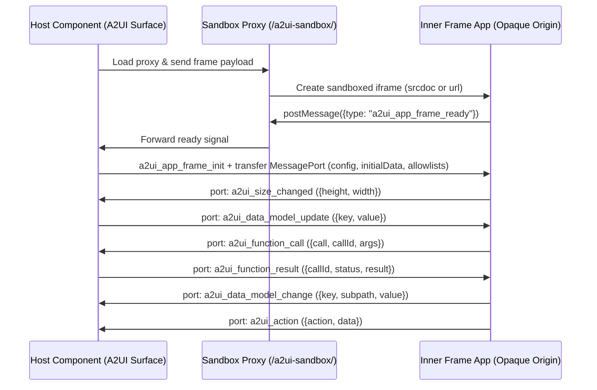

import {Tabs, TabItem} from '@astrojs/starlight/components';

`@a2ui/catalog-iframe` lets A2UI v1.0 surfaces embed inline HTML documents and external web applications inside isolated, sandboxed iframes. Both components are universal Web Components (`A2uiLitElement`) that render alongside native components in Lit, React, and Angular.

| Component           | Source                                                           | Best for                                                                   |
| :------------------ | :--------------------------------------------------------------- | :------------------------------------------------------------------------- |
| `WebAppFrameSrcdoc` | Inline HTML string in `htmlContent` (offline, no network access) | Model-generated widgets, calculators, and self-contained interactive tools |
| `WebAppFrameUrl`    | Hosted `https://` or `http://` URL in `url`                      | Existing web applications served from their own origin                     |

## Quick setup

### Step 1: Install the packages

```bash
npm install @a2ui/catalog-iframe @a2ui/web_core lit
```

`@a2ui/web_core` and `lit` are peer dependencies shared with your web renderer (`@a2ui/lit`, `@a2ui/react`, or `@a2ui/angular`) so the page loads a single copy of `Catalog` and `LitElement`.

### Step 2: Serve the `/a2ui-sandbox/` files

Both components isolate embedded content inside a small proxy page shipped in `node_modules/@a2ui/catalog-iframe/sandbox/`. Serve that folder at `/a2ui-sandbox/` on your app's origin:

<Tabs syncKey="bundler">
  <TabItem label="Vite">

Copy `node_modules/@a2ui/catalog-iframe/sandbox/*` to `/a2ui-sandbox` with [`vite-plugin-static-copy`](https://github.com/sapphi-red/vite-plugin-static-copy):

```ts
import {defineConfig} from 'vite';
import {viteStaticCopy} from 'vite-plugin-static-copy';

export default defineConfig({
  plugins: [
    viteStaticCopy({
      targets: [
        {
          src: 'node_modules/@a2ui/catalog-iframe/sandbox/*',
          dest: 'a2ui-sandbox',
        },
      ],
    }),
  ],
});
```

Without a plugin, run a pre-dev/pre-build Node script that copies the `sandbox/` folder into Vite's [`public/`](https://vite.dev/guide/assets.html#the-public-directory) directory (and add `public/a2ui-sandbox/` to `.gitignore`):

```js
import {cpSync, mkdirSync, rmSync} from 'node:fs';
import {createRequire} from 'node:module';
import path from 'node:path';

const require = createRequire(import.meta.url);
const catalogJsonPath = require.resolve('@a2ui/catalog-iframe/catalog.json');
const sourceDir = path.join(path.dirname(catalogJsonPath), 'sandbox');
const targetDir = path.resolve(import.meta.dirname, '../public/a2ui-sandbox');

rmSync(targetDir, {recursive: true, force: true});
mkdirSync(path.dirname(targetDir), {recursive: true});
cpSync(sourceDir, targetDir, {recursive: true});
```

  </TabItem>
  <TabItem label="Angular CLI">

Add the folder to the `assets` array of your build target in `angular.json` (see Angular's [assets configuration](https://angular.dev/reference/configs/workspace-config#assets-configuration)):

```json
{
  "glob": "**/*",
  "input": "node_modules/@a2ui/catalog-iframe/sandbox",
  "output": "a2ui-sandbox"
}
```

  </TabItem>
  <TabItem label="Static server">

Copy `node_modules/@a2ui/catalog-iframe/sandbox` to `<web root>/a2ui-sandbox` so `/a2ui-sandbox/sandbox.html` is served from the same origin as your page.

  </TabItem>
</Tabs>

### Step 3: Register `iframeCatalog`

Register `iframeCatalog` (ID `IFRAME_CATALOG_ID`, `"https://a2ui.org/specification/v1_0/catalogs/iframe/catalog.json"`) next to `basicCatalog`:

<Tabs syncKey="web-framework">
  <TabItem label="Lit">

```ts
import '@a2ui/lit';
import {basicCatalog, MessageProcessor} from '@a2ui/web_core/v1_0';
import {iframeCatalog} from '@a2ui/catalog-iframe';
import {html} from 'lit';

const processor = new MessageProcessor([basicCatalog, iframeCatalog], action => {
  console.log('Action dispatched:', action);
});
processor.processMessages(messages);

const surface = processor.model.getSurface('main');
const view = html`<a2ui-surface .surface=${surface}></a2ui-surface>`;
```

  </TabItem>
  <TabItem label="React">

```tsx
import {A2uiSurface} from '@a2ui/react';
import {basicCatalog, MessageProcessor} from '@a2ui/web_core/v1_0';
import {iframeCatalog} from '@a2ui/catalog-iframe';

const processor = new MessageProcessor([basicCatalog, iframeCatalog], action => {
  console.log('Action dispatched:', action);
});
processor.processMessages(messages);

export function MainSurface() {
  const surface = processor.model.getSurface('main');
  return surface ? <A2uiSurface surface={surface} /> : null;
}
```

  </TabItem>
  <TabItem label="Angular">

Wrap `iframeCatalog` in an `AngularCatalog` and enable `useUniversalComponents: true` in `provideA2Ui` so Angular mounts universal Web Component entries:

```ts
import {ApplicationConfig, Injectable} from '@angular/core';
import {AngularCatalog, BasicCatalog, provideA2Ui} from '@a2ui/angular';
import {iframeCatalog} from '@a2ui/catalog-iframe';

@Injectable({providedIn: 'root'})
export class IframeAngularCatalog extends AngularCatalog {
  constructor() {
    super(
      iframeCatalog.id,
      iframeCatalog.protocolVersion,
      [...iframeCatalog.components.values()],
      [...iframeCatalog.functions.values()],
    );
  }
}

export const appConfig: ApplicationConfig = {
  providers: [
    provideA2Ui(() => ({
      catalogs: [new BasicCatalog(), new IframeAngularCatalog()],
      useUniversalComponents: true,
      actionHandler: action => {
        console.log('Action dispatched:', action);
      },
    })),
  ],
};
```

  </TabItem>
</Tabs>

## Rendering an inline HTML frame

Once `basicCatalog` and `iframeCatalog` are registered, a surface created with [`createSurface`](../../specification/v1.0/schemas/#agent_to_renderer.json/$defs/CreateSurfaceMessage) can mix standard components and sandboxed frames. Set `catalogId` on the frame component to select the iframe catalog:

```json
[
  {
    "version": "1.0",
    "createSurface": {
      "surfaceId": "main",
      "catalogId": "https://a2ui.org/specification/v1_0/catalogs/basic/catalog.json"
    }
  },
  {
    "version": "1.0",
    "updateComponents": {
      "surfaceId": "main",
      "components": [
        {
          "id": "root",
          "component": "Column",
          "children": ["heading", "preview_frame"]
        },
        {
          "id": "heading",
          "component": "Text",
          "text": "## Interactive widget"
        },
        {
          "id": "preview_frame",
          "catalogId": "https://a2ui.org/specification/v1_0/catalogs/iframe/catalog.json",
          "component": "WebAppFrameSrcdoc",
          "height": 140,
          "htmlContent": "<!doctype html><html><body><p>Hello from inside the sandbox!</p></body></html>"
        }
      ]
    }
  }
]
```

## Connecting frame state and actions

Frames can read paths from the surface data model (`data.paths`), write allowed keys back (`mutableData`), invoke catalog functions (`allowedFunctions`), and emit actions (`allowedEvents`). Every allowlist denies by default unless declared on the component.

The two complete examples in [`catalogs/iframe/examples/`](https://github.com/a2ui-project/a2ui/blob/main/catalogs/iframe/examples) show both components in action.

### Inline HTML tip calculator (`WebAppFrameSrcdoc`)

[`srcdoc-tip-calculator.json`](https://github.com/a2ui-project/a2ui/blob/main/catalogs/iframe/examples/srcdoc-tip-calculator.json) places a `WebAppFrameSrcdoc` between two host `TextField` inputs bound to `/bill/amount` and `/bill/tipPercent` and a host `Text` label reading `Total to pay: ${/bill/totalLabel}`:

```json
{
  "id": "tip_calculator",
  "catalogId": "https://a2ui.org/specification/v1_0/catalogs/iframe/catalog.json",
  "component": "WebAppFrameSrcdoc",
  "height": 240,
  "config": {"currency": "USD", "locale": "en-US"},
  "data": {
    "paths": {
      "amount": "/bill/amount",
      "tipPercent": "/bill/tipPercent",
      "total": "/bill/total",
      "totalLabel": "/bill/totalLabel"
    }
  },
  "mutableData": {
    "total": {"type": "number", "minimum": 0},
    "totalLabel": {"type": "string"}
  },
  "allowedEvents": {
    "receipt_saved": {"type": "object", "required": ["amount", "tipPercent", "total"]},
    "open_url": {"type": "object", "properties": {"url": {"type": "string"}}, "required": ["url"]}
  },
  "allowedFunctions": {
    "formatCurrency": {"type": "object", "required": ["value", "currency"]}
  },
  "htmlContent": "<!doctype html><html><body><table>...</table><button id=\"save\">Save receipt</button><a href=\"https://en.wikipedia.org/wiki/Gratuity\">How tipping works</a><script>...</script></body></html>"
}
```

When the frame connects, it receives the current bill values and `config`, calculates the tip, and writes `total` back to `/bill/total` (permitted by `mutableData`). It calls `formatCurrency` from the surface's basic catalog, writes the formatted result to `totalLabel`, and updates the host `Text` to `Total to pay: $75.52`. Editing either host `TextField` streams updates into the frame, clicking "Save receipt" dispatches `receipt_saved` to your `MessageProcessor` action listener, and clicking the link emits an `open_url` action with `{url}` so the host app can open it safely.

### External URL order tracker (`WebAppFrameUrl`)

[`url-order-tracker.json`](https://github.com/a2ui-project/a2ui/blob/main/catalogs/iframe/examples/url-order-tracker.json) loads a web app from its own origin, passes static `config` settings and `/orders`, and displays the summary string the app writes to `/summary` in a sibling `Text` component:

```json
{
  "id": "order_tracker",
  "catalogId": "https://a2ui.org/specification/v1_0/catalogs/iframe/catalog.json",
  "component": "WebAppFrameUrl",
  "url": "https://example.com/a2ui-apps/order-tracker/",
  "height": 240,
  "config": {"theme": "light", "locale": "en-US"},
  "data": {"paths": {"orders": "/orders", "summary": "/summary"}},
  "mutableData": {"summary": {"type": "string"}},
  "allowedEvents": {
    "order_selected": {"type": "object", "required": ["orderId"]},
    "order_delivered": {"type": "object", "required": ["orderId"]}
  }
}
```

The proxy loads `https://example.com/a2ui-apps/order-tracker/?origin=<host origin>`. Once connected, the app renders the order list, writes a localized summary such as `1 processing, 2 shipped` to `/summary`, and emits `order_selected` or `order_delivered` when orders are clicked or marked delivered. (The example URL is a placeholder; the package test suite runs it against `typescript/catalogs/iframe/tests/fixtures/apps/order_tracker.html`.)

## Advanced reference and architecture

<details>
<summary>All component properties, allowlists, and link handling</summary>

Both `WebAppFrameSrcdoc` and `WebAppFrameUrl` accept the same configuration properties in addition to `htmlContent` or `url`:

| Property                  | Purpose                                                                                                       |
| :------------------------ | :------------------------------------------------------------------------------------------------------------ |
| `height`                  | Initial frame height in CSS pixels before the app sends `a2ui_size_changed`.                                  |
| `config`                  | Static key-value settings passed once during the initial handshake.                                           |
| `data.paths`              | Map of frame state keys to JSON Pointer paths in the surface data model.                                      |
| `mutableData`             | Map of `data.paths` keys the app may write back, each paired with a JSON Schema for incoming values.          |
| `allowedEvents`           | Map of action names the app may dispatch to the host, each paired with a payload JSON Schema.                 |
| `allowedFunctions`        | Map of A2UI functions the app may call on the host, each paired with an arguments JSON Schema.                |
| `disableSchemaValidation` | Skips JSON Schema validation on inbound messages while keeping allowlist, size, and structural checks active. |

**Handshake-time capture vs. per-message checks.** The host reads `config` and `data.paths` when the app connects, so a subsequent update to either property takes effect on the next handshake. By contrast, `allowedEvents`, `allowedFunctions`, and `mutableData` are re-read on every message and deny by default: any unlisted action, function call, or data write is dropped or rejected with a console warning. When an app invokes a function, the host looks in the frame's own catalog first and then in the surface's default catalog.

**Inline HTML CSP and hyperlinks.** On `WebAppFrameSrcdoc`, the host injects a Content Security Policy that blocks `fetch`, `XMLHttpRequest`, form submission, `<base>` rewrites, plugins, and nested frames (any CSP added by the HTML author can only narrow it). Hyperlinks inside `WebAppFrameSrcdoc` never navigate the frame: clicking an `<a>` element intercepts navigation and emits an `open_url` action with `{url}`, which reaches the host only when `open_url` is listed in `allowedEvents`.

See the [iframe catalog README](https://github.com/a2ui-project/a2ui/blob/main/catalogs/iframe/README.md) for the full property list and [`catalog_definition.json`](../../specification/v1.0/schemas/#catalog_definition.json) for the v1.0 catalog schema format.

</details>

<details>
<summary>Host-to-frame message protocol (<code>a2ui_*</code> handshake)</summary>

An embedded application needs no client library. It listens for `message` events on `window`, posts `{type: "a2ui_app_frame_ready"}` to `window.parent`, and receives `a2ui_app_frame_init` with `config`, `initialData` (current values of `data.paths`), `allowedEvents`, `allowedFunctions`, `mutableData`, host container dimensions, and a transferred `MessagePort` at `event.ports[0]`. Every message after the handshake travels over that port.

The sequence diagram below shows the handshake across the app, sandbox proxy, and host component, followed by ongoing traffic on `event.ports[0]`:



Once connected, the `MessagePort` carries seven message types:

| Direction   | Message `type`             | Payload fields                          | Behavior                                                                                                        |
| :---------- | :------------------------- | :-------------------------------------- | :-------------------------------------------------------------------------------------------------------------- |
| App to host | `a2ui_action`              | `action`, `data`                        | Dispatches an A2UI action from the frame component if `action` is in `allowedEvents`.                           |
| App to host | `a2ui_data_model_change`   | `key`, optional `subpath`, `value`      | Writes to the bound `data.paths[key]` pointer if `key` is in `mutableData`.                                     |
| App to host | `a2ui_function_call`       | `call`, `callId`, `args`                | Evaluates `call` in the frame or surface catalog if listed in `allowedFunctions`.                               |
| App to host | `a2ui_size_changed`        | `height`, `width`                       | Requests a frame height update to match rendered content.                                                       |
| Host to app | `a2ui_data_model_update`   | `key`, `value`                          | Pushes updated data whenever a bound path in `data.paths` changes.                                              |
| Host to app | `a2ui_function_result`     | `callId`, `status`, `result` or `error` | Returns the outcome of an `a2ui_function_call` (`OK`, `NOT_ALLOWED`, `VALIDATION_ERROR`, or `EXECUTION_ERROR`). |
| Host to app | `a2ui_host_context_update` | `hostContext`                           | Notifies the app when host container dimensions or context change.                                              |

Before acting on any port message, the host checks for prototype-pollution keys (`__proto__`, `constructor`, `prototype`), enforces payload size and nesting-depth limits, checks the allowlist of that message kind, and validates the payload against the declared JSON Schema unless `disableSchemaValidation` is `true`. Full wire schemas live in the [WebApp iframe component specification](https://github.com/a2ui-project/a2ui/blob/main/catalogs/iframe/web_app_frame_specification.md).

</details>

<details>
<summary>Custom sandbox proxy paths, separate origins, and double-iframe isolation</summary>

**Files inside `node_modules/@a2ui/catalog-iframe/sandbox/`** (built from `dist/sandbox/` in the repository):

1. `sandbox.html` is loaded by `WebAppFrameSrcdoc` and sets a CSP that keeps the inner frame from loading external URLs.
2. `sandbox-url.html` is loaded by `WebAppFrameUrl` and sets a CSP that allows `http` and `https` frame URLs.
3. `sandbox.js` runs in both proxy pages to verify the embedding origin, create the inner sandboxed frame, and relay messages.

**Custom path or dedicated origin.** If you serve the proxy somewhere other than `/a2ui-sandbox/`, call `configureSandbox` once at startup before the first surface renders:

```ts
import {configureSandbox} from '@a2ui/catalog-iframe';

configureSandbox({baseUrl: '/static/frames/'});
```

`resolveSandboxUrl('html')` and `resolveSandboxUrl('url')` return the exact proxy URLs the components will load. `baseUrl` can also be an absolute URL on a dedicated sandbox origin; when cross-origin, authorize your host origin inside the proxy HTML with a `<meta>` tag (stored with the proxy so an embedder cannot widen the list):

```html
<meta name="a2ui-sandbox-host-origins" content="https://app.example.com" />
```

**Security self-test.** At startup, `sandbox.js` can check that it cannot reach `window.top`, which holds only when the proxy is served from a separate origin. On same-origin deployments the components automatically append `disable_security_self_test=true` to the proxy URL, and leave the test enabled when cross-origin. Pass `configureSandbox({disableSecuritySelfTest: true})` or `false` to override that choice.

**Double-iframe isolation.** The outer frame loads the proxy page without a `sandbox` attribute so `sandbox.js` retains a real origin to check `document.referrer` (against its own origin and `a2ui-sandbox-host-origins`), exchange origin-verified `postMessage` frames with the host, and supply the outer document CSP inherited by `srcdoc`. The inner frame created by the proxy sets `sandbox="allow-scripts allow-forms allow-modals"` (omitting `allow-same-origin`, `allow-top-navigation`, and `allow-popups`), placing app scripts in an opaque `null` origin without access to host cookies, storage, or DOM. The inner frame also receives a Permissions Policy denying camera, microphone, geolocation, and clipboard access, plus the injected CSP for inline HTML.

</details>

## Troubleshooting

### The frame stays empty and the network panel shows a 404 under `/a2ui-sandbox/`

The proxy files are not served where the component expects them, so the ready signal never arrives. Confirm your Vite copy plugin/script or `angular.json` `assets` config ran (restart `ng serve` after editing `angular.json`), check that `/a2ui-sandbox/sandbox.html` loads in the browser, and if using a custom path, call `configureSandbox({baseUrl})` before rendering. Logging `resolveSandboxUrl('html').href` prints the resolved URL.

### The app loads but does nothing, or stays on its waiting state

The host dropped or rejected a message and logged a console warning. Check for an action missing from `allowedEvents` (including `open_url` on `WebAppFrameSrcdoc` link clicks), a write key missing from `mutableData`, a payload failing its JSON Schema, a function call returning `NOT_ALLOWED` / `VALIDATION_ERROR` / `EXECUTION_ERROR`, or a `WebAppFrameUrl` `url` that is not `http:` or `https:`.

### Custom element errors, or components that render empty

Duplicate copies of `lit` or `@a2ui/web_core` cause `Custom element tag name collision` errors and Lit's `Multiple versions of Lit loaded` warning. Check `npm ls lit @a2ui/web_core` (or `yarn why`) and run `npm dedupe`, or add `resolve: {dedupe: ['lit', '@a2ui/web_core']}` in `vite.config.ts`.

## Further reading

- [`@a2ui/catalog-iframe` package README](https://github.com/a2ui-project/a2ui/blob/main/typescript/catalogs/iframe/README.md) for styling hooks, host bridge internals, and building custom sandboxed components on `SandboxedFrameElement`.
- [WebApp iframe component specification](https://github.com/a2ui-project/a2ui/blob/main/catalogs/iframe/web_app_frame_specification.md) for wire protocol schemas, handshake details, and security controls.
- [How to Define a Catalog](../defining-a-catalog/) and [Authoring Universal Web Components](../authoring-universal-components/) for creating and publishing catalogs of your own.
