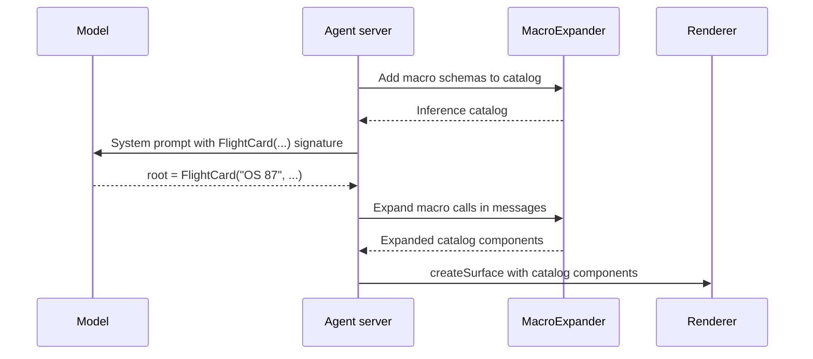

import {Aside, Tabs, TabItem} from '@astrojs/starlight/components';

Macros let you define composite UI components on the server that can programmatically inject server-side data and expand into the flexible, reusable [catalog](../../concepts/catalogs/) components your client supports (from the Basic Catalog, your own custom catalogs, or both) before any messages reach the renderer. Because the renderer only receives components the client already implements, you can add or change macros on the server without shipping new client code.

<Aside type="note" title="Language support">
  Macros are supported in the Python [agent SDK](../../concepts/sdks/#agent-sdk) (`a2ui-agent-sdk`)
  and the Go agent SDK (`github.com/a2ui-project/a2ui/go/agent/macros`), with support for other
  languages coming next.
</Aside>

## How macros work

When a language model builds UI from low-level primitives on every turn, repeated patterns like flight summaries or product cards take many lines of nested components. With a macro, you write a function once on the server to assemble that pattern.

Macros are useful when you want to:

1. Reduce output tokens and latency by letting the model write one call instead of a nested component tree.
2. Keep layouts consistent across turns because your server code constructs the component hierarchy.
3. Look up data from server-side databases and APIs, accepting an identifier from the model and populating the components on the server.
4. Ship new domain components with a server deployment alone, using catalog components the client already renders.

In the sequence below, [`MacroExpander`](../../concepts/glossary/#macroexpander) works on both sides of the model call. Before inference, it adds each macro's component schema to the catalog in the system prompt. After inference, it intercepts each macro call, runs your macro function, and outputs flat catalog components for the renderer.



### Example: macro, model call, and expanded output

Here is a `FlightCard` macro. The `flight` and `route` parameters take static strings, while `status` uses `DynamicString` (`v1.DynamicString` in Go) so it can bind to the [data model](../../concepts/data-binding/):

<Tabs syncKey="sdk-lang">
  <TabItem label="Python">

```python title="flight_macros.py"
from a2ui.builder.v1_0 import Card, Column, DynamicString, Text
from a2ui.transformers.macros import macro


@macro
def FlightCard(flight: str, route: str, status: DynamicString) -> Card:
    """Summary card for a flight with a live status line.

    Args:
        flight: Flight number, such as "OS 87".
        route: Departure and arrival cities, such as "Vienna to New York".
        status: Current status text or data binding.
    """
    return Card(
        child=Column(
            children=[
                Text(text=f"### {flight}"),
                Text(text=route, variant="caption"),
                Text(text=status),
            ]
        )
    )
```

  </TabItem>
  <TabItem label="Go">

```go title="flight_macros.go"
package flightmacros

import (
	v1 "github.com/a2ui-project/a2ui/go/agent/builder/v1"
	"github.com/a2ui-project/a2ui/go/agent/macros"
)

type FlightCardArgs struct {
	Flight string           `json:"flight" desc:"Flight number, such as \"OS 87\"."`
	Route  string           `json:"route" desc:"Departure and arrival cities, such as \"Vienna to New York\"."`
	Status v1.DynamicString `json:"status" desc:"Current status text or data binding."`
}

var FlightCard = macros.MustNewPureMacro(
	"FlightCard",
	"Summary card for a flight with a live status line.",
	func(args FlightCardArgs) *v1.Card {
		return v1.NewCard(
			v1.NewColumn(v1.Children(
				v1.NewText(v1.Str("### "+args.Flight)),
				v1.NewText(v1.Str(args.Route)).WithVariant(v1.TextVariantCaption),
				v1.NewText(args.Status),
			)),
		)
	},
)
```

  </TabItem>
</Tabs>

Using the [Express](../../concepts/inference-formats/) inference format, the model calls `FlightCard` in a single line:

```text title="Model output"
Your flight is boarding.
<a2ui>
$/flight/status = "Boarding"
root = FlightCard("OS 87", "Vienna to New York", $/flight/status)
</a2ui>
```

`MacroExpander` runs `FlightCard` on the server and sends the expanded components over the wire, with static arguments baked in and the `/flight/status` data binding preserved:

<Tabs syncKey="protocol-version">
  <TabItem label="v1.0">

```json
[
  {
    "version": "1.0",
    "createSurface": {
      "surfaceId": "main",
      "catalogId": "https://a2ui.org/specification/v1_0/catalogs/basic/catalog.json",
      "components": [
        {
          "component": "Text",
          "id": "root__text_1",
          "text": "### OS 87",
          "variant": "body"
        },
        {
          "component": "Text",
          "id": "root__text_2",
          "text": "Vienna to New York",
          "variant": "caption"
        },
        {
          "component": "Text",
          "id": "root__text_3",
          "text": {"@path": "/flight/status"},
          "variant": "body"
        },
        {
          "component": "Column",
          "id": "root__column_1",
          "children": ["root__text_1", "root__text_2", "root__text_3"],
          "justify": "start",
          "align": "stretch"
        },
        {
          "component": "Card",
          "id": "root",
          "child": "root__column_1"
        }
      ],
      "dataModel": {
        "flight": {"status": "Boarding"}
      }
    }
  }
]
```

  </TabItem>
  <TabItem label="v0.9.1">

```json
[
  {
    "version": "v0.9",
    "createSurface": {
      "surfaceId": "main",
      "catalogId": "https://a2ui.org/specification/v0_9/catalogs/basic/catalog.json"
    }
  },
  {
    "version": "v0.9",
    "updateComponents": {
      "surfaceId": "main",
      "components": [
        {
          "component": "Text",
          "id": "root__text_1",
          "text": "### OS 87",
          "variant": "body"
        },
        {
          "component": "Text",
          "id": "root__text_2",
          "text": "Vienna to New York",
          "variant": "caption"
        },
        {
          "component": "Text",
          "id": "root__text_3",
          "text": {"path": "/flight/status"},
          "variant": "body"
        },
        {
          "component": "Column",
          "id": "root__column_1",
          "children": ["root__text_1", "root__text_2", "root__text_3"],
          "justify": "start",
          "align": "stretch"
        },
        {
          "component": "Card",
          "id": "root",
          "child": "root__column_1"
        }
      ]
    }
  },
  {
    "version": "v0.9",
    "updateDataModel": {
      "surfaceId": "main",
      "path": "/",
      "value": {
        "flight": {"status": "Boarding"}
      }
    }
  }
]
```

  </TabItem>
</Tabs>

## Configure a macro

The steps below integrate a macro into an agent using the v1.0 Basic Catalog. You do not need to use the Basic Catalog: the same workflow applies to your own custom catalogs, as shown in [Macros with custom catalogs](#macros-with-custom-catalogs).

### Step 1: Install the agent SDK

<Tabs syncKey="sdk-lang">
  <TabItem label="Python">

Install `a2ui-agent-sdk` with `pip` (or `uv add a2ui-agent-sdk`):

```bash
pip install a2ui-agent-sdk
```

  </TabItem>
  <TabItem label="Go">

Install the Go agent and core modules (requires Go 1.26 or later):

```bash
go get github.com/a2ui-project/a2ui/go/agent github.com/a2ui-project/a2ui/go/core
```

Until the initial Go module tags are published, add `replace` directives in your `go.mod` pointing `github.com/a2ui-project/a2ui/go/agent` and `github.com/a2ui-project/a2ui/go/core` to a local checkout of `github.com/a2ui-project/a2ui`.

  </TabItem>
</Tabs>

### Step 2: Define a macro

Define a macro that returns a single root builder component. In Python, `@macro` inspects parameter type hints and the `Args:` docstring block to generate the component schema exposed to the model; in Go, `macros.NewMacro` (or `macros.NewPureMacro` for infallible callbacks) inspects the fields and `json`/`desc` tags on a typed arguments struct:

<Tabs syncKey="sdk-lang">
  <TabItem label="Python">

```python title="flight_macros.py"
from a2ui.builder.v1_0 import (
    Action,
    Button,
    Card,
    Column,
    DynamicString,
    Text,
)
from a2ui.transformers.macros import macro


@macro
def FlightCard(
    flight: str,
    route: str,
    status: DynamicString,
    on_rebook: Action,
) -> Card:
    """Summary card for a flight with a live status line and rebook button.

    Args:
        flight: Flight number, such as "OS 87".
        route: Departure and arrival cities, such as "Vienna to New York".
        status: Current status text or data binding.
        on_rebook: Action sent when the user clicks Rebook.
    """
    return Card(
        child=Column(
            children=[
                Text(text=f"### {flight}"),
                Text(text=route, variant="caption"),
                Text(text=status),
                Button(child=Text(text="Rebook"), action=on_rebook),
            ]
        )
    )
```

  </TabItem>
  <TabItem label="Go">

```go title="flight_macros.go"
package flightmacros

import (
	v1 "github.com/a2ui-project/a2ui/go/agent/builder/v1"
	"github.com/a2ui-project/a2ui/go/agent/macros"
)

type FlightCardArgs struct {
	Flight   string           `json:"flight" desc:"Flight number, such as \"OS 87\"."`
	Route    string           `json:"route" desc:"Departure and arrival cities, such as \"Vienna to New York\"."`
	Status   v1.DynamicString `json:"status" desc:"Current status text or data binding."`
	OnRebook v1.Action        `json:"on_rebook" desc:"Action sent when the user clicks Rebook."`
}

func NewFlightCard() (*macros.Macro, error) {
	return macros.NewMacro(
		"FlightCard",
		"Summary card for a flight with a live status line and rebook button.",
		func(args FlightCardArgs) (*v1.Card, error) {
			return v1.NewCard(
				v1.NewColumn(v1.Children(
					v1.NewText(v1.Str("### "+args.Flight)),
					v1.NewText(v1.Str(args.Route)).WithVariant(v1.TextVariantCaption),
					v1.NewText(args.Status),
					v1.NewButton(v1.NewText(v1.Str("Rebook")), args.OnRebook),
				)),
			), nil
		},
	)
}
```

  </TabItem>
</Tabs>

Because a macro is regular server code, it can also take an identifier (such as `flight_id`), look up the record in a database or service, and populate the returned components directly. In Go, `macros.NewMacro` accepts an expand callback returning `(Out, error)` so lookup or validation errors return directly to the expander.

### Step 3: Set up the expander and request processor

Create a `MacroExpander` with your macro list, build an inference catalog that includes the macro schemas, and create a request processor to generate the system prompt snippet:

<Tabs syncKey="sdk-lang">
  <TabItem label="Python">

```python title="agent.py"
from a2ui.core.basic_catalog import BasicCatalog
from a2ui.processor import A2uiRequestProcessor
from a2ui.transformers.macros import MacroExpander

from flight_macros import FlightCard

expander = MacroExpander([FlightCard], on_error="raise")
inference_catalog = expander.transform_to_inference_catalog(BasicCatalog("1.0"))

processor = A2uiRequestProcessor(catalogs=[inference_catalog])
system_prompt = processor.prompt_snippet  # Append to your model's system instruction.
```

  </TabItem>
  <TabItem label="Go">

```go title="agent.go"
package main

import (
	"github.com/a2ui-project/a2ui/go/agent"
	"github.com/a2ui-project/a2ui/go/agent/macros"
	"github.com/a2ui-project/a2ui/go/core"

	"example.com/app/flightmacros"
)

func setupAgent(capabilities core.RendererCapabilities) (*agent.RequestProcessor, *macros.TransportSession, string, error) {
	flightCard, err := flightmacros.NewFlightCard()
	if err != nil {
		return nil, nil, "", err
	}
	basicCatalog, err := core.BasicCatalog(core.Version1_0)
	if err != nil {
		return nil, nil, "", err
	}

	expander, err := macros.NewMacroExpander([]*macros.Macro{flightCard}, &macros.ExpanderOptions{
		OnError: macros.OnErrorRaise,
	})
	if err != nil {
		return nil, nil, "", err
	}
	basicCfg, err := agent.NewCatalogConfig(basicCatalog, expander)
	if err != nil {
		return nil, nil, "", err
	}

	generator := agent.NewGenerator([]*agent.CatalogConfig{basicCfg}, nil)
	processor, err := generator.CreateProcessor(capabilities, nil)
	if err != nil {
		return nil, nil, "", err
	}
	systemPrompt, err := processor.PromptSnippet() // Append to your model's system instruction.
	if err != nil {
		return nil, nil, "", err
	}

	// Share expander across the server and create one TransportSession per conversation.
	session := expander.NewSession()
	return processor, session, systemPrompt, nil
}
```

  </TabItem>
</Tabs>

`MacroExpander` acts both before inference (adding macro schemas to the catalog) and after parsing (expanding macro calls in outgoing messages). In Go, `*macros.MacroExpander` also implements `agent.CatalogTransformer` for single-catalog setups with `agent.NewGenerator` (or you can call `expander.TransformToInferenceCatalog(basicCatalog)` directly with `agent.NewRequestProcessor`).

Because lowering `updateComponents` on later turns depends on each surface's active `catalogId`, each conversation keeps its own surface-to-catalog tracking. In Python, create one `MacroExpander` per conversation, or pass `surface_catalogs` to `transform_to_transport` in multi-session servers. In Go, share a single concurrency-safe `*macros.MacroExpander` across the server and call `expander.NewSession()` once per conversation.

Both `A2uiRequestProcessor` and `agent.Generator` default to the Express inference format, and accept any format factory via `format_factory` (`InferenceFormatFactory` in Go).

### Step 4: Parse model output and expand macros

After your model responds, parse the response and pass each A2UI message batch through `transform_to_transport` (`session.TransformToTransport` in Go) before serializing the messages for the client:

<Tabs syncKey="sdk-lang">
  <TabItem label="Python">

```python title="agent.py (continued)"
from a2ui.parser import A2uiPart, TextPart

# llm_output = call_your_model(system_prompt, user_message)
parts = processor.parse_response(llm_output)

text_reply: list[str] = []
transport_messages = []

for part in parts:
    if isinstance(part, TextPart):
        text_reply.append(part.text)
    elif isinstance(part, A2uiPart):
        transport_messages.extend(expander.transform_to_transport(part.a2ui))

wire_payload = [
    msg.model_dump(by_alias=True, exclude_none=True)
    for msg in transport_messages
]
```

  </TabItem>
  <TabItem label="Go">

```go title="agent.go (continued)"
import "encoding/json"

func handleModelTurn(
	processor *agent.RequestProcessor,
	session *macros.TransportSession,
	llmOutput string,
) ([]string, []byte, error) {
	// llmOutput := callYourModel(systemPrompt, userMessage)
	parts, err := processor.ParseResponse(llmOutput, nil)
	if err != nil {
		return nil, nil, err
	}

	var textReply []string
	var transportMessages []core.AgentToRendererMessage

	for _, part := range parts {
		if part.IsText() {
			textReply = append(textReply, part.Text)
		} else if part.IsA2UI() {
			expanded, err := session.TransformToTransport(part.A2UI)
			if err != nil {
				return nil, nil, err
			}
			transportMessages = append(transportMessages, expanded...)
		}
	}

	wirePayload, err := json.Marshal(transportMessages)
	if err != nil {
		return nil, nil, err
	}
	return textReply, wirePayload, nil
}
```

  </TabItem>
</Tabs>

Send the serialized payload over your transport to the renderer alongside any conversational text in `text_reply` (`textReply` in Go). When a user triggers an interactive child inside an expanded macro (such as clicking the `Rebook` button bound to `on_rebook`), the renderer sends a standard inbound `action` message (referencing the expanded button ID, such as `root__button_1`) to your server's inbound processor (`A2uiRendererToAgentMessageProcessor` in Python or `agent.NewRendererToAgentMessageProcessor` in Go); no reverse macro transformation is required.

## Macros with custom catalogs

Macros build component trees using typed component builders. Basic Catalog builders ship in `a2ui.builder.v1_0` and `a2ui.builder.v0_9` for Python, and in `github.com/a2ui-project/a2ui/go/agent/builder/v1` and `builder/v09` for Go. When you define a [custom catalog](../defining-a-catalog/), generate Python builder classes with the `a2ui` CLI or declare Go structs embedding `v1.ComponentNode`.

### Step 1: Define a custom catalog schema

Suppose you have a `travel_catalog.json` file that defines a `BoardingPass` component (and your client renderer registers the matching `BoardingPass` widget).

<details>
<summary>Example <code>travel_catalog.json</code></summary>

```json title="travel_catalog.json"
{
  "$schema": "https://json-schema.org/draft/2020-12/schema",
  "catalogId": "https://example.com/catalogs/travel/v1/catalog.json",
  "protocolVersion": "1.0",
  "components": {
    "BoardingPass": {
      "type": "object",
      "description": "A boarding pass with a scannable code.",
      "properties": {
        "component": {"const": "BoardingPass"},
        "passenger": {"type": "string"},
        "seat": {"type": "string"},
        "gate": {"$ref": "common_types.json#/$defs/DynamicString"}
      },
      "required": ["component", "passenger", "seat", "gate"]
    }
  },
  "$defs": {
    "anyComponent": {
      "oneOf": [{"$ref": "#/components/BoardingPass"}],
      "discriminator": {"propertyName": "component"}
    },
    "anyFunction": {"not": {}}
  }
}
```

</details>

### Step 2: Create typed builders for your catalog

<Tabs syncKey="sdk-lang">
  <TabItem label="Python">

Install the standalone `a2ui` binary using the release installer script. Both scripts verify the SHA-256 checksum of the downloaded archive and do not require administrator privileges:

```bash title="macOS and Linux"
curl -fsSL https://raw.githubusercontent.com/a2ui-project/a2ui/main/scripts/public/install_cli.sh | sh
```

```powershell title="Windows (PowerShell)"
irm https://raw.githubusercontent.com/a2ui-project/a2ui/main/scripts/public/install_cli.ps1 | iex
```

On macOS and Linux, the script installs `a2ui` into `${XDG_BIN_HOME:-$HOME/.local/bin}` (set `A2UI_INSTALL_DIR` or `A2UI_VERSION` to customize). On Windows, it installs `a2ui.exe` into `%LOCALAPPDATA%\Programs\a2ui\bin` and adds it to your user `PATH` (customizable via `$env:A2UI_INSTALL_DIR` or `$env:A2UI_VERSION`).

Run `a2ui codegen` with `--lang python` to generate a Python builder module from `travel_catalog.json`:

```bash
a2ui codegen --lang python --catalog travel_catalog.json --out travel_builders.py --catalog-name travel
```

The generated `travel_builders.py` file contains a typed `ComponentBuilderNode` subclass for every component in your catalog:

```python title="travel_builders.py (excerpt)"
class BoardingPass(ComponentBuilderNode):
    r"""A boarding pass with a scannable code."""

    component: Literal["BoardingPass"] = "BoardingPass"
    passenger: str
    seat: str
    gate: str | DataBinding | FunctionCall
```

Re-run `a2ui codegen` whenever `travel_catalog.json` changes rather than editing the generated file by hand.

  </TabItem>
  <TabItem label="Go">

In Go, define a struct embedding `v1.ComponentNode` with exported fields and `json` tags matching your catalog's properties, and implement `ComponentType() string` (`a2ui codegen` is not required):

```go title="travel_builders.go"
package tripmacros

import v1 "github.com/a2ui-project/a2ui/go/agent/builder/v1"

// BoardingPass builds a custom BoardingPass component from travel_catalog.json.
type BoardingPass struct {
	v1.ComponentNode
	Passenger string           `json:"passenger"`
	Seat      string           `json:"seat"`
	Gate      v1.DynamicString `json:"gate"`
}

func (*BoardingPass) ComponentType() string { return "BoardingPass" }

func NewBoardingPass(passenger, seat string, gate v1.DynamicString) *BoardingPass {
	return &BoardingPass{
		Passenger: passenger,
		Seat:      seat,
		Gate:      gate,
	}
}
```

Validate your builders and catalog schemas in tests with `go test ./...` and `go vet ./...`.

  </TabItem>
</Tabs>

### Step 3: Write a macro and expand across catalogs

Use your custom builder inside a macro. In A2UI v1.0, a single surface can combine components from multiple catalogs, so a macro can mix `BoardingPass` with layout components from the v1.0 Basic Catalog:

<Tabs syncKey="sdk-lang">
  <TabItem label="Python">

```python title="trip_macros.py"
from a2ui.builder.v1_0 import Card, Column, DynamicString, Text
from a2ui.transformers.macros import macro

from travel_builders import BoardingPass


@macro
def TripSummary(passenger: str, seat: str, gate: DynamicString) -> Card:
    """Trip summary card containing a boarding pass.

    Args:
        passenger: Passenger full name.
        seat: Assigned seat number.
        gate: Departure gate text or data binding.
    """
    return Card(
        child=Column(
            children=[
                Text(text=f"### Have a good trip, {passenger}"),
                BoardingPass(passenger=passenger, seat=seat, gate=gate),
            ]
        )
    )
```

  </TabItem>
  <TabItem label="Go">

```go title="trip_macros.go"
package tripmacros

import (
	v1 "github.com/a2ui-project/a2ui/go/agent/builder/v1"
	"github.com/a2ui-project/a2ui/go/agent/macros"
)

type TripSummaryArgs struct {
	Passenger string           `json:"passenger" desc:"Passenger full name."`
	Seat      string           `json:"seat" desc:"Assigned seat number."`
	Gate      v1.DynamicString `json:"gate" desc:"Departure gate text or data binding."`
}

var TripSummary = macros.MustNewPureMacro(
	"TripSummary",
	"Trip summary card containing a boarding pass.",
	func(args TripSummaryArgs) *v1.Card {
		return v1.NewCard(
			v1.NewColumn(v1.Children(
				v1.NewText(v1.Str("### Have a good trip, "+args.Passenger)),
				NewBoardingPass(args.Passenger, args.Seat, args.Gate),
			)),
		)
	},
)
```

  </TabItem>
</Tabs>

Load `travel_catalog.json` (`Catalog.from_json` in Python, `core.CatalogFromJSONBytes` in Go) and pass all transport catalogs to `transform_catalogs` (`TransformCatalogs` in Go). If your agent uses only your custom catalog without the Basic Catalog, pass `[travel_catalog]` (`[]*core.Catalog{travelCatalog}`) instead:

<Tabs syncKey="sdk-lang">
  <TabItem label="Python">

```python title="agent.py"
import json
from pathlib import Path

from a2ui.core import Catalog
from a2ui.core.basic_catalog import BasicCatalog
from a2ui.parser import A2uiPart
from a2ui.processor import A2uiRequestProcessor
from a2ui.transformers.macros import MacroExpander

from trip_macros import TripSummary

travel_catalog = Catalog.from_json(
    json.loads(Path("travel_catalog.json").read_text())
)
basic_catalog = BasicCatalog("1.0")

expander = MacroExpander([TripSummary], on_error="raise")
inference_catalogs = expander.transform_catalogs([basic_catalog, travel_catalog])

processor = A2uiRequestProcessor(catalogs=inference_catalogs)
system_prompt = processor.prompt_snippet

# After receiving llm_output from the model:
parts = processor.parse_response(llm_output)
inference_messages = [
    msg for part in parts if isinstance(part, A2uiPart) for msg in part.a2ui
]
transport_messages = expander.transform_to_transport(inference_messages)
```

  </TabItem>
  <TabItem label="Go">

```go title="agent.go"
package main

import (
	"os"

	"github.com/a2ui-project/a2ui/go/agent"
	"github.com/a2ui-project/a2ui/go/agent/macros"
	"github.com/a2ui-project/a2ui/go/core"

	"example.com/app/tripmacros"
)

func runTripTurn(llmOutput string) (string, []core.AgentToRendererMessage, error) {
	raw, err := os.ReadFile("travel_catalog.json")
	if err != nil {
		return "", nil, err
	}
	travelCatalog, err := core.CatalogFromJSONBytes(raw, nil)
	if err != nil {
		return "", nil, err
	}
	basicCatalog, err := core.BasicCatalog(core.Version1_0)
	if err != nil {
		return "", nil, err
	}

	expander, err := macros.NewMacroExpander([]*macros.Macro{tripmacros.TripSummary}, &macros.ExpanderOptions{
		OnError: macros.OnErrorRaise,
	})
	if err != nil {
		return "", nil, err
	}
	inferenceCatalogs, err := expander.TransformCatalogs([]*core.Catalog{basicCatalog, travelCatalog})
	if err != nil {
		return "", nil, err
	}

	processor, err := agent.NewRequestProcessor(inferenceCatalogs, nil)
	if err != nil {
		return "", nil, err
	}
	systemPrompt, err := processor.PromptSnippet()
	if err != nil {
		return "", nil, err
	}

	session := expander.NewSession()

	// After receiving llmOutput from the model:
	parts, err := processor.ParseResponse(llmOutput, nil)
	if err != nil {
		return "", nil, err
	}
	var inferenceMessages []core.AgentToRendererMessage
	for _, part := range parts {
		if part.IsA2UI() {
			inferenceMessages = append(inferenceMessages, part.A2UI...)
		}
	}
	transportMessages, err := session.TransformToTransport(inferenceMessages)
	if err != nil {
		return "", nil, err
	}
	return systemPrompt, transportMessages, nil
}
```

  </TabItem>
</Tabs>

In v1.0, `transform_catalogs` (`TransformCatalogs` in Go) registers your base catalogs on the expander and appends an inference-only sidecar catalog for the macros. When `transform_to_transport` (`session.TransformToTransport` in Go) expands `TripSummary`, it removes the sidecar catalog and stamps the owning `catalogId` onto each expanded `Card`, `Column`, `Text`, and `BoardingPass` component automatically.

## Reference

### Supported parameter types

Parameter types control both the JSON Schema shown to the model and whether a value is static or reactive:

- Plain scalar types (`str`, `int`, `float`, `bool` in Python; `string`, `int`, `float64`, `bool` in Go) accept only static literal values, which are baked into the expanded components when the macro runs. Passing a data binding to a static scalar parameter fails validation.
- Reactive A2UI types (`DynamicString`, `DynamicNumber`, `DynamicBoolean`, `DynamicStringList` in Python; `v1.DynamicString`, `v1.DynamicNumber`, `v1.DynamicBoolean`, `v1.DynamicStringList` in Go) accept either a literal value (`v1.Str`, `v1.Num`, `v1.Bool`, `v1.Strs` in Go) or a `@path` / `@call` binding. When you pass that parameter to a child component property, the binding remains live on the renderer.

Always treat macro arguments as untrusted model output, and validate identifiers against your backend data rather than trusting arbitrary strings.

The table below lists the most common parameter types (showing v1.0 schema definitions):

| Python annotation                                                       | Go field type                                                                       | Schema exposed to the model                                                                               | Value passed to your macro                                                                                                                     |
| :---------------------------------------------------------------------- | :---------------------------------------------------------------------------------- | :-------------------------------------------------------------------------------------------------------- | :--------------------------------------------------------------------------------------------------------------------------------------------- |
| `str`, `int`, `float`, `bool`                                           | `string`, `int`, `float64`, `bool`                                                  | `string`, `integer`, `number`, `boolean`                                                                  | Static literal value (data bindings rejected).                                                                                                 |
| `Literal[...]` or `Enum` (with `str` values)                            | `string` with `` `enum:"a,b"` `` tag, or `builder.StringEnum`                       | `enum`                                                                                                    | Static literal value (Python `Enum` arrives as raw `str`; Go `builder.StringEnum` arrives as that named string type).                          |
| `Sequence[V]`, `dict[str, V]`                                           | `[]V`, `map[string]V`, or exported struct                                           | `array`, `object`                                                                                         | Collection or struct with elements converted to `V`.                                                                                           |
| `DynamicString`, `DynamicNumber`, `DynamicBoolean`, `DynamicStringList` | `v1.DynamicString`, `v1.DynamicNumber`, `v1.DynamicBoolean`, `v1.DynamicStringList` | [`DynamicString`](/specification/v1.0/schemas/#common_types.json/$defs/DynamicString) and related types   | Literal value, `DataBinding`, or `FunctionCall`.                                                                                               |
| `Action`                                                                | `v1.Action`                                                                         | [`Action`](/specification/v1.0/schemas/#common_types.json/$defs/Action)                                   | `Action` built from an event object or function call.                                                                                          |
| `Child` or component class                                              | `builder.Node` or `*builder.ComponentRef`                                           | [`Child`](/specification/v1.0/schemas/#common_types.json/$defs/Child) (`ComponentId` in v0.9.1)           | `ComponentRef` pointing to another component ID.                                                                                               |
| `ChildList` or `Sequence[Child]`                                        | `v1.ChildList`, `v1.StaticChildList`, or `[]builder.Node`                           | [`ChildList`](/specification/v1.0/schemas/#common_types.json/$defs/ChildList)                             | Collection of `ComponentRef` items; `ChildList` and `v1.ChildList` (not `Sequence[Child]` or `[]builder.Node`) also accept `DynamicChildList`. |
| `CheckRule` or `Sequence[CheckRule]`                                    | `v1.CheckRule` or `[]v1.CheckRule`                                                  | [`CheckRule`](/specification/v1.0/schemas/#common_types.json/$defs/CheckRule) (or `array` of `CheckRule`) | `CheckRule` value(s) for input validation.                                                                                                     |
| `AccessibilityAttributes`                                               | `v1.AccessibilityAttributes`                                                        | [`AccessibilityAttributes`](/specification/v1.0/schemas/#common_types.json/$defs/AccessibilityAttributes) | `AccessibilityAttributes` value.                                                                                                               |

In Python, `@macro` reads parameter descriptions from Google-style (`Args:`) docstrings, Sphinx-style (`:param name:`) docstrings, or `typing.Annotated[T, Field(description="...")]`. In Go, `macros.NewMacro` and `macros.NewPureMacro` inspect exported struct fields and struct tags: `json:"name,omitempty"` sets the wire parameter name (defaulting to lowerCamelCase) and marks optional parameters alongside pointer fields or `default:"..."`, `desc:"..."` sets the schema description, and `enum:"a,b"` restricts string choices. Both SDKs also support `DynamicValue` (`v1.DynamicValue`), `Extensions` (`v1.Extensions`), and catalog sub-models (`TabItem`, `ChoicePickerOption`); see the [parameter type mapping table in the Python macros README](https://github.com/a2ui-project/a2ui/blob/main/python/a2ui_agent/src/a2ui/transformers/macros/README.md#parameter-type-mapping) or run `go doc github.com/a2ui-project/a2ui/go/agent/macros` for full details.

### Protocol versions

To target A2UI v0.9.1 instead of v1.0, import builders from `a2ui.builder.v0_9` in Python (`github.com/a2ui-project/a2ui/go/agent/builder/v09` in Go) and pass a single catalog such as `BasicCatalog("0.9.1")` (`core.BasicCatalog(core.Version0_9_1)` in Go) to `transform_to_inference_catalog` (`TransformToInferenceCatalog` in Go). Do not mix v1.0 and v0.9.1 builders or catalogs on the same `MacroExpander`.

### Additional configuration options

#### Custom macro names and descriptions

In Python, override the inferred PascalCase component name or docstring description by passing arguments to `@macro`, such as `@macro("CustomCard")` or `@macro(name="CustomCard", description="...")`. In Go, pass the component name and description explicitly as the first two arguments to `macros.NewMacro` or `macros.NewPureMacro`.

#### Error handling (`on_error` / `OnError`)

With the default `on_error="passthrough"` (`macros.OnErrorPassthrough` in Go), a macro that fails argument coercion or returns a runtime error during expansion is logged and left unexpanded so sibling components still expand (note that client renderers do not implement unexpanded macro components). Pass `on_error="raise"` in Python or `&macros.ExpanderOptions{OnError: macros.OnErrorRaise}` in Go to fail with `A2uiValidationError` (`*core.ValidationError` in Go) so an agent retry loop can send the error back to the model; structural errors (`A2uiRecursionError` / `*core.RecursionError`, `A2uiCatalogError` / `*core.CatalogError`, and protocol-version mismatches) always fail immediately.

#### Filtering base components (`passthrough_components` / `PassthroughFilter`)

By default, all components from your base catalogs remain visible to the model alongside your macros. Pass `passthrough_components=["Button"]` in Python or `PassthroughFilter: macros.PassthroughOnly("Button")` in Go to expose only specific base components plus your macros, or `passthrough_components=[]` / `macros.PassthroughOnly()` to expose only your macros.

#### Explicit protocol version (`protocol_version` / `ProtocolVersion`)

`MacroExpander` normally infers the protocol version from your macro parameter and return types or registered catalogs. If a v1.0 macro uses only version-neutral types (such as `str`/`string`, `int`, or `Child`/`*builder.ComponentRef`, without a v1.0 builder return type) and you export a standalone macro catalog with `expander.to_catalog()` (`expander.ToCatalog()` in Go) before registering any v1.0 catalogs, pass `protocol_version="1.0"` in Python or `ProtocolVersion: core.Version1_0` in Go.

#### Disambiguating duplicate component names (`catalog_id` / `WithCatalogID`)

When multiple registered v1.0 catalogs define a component with the same name, specify the owning catalog when constructing that builder: `BoardingPass(..., catalog_id=TRAVEL_CATALOG_ID)` in Python, or `.WithCatalogID(travelCatalogID)` (or setting `CatalogID` on `v1.ComponentNode` / implementing `DefaultCatalogID() string` on custom Go builders) in Go.

### Related resources

- [Python macros README](https://github.com/a2ui-project/a2ui/blob/main/python/a2ui_agent/src/a2ui/transformers/macros/README.md) for `@macro` and `MacroExpander` API details in Python (run `go doc github.com/a2ui-project/a2ui/go/agent/macros` for Go API reference).
- [Macros community sample](https://github.com/a2ui-project/a2ui/tree/main/samples/community/macros) for a runnable FastAPI agent and React client using server-side macros.
- [Inference Formats](../../concepts/inference-formats/) for details on Express and Direct JSON.
