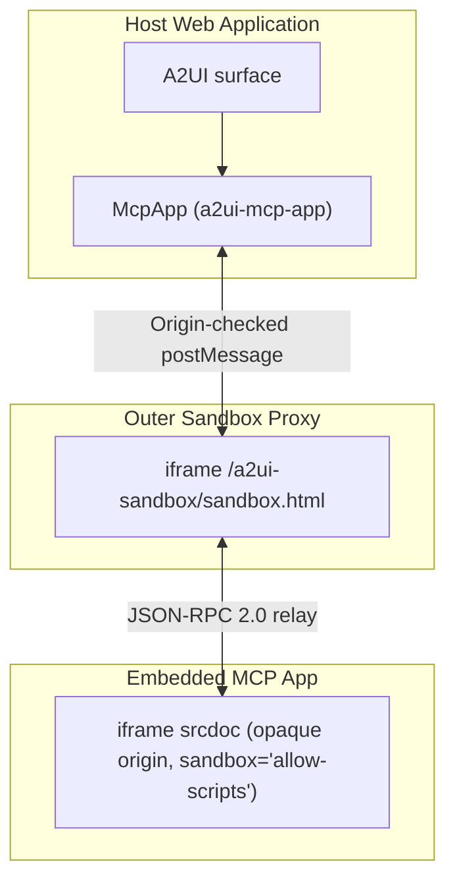
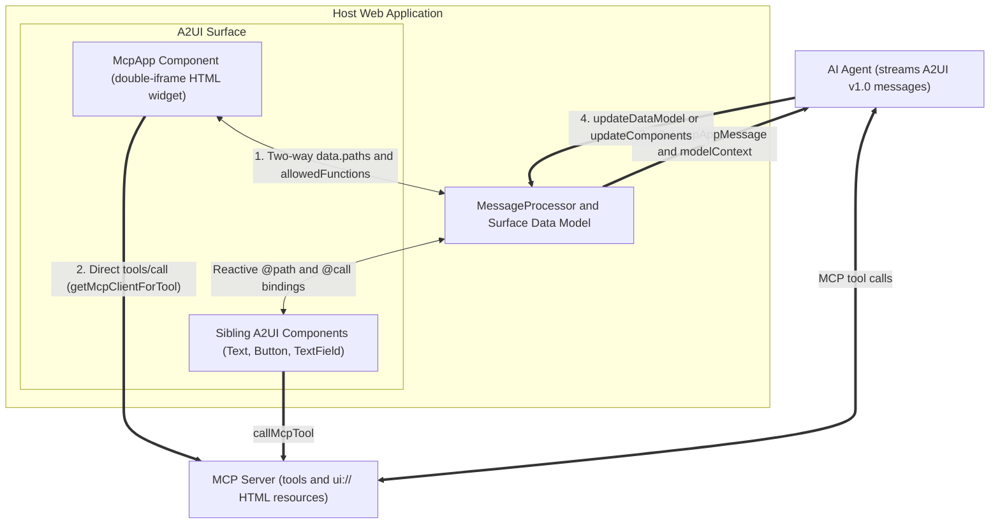

import {Aside, Tabs, TabItem} from '@astrojs/starlight/components';

export const baseUrl = import.meta.env.BASE_URL.replace(/\/$/, '');

The `McpApp` component in `@a2ui/catalog-mcp` embeds interactive **[Model Context Protocol (MCP) Apps](https://github.com/modelcontextprotocol/ext-apps)** inside an A2UI surface so third-party HTML widgets, native A2UI components, and your agent stay in sync.

Standard A2UI components cover forms, cards, and lists, while MCP Apps let an MCP server ship a custom HTML widget, such as a drag-and-drop Kanban board or a 3D canvas, alongside its tools. When you place `McpApp` on a surface, `@a2ui/catalog-mcp` runs that HTML inside an isolated sandbox and connects its state and tool calls to the surrounding UI.

<Aside type="tip" title="Setting up @a2ui/catalog-mcp?">
  See the [MCP Integration Overview](../mcp-overview/) to compare all four MCP patterns. Install
  `@a2ui/catalog-mcp` and register `mcpCatalog` with `configureMcpCatalog` first in [Call MCP Tools
  from A2UI](../mcp-catalog/#quick-setup). If your MCP server returns `a2ui://` JSON layouts rather
  than HTML widgets, see [Serve A2UI Layouts from an MCP Server](../a2ui-over-mcp/).
</Aside>


---

## Set up McpApp in your web app

After registering `mcpCatalog` and `configureMcpCatalog` in your Lit, React, or Angular app (see [Call MCP Tools from A2UI](../mcp-catalog/#quick-setup)), serve the sandbox relay files and add [`McpApp`](../mcp-catalog/#mcp_catalog.json/components/McpApp) to your surface.

### Serve the sandbox files

`McpApp` loads its outer sandbox relay from `/a2ui-sandbox/` on your app's origin. Configure your bundler or web server to serve `node_modules/@a2ui/catalog-mcp/sandbox` at `/a2ui-sandbox/`:

<Tabs syncKey="bundler">
  <TabItem label="Vite">

Copy the folder into `public/a2ui-sandbox/`, or copy it at build time with [`vite-plugin-static-copy`](https://github.com/sapphi-red/vite-plugin-static-copy):

```ts
import {defineConfig} from 'vite';
import {viteStaticCopy} from 'vite-plugin-static-copy';

export default defineConfig({
  plugins: [
    viteStaticCopy({
      targets: [{src: 'node_modules/@a2ui/catalog-mcp/sandbox/*', dest: 'a2ui-sandbox'}],
    }),
  ],
});
```

  </TabItem>
  <TabItem label="Angular CLI">

Add the sandbox directory to the `assets` array in `angular.json`:

```json
{
  "glob": "**/*",
  "input": "node_modules/@a2ui/catalog-mcp/sandbox",
  "output": "a2ui-sandbox"
}
```

  </TabItem>
  <TabItem label="Static server">

Copy `node_modules/@a2ui/catalog-mcp/sandbox` to `<web root>/a2ui-sandbox` on the same origin as your app.

  </TabItem>
</Tabs>

### Add McpApp to a surface

Place `McpApp` on an A2UI v1.0 surface with its HTML document (`htmlContent`), any surface data paths it shares (`data.paths`), and any MCP tools it is allowed to call (`allowedTools`):

```json
{
  "id": "scene3d_app",
  "component": "McpApp",
  "catalogId": "https://a2ui.org/specification/v1_0/catalogs/mcp/catalog.json",
  "title": "3D Holographic Geometry Studio",
  "allowedTools": ["capture_3d_snapshot"],
  "data": {
    "paths": {
      "scene3d": "/scene3d",
      "modelContext": "/scene3d/modelContext"
    }
  },
  "htmlContent": "<!doctype html><html><body>...<script>...</script></body></html>"
}
```

In this component, updates to `/scene3d` on the surface push into the widget, edits to `scene3d` inside the widget update sibling A2UI components, and tool calls outside `["capture_3d_snapshot"]` are blocked.

<details>
<summary>All <code>McpApp</code> component properties</summary>

An embedded `McpApp` is isolated from your page DOM, cookies, and browser storage, and interacts with your surface only through explicit properties:

| Property           | Required | Purpose                                                                                                                                             |
| :----------------- | :------- | :-------------------------------------------------------------------------------------------------------------------------------------------------- |
| `htmlContent`      | Yes      | HTML document of the app (values starting with `url_encoded:` are URL-decoded first).                                                               |
| `title`            | No       | Accessible title for the iframe (defaults to `"MCP App"`).                                                                                          |
| `data.paths`       | No       | Maps state keys inside the app (plus reserved `toolInput`, `toolResult`, and `modelContext` keys) to data model paths for two-way reactive sync.    |
| `allowedTools`     | No       | List of MCP tool names the app is allowed to call. Unlisted tool calls are rejected.                                                                |
| `allowedFunctions` | No       | Map of A2UI catalog function names to argument JSON Schemas that the app is allowed to invoke.                                                      |
| `csp`              | No       | Content Security Policy domain allowlists (`connectDomains`, `resourceDomains`, `frameDomains`, `baseUriDomains`) from the resource `_meta.ui.csp`. |
| `permissions`      | No       | Browser permissions (`camera`, `microphone`, `geolocation`, `clipboardWrite`) delegated from the resource `_meta.ui.permissions`.                   |

When a tool result returned by `callMcpTool` contains an MCP App `ui://` resource, its `resourceUri`, `html`, `csp`, and `permissions` fields are also included in the `callMcpTool` payload so you can bind `McpApp` properties to them.

</details>

### Style the frame

`McpApp` starts at `500px` tall and resizes automatically when the embedded widget reports its content size. Customize the container with CSS custom properties on `a2ui-mcp-app` or any parent element:

```css
a2ui-mcp-app {
  --a2ui-sandboxed-frame-height: 400px;
  --a2ui-sandboxed-frame-border: 1px solid #e2e8f0;
  --a2ui-sandboxed-frame-border-radius: 12px;
  --a2ui-sandboxed-frame-background: #ffffff;
}
```

<details>
<summary>Default values for CSS custom properties</summary>

| CSS custom property                    | Default                                                              | Purpose                                |
| :------------------------------------- | :------------------------------------------------------------------- | :------------------------------------- |
| `--a2ui-sandboxed-frame-height`        | `500px`                                                              | Initial height before auto-resize.     |
| `--a2ui-sandboxed-frame-border`        | `var(--a2ui-border-width, 1px) solid var(--a2ui-color-border, #ccc)` | Border around the frame.               |
| `--a2ui-sandboxed-frame-border-radius` | `var(--a2ui-border-radius, 8px)`                                     | Corner radius of the frame.            |
| `--a2ui-sandboxed-frame-background`    | `#fff`                                                               | Background behind transparent content. |

</details>

---

## Quick start: run the Kanban showcase

The fastest way to see an MCP App working inside an A2UI v1.0 surface is to run the Kanban board showcase ([`samples/community/mcp/a2ui-kanban/`](https://github.com/a2ui-project/a2ui/blob/main/samples/community/mcp/a2ui-kanban/README.md)). It connects three local processes: an MCP server that provides a drag-and-drop board widget (`ui://kanban/board`), a Python agent, and a Lit chat app built with `basicCatalog` and `mcpCatalog`.

### Prerequisites

Install these tools before running the sample from a clone of the A2UI repository:

1. Python 3.10 or later for the agent backend.
2. [`uv`](https://docs.astral.sh/uv/) to install Python dependencies and start the agent.
3. Node.js 22.12 or later with Corepack enabled (`corepack enable`) so `yarn` uses the repository's configured workspace manager.
4. A `GEMINI_API_KEY` from [Google AI Studio](https://aistudio.google.com/apikey), or `KANBAN_AGENT=scripted` to try the guided walkthrough without an API key.

### Start the three services

Open three terminals starting from the root of the A2UI repository.

#### Build the packages and start the MCP server

In the first terminal, build `@a2ui/catalog-mcp` and `@a2ui/lit`, install the `samples/community` dependencies, and start the Kanban MCP server on `http://localhost:8788/mcp`:

```bash
yarn install
yarn workspace @a2ui/catalog-mcp run build
yarn workspace @a2ui/lit run build

cd samples/community
yarn install

cd mcp/a2ui-kanban/mcp-server
yarn build
yarn start
```

#### Start the Kanban agent

In the second terminal, start the Python A2A agent on `http://localhost:10007`:

```bash
cd samples/community/mcp/a2ui-kanban/agent
export GEMINI_API_KEY="your-api-key"  # or: export KANBAN_AGENT=scripted
uv run .
```

#### Start the chat app

In the third terminal, start the Vite dev server on `http://localhost:5173`:

```bash
cd samples/community/mcp/a2ui-kanban/client
yarn dev
```

### Things to try in the browser

Open `http://localhost:5173/` and try these interactions to see the widget, the A2UI surface, and the agent working together:

1. Click **"Show me the sprint board"** to render the sandboxed Kanban widget alongside native A2UI summary badges and a quick-add task bar.
2. Drag a card across columns inside the widget and watch the sibling A2UI column counts update right away without waiting for an agent turn.
3. Enter a title and assignee in the A2UI quick-add bar and click **"Add task"** to call the MCP server from the browser and update both the board widget and the badges at once.
4. Click a card to select it, then ask the agent in chat to split or move that card using the selection context shared by the widget.
5. Open the **Protocol Debug Inspector** drawer on the right side of the page to inspect the live A2UI messages, `postMessage` frames, and MCP tool calls behind each action.

<details>
<summary>Pre-1.0 sample (Calculator and Pong)</summary>

This earlier sample predates A2UI v1.0 and `@a2ui/catalog-mcp` (using protocol v0.9) and defines its own sample-local custom component rather than importing `McpApp` from `@a2ui/catalog-mcp`.

#### Calculator and Pong (Angular v0.9 + proxy agent + MCP server)

This sample runs an SSE Calculator MCP server, a Python ADK proxy agent, and an Angular client hosting calculator and Pong widgets in separate sandboxed iframes:

1. Start the Calculator MCP server on `http://localhost:8000` (pass `--port 8001` if port `8000` is in use):

   ```bash
   cd samples/community/mcp/mcp-apps-calculator/
   uv run .
   ```

2. In a second terminal, start the MCP proxy agent on `http://localhost:10006`:

   ```bash
   cd samples/community/agent/adk/mcp_app_proxy/
   export GEMINI_API_KEY="your-api-key"
   uv run .
   ```

3. Build the monorepo renderer packages at the repository root, then install and start the Angular client on `http://localhost:4200`:

   ```bash
   yarn build:all
   cd samples/community/client/angular/
   yarn install
   yarn start mcp_calculator
   ```

4. Open `http://localhost:4200/?disable_security_self_test=true` in your browser. Because this pre-v1.0 sample serves its proxy iframe on the same `localhost` origin without `@a2ui/catalog-mcp`'s automatic origin check, pass `?disable_security_self_test=true` in the URL to skip the cross-origin self-test during local development:

   <table>
     <thead>
       <tr>
         <th>Calculator App</th>
         <th>Pong App</th>
       </tr>
     </thead>
     <tbody>
       <tr>
         <td>
           
         </td>
         <td>
           
         </td>
       </tr>
     </tbody>
   </table>

</details>

<details>
<summary>Troubleshooting the samples</summary>

If a sample fails to build or load, check these common issues:

| Symptom                                                           | Fix                                                                                                                                              |
| :---------------------------------------------------------------- | :----------------------------------------------------------------------------------------------------------------------------------------------- |
| `GEMINI_API_KEY environment variable not set`                     | Export `GEMINI_API_KEY` in that terminal, add a `.env` file in the agent directory, or set `KANBAN_AGENT=scripted` for the Kanban agent.         |
| Kanban client fails to compile `@a2ui/catalog-mcp` or `@a2ui/lit` | Run `yarn install`, `yarn workspace @a2ui/catalog-mcp run build`, and `yarn workspace @a2ui/lit run build` at the repository root first.         |
| Port `8788` or `10007` is already in use on Kanban                | Start the service on another port and pass `?mcp_url=http://localhost:<port>/mcp&agent_url=http://localhost:<port>` to `http://localhost:5173/`. |
| Angular client shows a blank page or missing renderer imports     | Run `yarn build:all` at the repository root before running `yarn start mcp_calculator` in `samples/community/client/angular/`.                   |
| `ng serve` not found in the Angular sample                        | Run `yarn install` inside `samples/community/client/angular/` to install `@angular/cli`.                                                         |
| `"URL with hostname not allowed"` in Angular                      | Open `http://localhost:4200/` rather than `0.0.0.0` (Angular's dev server restricts allowed hosts by default).                                   |
| Security self-test error in the pre-1.0 Angular sample            | Append `?disable_security_self_test=true` to `http://localhost:4200/`.                                                                           |

</details>

---

## How McpApp works under the hood

When you move beyond the samples and review `McpApp` for production, two design choices matter most: how untrusted HTML is isolated from your host app, and how state crosses that boundary safely.

### Double-iframe sandbox

Putting third-party HTML in a single iframe with both `allow-scripts` and `allow-same-origin` is unsafe because scripts inside that frame share your app's origin and can read cookies, web storage, or `window.parent.document`.

Instead, `McpApp` uses two nested iframes. An outer proxy frame loads `/a2ui-sandbox/sandbox.html`, checks message origins, and injects the untrusted HTML into an inner `srcdoc` iframe with `sandbox="allow-scripts"` only. Without `allow-same-origin`, the browser assigns the inner frame a unique opaque origin (`null`), blocking access to your app's DOM, cookies, and storage.

In the diagram below, the host web application renders an A2UI surface containing `McpApp` (`a2ui-mcp-app`). That element exchanges origin-checked `postMessage` events with the outer `/a2ui-sandbox/sandbox.html` proxy iframe, which relays JSON-RPC 2.0 messages to and from the inner `srcdoc` iframe running on an opaque origin with `sandbox='allow-scripts'`.



<details>
<summary>Advanced: outer proxy checks, CSP allowlists, and authoring constraints</summary>

Each `McpApp` instance enforces the following rules across its two frames:

1. The outer frame loads `sandbox.html` from `/a2ui-sandbox/` on your app's origin, or from a dedicated sandbox origin set via `configureMcpCatalog({sandbox: {baseUrl}})`. When hosted on a separate origin, `sandbox.html` runs a startup self-test verifying that it cannot reach `window.top`; on the same origin, `@a2ui/catalog-mcp` disables that check automatically.
2. The inner frame receives `sandbox="allow-scripts"` only. Omitting `allow-same-origin` isolates cookies and storage, omitting `allow-top-navigation` and `allow-top-navigation-by-user-activation` prevents frame-busting redirects (`window.top.location = "..."`), and omitting `allow-popups`, `allow-forms`, and `allow-modals` blocks unprompted windows, form submissions, and modal dialogs.
3. Before injecting `srcdoc`, the outer proxy applies any Content Security Policy domain allowlists in `csp` (`_meta.ui.csp`) and browser capability flags in `permissions` (`_meta.ui.permissions`, such as `camera`, `microphone`, `geolocation`, and `clipboard-write`).

If you are authoring an MCP App to run inside this sandbox, keep three browser restrictions in mind:

1. `localStorage`, `sessionStorage`, `IndexedDB`, and cookies throw security errors inside an opaque `null` origin. Persist state on the MCP server via `tools/call` or synchronize it with the host surface via `data.paths`.
2. `window.parent.document` and `window.top` are blocked. Request iframe height updates with `ui/notifications/size-changed`, and open external `http:` or `https:` links in a new tab with `ui/open-link`.
3. External network requests, images, fonts, and subframes inside `srcdoc` are blocked unless the MCP resource lists their domains under `_meta.ui.csp` (`connectDomains`, `resourceDomains`, `frameDomains`, `baseUriDomains`).

To serve `/a2ui-sandbox/` in your bundler and configure [`McpApp`](../mcp-catalog/#mcp_catalog.json/components/McpApp) properties, see [Set up McpApp in your web app](#set-up-mcpapp-in-your-web-app). For the startup handshake (`ui/notifications/sandbox-proxy-ready`, `ui/notifications/sandbox-resource-ready`, and `ui/initialize`), see the [MCP App component specification](https://github.com/a2ui-project/a2ui/blob/main/catalogs/mcp/v1/mcp_app_specification.md).

</details>

### Synchronizing state and tool calls

Once the sandbox loads, `McpApp` bridges four communication paths over JSON-RPC 2.0: reactive two-way data paths shared with sibling A2UI components, direct MCP tool calls from the browser, local A2UI catalog function calls, and follow-up messages or context updates sent to the agent.

In the diagram below, the host web application holds `MessageProcessor` and the surface data model alongside `McpApp` and its sibling A2UI components. `McpApp` synchronizes bound `data.paths` keys and `allowedFunctions` locally with `MessageProcessor`, calls allowed MCP tools directly via `getMcpClientForTool`, and forwards `a2ui.mcpAppMessage` actions and `modelContext` state to the AI agent, which can invoke MCP tools and stream `updateDataModel` or `updateComponents` messages back to `MessageProcessor`.



<details>
<summary>Advanced: JSON-RPC 2.0 channels and how the Kanban showcase uses them</summary>

`McpApp` communicates with the embedded widget using `@modelcontextprotocol/ext-apps/app-bridge` plus A2UI v1.0 extensions across four channels:

1. Two-way local data binding (`data.paths`). When a bound path in the surface data model changes (from a sibling input, a client function, or an `updateDataModel` message from the agent), `McpApp` sends `ui/notifications/data-model-update` to the widget (plus standard `ui/notifications/tool-input` and `ui/notifications/tool-result` notifications when `toolInput` or `toolResult` are bound). When the widget emits `ui/notifications/data-model-change`, `McpApp` writes the new value to the bound path so sibling A2UI components update immediately.
2. Direct MCP tool execution (`tools/call`). When the widget calls a tool listed in `allowedTools` and the host registered `getMcpClientForTool` via `configureMcpCatalog`, `McpApp` calls the MCP server directly and returns the `CallToolResult`. If no browser MCP client is configured, `McpApp` dispatches an A2UI action named after the tool so a backend proxy agent can run it instead. Unlisted tool names are rejected with a JSON-RPC error.
3. Local catalog function calls (`ui/requests/function-call`). When `allowedFunctions` maps A2UI catalog function names to JSON Schemas for their arguments, the widget can validate arguments and invoke those functions locally on the surface.
4. Agent context and follow-up turns (`ui/update-model-context` and `ui/message`). Calling `ui/update-model-context` writes the widget's active selection or filter state to the bound `modelContext` path in the surface data model so your host can attach it to the next user turn. Calling `ui/message` dispatches an `a2ui.mcpAppMessage` action so the host can forward a prompt or event from the widget to the agent.

In the Kanban showcase above, every interaction maps to one of these channels:

1. Asking the agent to move or create tasks calls MCP tools on the server and streams `updateDataModel` to `/kanban/board`, which `McpApp` forwards via `ui/notifications/data-model-update`.
2. Selecting a card or filtering by assignee calls `ui/update-model-context`, writing `/kanban/modelContext` and `/kanban/selection` for the next chat turn.
3. Dragging a card sends `ui/notifications/data-model-change` for `board`, updating `/kanban/board` locally and recomputing the sibling `Text` column and WIP badges (bound via `@call: transformData`).
4. Dropping a card (`tools/call` plus `ui/message`) or clicking **"Ask agent to split"** (`ui/message`) dispatches `a2ui.mcpAppMessage` to the chat host.
5. Submitting the quick-add task bar chains `callMcpTool("create_task")`, `transformData`, and `updateDataModel` in the browser to update `/kanban/board` with zero agent turns.

</details>

---

## Troubleshooting McpApp

### The McpApp frame stays blank (404 under /a2ui-sandbox/)

Check that `node_modules/@a2ui/catalog-mcp/sandbox` is served at `/a2ui-sandbox/` on your app's origin (see [Serve the sandbox files](#serve-the-sandbox-files)), or pass `configureMcpCatalog({sandbox: {baseUrl}})` with the path where you host those files.

### Tool or function calls from an embedded McpApp are rejected

Check the browser console for warnings. Every MCP tool the widget calls must be listed in `allowedTools`, and every A2UI function must be listed in `allowedFunctions` and registered in `mcpCatalog` or the surface's catalog.

---

## Next steps

1. Install `@a2ui/catalog-mcp` and invoke headless MCP tools in [Call MCP Tools from A2UI](../mcp-catalog/).
2. Review the handshake lifecycle, JSON-RPC message schemas, and cycle-prevention rules in the [MCP App component specification](https://github.com/a2ui-project/a2ui/blob/main/catalogs/mcp/v1/mcp_app_specification.md).
3. Build an MCP server that returns reusable A2UI component layouts in [Serve A2UI Layouts from an MCP Server](../a2ui-over-mcp/).
4. Bundle an A2UI renderer inside an MCP App in [Render A2UI Inside an MCP App](../a2ui-in-mcp-apps/).
