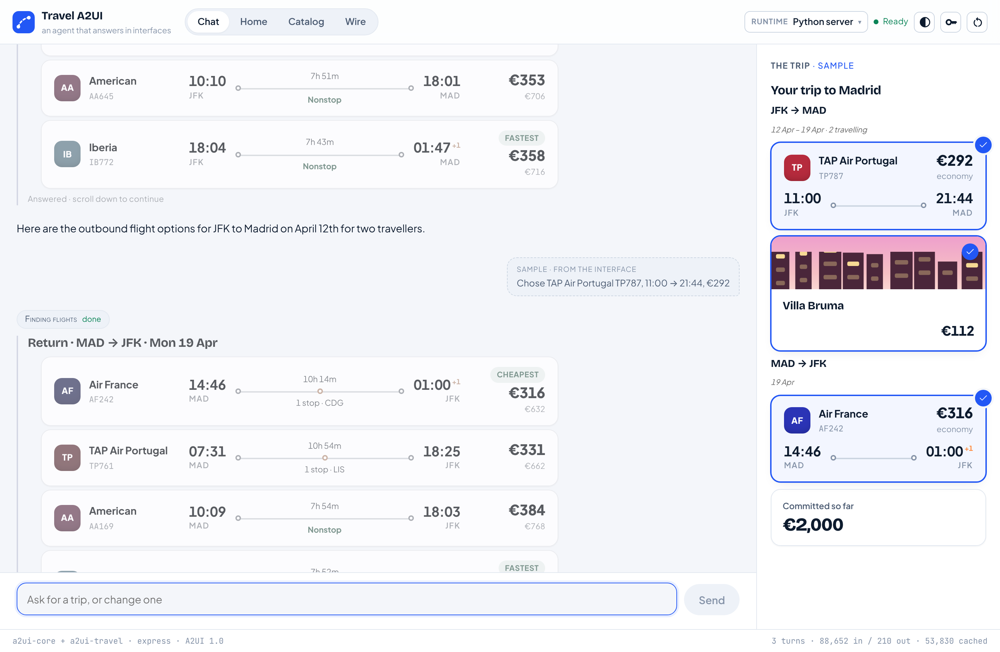
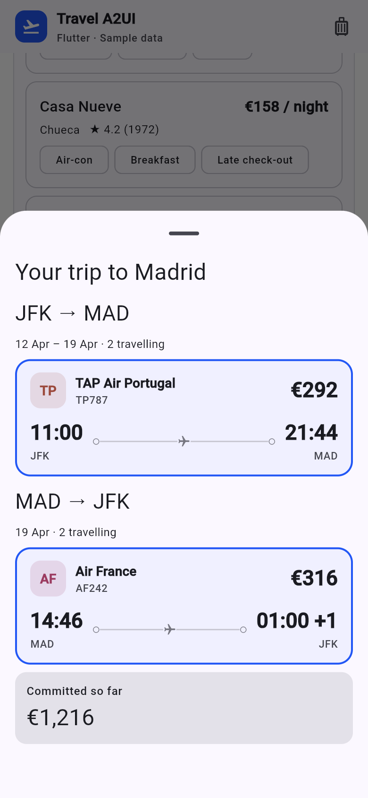
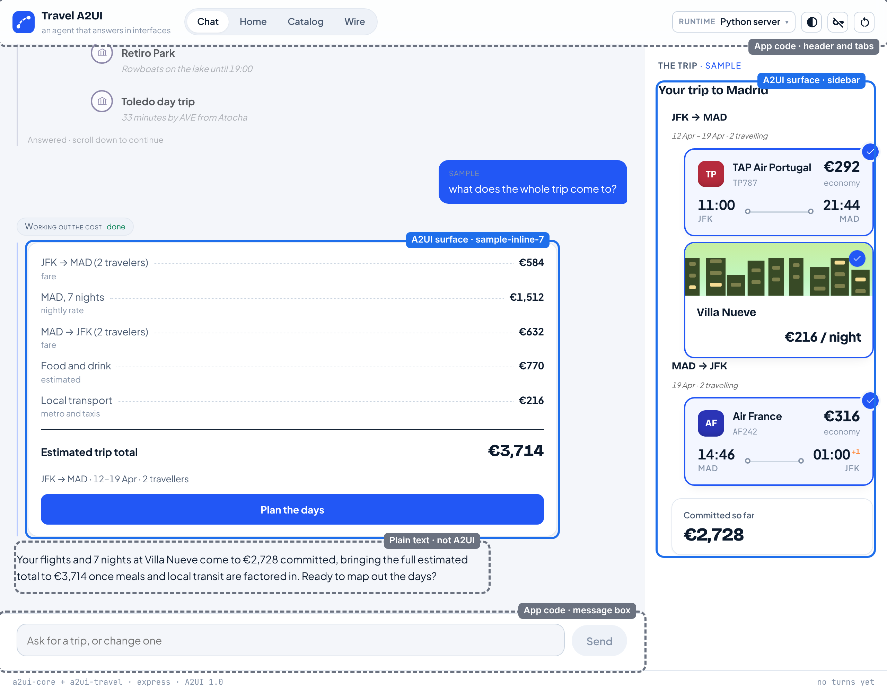
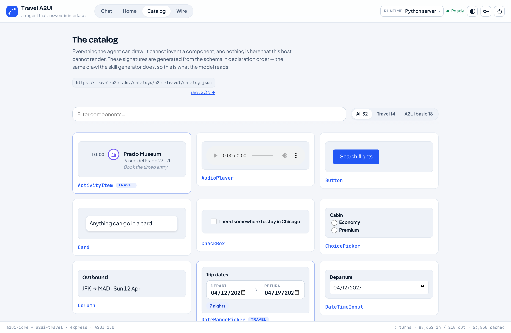
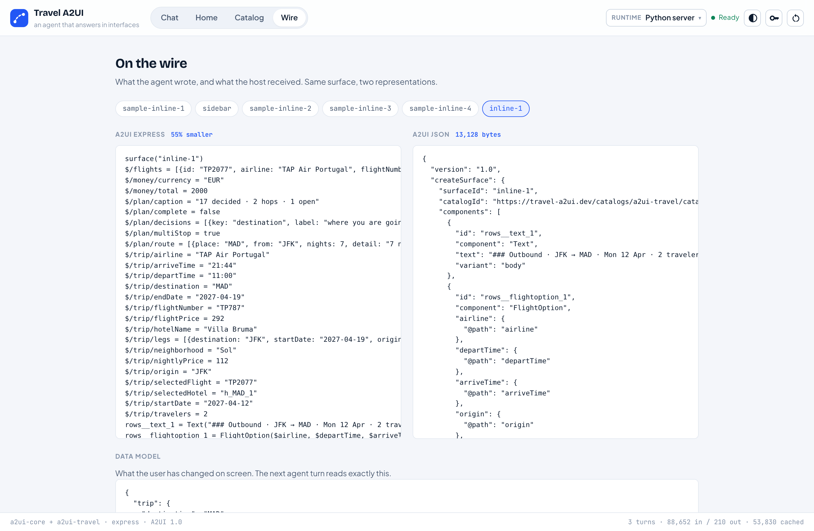
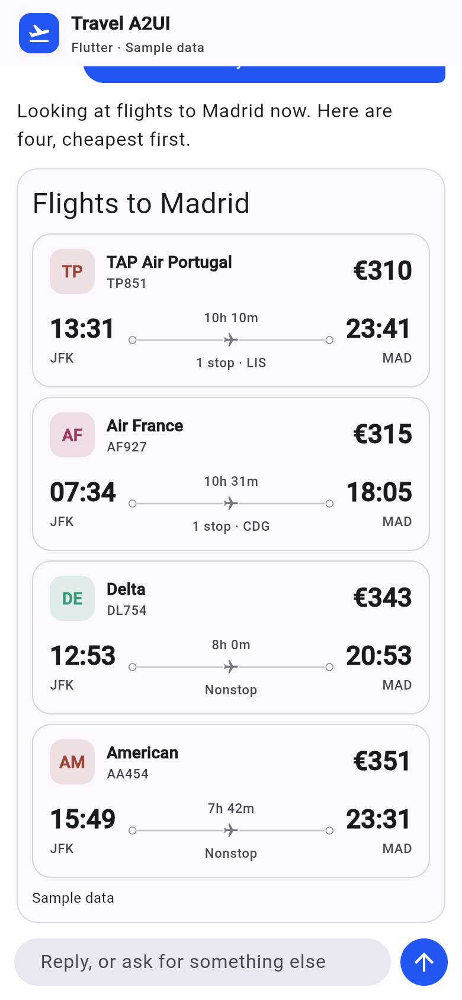

import {Steps, LinkCard} from '@astrojs/starlight/components';
import TurnFlow from '@components/docs/travel-a2ui/TurnFlow.astro';
import {A2UI, BUILD_YOUR_OWN, DEPLOY, REPO} from '../../../../lib/travel-a2ui/site';

Run the app first, then read the second half with it open: every idea there is
something you can see on screen. The app is <a href={REPO}>samples/travel-a2ui</a>
in A2UI Labs.

## The web app (Python + React)

You need **Python 3.11+** and **Node 20+**.

<Steps>

1. Get the code and start it:

   ```bash
   git clone https://github.com/a2ui-project/labs
   cd labs/samples/travel-a2ui
   ./scripts/quickstart.sh react
   ```

   The script installs the server into `.venv`, builds the React client and
   starts the server. Its output, trimmed (your versions will differ):

   ```text
   → Checking what is installed
     Python 3.11.18
     node v22.23.4
   → The Python server
     installed into .venv
   → The React client
   ✓ built in 456ms
   → Starting on port 8080
     React:   http://127.0.0.1:8080
     No GEMINI_API_KEY set: paste a key into the app when it asks.
   INFO:     Uvicorn running on http://127.0.0.1:8080
   ```

2. Open [http://127.0.0.1:8080](http://127.0.0.1:8080).

</Steps>



You land on a recorded sample trip, no key needed. To talk to the agent, paste
a free Gemini key from [AI Studio](https://aistudio.google.com/apikey) when the
app asks (it stays in your browser), then try _"Six days in Madrid in April,
two of us, around $2,500 all in"_.

## The mobile app (Python + Flutter)

You need **Python 3.11+** and **Flutter 3.47+**. Node is not needed.

<Steps>

1. Get the code and start it:

   ```bash
   git clone https://github.com/a2ui-project/labs
   cd labs/samples/travel-a2ui
   ./scripts/quickstart.sh flutter
   ```

   The Flutter build takes about a minute, then the server starts:

   ```text
   → The Flutter client
   ✓ Built build/web
   → Starting on port 8080
     Flutter: http://127.0.0.1:8080/flutter/
   ```

2. Open [http://127.0.0.1:8080/flutter/](http://127.0.0.1:8080/flutter/) and
   paste your Gemini key.

</Steps>



Try _"A weekend in Lisbon from JFK in May, two of us"_. Here Flutter is built
for the web, in a phone layout; the same Dart code can target iOS and Android,
which this repository does not set up.

**Both at once:** `./scripts/quickstart.sh both` serves React and Flutter from
one server. Ask both the same thing: the same kind of messages, drawn by two
renderers.

## How A2UI works

<TurnFlow />

### 1. The core pieces

- **Catalog.** The list of components the agent may use, and what each takes.
  The web client's **Catalog** tab draws all of them.
- **Surface.** One region of UI the agent controls, with an id. Each card in
  the conversation is a surface, and so is the trip panel.
- **Component.** One piece of a surface: a `Text`, a `Button`, a
  `FlightOption`. Each has an id and a type from the catalog.
- **Data model.** The data a surface shows. Components point at it by path,
  such as `/flights`, instead of holding the values.
- **Messages.** JSON that creates a surface, changes its components or
  changes its data. This is what travels from the agent to the screen.
- **Action.** What a press sends back. Tap a flight and the agent receives a
  `select_flight` action with that flight's id.
- **Renderer.** The code that turns messages into widgets: React on the web,
  Flutter on mobile.

#### Parent and child components

A surface is a **flat list of components**, and a parent names its children
by id. When the agent writes one line, `Flights("Outbound · JFK → MAD", …)`,
the server expands it into these components (real output, trimmed to ids and
links):

```json
[
  {"id": "root", "component": "Column", "children": ["fares"]},
  {"id": "fares__text_1", "component": "Text", "text": "### Outbound · JFK → MAD"},
  {"id": "fares__flightoption_1", "component": "FlightOption"},
  {
    "id": "fares__list_1",
    "component": "List",
    "children": {
      "path": "/flights",
      "componentId": "fares__flightoption_1"
    }
  },
  {"id": "fares", "component": "Column", "children": ["fares__text_1", "fares__list_1"]}
]
```

The renderer starts at `root` and follows the ids:

```text
root   Column
└─ fares  Column
   ├─ fares__text_1  Text
   └─ fares__list_1  List over /flights
      └─ fares__flightoption_1
         FlightOption, once per row
```

This shape is what makes a card reliable:

- **Nothing deep to get wrong.** Each component is one short entry. A model
  never has to balance ten levels of brackets.
- **It streams.** The model writes `root` first, and a parent can name a child
  that has not arrived yet. The renderer draws the card at once and fills each
  child in as it arrives. This is a real turn as the server sent it:

  ```text
  0.00s  inline-1  root, heading
  0.07s  inline-1  heading
  0.20s  inline-1  dates, + their data
  0.57s  inline-1  go, goLabel, + data
  0.67s  sidebar   root
  0.84s  sidebar   panel and its rows
  ```

- **One piece changes without redrawing the rest.** A message can replace a
  single component by id, or change the data, and only what uses that data is
  redrawn.
- **Structure and data are separate.** The model writes one `FlightOption`
  as a template; the rows at `/flights` come from the flight search. The price
  on screen is the price the search found, never retyped.
- **Every piece is checked.** Each component is validated against the
  catalog. Before anything is sent, the server also applies it to a copy of
  what the client holds; a block that would not fit goes back to the model
  with the reason. The screen never gets a broken card.

### 2. What is A2UI here, and what is app code

Not everything on screen is A2UI. Blue is composed by the agent; grey is the
app's own code, the same on every turn:



- **A2UI, composed by the agent:** the cards in the conversation, the trip
  panel (the trip sheet in Flutter) and the web client's Home dashboard.
- **App code:** the header and tabs, the message box, the chat bubbles (the
  model's words, shown as plain text), the key form, and the Catalog and Wire
  tabs.

A rule of thumb for your own app: if it should look the same on every turn,
write it as app code; if it depends on what the user just asked, let the agent
compose it.

#### The catalog draws the line

The catalog (`catalogs/a2ui-travel/catalog.json`) is a JSON Schema document
listing every component the agent may use and every property it takes. It
starts from A2UI's **basic catalog** (`Text`, `Row`, `Column`, `List`,
`Button`, `TextField` and more) and adds travel components such as
`FlightOption`, `HotelCard`, `DateRangePicker` and `PriceSummary`. The server
checks every message against it, React and Flutter implement every component
in it, and all three read the same file.



| The model decides                | Code decides                |
| -------------------------------- | --------------------------- |
| Whether to show a card           | Which components exist      |
| Which components, and the layout | The data in them            |
| The wording                      | That every message is valid |
| What to ask next                 | What a press records        |

### 3. Agent skills

A **skill** is a Markdown file that teaches a model to write A2UI for one
catalog. This app has two, in `skills/express-modular/`: `a2ui-core` (the
notation) and `a2ui-travel` (the catalog). Here is a real entry from the
second:

```text
• FlightOption(airline, departTime,
    arriveTime, origin, destination,
    price, action (static), duration?,
    stops?, flightNumber?, …)
  - Description: A single selectable
    flight itinerary leg. Use one per
    option when presenting a choice
    of flights.
  - airline: Operating carrier,
    e.g. 'Iberia' or 'Delta'.
```

Skills are **generated from the catalog, never written by hand**, with the
A2UI agent SDK's `SkillGenerator`:

```text
build_catalog.py → catalog.json
                     │
          A2UI agent SDK processor
            ├─ SkillGenerator → skills/
            ├─ the agent's own prompt
            └─ the parser for its output
```

One configuration (`apps/server/src/travel_a2ui/brain/catalog.py`) produces
all three, so what the model is taught is exactly what it is checked against.
Change a component and run `npm run generate`; `npm run check` fails if a skill is stale.

### 4. Agent output and A2UI messages

**Agent output** is what the model writes: **Express**, a short notation (a
DSL), inside `<a2ui>` tags. `root` comes first, so the card can stream:

```text
root = Column([head, list])
head = Text("### Flights to Madrid")
list = List(_template($/flights, fare))
fare = FlightOption($airline,
  $departTime, $arriveTime,
  $origin, $destination, $price,
  Event("select_flight", {id: $id}))
```

**A2UI messages** are the JSON the client receives: `createSurface`,
`updateComponents`, `updateDataModel` and `deleteSurface`.

- **On the server,** the A2UI agent SDK's request processor reads the Express
  as the model streams it, line by line, turns it into A2UI messages and
  validates them.
- **In the client,** a **MessageProcessor** from the official SDK applies the
  messages. It keeps each surface's components and data, fills in bound
  values, runs catalog functions such as `formatCurrency`, and sends presses
  back as actions. React uses `@a2ui/web_core`'s (`apps/web/src/surfaces.ts`);
  Flutter uses `a2ui_core`'s (`renderers/flutter/lib/chat.dart`).

The web client's **Wire** tab shows both forms of every surface side by side:



Express is one way to write A2UI, chosen because it is short. A2UI itself is
the JSON; a model can write that directly.

### 5. Renderers

A **renderer** implements the catalog's components with native widgets and
uses a MessageProcessor to apply messages. It holds no app logic.

- **In this app:** React (`@a2ui/react`, `@a2ui/web_core`) and Flutter
  (`a2ui_flutter`, `a2ui_core`).
- **Maintained by the A2UI project:** Lit (web components), Angular, React,
  Flutter and Markdown.
- **From the community:** SwiftUI and UIKit, Android Compose, React Native,
  Vue, Lynx, a terminal renderer and more.



The server never knows which client it is talking to. Adding a platform means
writing a renderer for the same catalog, with no change to the agent.

## Put it online

<a href={DEPLOY}>
  
</a>

One click deploys the server and both clients to Cloud Run in your own Google
Cloud project. It asks for a project and a region, and the first build takes
about ten minutes. No key is stored on the service: each visitor pastes their
own.

## Keep going

<LinkCard
  title="Build your own"
  description="What to change to make this app about something other than travel."
  href={BUILD_YOUR_OWN}
/>
<LinkCard title="A2UI renderers" href={A2UI.renderers} />
<LinkCard title="How A2UI works" description="The concepts, in depth." href={A2UI.overview} />
<LinkCard title="A2UI v1.0 specification" href={A2UI.spec} />
