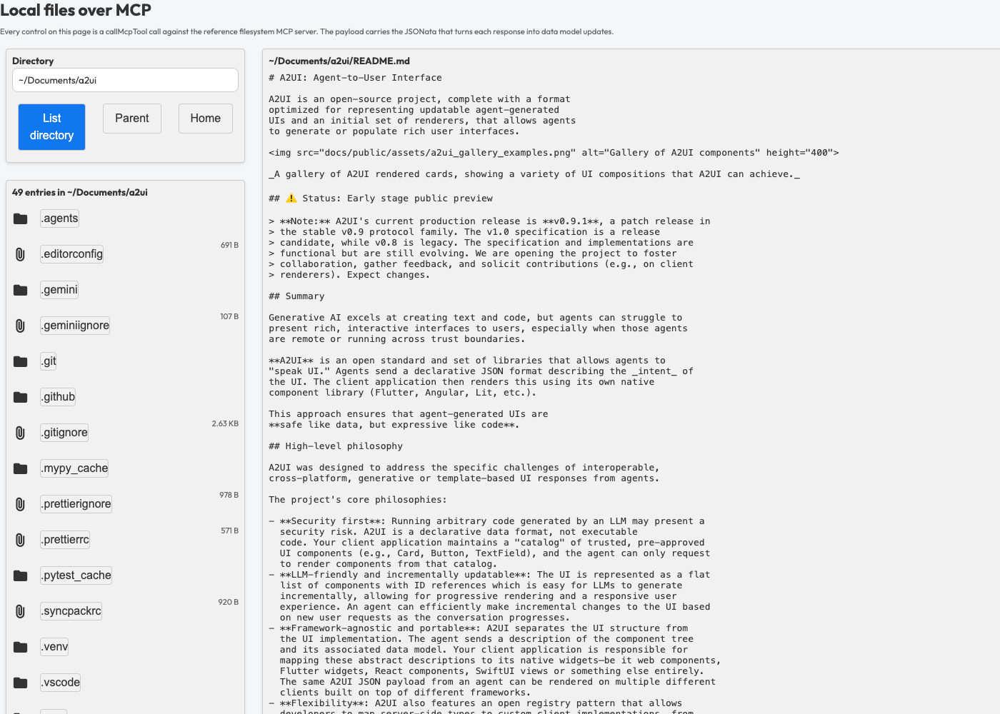

# A2UI over MCP Demo - Filesystem Browser

This sample implements an interactive filesystem browser using a static A2UI v1.0 JSON payload, the reference [filesystem MCP server](https://github.com/modelcontextprotocol/servers/tree/main/src/filesystem), and the A2UI MCP catalog from `@a2ui/catalog-mcp`.



## What this sample shows

An A2UI mini-app can deliver interactive functionality to any host that supports MCP:

- **Declarative tool execution**: Every button in [a2ui_filesystem.json](a2ui_filesystem.json) invokes a chain of catalog functions centered on `callMcpTool`. Clicking a row executes no custom client-side application logic.
- **Data transformation for standard MCP servers**: The filesystem server returns plain text. The MCP catalog's data functions (`jmespath`, `split`, `regexCapture`, `regexReplace`, and `updateDataModel`) split the text into lines, extract fields using regular expressions, transform the result with JMESPath, and write the structured entries into the data model.
- **Two catalogs on one surface**: The surface is created on the basic catalog, and every MCP function call names the MCP catalog with its own `catalogId`, as the published v1.0 examples do.
- **Minimal host scaffolding**: [client/app.ts](client/app.ts) registers the basic catalog and `mcpCatalog`, connects an MCP client, feeds the static A2UI payload into the renderer, and runs the first listing.

## Run it

Run these commands from `samples/community`:

```bash
yarn install
yarn workspace a2ui-over-mcp-filesystem run dev
```

Open http://localhost:5174. The page opens on your home directory. Click a
directory row to list it, click a file row to read it, or run a `search_files`
glob below the current directory.

One command starts both halves of the demo:

- `mcp-proxy` runs `@modelcontextprotocol/server-filesystem` over `~` and
  relays it over Streamable HTTP on `127.0.0.1:8787`.
- Vite serves the page on port 5174 and proxies `/mcp` to the relay, so the
  page and the MCP server share one origin.

WARNING: While the demo runs, `127.0.0.1:8787` serves every filesystem tool,
including `write_file`, `edit_file`, and `move_file`, with
`Access-Control-Allow-Origin: *`. Any page open in your browser can reach it.
The filesystem server has no read-only mode: its `readOnlyHint` annotations are
advisory, and its only real boundary is the directory on its command line. Stop
the demo when you are done with it.

### Browse somewhere else

Set `A2UI_FS_ROOT` to the directory the server may read:

```bash
A2UI_FS_ROOT="$HOME/Documents" yarn workspace a2ui-over-mcp-filesystem run dev
```

The server refuses any path outside that root. It expands a leading `~`
itself, which is why the default needs no shell expansion.

## How it works

```text
browser                                  node
+-----------------------------+          +--------------------------------+
| a2ui_filesystem.json        |          | vite            (port 5174)    |
|   updateDataModel(jmespath( |  /mcp    |   proxy /mcp -> 127.0.0.1:8787 |
|     regexCapture(split(     | <------> | mcp-proxy       (port 8787)    |
|       callMcpTool(...)))))  |          |   | stdio                      |
| @a2ui/catalog-mcp           |          |   v                            |
| client/app.ts (scaffolding) |          | server-filesystem (npx)        |
+-----------------------------+          +--------------------------------+
```

Every button runs the same chain, read inside out:

1. `callMcpTool` runs the tool and returns its result unchanged.
2. `jmespath` joins the text blocks of that result into one string.
3. `split` cuts the string into lines.
4. `regexCapture` applies one pattern to every line, giving an array of
   capture groups per line and `null` for a line that does not match.
5. `jmespath` shapes those rows into an object of data model paths.
6. `updateDataModel` writes each path into the surface.

Steps 3 and 4 are where the loop would be. Both functions apply element by
element when handed an array, and JMESPath has no loop of its own.

Each of these calls is a v1.0 `@call` that names the MCP catalog:

```json
{
  "@call": "split",
  "catalogId": "https://a2ui.org/specification/v1_0/catalogs/mcp/catalog.json",
  "args": {"value": {"@path": "/text"}, "separator": "\n"}
}
```

`formatString` is the one function the payload takes from the basic catalog,
which is the catalog the surface was created on, so it carries no `catalogId`.

A directory listing lands at `/entries`, and the row template turns each entry
into a button whose tool name comes from the entry itself: a directory calls
`list_directory_with_sizes`, a file calls `read_text_file`.

The host runs the first listing. After it has processed the payload,
`app.ts` resolves the `List directory` button's action once through a
`DataContext`, exactly as a click would, which lists the `~` the data model
starts with.

The proxy exists because the filesystem server speaks JSON-RPC over stdio,
which a page cannot open. `mcp-proxy` runs it as a child process and relays it
over Streamable HTTP. One child process serves every browser session.

### Regular expressions

The patterns are JavaScript `RegExp` syntax, checked by `isSafeRegex` from
`@a2ui/web_core` before they run. That check rejects any pattern whose
backtracking grows with the input, which rules out more than catastrophic
cases: two adjacent quantifiers that can consume the same characters, such as
`\s+` followed by `\s*$`, are enough. The listing pattern is written so each
character has one place to go:

```text
^\[(DIR|FILE)\] ([^.\s](?: ?\S)*)(?:  +(?:([0-9.]+ [A-Za-z]+) *)?)?$
```

A name starts with anything but a dot (which hides dotfiles) and may hold
single spaces; two or more spaces end it, and whatever follows is the size, if
any, and the padding the server adds. The Parent button's `/(?=[^/]*$)[^/]*`
matches the last slash and what follows it, so `regexReplace` can strip it.

## What the data model holds

The payload keeps its whole state in the surface data model:

| Path                            | Holds                                                                                                       |
| :------------------------------ | :---------------------------------------------------------------------------------------------------------- |
| `/dir`                          | The directory being browsed. The Directory field binds to it, so typing in the field retargets the buttons. |
| `/row_base`                     | What a row's `name` needs in front of it to become a path.                                                  |
| `/search_pattern`               | The glob the search field holds.                                                                            |
| `/entries`                      | One object per row, rendered by the `entry_row` template.                                                   |
| `/entries_title`                | The heading above the list.                                                                                 |
| `/viewer_title`, `/viewer_body` | The right pane, which shows a file as fenced Markdown.                                                      |
| `/expr`                         | The three JMESPath expressions, named `list`, `read`, and `search`.                                         |

A listing sets `/row_base` to `/dir` plus a slash. A search sets it to the empty
string, because `search_files` already answers with absolute paths.

Each row of `/entries` carries everything its button needs:

| Field     | Holds                                                                   |
| :-------- | :---------------------------------------------------------------------- |
| `name`    | The text on the row button, and the last segment of the path it opens.  |
| `size`    | The caption to the right of the name, empty for a directory.            |
| `icon`    | `folder` or `attachFile`.                                               |
| `tool`    | The MCP tool the row calls.                                             |
| `kind`    | `dir` or `file`, which picks the expression that reshapes the response. |
| `pattern` | The pattern that parses the response, which differs per row.            |

A row carries neither a path nor an arguments object. A JMESPath projection
cannot see the directory sitting at the top of the document, so the expression
that builds the rows cannot join it to each name. The row button builds both in
the component instead, as the next section shows.

## Tool arguments

In v1.0 a data binding is `{"@path": ...}`, so an argument named `path` is just
an argument, and the payload writes tool arguments as literal objects:

```json
{
  "@call": "callMcpTool",
  "catalogId": "https://a2ui.org/specification/v1_0/catalogs/mcp/catalog.json",
  "args": {
    "name": "search_files",
    "arguments": {"path": {"@path": "/dir"}, "pattern": {"@path": "/search_pattern"}}
  }
}
```

A row button's path is `/row_base` joined to the row's own `name`. A template
row can read an absolute path, so `formatString` joins the two:

```json
{"path": {"@call": "formatString", "args": {"value": "${/row_base}${name}"}}}
```

The Parent button needs no tool to compute its target either. It strips the last
segment off `/dir` with a regular expression:

```json
{
  "@call": "regexReplace",
  "catalogId": "https://a2ui.org/specification/v1_0/catalogs/mcp/catalog.json",
  "args": {"value": {"@path": "/dir"}, "pattern": "/(?=[^/]*$)[^/]*", "replacement": ""}
}
```

## The expressions

This sample keeps its three expressions in the data model under `/expr`, so a
control can name one by path. A row picks its own from its `kind`: the row
button's `expression` argument is a `jmespath` call over `{kind, list, read}`
that returns `list` for a directory and `read` for a file.

```json
{
  "@call": "jmespath",
  "catalogId": "https://a2ui.org/specification/v1_0/catalogs/mcp/catalog.json",
  "args": {
    "expression": "(kind == 'dir' && list) || read",
    "data": {
      "kind": {"@path": "kind"},
      "list": {"@path": "/expr/list"},
      "read": {"@path": "/expr/read"}
    }
  }
}
```

The expressions are plain [JMESPath](https://jmespath.org), the original
specification with no extensions, so they would run on a stock JMESPath library
in any language. All the string work happens in the catalog functions that run
before them.

Here is `/expr/list` in full. Its input is the `{dir, nl, rows}` document the
button assembles, where `rows` is one array of capture groups per matched line:

```
{dir: dir, rows: rows[?@ != null]} | {
  "/dir": dir,
  "/row_base": join('', [dir, '/']),
  "/entries": rows[*].{
    name: [1],
    size: [2] || '',
    icon: ([0] == 'DIR' && 'folder') || 'attachFile',
    tool: ([0] == 'DIR' && 'list_directory_with_sizes') || 'read_text_file',
    kind: ([0] == 'DIR' && 'dir') || 'file',
    pattern: ([0] == 'DIR' && '^\[(DIR|FILE)\] ([^.\s](?: ?\S)*)(?:  +(?:([0-9.]+ [A-Za-z]+) *)?)?$') || '^(.*)$'
  },
  "/entries_title": join('', [
    to_string(length(rows)),
    (length(rows) == `1` && ' entry') || ' entries'
  ]),
  "/viewer_title": (dir == '~' && 'Home Directory (~)') || dir,
  "/viewer_body": 'Choose a file on the left to read it.'
}
```

Key details in this expression:

- **Filtering**: `regexCapture` returns `null` for lines that do not match the pattern, so `rows[?@ != null]` removes blank lines, summary footers, and dotfiles (excluded by `[^.\s]` in the regex) in one step.
- **Indexed capture groups**: Each element of `rows` is an array of capture groups for a single line (`[0]` is `DIR` or `FILE`, `[1]` is the name, and `[2]` is the size).
- **Conditionals**: Standard JMESPath does not include a ternary operator, so conditionals are written as `(cond && a) || b`.
- **Intermediate values**: Piping into a multi-select hash (`{dir: dir, rows: rows[?@ != null]}`) binds intermediate values for use in subsequent stages.
- **Newlines**: Because JMESPath raw strings do not process escape sequences, each button passes a newline character in `data` under the key `nl` and references it in `join(nl, result.content[?type == 'text'].text)`.

## Files

| File                                           | Purpose                                                                                               |
| ---------------------------------------------- | ----------------------------------------------------------------------------------------------------- |
| [a2ui_filesystem.json](a2ui_filesystem.json)   | The A2UI v1.0 payload: the UI, every tool call, and every expression.                                 |
| [client/app.ts](client/app.ts)                 | The host: registers the basic and MCP catalogs, connects to MCP, processes the payload, lists `/dir`. |
| [client/vite.config.ts](client/vite.config.ts) | Dev server, the `/mcp` proxy, and catalog resolution.                                                 |
| [package.json](package.json)                   | `yarn dev`: the MCP relay and the web server, side by side.                                           |

## Test and build

Run these commands from `samples/community`:

```bash
yarn workspace a2ui-over-mcp-filesystem run test
yarn workspace a2ui-over-mcp-filesystem run build
```

The tests mock the MCP server with responses captured from a real one. They
cover the payload processing on the basic and MCP catalogs without a surface
error, the first listing, and each expression turning server text into the
data model.
