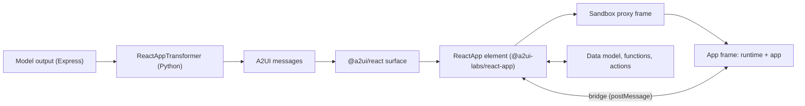

# ReactApp for A2UI (labs prototype)

`ReactApp` lets an agent write a small React app inline in an A2UI response, for interactions the native components can't express: charts with interactions, drag and drop, brushing, canvases, timers. The app renders in the A2UI double-iframe sandbox next to the native components and talks to the surface through a `postMessage` bridge: it reads and writes data model paths, calls catalog and agent functions, and dispatches actions.

```text
chart = ReactApp(title="Balance by year", height=340, dataPaths=["/loan"], source=r"""
import { useData, VegaChart } from "a2ui";
export default function App() {
  const [rate] = useData<number>("/loan/rate", 5);
  ...
}
""")
```

This folder is self-contained so it can move to the `a2ui/labs` repository.

## Layout

| Path                                                             | Contents                                                                                                                                                                                                                                                                               |
| ---------------------------------------------------------------- | -------------------------------------------------------------------------------------------------------------------------------------------------------------------------------------------------------------------------------------------------------------------------------------- |
| [`catalog/v1/`](catalog/v1/)                                     | The ReactApp catalog (`catalog.json`, id `https://a2ui.org/labs/react_app/v1/catalog.json`) and examples.                                                                                                                                                                              |
| [`docs/bridge_protocol.md`](docs/bridge_protocol.md)             | The normative bridge protocol (JSON-RPC 2.0 over `postMessage`).                                                                                                                                                                                                                       |
| [`docs/use_cases.md`](docs/use_cases.md)                         | Three use cases traced step by step.                                                                                                                                                                                                                                                   |
| [`typescript/react_app_runtime/`](typescript/react_app_runtime/) | `@a2ui-labs/react-app-runtime`: what runs in the app frame (React 19, the `a2ui` module, Sucrase, VegaChart, theming), built into content-hashed ES modules with an import map. Its [`src/a2ui.d.ts`](typescript/react_app_runtime/src/a2ui.d.ts) is the API the model writes against. |
| [`typescript/react_app/`](typescript/react_app/)                 | `@a2ui-labs/react-app`: the host-side `ReactApp` component and catalog for web renderers, the bridge, and the Playwright fixture.                                                                                                                                                      |
| [`python/a2ui_react_app/`](python/a2ui_react_app/)               | `a2ui-react-app`: the catalog, the prompt fragment and `ReactAppTransformer` for Python agents.                                                                                                                                                                                        |

## How it fits together



1. The agent adds the ReactApp catalog and `react_app_prompt(...)` to its prompt, and runs `ReactAppTransformer` on the compiled messages (structural checks in this version).
2. The client registers `reactAppCatalog` with its `MessageProcessor`, configures where the runtime is served (`configureReactApp`), and serves the sandbox proxy and the runtime files.
3. The `ReactApp` element builds an app document (import map, stylesheet, the app source, a bootstrap script) and loads it in the sandbox's inner frame (`sandbox="allow-scripts"`, opaque origin, no network).
4. The runtime asks the host for the theme and the data the app reads first (`reactApp/initialize`), transpiles the TSX with Sucrase, renders it and reports `ui/rendered`.

## Running it

The TypeScript packages form their own Yarn project in this folder. The Python package has its own uv project; see its [README](python/a2ui_react_app/README.md).

```bash
# Once, in the monorepo root: build the A2UI packages this prototype links to.
yarn install
(cd typescript/core/web_core && yarn build)
(cd typescript/renderers/markdown-it && yarn build)
(cd typescript/renderers/react && yarn build)

# In this folder.
yarn install
yarn build
yarn test   # vitest (runtime), Karma and Playwright (react_app)
```

`yarn test` in `typescript/react_app` runs the Playwright fixture. It serves a host page and, on a second origin, the runtime, and checks real round trips through the double iframe. Set `SCREENSHOT_DIR` to keep its screenshots.

### Serving the runtime in a host app

The runtime files must be served with `Access-Control-Allow-Origin: *`, because the app frame has an opaque origin and loads ES modules with CORS. `@a2ui-labs/react-app-runtime` exports a request handler for Node `http`, Connect, Express or a Vite dev server:

```ts
import {createReactAppRuntimeHandler} from '@a2ui-labs/react-app-runtime';

server.use(createReactAppRuntimeHandler({basePath: '/a2ui-sandbox/react-app/v1/'}));
```

On the client:

```ts
import {configureReactApp, reactAppCatalog} from '@a2ui-labs/react-app';

configureReactApp({runtimeBaseUrl: '/a2ui-sandbox/react-app/v1/'});
const processor = new MessageProcessor([basicCatalog, reactAppCatalog, appCatalog], onAction, {
  outboundListener: sendToAgent, // needed for agent functions
});
```

Serve `@a2ui-labs/react-app`'s `dist/sandbox/` at `/a2ui-sandbox/` (or wherever `configureReactApp({sandbox: {baseUrl}})` points).

## Prototype dependencies

During the prototype these packages use the monorepo's unpublished code:

1. TypeScript: `@a2ui/web_core`, `@a2ui/react` and `@a2ui/markdown-it` resolve to `portal:` links into `typescript/` (see `resolutions` in [`package.json`](package.json)), so they must be built in the monorepo first.
2. TypeScript: `@a2ui-labs/react-app` copies the shared sandbox from `typescript/catalogs/shared/` at build time, as `@a2ui/catalog-mcp` does.
3. Python: `a2ui-react-app` depends on `python/a2ui_agent` and `python/a2ui_core` through editable path dependencies.

When the code moves to labs, these switch to published versions of `@a2ui/web_core`, `@a2ui/react`, `a2ui-agent-sdk` and `a2ui-core` (with the Express raw-string change), and the shared sandbox comes from its own package or a vendored copy.
