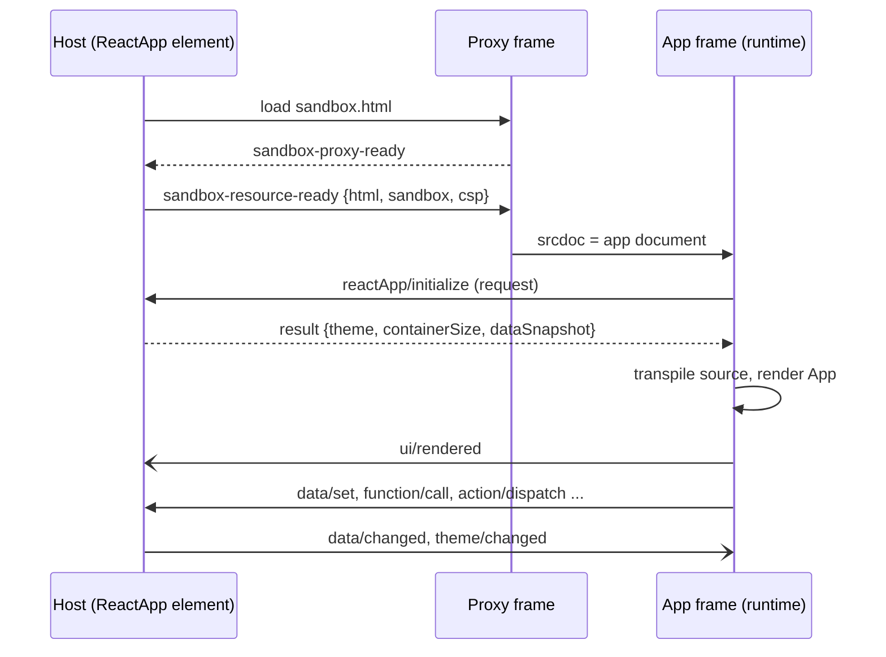

# ReactApp bridge protocol

Status: draft, version 1 (labs prototype).

This document is normative for the messages a `ReactApp` frame and its host exchange. The key words MUST, MUST NOT, SHOULD and MAY are used as in RFC 2119.

## 1. Parties and transport

1. The **host** is the `ReactApp` component in the page that renders the A2UI surface (`@a2ui-labs/react-app`). It owns a `ComponentContext`, so it can read and write the surface data model, invoke catalog functions (including agent functions) and dispatch actions.
2. The **app** is the generated React app running in the inner frame of the double-iframe sandbox, on top of the runtime (`@a2ui-labs/react-app-runtime`). The app code never posts messages itself; the `a2ui` module does it for the app.
3. The **proxy** is the shared sandbox proxy page between them (`typescript/catalogs/shared/sandbox/sandbox.ts`). It loads the app document into an inner `<iframe sandbox="allow-scripts">` (no `allow-same-origin`, so the app has an opaque origin), then relays every other message unchanged in both directions. The proxy checks origins: it accepts host messages only from the embedding origin, and app messages only from its inner frame.
4. Every bridge message is a JSON-RPC 2.0 object sent with `postMessage`. The host posts to the proxy window with the proxy origin as the target. The app posts to `window.parent` with target `*`, since its own origin is opaque. The host MUST accept a message only when `event.source` is the proxy window and `event.origin` is the proxy origin. The app MUST accept a message only when `event.source` is `window.parent`.
5. Messages with a `jsonrpc` value other than `"2.0"`, or a `method` outside this document, MUST be ignored by the receiver, apart from requests with an unknown method, which get a `-32601` error. This leaves room for the proxy's own handshake messages (`ui/notifications/sandbox-proxy-ready`, `a2ui_sandbox_proxy_ready`, `sandbox-init`), which are not part of this protocol.

## 2. Lifecycle

1. The host builds the **app document**, a complete HTML document with:
   1. an import map that maps the module names in section 9 to the runtime's content-hashed files,
   2. the runtime stylesheet (`a2ui-lite.css`),
   3. a `<script type="application/json" id="a2ui-react-app-config">` holding `{"source": string, "compiled"?: string, "title"?: string}`, with every `<` written as `\u003c`,
   4. an inline module script that imports the runtime entry and starts it.
2. The host sends the document as the `html` of the sandbox resource, with `sandbox: "allow-scripts"` and `csp.resourceDomains` set to the origin that serves the runtime. The proxy adds a CSP meta tag whose `script-src`, `style-src` and `font-src` allow that origin; `connect-src` and `frame-src` stay `'none'`.
3. A change of `source` or `compiled` changes the document, so the frame reloads and a new bridge session starts. Other property changes (`dataPaths`, `functions`, `title`, `height`) apply to the running session.
4. Once loaded, the runtime MUST send `reactApp/initialize` before any other request. The host MUST answer every other request that arrives before `reactApp/initialize` with error `-32002`.
5. After the initialize response, the runtime transpiles the source (unless `compiled` is present), imports it, renders its default export into `#root`, and sends `ui/rendered` after the first commit has painted.
6. A session ends when the frame reloads or the host disconnects the bridge. The host MUST drop its subscriptions, and MUST NOT answer requests from a previous session.

## 3. Methods

All `params` and `result` values are JSON objects. Paths are JSON pointers: an absolute path (`/loan/rate`) addresses the surface data model, and a relative path (`rate`) resolves against the component's data context, as A2UI `@path` bindings do.

### 3.1. `reactApp/initialize` (app to host, request)

Params:

| Field | Type | Meaning |
| --- | --- | --- |
| `protocolVersion` | `"1"` | Bridge protocol version the runtime speaks. |
| `runtimeVersion` | string | Version of the runtime package. |
| `paths` | string[] | Paths the app will read during its first render. The runtime finds them by scanning the source for string literals passed to `useData`, `getData` and `subscribe`. |

Result:

| Field | Type | Meaning |
| --- | --- | --- |
| `protocolVersion` | `"1"` | Bridge protocol version the host speaks. |
| `theme` | `{colorScheme, cssVars}` | `colorScheme` is `"light"` or `"dark"`; `cssVars` maps each `--a2ui-*` custom property name to its computed value on the host element. |
| `containerSize` | `{width, height}` | Size of the frame in CSS pixels. |
| `dataSnapshot` | `{[path]: value}` | Current value of every requested path the allowlist permits. A path with no value is omitted. |
| `deniedPaths` | string[] | Requested paths the allowlist refused. |

The host MUST subscribe to every path in `dataSnapshot` as if the app had sent `data/subscribe`, so changes made between the snapshot and the app's first render reach the app. The runtime MUST seed its store with `dataSnapshot` before the first render, so `useData` returns real values on the first paint.

If the protocol versions differ, the host MUST answer with error `-32602`, and the runtime MUST show its error card.

### 3.2. `data/get` (app to host, request)

Params `{path}`. Result `{value}`; `value` is absent when the path holds nothing.

### 3.3. `data/set` (app to host, request)

Params `{path, value, seq}`. `seq` is a positive integer that increases with every write the session sends (across all paths). Result `{seq, value}`, where `value` is the value at `path` after the write.

1. The host MUST apply writes in the order it receives them. `postMessage` preserves order, so this is the order the app sent them.
2. A write whose value equals the current value (by JSON structural equality) MUST succeed without touching the data model.
3. The host MUST NOT send a `data/changed` for a path because of the app's own write (echo suppression). Other subscribers of the path (native components, other ReactApps) are notified as usual.
4. `value` MAY be `null`; there is no delete operation in version 1.

### 3.4. `data/subscribe` and `data/unsubscribe` (app to host, request)

Params `{path}`. `data/subscribe` results in `{value}`, the current value (absent when none), and from then on the host sends `data/changed` for the path. Subscribing to a path the session already subscribes to MUST NOT create a second host subscription. `data/unsubscribe` results in `{}` and stops the notifications.

### 3.5. `data/changed` (host to app, notification)

Params `{path, value}`; `value` is absent when the path no longer holds anything. Sent for each subscribed path whose value changes for a reason other than the app's own write, at most once per data model notification. The host compares by JSON structural equality and MUST NOT send a value equal to the last one it sent for that path.

### 3.6. `function/call` (app to host, request)

Params `{name, args}`; `args` is an object of named arguments. Result `{value}`.

1. The host invokes the function through `ComponentContextFrameHost.invokeFunction`: the component's own catalog when it declares `name`, otherwise the surface's default catalog invoker. On a v1.0 surface whose message processor has an outbound listener, a function the renderer does not implement locally (undeclared, or declared schema-only) is routed to the agent with a `callAgentFunction` RPC. The host doesn't need to know which kind it is.
2. The host MUST await a promise result. A signal result is read once.
3. A function that throws, rejects or is refused (for example `allowedCallers: agentOnly`, invalid arguments) results in error `-32010` with the error message.
4. The runtime's default timeout for this method is 30 seconds (the default timeout of `callAgentFunction` in web_core), and callers MAY change it per call.

### 3.7. `action/dispatch` (app to host, request)

Params `{name, context}`. The host dispatches an A2UI `event` action of the component with that name and context, so action listeners see the `ReactApp` as its source. Result `{}` once the dispatch resolves.

### 3.8. `ui/rendered` (app to host, notification)

Params `{timings}`, where every timing is in milliseconds since the app document's time origin (`performance.timeOrigin` of the inner frame):

| Field | Meaning |
| --- | --- |
| `runtimeReady` | The runtime module started. |
| `initialized` | The initialize response arrived. |
| `compiled` | The source was transpiled and imported (or `compiled` was imported). |
| `rendered` | The first commit painted (measured after two animation frames). |
| `transpileMs` | Time spent in Sucrase; `0` when `compiled` was used. |

The host records its own clock at the proxy's ready message and at `ui/rendered`, and reports the difference as the frame's time to first render.

### 3.9. `ui/resize` (app to host, notification)

Params `{height, width?}` in CSS pixels: the size the app's content needs. The host applies it within the limits of the shared `FrameSizing` (clamped and throttled). The runtime sends it when the document's scroll height changes, at most once per animation frame.

### 3.10. `ui/error` (app to host, notification)

Params `{phase, message, stack?, line?, column?}`. `phase` is one of:

1. `compile`: Sucrase failed. `line` and `column` point into `source`.
2. `load`: importing the compiled module failed, or it has no default export.
3. `render`: a React error boundary caught an error.
4. `runtime`: an uncaught error or unhandled rejection in the app.
5. `bridge`: a request failed (the runtime also rejects the caller's promise).

The runtime MUST show an error card in the frame for `compile`, `load` and `render`. The host MUST log every `ui/error` and SHOULD expose it to the page (the reference host dispatches a `react-app-error` DOM event from the element).

### 3.11. `ui/log` (app to host, notification)

Params `{level, args}`, with `level` one of `debug`, `info`, `warn`, `error` and `args` the logged values made JSON-safe. The runtime forwards `console` calls of the app. The host MAY log or display them.

### 3.12. `theme/changed` (host to app, notification)

Params `{colorScheme, cssVars}`, same shape as `theme` in section 3.1. The host sends it when the page's color scheme changes, or when the page calls the element's theme refresh method. The runtime sets the variables on `:root`, so CSS that uses `var(--a2ui-*)` updates without a re-render, and re-renders components that use `useTheme`.

## 4. Allowlists

1. `dataPaths` (component property): when present, a path is allowed if it equals an entry or starts with an entry followed by `/`. `/loan` allows `/loan` and `/loan/rate`, but not `/loans` or `/`. When absent, every path is allowed. Relative paths are checked as written, before resolution.
2. `functions` (component property): when present, a function is allowed if its name is in the list. When absent, every function is allowed.
3. A refused path results in error `-32011`, a refused function in error `-32012`. The host reads the allowlists on every request, so a property update applies at once.

## 5. Ordering and consistency

1. Requests are independent; the host MAY answer them out of order (a slow agent function doesn't hold back a `data/set`).
2. The runtime updates its own store before sending `data/set` (optimistic write), so `useData` re-renders at once.
3. While a path has writes in flight, the runtime MUST ignore `data/changed` for it. When the last in-flight write for a path is acknowledged, the runtime sets the path to the `value` of that response. Since the host applies writes in arrival order, this value is the data model's state after the app's last write, including any change the host made in between.
4. If a `data/set` fails, the runtime restores the path to the value it had before the first write of the failed batch and reports `ui/error` with phase `bridge`.
5. `useFunction` gives every call a sequence number and only keeps the result of the latest one, so an older response that arrives late never replaces a newer one.

## 6. Timeouts

1. The runtime MUST fail a request whose response doesn't arrive in time with error `-32013` and forget its id: a late response is ignored.
2. Default timeouts: 10 seconds for `reactApp/initialize`, `data/*` and `action/dispatch`; 30 seconds for `function/call`. Callers MAY pass `timeoutMs` to `callFunction`.
3. The host has no timeouts of its own. `callAgentFunction` has its own timeout in the message processor (30 seconds by default), and a timeout there arrives as a `-32010` error.

## 7. Errors

Errors use the JSON-RPC `error` member: `{code, message, data?}`.

| Code | Name | When |
| --- | --- | --- |
| `-32600` | Invalid request | The message isn't a valid JSON-RPC request. |
| `-32601` | Method not found | Unknown method. |
| `-32602` | Invalid params | Missing or mistyped params, or a protocol version mismatch. |
| `-32603` | Internal error | Unexpected host failure. |
| `-32001` | Payload rejected | The message breaks the limits of section 8. |
| `-32002` | Not initialized | A request other than `reactApp/initialize` arrived first. |
| `-32010` | Function failed | The function threw, rejected or was refused by the invoker. `data.name` is the function name. |
| `-32011` | Path not allowed | The path is outside `dataPaths`. `data.path` is the path. |
| `-32012` | Function not allowed | The function is outside `functions`. `data.name` is the function name. |
| `-32013` | Timeout | Runtime-side only: no response in time. |
| `-32014` | Action failed | The action dispatch rejected. |

The runtime turns an error response into a rejected promise with an `Error` whose `message` is the error message and whose `code` property is the code.

## 8. Limits

1. The host MUST check every message from the app with the shared `validateMessagePayload` (`typescript/catalogs/shared/sandbox/payload_validation.ts`): at most 64 KB serialized, at most 10 levels of nesting, and no `__proto__`, `constructor` or `prototype` keys. A request that fails gets error `-32001`; a notification that fails is dropped and logged.
2. Path segments MUST NOT be `__proto__`, `constructor` or `prototype` (after JSON pointer unescaping); the host answers `-32602`.
3. Host-to-app messages have no size limit, since the host trusts its own data model.
4. `ui/resize` heights are clamped by `FrameSizing`; `ui/log` and `ui/error` are rate limited to 50 messages per second per frame, and the host drops the rest.

## 9. Modules available to the app

The import map of the app document maps these names. Any other bare import fails to resolve, and the runtime reports it as a `load` error.

| Module | Contents |
| --- | --- |
| `react` | React 19. |
| `react/jsx-runtime` | Used by the transpiled JSX; apps don't import it directly. |
| `react-dom`, `react-dom/client` | React DOM 19; apps rarely need them, since the runtime mounts `App`. |
| `a2ui` | The bridge API and primitives, typed by [`a2ui.d.ts`](../typescript/react_app_runtime/src/a2ui.d.ts). |

`vega-embed`, `vega` and `vega-lite` are also mapped, but only `VegaChart` uses them, and they load on its first render.

## 10. Versioning

The runtime is served under a versioned directory (`.../react-app/v1/`) whose files have content hashes in their names. The catalog version pins the runtime major version, so the agent prompt, the `a2ui.d.ts` and the host agree. A breaking change to this protocol increments `protocolVersion` and the catalog version together.
